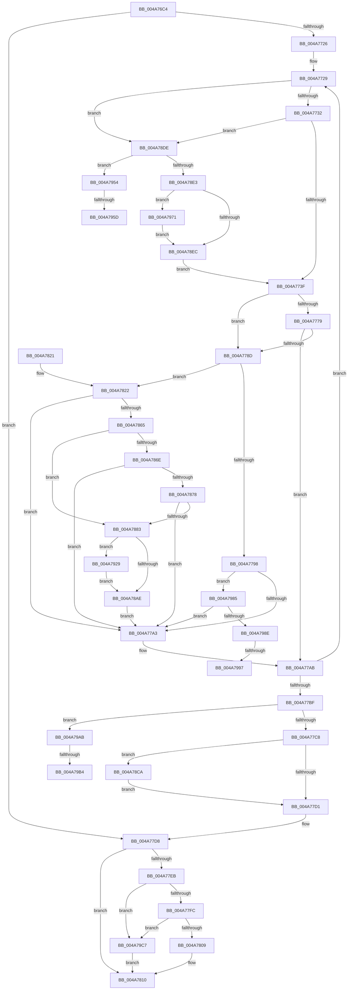

# MiSetPagingOfDriver

- RVA: `0x004A76C4`–`0x004A79D3` (길이 `783` bytes)
- VA: `0x00000001404A76C4`
- 실행 섹션: `.text`
- PDB 이름 있음: `예`; PDB Function 태그: `예`
- unwind 정보 RVA: `0x000B7278`
- 디코드: `189`개 명령, `783/783` bytes 표시
- 미해석 바이트: `0` (있으면 어셈블리에 `.byte`로 보존)

> 이 문서는 커널 이미지의 기계어와 PDB 기호를 분석해 생성했습니다. 4번과 5번은 함수 원형과 자료형을 바이너리 사용 방식에서 추정한 C 해석이며 원본 소스 복구 결과는 아닙니다.

## 1. Dependencies

- 직접 호출 지점: **16**; 고유 호출 대상: **11**
- 직접 호출자로 확인된 함수: **2**
- RIP 상대 이미지 참조: **5**

### Outgoing calls
- `0x004A7711` → [MiLockWorkingSetShared](../27/MiLockWorkingSetShared_function_0027CBF0.md) (function, `0x0027CBF0`)
- `0x004A77E1` → [MiUnlockWorkingSetShared](../27/MiUnlockWorkingSetShared_function_0027D690.md) (function, `0x0027D690`)
- `0x004A784E` → [MiGetWsleContents](../31/MiGetWsleContents_function_00316540.md) (function, `0x00316540`)
- `0x004A7898` → [MiWriteWsle](../29/MiWriteWsle_function_00292CA0.md) (function, `0x00292CA0`)
- `0x004A78BB` → [MiInsertTbFlushEntry](../29/MiInsertTbFlushEntry_function_00293670.md) (function, `0x00293670`)
- `0x004A78D4` → [MiUnlockPageTable](../21/MiUnlockPageTable_function_00216EC0.md) (function, `0x00216EC0`)
- `0x004A791A` → [MiLockNestedPageTable](../23/MiLockNestedPageTable_function_0023E890.md) (function, `0x0023E890`)
- `0x004A7929` → [MiGetProcessorFlushList](../24/MiGetProcessorFlushList_function_00242C90.md) (function, `0x00242C90`)
- `0x004A794A` → [MiInitializeTbFlushList](../29/MiInitializeTbFlushList_function_00294F00.md) (function, `0x00294F00`)
- `0x004A7960` → [MiFlushTbList](../31/MiFlushTbList_function_00311FC0.md) (function, `0x00311FC0`)
- `0x004A7965` → [MiReleaseProcessorFlushList](../31/MiReleaseProcessorFlushList_function_00313C70.md) (function, `0x00313C70`)
- `0x004A797B` → [MiUnlockPageTable](../21/MiUnlockPageTable_function_00216EC0.md) (function, `0x00216EC0`)
- `0x004A799A` → [MiFlushTbList](../31/MiFlushTbList_function_00311FC0.md) (function, `0x00311FC0`)
- `0x004A799F` → [MiReleaseProcessorFlushList](../31/MiReleaseProcessorFlushList_function_00313C70.md) (function, `0x00313C70`)
- `0x004A79B7` → [MiFlushTbList](../31/MiFlushTbList_function_00311FC0.md) (function, `0x00311FC0`)
- `0x004A79BC` → [MiReleaseProcessorFlushList](../31/MiReleaseProcessorFlushList_function_00313C70.md) (function, `0x00313C70`)

### Direct callers
- [MmPageEntireDriver](../../page/A4/MmPageEntireDriver_function_00A4BBB0.md) at `0x00A4BC25`
- [MiEnablePagingOfDriver](../../init/C5/MiEnablePagingOfDriver_function_00C5F550.md) at `0x00C5F5B7`

### Static image references
- `0x004A76FA` → RVA `0x00E37E40` (`.data`; read)
- `0x004A77EF` → RVA `0x00FC6B28` (`ALMOSTRO`; read)
- `0x004A77FC` → RVA `0x00FC6B98` (`ALMOSTRO`; read)
- `0x004A7809` → RVA `0x00E2D974` (`.data`; read/write)
- `0x004A79C7` → RVA `0x00E2D970` (`.data`; read/write)

## 2. Other-region calls and transfers

- 다른 실행 섹션으로 향하는 call: **0**
- call이 아닌 외부 분기/꼬리 이동: **6**
  - `0x004A7957` → [sub_006F9B92](../6F/Unknown_function_006F9B92.md) (`tail-transfer`)
  - `0x004A796C` → [sub_006F9B92](../6F/Unknown_function_006F9B92.md) (`tail-transfer`)
  - `0x004A7991` → [sub_006F9B92 + 0x17](../6F/Unknown_function_006F9B92.md) (`tail-transfer`)
  - `0x004A79A6` → [sub_006F9B92 + 0x17](../6F/Unknown_function_006F9B92.md) (`tail-transfer`)
  - `0x004A79AE` → [sub_006F9B92 + 0x2E](../6F/Unknown_function_006F9B92.md) (`tail-transfer`)
  - `0x004A79C2` → [sub_006F9B92 + 0x2E](../6F/Unknown_function_006F9B92.md) (`tail-transfer`)

## 3. Assembly (complete function range)

```asm
004A76C4  48 89 4C 24 08                  mov qword ptr [rsp + 8], rcx
004A76C9  53                              push rbx
004A76CA  55                              push rbp
004A76CB  56                              push rsi
004A76CC  57                              push rdi
004A76CD  41 54                           push r12
004A76CF  41 55                           push r13
004A76D1  41 56                           push r14
004A76D3  41 57                           push r15
004A76D5  48 83 EC 38                     sub rsp, 0x38
004A76D9  4C 8B E2                        mov r12, rdx
004A76DC  48 B8 00 00 00 00 80 F6 FF FF   movabs rax, 0xfffff68000000000
004A76E6  49 C1 E4 19                     shl r12, 0x19
004A76EA  4D 8B E8                        mov r13, r8
004A76ED  4C 8B F2                        mov r14, rdx
004A76F0  48 8B D9                        mov rbx, rcx
004A76F3  48 8B C0                        mov rax, rax
004A76F6  48 C1 E0 19                     shl rax, 0x19
004A76FA  48 8D 0D 3F 07 99 00            lea rcx, [rip + 0x99073f]
004A7701  4C 2B E0                        sub r12, rax
004A7704  45 33 FF                        xor r15d, r15d
004A7707  49 C1 FC 10                     sar r12, 0x10
004A770B  33 FF                           xor edi, edi
004A770D  33 ED                           xor ebp, ebp
004A770F  33 F6                           xor esi, esi
004A7711  E8 DA 54 DD FF                  call 0x14027cbf0
004A7716  88 84 24 88 00 00 00            mov byte ptr [rsp + 0x88], al
004A771D  4D 3B F5                        cmp r14, r13
004A7720  0F 87 B2 00 00 00               ja 0x1404a77d8
004A7726  8D 57 01                        lea edx, [rdi + 1]
004A7729  48 85 F6                        test rsi, rsi
004A772C  0F 84 AC 01 00 00               je 0x1404a78de
004A7732  49 F7 C6 FF 0F 00 00            test r14, 0xfff
004A7739  0F 84 9F 01 00 00               je 0x1404a78de
004A773F  48 8B 43 30                     mov rax, qword ptr [rbx + 0x30]
004A7743  48 B9 F8 FF FF FF 7F 00 00 00   movabs rcx, 0x7ffffffff8
004A774D  48 C1 E8 09                     shr rax, 9
004A7751  4D 8B DF                        mov r11, r15
004A7754  48 23 C1                        and rax, rcx
004A7757  49 8B CE                        mov rcx, r14
004A775A  48 2B C8                        sub rcx, rax
004A775D  48 B8 00 00 00 00 80 F6 FF FF   movabs rax, 0xfffff68000000000
004A7767  48 8B C0                        mov rax, rax
004A776A  48 2B C8                        sub rcx, rax
004A776D  48 C1 F9 03                     sar rcx, 3
004A7771  3B 8B 30 01 00 00               cmp ecx, dword ptr [rbx + 0x130]
004A7777  73 14                           jae 0x1404a778d
004A7779  48 8B 83 38 01 00 00            mov rax, qword ptr [rbx + 0x138]
004A7780  8B C9                           mov ecx, ecx
004A7782  48 0F A3 08                     bt qword ptr [rax], rcx
004A7786  0F 92 C0                        setb al
004A7789  84 C0                           test al, al
004A778B  75 1E                           jne 0x1404a77ab
004A778D  49 8B 1E                        mov rbx, qword ptr [r14]
004A7790  84 DA                           test dl, bl
004A7792  0F 85 8A 00 00 00               jne 0x1404a7822
004A7798  48 0F BA E3 0A                  bt rbx, 0xa
004A779D  0F 82 E2 01 00 00               jb 0x1404a7985
004A77A3  48 8B 9C 24 80 00 00 00         mov rbx, qword ptr [rsp + 0x80]
004A77AB  49 83 C6 08                     add r14, 8
004A77AF  49 81 C4 00 10 00 00            add r12, 0x1000
004A77B6  4D 3B F5                        cmp r14, r13
004A77B9  0F 86 6A FF FF FF               jbe 0x1404a7729
004A77BF  4D 85 FF                        test r15, r15
004A77C2  0F 85 E3 01 00 00               jne 0x1404a79ab
004A77C8  48 85 F6                        test rsi, rsi
004A77CB  0F 85 F9 00 00 00               jne 0x1404a78ca
004A77D1  8A 84 24 88 00 00 00            mov al, byte ptr [rsp + 0x88]
004A77D8  8A D0                           mov dl, al
004A77DA  48 8D 0D 5F 06 99 00            lea rcx, [rip + 0x99065f]
004A77E1  E8 AA 5E DD FF                  call 0x14027d690
004A77E6  48 85 ED                        test rbp, rbp
004A77E9  74 25                           je 0x1404a7810
004A77EB  48 8B 43 30                     mov rax, qword ptr [rbx + 0x30]
004A77EF  48 3B 05 32 F3 B1 00            cmp rax, qword ptr [rip + 0xb1f332]
004A77F6  0F 84 CB 01 00 00               je 0x1404a79c7
004A77FC  48 3B 05 95 F3 B1 00            cmp rax, qword ptr [rip + 0xb1f395]
004A7803  0F 84 BE 01 00 00               je 0x1404a79c7
004A7809  F0 01 2D 64 61 98 00            lock add dword ptr [rip + 0x986164], ebp
004A7810  48 83 C4 38                     add rsp, 0x38
004A7814  41 5F                           pop r15
004A7816  41 5E                           pop r14
004A7818  41 5D                           pop r13
004A781A  41 5C                           pop r12
004A781C  5F                              pop rdi
004A781D  5E                              pop rsi
004A781E  5D                              pop rbp
004A781F  5B                              pop rbx
004A7820  C3                              ret
004A7821  CC                              int3
004A7822  48 8B C3                        mov rax, rbx
004A7825  48 B9 FF FF FF FF FF 00 00 00   movabs rcx, 0xffffffffff
004A782F  48 C1 E8 0C                     shr rax, 0xc
004A7833  48 23 C1                        and rax, rcx
004A7836  4C 8D 14 40                     lea r10, [rax + rax*2]
004A783A  49 C1 E2 04                     shl r10, 4
004A783E  48 B8 00 00 00 00 00 DE FF FF   movabs rax, 0xffffde0000000000
004A7848  49 8B D4                        mov rdx, r12
004A784B  4C 03 D0                        add r10, rax
004A784E  E8 ED EC E6 FF                  call 0x140316540
004A7853  44 8A C0                        mov r8b, al
004A7856  BA 01 00 00 00                  mov edx, 1
004A785B  24 0F                           and al, 0xf
004A785D  3C 09                           cmp al, 9
004A785F  0F 85 3E FF FF FF               jne 0x1404a77a3
004A7865  41 8B 42 20                     mov eax, dword ptr [r10 + 0x20]
004A7869  66 3B C2                        cmp ax, dx
004A786C  74 15                           je 0x1404a7883
004A786E  66 83 F8 02                     cmp ax, 2
004A7872  0F 85 2B FF FF FF               jne 0x1404a77a3
004A7878  41 F6 42 22 08                  test byte ptr [r10 + 0x22], 8
004A787D  0F 84 20 FF FF FF               je 0x1404a77a3
004A7883  4D 85 DB                        test r11, r11
004A7886  4D 8B FE                        mov r15, r14
004A7889  49 8B D4                        mov rdx, r12
004A788C  4D 0F 45 FB                     cmovne r15, r11
004A7890  41 80 E0 FA                     and r8b, 0xfa
004A7894  41 80 C8 0A                     or r8b, 0xa
004A7898  E8 03 B4 DE FF                  call 0x140292ca0
004A789D  48 83 E3 FE                     and rbx, 0xfffffffffffffffe
004A78A1  48 0F BA EB 0A                  bts rbx, 0xa
004A78A6  49 89 1E                        mov qword ptr [r14], rbx
004A78A9  48 85 FF                        test rdi, rdi
004A78AC  74 7B                           je 0x1404a7929
004A78AE  45 33 C9                        xor r9d, r9d
004A78B1  49 8B D4                        mov rdx, r12
004A78B4  48 8B CF                        mov rcx, rdi
004A78B7  45 8D 41 01                     lea r8d, [r9 + 1]
004A78BB  E8 B0 BD DE FF                  call 0x140293670
004A78C0  BA 01 00 00 00                  mov edx, 1
004A78C5  E9 D9 FE FF FF                  jmp 0x1404a77a3
004A78CA  48 8B D6                        mov rdx, rsi
004A78CD  48 8D 0D 6C 05 99 00            lea rcx, [rip + 0x99056c]
004A78D4  E8 E7 F5 D6 FF                  call 0x140216ec0
004A78D9  E9 F3 FE FF FF                  jmp 0x1404a77d1
004A78DE  4D 85 FF                        test r15, r15
004A78E1  75 71                           jne 0x1404a7954
004A78E3  48 85 F6                        test rsi, rsi
004A78E6  0F 85 85 00 00 00               jne 0x1404a7971
004A78EC  48 B8 F8 FF FF FF 7F 00 00 00   movabs rax, 0x7ffffffff8
004A78F6  49 8B F6                        mov rsi, r14
004A78F9  48 C1 EE 09                     shr rsi, 9
004A78FD  48 23 F0                        and rsi, rax
004A7900  48 B8 00 00 00 00 80 F6 FF FF   movabs rax, 0xfffff68000000000
004A790A  48 8B C0                        mov rax, rax
004A790D  48 03 F0                        add rsi, rax
004A7910  48 8D 0D 29 05 99 00            lea rcx, [rip + 0x990529]
004A7917  48 8B D6                        mov rdx, rsi
004A791A  E8 71 6F D9 FF                  call 0x14023e890
004A791F  BA 01 00 00 00                  mov edx, 1
004A7924  E9 16 FE FF FF                  jmp 0x1404a773f
004A7929  E8 62 B3 D9 FF                  call 0x140242c90
004A792E  45 33 C9                        xor r9d, r9d
004A7931  C7 44 24 20 01 00 00 00         mov dword ptr [rsp + 0x20], 1
004A7939  48 8D 15 00 05 99 00            lea rdx, [rip + 0x990500]
004A7940  48 8B C8                        mov rcx, rax
004A7943  48 8B F8                        mov rdi, rax
004A7946  44 8B 40 0C                     mov r8d, dword ptr [rax + 0xc]
004A794A  E8 B1 D5 DE FF                  call 0x140294f00
004A794F  E9 5A FF FF FF                  jmp 0x1404a78ae
004A7954  48 85 FF                        test rdi, rdi
004A7957  0F 84 35 22 25 00               je 0x1406f9b92
004A795D  48 8B CF                        mov rcx, rdi
004A7960  E8 5B A6 E6 FF                  call 0x140311fc0
004A7965  E8 06 C3 E6 FF                  call 0x140313c70
004A796A  33 FF                           xor edi, edi
004A796C  E9 21 22 25 00                  jmp 0x1406f9b92
004A7971  48 8B D6                        mov rdx, rsi
004A7974  48 8D 0D C5 04 99 00            lea rcx, [rip + 0x9904c5]
004A797B  E8 40 F5 D6 FF                  call 0x140216ec0
004A7980  E9 67 FF FF FF                  jmp 0x1404a78ec
004A7985  4D 85 FF                        test r15, r15
004A7988  0F 84 15 FE FF FF               je 0x1404a77a3
004A798E  48 85 FF                        test rdi, rdi
004A7991  0F 84 12 22 25 00               je 0x1406f9ba9
004A7997  48 8B CF                        mov rcx, rdi
004A799A  E8 21 A6 E6 FF                  call 0x140311fc0
004A799F  E8 CC C2 E6 FF                  call 0x140313c70
004A79A4  33 FF                           xor edi, edi
004A79A6  E9 FE 21 25 00                  jmp 0x1406f9ba9
004A79AB  48 85 FF                        test rdi, rdi
004A79AE  0F 84 0C 22 25 00               je 0x1406f9bc0
004A79B4  48 8B CF                        mov rcx, rdi
004A79B7  E8 04 A6 E6 FF                  call 0x140311fc0
004A79BC  E8 AF C2 E6 FF                  call 0x140313c70
004A79C1  90                              nop
004A79C2  E9 F9 21 25 00                  jmp 0x1406f9bc0
004A79C7  F0 01 2D A2 5F 98 00            lock add dword ptr [rip + 0x985fa2], ebp
004A79CE  E9 3D FE FF FF                  jmp 0x1404a7810
```

## 4. C-style interpretation (structured pseudocode)

```c
__int64 __fastcall MiSetPagingOfDriver(__int64 a1, __int64 a2, __int64 a3, int a4)
{
    __int64 result;
    __int64 v_r10;
    __int64 v_r12;
    __int64 v_r14;
    __int64 v_r15;
    __int64 v_rbp;
    __int64 v_rbx;
    __int64 v_rdi;
    __int64 v_rsi;
    __int64 v_rsp;
    unsigned __int8 v_stack_p10;
    unsigned int v_stack_p20;
    unsigned __int64 v_stack_p8;

    v_stack_p8 = a1;
    v_rsp = (v_rsp) - (56);
    v_r12 = (a2) << (25);
    result = (result) << (25);
    v_r12 = (v_r12) - (result);
    v_r15 = 0;
    v_r12 = (v_r12) >> (16);
    v_rdi = 0;
    v_rbp = 0;
    v_rsi = 0;
    result = MiLockWorkingSetShared(v_rip + 10028863, a2, a3, a4);
    v_stack_p10 = (unsigned __int8)(result);
    if (a2 > a3) goto loc_004A77D8;
loc_004A7729:
    if (0 == 0) goto loc_004A78DE;
    if (((a2) & (0xFFFULL)) == 0) goto loc_004A78DE;
loc_004A773F:
    result = (*(unsigned __int64 *)(a1 + 48)) >> (9);
    result = (result) & (v_rip + 10028863);
    a1 = (a2) - (result);
    a1 = (a1) - (result);
    a1 = (a1) >> (3);
    if (((unsigned int)(a1)) >= (*(unsigned int *)(a1 + 304))) goto loc_004A778D;
    result = (((unsigned int)(a1)) < (*(unsigned int *)(a1 + 304))) ? 1 : 0;
    if ((unsigned __int8)(result) != 0) goto loc_004A77AB;
loc_004A778D:
    if ((((unsigned __int8)(v_rdi + 1)) & ((unsigned __int8)(*(unsigned __int64 *)(a2)))) != 0) goto loc_004A7822;
    if (condition_is_below) goto loc_004A7985;
loc_004A77A3:
loc_004A77AB:
    v_r14 = (a2) + (8);
    v_r12 = (v_r12) + (0x1000ULL);
    if (v_r14 <= a3) goto loc_004A7729;
    if (0 != 0) goto loc_004A79AB;
    if (0 != 0) goto loc_004A78CA;
loc_004A77D1:
loc_004A77D8:
    result = MiUnlockWorkingSetShared(v_rip + 10028639, (unsigned __int8)(v_stack_p10), a3, a4);
    if (0 == 0) goto loc_004A7810;
    if ((*(unsigned __int64 *)(v_stack_p8 + 48)) == (*(unsigned __int64 *)(v_rip + 11662130))) goto loc_004A79C7;
    if ((*(unsigned __int64 *)(v_stack_p8 + 48)) == (*(unsigned __int64 *)(v_rip + 11662229))) goto loc_004A79C7;
loc_004A7810:
    v_rsp = (v_rsp) + (56);
    return *(unsigned __int64 *)(v_stack_p8 + 48);
loc_004A7822:
    result = (v_stack_p8) >> (12);
    result = (result) & (v_rip + 10028639);
    v_r10 = (result + result * 2) << (4);
    v_r10 = (v_r10) + (result);
    result = MiGetWsleContents(v_rip + 10028639, v_r12, a3, a4);
    result = (unsigned __int8)((result) & (15));
    if (((unsigned __int8)(result)) != 9) goto loc_004A77A3;
    if (((unsigned __int16)((unsigned int)(*(unsigned int *)(v_r10 + 32)))) == 1) goto loc_004A7883;
    if (((unsigned __int16)((unsigned int)(*(unsigned int *)(v_r10 + 32)))) != 2) goto loc_004A77A3;
    if (((*(unsigned __int8 *)(v_r10 + 34)) & (8)) == 0) goto loc_004A77A3;
loc_004A7883:
    v_r15 = v_r14;
    if (0 != 0) { v_r15 = 0; }
    a3 = (unsigned __int8)(((unsigned __int8)(result)) & (250));
    a3 = (unsigned __int8)((a3) | (10));
    result = MiWriteWsle(v_rip + 10028639, v_r12, a3, a4);
    v_rbx = (v_stack_p8) & (-2);
    *(unsigned __int64 *)(v_r14) = v_rbx;
    if (0 == 0) goto loc_004A7929;
loc_004A78AE:
    a4 = 0;
    result = MiInsertTbFlushEntry(0, v_r12, a4 + 1, a4);
    goto loc_004A77A3;
loc_004A78CA:
    result = MiUnlockPageTable(v_rip + 10028396, 0, a4 + 1, a4);
    goto loc_004A77D1;
loc_004A78DE:
    if (v_r15 != 0) goto loc_004A7954;
    if (0 != 0) goto loc_004A7971;
loc_004A78EC:
    v_rsi = (v_r14) >> (9);
    v_rsi = (v_rsi) & (result);
    v_rsi = (v_rsi) + (result);
    result = MiLockNestedPageTable(v_rip + 10028329, v_rsi, a4 + 1, a4);
    goto loc_004A773F;
loc_004A7929:
    result = MiGetProcessorFlushList(v_rip + 10028329, 1, a4 + 1, a4);
    a4 = 0;
    v_stack_p20 = 1;
    result = MiInitializeTbFlushList(result, v_rip + 10028288, (unsigned int)(*(unsigned int *)(result + 12)), a4);
    goto loc_004A78AE;
loc_004A7954:
    result = MiFlushTbList(result, v_rip + 10028288, (unsigned int)(*(unsigned int *)(result + 12)), a4);
    result = MiReleaseProcessorFlushList(result, v_rip + 10028288, (unsigned int)(*(unsigned int *)(result + 12)), a4);
    v_rdi = 0;
loc_004A7971:
    result = MiUnlockPageTable(v_rip + 10028229, v_rsi, (unsigned int)(*(unsigned int *)(result + 12)), a4);
    goto loc_004A78EC;
loc_004A7985:
    if (v_r15 == 0) goto loc_004A77A3;
    result = MiFlushTbList(0, v_rsi, (unsigned int)(*(unsigned int *)(result + 12)), a4);
    result = MiReleaseProcessorFlushList(0, v_rsi, (unsigned int)(*(unsigned int *)(result + 12)), a4);
    v_rdi = 0;
loc_004A79AB:
    result = MiFlushTbList(0, v_rsi, (unsigned int)(*(unsigned int *)(result + 12)), a4);
    result = MiReleaseProcessorFlushList(0, v_rsi, (unsigned int)(*(unsigned int *)(result + 12)), a4);
loc_004A79C7:
    goto loc_004A7810;
}
```

## 5. (Beta) C Style

```c
int64_t MiSetPagingOfDriver(int64_t Arg1, int64_t Arg2, int64_t Arg3, int32_t Arg4)
{
    int64_t result;
    int64_t local_r10;
    int64_t local_r12;
    int64_t local_r14;
    int64_t local_r15;
    int64_t local_rbp;
    int64_t local_rbx;
    int64_t local_rdi;
    int64_t local_rsi;
    int64_t local_rsp;
    uint8_t v_stack_p10;
    uint32_t v_stack_p20;
    uint64_t v_stack_p8;

    v_stack_p8 = Arg1;
    local_rsp = (local_rsp) - (56);
    local_r12 = (Arg2) << (25);
    result = (result) << (25);
    local_r12 = (local_r12) - (result);
    local_r15 = 0;
    local_r12 = (local_r12) >> (16);
    local_rdi = 0;
    local_rbp = 0;
    local_rsi = 0;
    result = MiLockWorkingSetShared(v_rip + 10028863, Arg2, Arg3, Arg4);
    v_stack_p10 = (uint8_t)(result);
    if (Arg2 > Arg3) goto loc_004A77D8;
loc_004A7729:
    if (0 == 0) goto loc_004A78DE;
    if (((Arg2) & (0xFFFULL)) == 0) goto loc_004A78DE;
loc_004A773F:
    result = (*(uint64_t *)(Arg1 + 0x30)) >> (9);
    result = (result) & (v_rip + 10028863);
    Arg1 = (Arg2) - (result);
    Arg1 = (Arg1) - (result);
    Arg1 = (Arg1) >> (3);
    if (((uint32_t)(Arg1)) >= (*(uint32_t *)(Arg1 + 0x130))) goto loc_004A778D;
    result = (((uint32_t)(Arg1)) < (*(uint32_t *)(Arg1 + 0x130))) ? 1 : 0;
    if ((uint8_t)(result) != 0) goto loc_004A77AB;
loc_004A778D:
    if ((((uint8_t)(local_rdi + 1)) & ((uint8_t)(*(uint64_t *)(Arg2)))) != 0) goto loc_004A7822;
    if (condition_is_below) goto loc_004A7985;
loc_004A77A3:
loc_004A77AB:
    local_r14 = (Arg2) + (8);
    local_r12 = (local_r12) + (0x1000ULL);
    if (local_r14 <= Arg3) goto loc_004A7729;
    if (0 != 0) goto loc_004A79AB;
    if (0 != 0) goto loc_004A78CA;
loc_004A77D1:
loc_004A77D8:
    result = MiUnlockWorkingSetShared(v_rip + 10028639, (uint8_t)(v_stack_p10), Arg3, Arg4);
    if (0 == 0) goto loc_004A7810;
    if ((*(uint64_t *)(v_stack_p8 + 0x30)) == (*(uint64_t *)(v_rip + 0xB1F332))) goto loc_004A79C7;
    if ((*(uint64_t *)(v_stack_p8 + 0x30)) == (*(uint64_t *)(v_rip + 0xB1F395))) goto loc_004A79C7;
loc_004A7810:
    local_rsp = (local_rsp) + (56);
    return *(uint64_t *)(v_stack_p8 + 0x30);
loc_004A7822:
    result = (v_stack_p8) >> (12);
    result = (result) & (v_rip + 10028639);
    local_r10 = (result + result * 2) << (4);
    local_r10 = (local_r10) + (result);
    result = MiGetWsleContents(v_rip + 10028639, local_r12, Arg3, Arg4);
    result = (uint8_t)((result) & (15));
    if (((uint8_t)(result)) != 9) goto loc_004A77A3;
    if (((uint16_t)((uint32_t)(*(uint32_t *)(local_r10 + 0x20)))) == 1) goto loc_004A7883;
    if (((uint16_t)((uint32_t)(*(uint32_t *)(local_r10 + 0x20)))) != 2) goto loc_004A77A3;
    if (((*(uint8_t *)(local_r10 + 0x22)) & (8)) == 0) goto loc_004A77A3;
loc_004A7883:
    local_r15 = local_r14;
    if (0 != 0) { local_r15 = 0; }
    Arg3 = (uint8_t)(((uint8_t)(result)) & (250));
    Arg3 = (uint8_t)((Arg3) | (10));
    result = MiWriteWsle(v_rip + 10028639, local_r12, Arg3, Arg4);
    local_rbx = (v_stack_p8) & (-2);
    *(uint64_t *)(local_r14) = local_rbx;
    if (0 == 0) goto loc_004A7929;
loc_004A78AE:
    Arg4 = 0;
    result = MiInsertTbFlushEntry(0, local_r12, Arg4 + 1, Arg4);
    goto loc_004A77A3;
loc_004A78CA:
    result = MiUnlockPageTable(v_rip + 10028396, 0, Arg4 + 1, Arg4);
    goto loc_004A77D1;
loc_004A78DE:
    if (local_r15 != 0) goto loc_004A7954;
    if (0 != 0) goto loc_004A7971;
loc_004A78EC:
    local_rsi = (local_r14) >> (9);
    local_rsi = (local_rsi) & (result);
    local_rsi = (local_rsi) + (result);
    result = MiLockNestedPageTable(v_rip + 10028329, local_rsi, Arg4 + 1, Arg4);
    goto loc_004A773F;
loc_004A7929:
    result = MiGetProcessorFlushList(v_rip + 10028329, 1, Arg4 + 1, Arg4);
    Arg4 = 0;
    v_stack_p20 = 1;
    result = MiInitializeTbFlushList(result, v_rip + 10028288, (uint32_t)(*(uint32_t *)(result + 0xC)), Arg4);
    goto loc_004A78AE;
loc_004A7954:
    result = MiFlushTbList(result, v_rip + 10028288, (uint32_t)(*(uint32_t *)(result + 0xC)), Arg4);
    result = MiReleaseProcessorFlushList(result, v_rip + 10028288, (uint32_t)(*(uint32_t *)(result + 0xC)), Arg4);
    local_rdi = 0;
loc_004A7971:
    result = MiUnlockPageTable(v_rip + 10028229, local_rsi, (uint32_t)(*(uint32_t *)(result + 0xC)), Arg4);
    goto loc_004A78EC;
loc_004A7985:
    if (local_r15 == 0) goto loc_004A77A3;
    result = MiFlushTbList(0, local_rsi, (uint32_t)(*(uint32_t *)(result + 0xC)), Arg4);
    result = MiReleaseProcessorFlushList(0, local_rsi, (uint32_t)(*(uint32_t *)(result + 0xC)), Arg4);
    local_rdi = 0;
loc_004A79AB:
    result = MiFlushTbList(0, local_rsi, (uint32_t)(*(uint32_t *)(result + 0xC)), Arg4);
    result = MiReleaseProcessorFlushList(0, local_rsi, (uint32_t)(*(uint32_t *)(result + 0xC)), Arg4);
loc_004A79C7:
    goto loc_004A7810;
}
```

## 6. Execution-region graph

[열기: 2D/3D 그래프와 함수 탐색 컨트롤 패널](../../../control-panel.html?section=text&rva=0x004A76C4&view=graph)

- 2D 그래프는 위에서 아래로 흐르고, 3D 그래프는 빈 공간을 드래그해 회전합니다. Shift+드래그는 이동, 휠은 확대·축소, 함수 노드 선택은 대상 보고서 이동입니다.

### Static fallback


