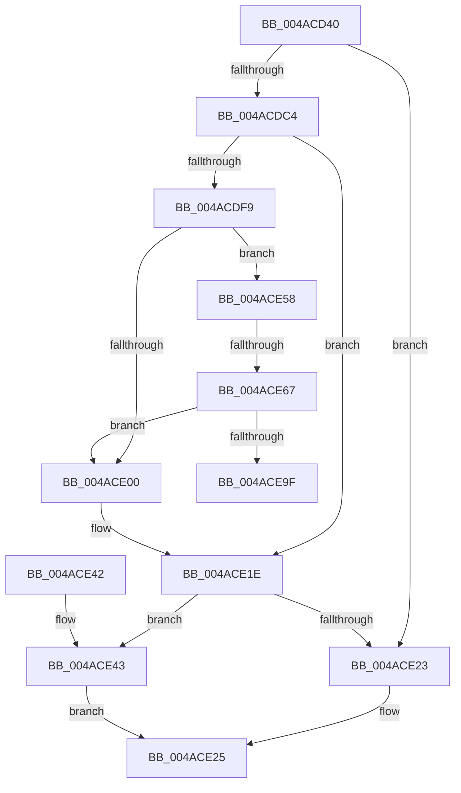

# MiSimpleAgePte

- RVA: `0x004ACD40`–`0x004ACEA4` (길이 `356` bytes)
- VA: `0x00000001404ACD40`
- 실행 섹션: `.text`
- PDB 이름 있음: `예`; PDB Function 태그: `예`
- unwind 정보 RVA: `0x000B835C`
- 디코드: `94`개 명령, `356/356` bytes 표시
- 미해석 바이트: `0` (있으면 어셈블리에 `.byte`로 보존)

> 이 문서는 커널 이미지의 기계어와 PDB 기호를 분석해 생성했습니다. 4번과 5번은 함수 원형과 자료형을 바이너리 사용 방식에서 추정한 C 해석이며 원본 소스 복구 결과는 아닙니다.

## 1. Dependencies

- 직접 호출 지점: **5**; 고유 호출 대상: **5**
- 직접 호출자로 확인된 함수: **0**
- RIP 상대 이미지 참조: **0**

### Outgoing calls
- `0x004ACD6C` → [MI_READ_PTE_LOCK_FREE](../28/MI_READ_PTE_LOCK_FREE_function_002828A0.md) (function, `0x002828A0`)
- `0x004ACDBB` → [MiWalkVaCheckCommon](../22/MiWalkVaCheckCommon_function_0022A960.md) (function, `0x0022A960`)
- `0x004ACDEA` → [MiGetVaAge](../24/MiGetVaAge_function_00240AC0.md) (function, `0x00240AC0`)
- `0x004ACE19` → [MiAgePteWorker](../28/MiAgePteWorker_function_0028FB20.md) (function, `0x0028FB20`)
- `0x004ACE92` → [MiGetPagePrivilege](../28/MiGetPagePrivilege_function_00285420.md) (function, `0x00285420`)

### Direct callers
- 이 함수 시작 RVA로 연결되는 직접 call은 확인되지 않았습니다. 간접 호출은 완전히 역산할 수 없습니다.

### Static image references
- 디코드된 RIP-relative 메모리 참조가 없습니다.

## 2. Other-region calls and transfers

- 다른 실행 섹션으로 향하는 call: **0**
- call이 아닌 외부 분기/꼬리 이동: **2**
  - `0x004ACE61` → [sub_006FA730](../6F/Unknown_function_006FA730.md) (`tail-transfer`)
  - `0x004ACE9F` → [sub_006FA730 + 0x13](../6F/Unknown_function_006FA730.md) (`tail-transfer`)

## 3. Assembly (complete function range)

```asm
004ACD40  48 89 5C 24 10                  mov qword ptr [rsp + 0x10], rbx
004ACD45  48 89 6C 24 18                  mov qword ptr [rsp + 0x18], rbp
004ACD4A  48 89 74 24 20                  mov qword ptr [rsp + 0x20], rsi
004ACD4F  57                              push rdi
004ACD50  41 54                           push r12
004ACD52  41 55                           push r13
004ACD54  41 56                           push r14
004ACD56  41 57                           push r15
004ACD58  48 83 EC 30                     sub rsp, 0x30
004ACD5C  48 8B 71 20                     mov rsi, qword ptr [rcx + 0x20]
004ACD60  4C 8B F9                        mov r15, rcx
004ACD63  48 8B CA                        mov rcx, rdx
004ACD66  41 8B D8                        mov ebx, r8d
004ACD69  48 8B EA                        mov rbp, rdx
004ACD6C  E8 2F 5B DD FF                  call 0x1402828a0
004ACD71  48 89 44 24 60                  mov qword ptr [rsp + 0x60], rax
004ACD76  48 B9 FF FF FF FF FF 00 00 00   movabs rcx, 0xffffffffff
004ACD80  48 C1 E8 0C                     shr rax, 0xc
004ACD84  48 23 C1                        and rax, rcx
004ACD87  49 BD 00 00 00 00 00 DE FF FF   movabs r13, 0xffffde0000000000
004ACD91  4C 8D 34 40                     lea r14, [rax + rax*2]
004ACD95  49 C1 E6 04                     shl r14, 4
004ACD99  49 8B C5                        mov rax, r13
004ACD9C  4C 03 F0                        add r14, rax
004ACD9F  45 33 C9                        xor r9d, r9d
004ACDA2  48 8D 44 24 60                  lea rax, [rsp + 0x60]
004ACDA7  85 DB                           test ebx, ebx
004ACDA9  4D 8B C6                        mov r8, r14
004ACDAC  48 89 44 24 20                  mov qword ptr [rsp + 0x20], rax
004ACDB1  41 0F 94 C1                     sete r9b
004ACDB5  48 8B D5                        mov rdx, rbp
004ACDB8  48 8B CE                        mov rcx, rsi
004ACDBB  E8 A0 DB D7 FF                  call 0x14022a960
004ACDC0  85 C0                           test eax, eax
004ACDC2  74 5F                           je 0x1404ace23
004ACDC4  49 8B 9F B8 00 00 00            mov rbx, qword ptr [r15 + 0xb8]
004ACDCB  48 8B FD                        mov rdi, rbp
004ACDCE  48 C1 E7 19                     shl rdi, 0x19
004ACDD2  48 B8 00 00 00 00 80 F6 FF FF   movabs rax, 0xfffff68000000000
004ACDDC  48 C1 E0 19                     shl rax, 0x19
004ACDE0  48 2B F8                        sub rdi, rax
004ACDE3  48 C1 FF 10                     sar rdi, 0x10
004ACDE7  48 8B D7                        mov rdx, rdi
004ACDEA  E8 D1 3C D9 FF                  call 0x140240ac0
004ACDEF  F6 44 24 60 20                  test byte ptr [rsp + 0x60], 0x20
004ACDF4  44 8A E0                        mov r12b, al
004ACDF7  74 25                           je 0x1404ace1e
004ACDF9  48 83 7B 48 00                  cmp qword ptr [rbx + 0x48], 0
004ACDFE  75 58                           jne 0x1404ace58
004ACE00  C7 44 24 28 03 00 00 00         mov dword ptr [rsp + 0x28], 3
004ACE08  4D 8B CE                        mov r9, r14
004ACE0B  4C 8B C7                        mov r8, rdi
004ACE0E  48 89 5C 24 20                  mov qword ptr [rsp + 0x20], rbx
004ACE13  48 8B D5                        mov rdx, rbp
004ACE16  49 8B CF                        mov rcx, r15
004ACE19  E8 02 2D DE FF                  call 0x14028fb20
004ACE1E  45 84 E4                        test r12b, r12b
004ACE21  74 20                           je 0x1404ace43
004ACE23  33 C0                           xor eax, eax
004ACE25  48 8B 5C 24 68                  mov rbx, qword ptr [rsp + 0x68]
004ACE2A  48 8B 6C 24 70                  mov rbp, qword ptr [rsp + 0x70]
004ACE2F  48 8B 74 24 78                  mov rsi, qword ptr [rsp + 0x78]
004ACE34  48 83 C4 30                     add rsp, 0x30
004ACE38  41 5F                           pop r15
004ACE3A  41 5E                           pop r14
004ACE3C  41 5D                           pop r13
004ACE3E  41 5C                           pop r12
004ACE40  5F                              pop rdi
004ACE41  C3                              ret
004ACE42  CC                              int3
004ACE43  48 FF 43 28                     inc qword ptr [rbx + 0x28]
004ACE47  48 8B 43 28                     mov rax, qword ptr [rbx + 0x28]
004ACE4B  48 3B 43 30                     cmp rax, qword ptr [rbx + 0x30]
004ACE4F  1B C0                           sbb eax, eax
004ACE51  F7 D0                           not eax
004ACE53  83 E0 04                        and eax, 4
004ACE56  EB CD                           jmp 0x1404ace25
004ACE58  8B 8E B8 00 00 00               mov ecx, dword ptr [rsi + 0xb8]
004ACE5E  F6 C1 0F                        test cl, 0xf
004ACE61  0F 84 C9 D8 24 00               je 0x1406fa730
004ACE67  48 8B 44 24 60                  mov rax, qword ptr [rsp + 0x60]
004ACE6C  48 B9 FF FF FF FF FF 00 00 00   movabs rcx, 0xffffffffff
004ACE76  48 C1 E8 0C                     shr rax, 0xc
004ACE7A  48 23 C1                        and rax, rcx
004ACE7D  48 8D 0C 40                     lea rcx, [rax + rax*2]
004ACE81  48 C1 E1 04                     shl rcx, 4
004ACE85  49 8B C5                        mov rax, r13
004ACE88  45 33 C0                        xor r8d, r8d
004ACE8B  48 03 C8                        add rcx, rax
004ACE8E  41 8D 50 02                     lea edx, [r8 + 2]
004ACE92  E8 89 85 DD FF                  call 0x140285420
004ACE97  A8 41                           test al, 0x41
004ACE99  0F 84 61 FF FF FF               je 0x1404ace00
004ACE9F  E9 9F D8 24 00                  jmp 0x1406fa743
```

## 4. C-style interpretation (structured pseudocode)

```c
__int64 __fastcall MiSimpleAgePte(__int64 a1, __int64 a2, int a3, int a4)
{
    __int64 result;
    __int64 v_r14;
    __int64 v_rdi;
    __int64 v_rsp;
    unsigned int v_stack_m30;
    unsigned __int64 v_stack_m38;
    unsigned __int64 v_stack_p10;
    unsigned __int64 v_stack_p18;
    unsigned __int64 v_stack_p20;
    unsigned __int64 v_stack_p60;
    unsigned __int64 v_stack_p8;

    v_stack_p10 = v_rbx;
    v_stack_p18 = v_rbp;
    v_stack_p20 = v_rsi;
    v_rsp = (v_rsp) - (48);
    result = MI_READ_PTE_LOCK_FREE(a2, a2, a3, a4);
    v_stack_p8 = result;
    result = (result) >> (12);
    result = (result) & (a2);
    v_r14 = (result + result * 2) << (4);
    v_r14 = (v_r14) + (v_r13);
    a4 = 0;
    v_stack_m38 = v_stack_p8;
    a4 = ((unsigned int)((unsigned int)(a3)) == 0) ? 1 : 0;
    result = MiWalkVaCheckCommon(*(unsigned __int64 *)(a1 + 32), a2, v_r14, a4);
    if ((unsigned int)(result) == 0) goto loc_004ACE23;
    v_rdi = (a2) << (25);
    result = (result) << (25);
    v_rdi = (v_rdi) - (result);
    v_rdi = (v_rdi) >> (16);
    result = MiGetVaAge(*(unsigned __int64 *)(a1 + 32), v_rdi, v_r14, a4);
    if (((v_stack_p8) & (32)) == 0) goto loc_004ACE1E;
    if ((*(unsigned __int64 *)(*(unsigned __int64 *)(a1 + 184) + 72)) != 0) goto loc_004ACE58;
loc_004ACE00:
    v_stack_m30 = 3;
    v_stack_m38 = *(unsigned __int64 *)(a1 + 184);
    result = MiAgePteWorker(a1, a2, v_rdi, v_r14);
loc_004ACE1E:
    if ((unsigned __int8)((unsigned __int8)(result)) == 0) goto loc_004ACE43;
loc_004ACE23:
    result = 0;
loc_004ACE25:
    v_rsp = (v_rsp) + (48);
    return result;
loc_004ACE43:
    result = (unsigned int)(~(*(unsigned __int64 *)(v_stack_p10 + 40)));
    result = (unsigned int)((result) & (4));
    goto loc_004ACE25;
loc_004ACE58:
    result = (v_stack_p60) >> (12);
    result = (result) & ((unsigned int)(*(unsigned int *)(v_stack_p20 + 184)));
    a1 = (result + result * 2) << (4);
    a3 = 0;
    a1 = (a1) + (v_r13);
    result = MiGetPagePrivilege(a1, a3 + 2, a3, v_r14);
    if ((((unsigned __int8)(result)) & (65)) == 0) goto loc_004ACE00;
}
```

## 5. (Beta) C Style

```c
int64_t MiSimpleAgePte(void *Arg1, int64_t Arg2, int32_t Arg3, int32_t Arg4)
{
    uint8_t *arg1 = (uint8_t *)Arg1;

    int64_t result;
    int64_t local_r14;
    int64_t local_rdi;
    int64_t local_rsp;
    uint32_t v_stack_m30;
    uint64_t v_stack_m38;
    uint64_t v_stack_p10;
    uint64_t v_stack_p18;
    uint64_t v_stack_p20;
    uint64_t v_stack_p60;
    uint64_t v_stack_p8;

    v_stack_p10 = local_rbx;
    v_stack_p18 = local_rbp;
    v_stack_p20 = local_rsi;
    local_rsp = (local_rsp) - (48);
    result = MI_READ_PTE_LOCK_FREE(Arg2, Arg2, Arg3, Arg4);
    v_stack_p8 = result;
    result = (result) >> (12);
    result = (result) & (Arg2);
    local_r14 = (result + result * 2) << (4);
    local_r14 = (local_r14) + (local_r13);
    Arg4 = 0;
    v_stack_m38 = v_stack_p8;
    Arg4 = ((uint32_t)((uint32_t)(Arg3)) == 0) ? 1 : 0;
    result = MiWalkVaCheckCommon(*(uint64_t *)(arg1 + 0x20), Arg2, local_r14, Arg4);
    if ((uint32_t)(result) == 0) goto loc_004ACE23;
    local_rdi = (Arg2) << (25);
    result = (result) << (25);
    local_rdi = (local_rdi) - (result);
    local_rdi = (local_rdi) >> (16);
    result = MiGetVaAge(*(uint64_t *)(arg1 + 0x20), local_rdi, local_r14, Arg4);
    if (((v_stack_p8) & (32)) == 0) goto loc_004ACE1E;
    if ((*(uint64_t *)(*(uint64_t *)(arg1 + 0xB8) + 0x48)) != 0) goto loc_004ACE58;
loc_004ACE00:
    v_stack_m30 = 3;
    v_stack_m38 = *(uint64_t *)(arg1 + 0xB8);
    result = MiAgePteWorker(Arg1, Arg2, local_rdi, local_r14);
loc_004ACE1E:
    if ((uint8_t)((uint8_t)(result)) == 0) goto loc_004ACE43;
loc_004ACE23:
    result = 0;
loc_004ACE25:
    local_rsp = (local_rsp) + (48);
    return result;
loc_004ACE43:
    result = (uint32_t)(~(*(uint64_t *)(v_stack_p10 + 0x28)));
    result = (uint32_t)((result) & (4));
    goto loc_004ACE25;
loc_004ACE58:
    result = (v_stack_p60) >> (12);
    result = (result) & ((uint32_t)(*(uint32_t *)(v_stack_p20 + 0xB8)));
    Arg1 = (result + result * 2) << (4);
    Arg3 = 0;
    Arg1 = (Arg1) + (local_r13);
    result = MiGetPagePrivilege(Arg1, Arg3 + 2, Arg3, local_r14);
    if ((((uint8_t)(result)) & (65)) == 0) goto loc_004ACE00;
}
```

### 관측된 메모리 오프셋

구조체 형식이 확인되지 않은 접근은 인자 기준의 오프셋으로만 기록했습니다.

| 기준 인자 | 오프셋 표현 | 폭 (bit) | 접근 |
|---|---:|---:|---|
| `Arg1` | `+ 0x20` | `64` | `R` |
| `Arg1` | `+ 0xB8` | `64` | `R` |

## 6. Execution-region graph

[열기: 2D/3D 그래프와 함수 탐색 컨트롤 패널](../../../control-panel.html?section=text&rva=0x004ACD40&view=graph)

- 2D 그래프는 위에서 아래로 흐르고, 3D 그래프는 빈 공간을 드래그해 회전합니다. Shift+드래그는 이동, 휠은 확대·축소, 함수 노드 선택은 대상 보고서 이동입니다.

### Static fallback


