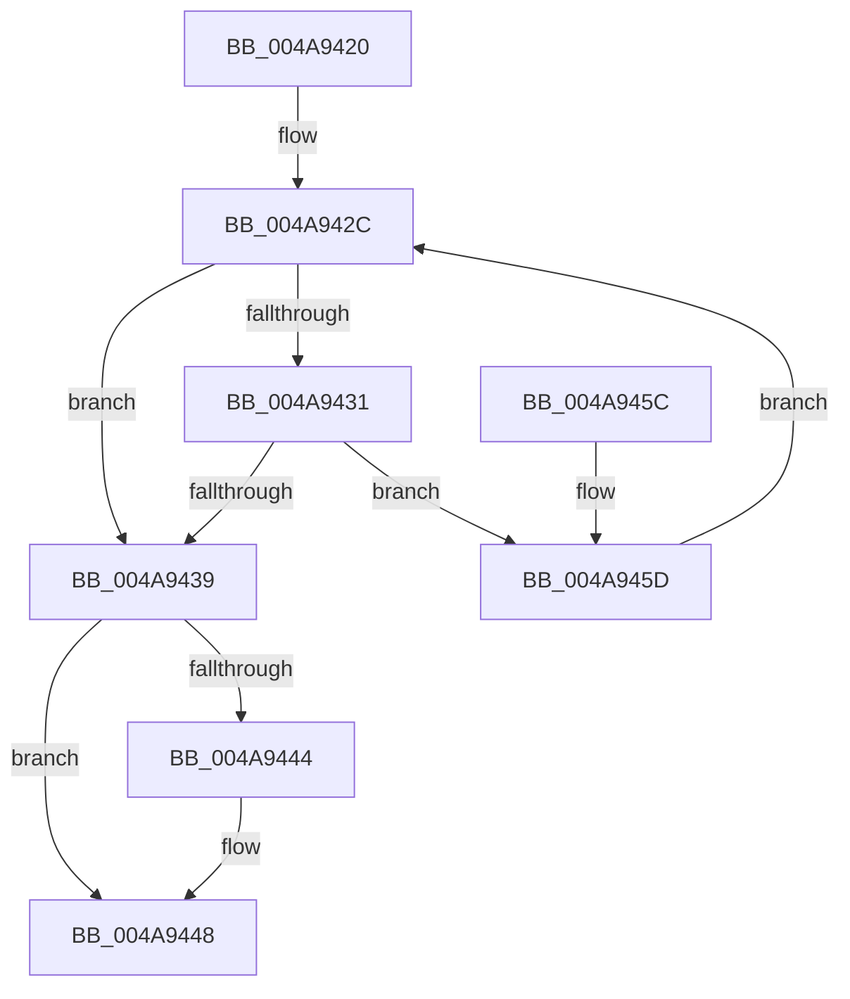

# MiSplitPageChain

- RVA: `0x004A9420`–`0x004A9465` (길이 `69` bytes)
- VA: `0x00000001404A9420`
- 실행 섹션: `.text`
- PDB 이름 있음: `예`; PDB Function 태그: `아니요`
- unwind 정보 RVA: `0x000DB714`
- 디코드: `22`개 명령, `69/69` bytes 표시
- 미해석 바이트: `0` (있으면 어셈블리에 `.byte`로 보존)

> 이 문서는 커널 이미지의 기계어와 PDB 기호를 분석해 생성했습니다. 4번과 5번은 함수 원형과 자료형을 바이너리 사용 방식에서 추정한 C 해석이며 원본 소스 복구 결과는 아닙니다.

## 1. Dependencies

- 직접 호출 지점: **0**; 고유 호출 대상: **0**
- 직접 호출자로 확인된 함수: **2**
- RIP 상대 이미지 참조: **0**

### Outgoing calls
- 직접 디코드된 call 명령이 없습니다.

### Direct callers
- [MiUnmapMdlCommon](../3E/MiUnmapMdlCommon_function_003E7DF0.md) at `0x003E825E`
- [MiGetCachedPoolPages](MiGetCachedPoolPages_function_004A9324.md) at `0x004A938B`

### Static image references
- 디코드된 RIP-relative 메모리 참조가 없습니다.

## 2. Other-region calls and transfers

- 다른 실행 섹션으로 향하는 call: **0**
- 별도 외부 분기/꼬리 이동을 확인하지 못했습니다.

## 3. Assembly (complete function range)

```asm
004A9420  4C 8B 09                        mov r9, qword ptr [rcx]
004A9423  41 BA 01 00 00 00               mov r10d, 1
004A9429  4D 89 08                        mov qword ptr [r8], r9
004A942C  4C 3B D2                        cmp r10, rdx
004A942F  74 08                           je 0x1404a9439
004A9431  49 8B 01                        mov rax, qword ptr [r9]
004A9434  48 85 C0                        test rax, rax
004A9437  75 24                           jne 0x1404a945d
004A9439  49 8B 01                        mov rax, qword ptr [r9]
004A943C  48 89 01                        mov qword ptr [rcx], rax
004A943F  48 85 C0                        test rax, rax
004A9442  75 04                           jne 0x1404a9448
004A9444  48 21 41 08                     and qword ptr [rcx + 8], rax
004A9448  4C 29 51 10                     sub qword ptr [rcx + 0x10], r10
004A944C  49 C7 01 00 00 00 00            mov qword ptr [r9], 0
004A9453  4D 89 48 08                     mov qword ptr [r8 + 8], r9
004A9457  4D 89 50 10                     mov qword ptr [r8 + 0x10], r10
004A945B  C3                              ret
004A945C  CC                              int3
004A945D  4D 8B 09                        mov r9, qword ptr [r9]
004A9460  49 FF C2                        inc r10
004A9463  EB C7                           jmp 0x1404a942c
```

## 4. C-style interpretation (structured pseudocode)

```c
__int64 __fastcall MiSplitPageChain(__int64 a1, __int64 a2, __int64 a3)
{
    __int64 v_r10;

    *(unsigned __int64 *)(a3) = *(unsigned __int64 *)(a1);
loc_004A942C:
    if (1 == a2) goto loc_004A9439;
    if (*(unsigned __int64 *)(*(unsigned __int64 *)(a1)) != 0) goto loc_004A945D;
loc_004A9439:
    *(unsigned __int64 *)(a1) = *(unsigned __int64 *)(*(unsigned __int64 *)(a1));
    if (*(unsigned __int64 *)(*(unsigned __int64 *)(a1)) == 0) {
    }
    *(unsigned __int64 *)(*(unsigned __int64 *)(a1)) = 0;
    *(unsigned __int64 *)(a3 + 8) = *(unsigned __int64 *)(a1);
    *(unsigned __int64 *)(a3 + 16) = 1;
    return *(unsigned __int64 *)(*(unsigned __int64 *)(a1));
loc_004A945D:
    v_r10 = (1) + 1;
    goto loc_004A942C;
}
```

## 5. (Beta) C Style

```c
int64_t MiSplitPageChain(void *Arg1, int64_t Arg2, void *Arg3)
{
    uint8_t *arg1 = (uint8_t *)Arg1;
    uint8_t *arg3 = (uint8_t *)Arg3;

    int64_t local_r10;

    *(uint64_t *)(arg3) = *(uint64_t *)(arg1);
loc_004A942C:
    if (1 == Arg2) goto loc_004A9439;
    if (*(uint64_t *)(*(uint64_t *)(arg1)) != 0) goto loc_004A945D;
loc_004A9439:
    *(uint64_t *)(arg1) = *(uint64_t *)(*(uint64_t *)(arg1));
    if (*(uint64_t *)(*(uint64_t *)(arg1)) == 0) {
    }
    *(uint64_t *)(*(uint64_t *)(arg1)) = 0;
    *(uint64_t *)(arg3 + 0x8) = *(uint64_t *)(arg1);
    *(uint64_t *)(arg3 + 0x10) = 1;
    return *(uint64_t *)(*(uint64_t *)(arg1));
loc_004A945D:
    local_r10 = (1) + 1;
    goto loc_004A942C;
}
```

### 관측된 메모리 오프셋

구조체 형식이 확인되지 않은 접근은 인자 기준의 오프셋으로만 기록했습니다.

| 기준 인자 | 오프셋 표현 | 폭 (bit) | 접근 |
|---|---:|---:|---|
| `Arg1` | `+ 0x0` | `64` | `R` |
| `Arg1` | `+ 0x0` | `64` | `W` |
| `Arg1` | `+ 0x8` | `64` | `R/W` |
| `Arg1` | `+ 0x10` | `64` | `R/W` |
| `Arg3` | `+ 0x0` | `64` | `W` |
| `Arg3` | `+ 0x8` | `64` | `W` |
| `Arg3` | `+ 0x10` | `64` | `W` |

## 6. Execution-region graph

[열기: 2D/3D 그래프와 함수 탐색 컨트롤 패널](../../../control-panel.html?section=text&rva=0x004A9420&view=graph)

- 2D 그래프는 위에서 아래로 흐르고, 3D 그래프는 빈 공간을 드래그해 회전합니다. Shift+드래그는 이동, 휠은 확대·축소, 함수 노드 선택은 대상 보고서 이동입니다.

### Static fallback


