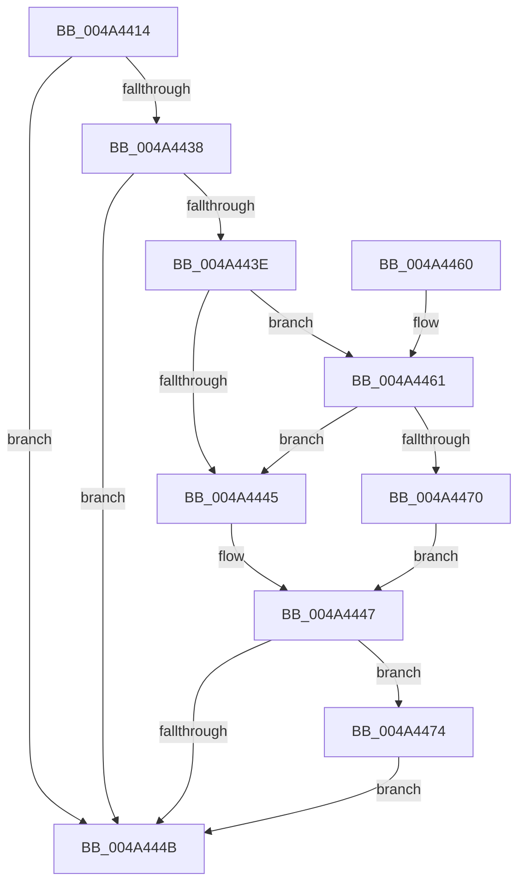

# MiStoreLogWriteCompleteFailure

- RVA: `0x004A4414`–`0x004A44B8` (길이 `164` bytes)
- VA: `0x00000001404A4414`
- 실행 섹션: `.text`
- PDB 이름 있음: `예`; PDB Function 태그: `아니요`
- unwind 정보 RVA: `0x000B6698`
- 디코드: `41`개 명령, `164/164` bytes 표시
- 미해석 바이트: `0` (있으면 어셈블리에 `.byte`로 보존)

> 이 문서는 커널 이미지의 기계어와 PDB 기호를 분석해 생성했습니다. 4번과 5번은 함수 원형과 자료형을 바이너리 사용 방식에서 추정한 C 해석이며 원본 소스 복구 결과는 아닙니다.

## 1. Dependencies

- 직접 호출 지점: **2**; 고유 호출 대상: **2**
- 직접 호출자로 확인된 함수: **1**
- RIP 상대 이미지 참조: **3**

### Outgoing calls
- `0x004A4453` → [_security_check_cookie](../6A/_security_check_cookie_function_006AC640.md) (function, `0x006AC640`)
- `0x004A44B1` → [tlgWriteEx_EtwWriteEx](tlgWriteEx_EtwWriteEx_function_004AA348.md) (function, `0x004AA348`)

### Direct callers
- [MiStoreModifiedWriteComplete](../20/MiStoreModifiedWriteComplete_function_002045E8.md) at `0x00204641`

### Static image references
- `0x004A441B` → RVA `0x00E0A740` (`.data`; read)
- `0x004A442A` → RVA `0x00E37618` (`.data`; read)
- `0x004A4497` → RVA `0x00059BA5` (`.rdata`; read)

## 2. Other-region calls and transfers

- 다른 실행 섹션으로 향하는 call: **0**
- 별도 외부 분기/꼬리 이동을 확인하지 못했습니다.

## 3. Assembly (complete function range)

```asm
004A4414  48 81 EC 88 00 00 00            sub rsp, 0x88
004A441B  48 8B 05 1E 63 96 00            mov rax, qword ptr [rip + 0x96631e]
004A4422  48 33 C4                        xor rax, rsp
004A4425  48 89 44 24 78                  mov qword ptr [rsp + 0x78], rax
004A442A  4C 8B 05 E7 31 99 00            mov r8, qword ptr [rip + 0x9931e7]
004A4431  8B D1                           mov edx, ecx
004A4433  4D 85 C0                        test r8, r8
004A4436  74 13                           je 0x1404a444b
004A4438  41 83 38 05                     cmp dword ptr [r8], 5
004A443C  76 0D                           jbe 0x1404a444b
004A443E  41 F6 40 10 02                  test byte ptr [r8 + 0x10], 2
004A4443  75 1C                           jne 0x1404a4461
004A4445  32 C0                           xor al, al
004A4447  84 C0                           test al, al
004A4449  75 29                           jne 0x1404a4474
004A444B  48 8B 4C 24 78                  mov rcx, qword ptr [rsp + 0x78]
004A4450  48 33 CC                        xor rcx, rsp
004A4453  E8 E8 81 20 00                  call 0x1406ac640
004A4458  48 81 C4 88 00 00 00            add rsp, 0x88
004A445F  C3                              ret
004A4460  CC                              int3
004A4461  49 8B 48 18                     mov rcx, qword ptr [r8 + 0x18]
004A4465  48 8B C1                        mov rax, rcx
004A4468  83 E0 02                        and eax, 2
004A446B  48 3B C1                        cmp rax, rcx
004A446E  75 D5                           jne 0x1404a4445
004A4470  B0 01                           mov al, 1
004A4472  EB D3                           jmp 0x1404a4447
004A4474  83 64 24 74 00                  and dword ptr [rsp + 0x74], 0
004A4479  48 8D 44 24 40                  lea rax, [rsp + 0x40]
004A447E  48 89 44 24 68                  mov qword ptr [rsp + 0x68], rax
004A4483  41 B9 01 00 00 00               mov r9d, 1
004A4489  48 8D 44 24 48                  lea rax, [rsp + 0x48]
004A448E  89 54 24 40                     mov dword ptr [rsp + 0x40], edx
004A4492  48 89 44 24 38                  mov qword ptr [rsp + 0x38], rax
004A4497  48 8D 15 07 57 BB FF            lea rdx, [rip - 0x44a8f9]
004A449E  49 8B C8                        mov rcx, r8
004A44A1  C7 44 24 30 03 00 00 00         mov dword ptr [rsp + 0x30], 3
004A44A9  C7 44 24 70 04 00 00 00         mov dword ptr [rsp + 0x70], 4
004A44B1  E8 92 5E 00 00                  call 0x1404aa348
004A44B6  EB 93                           jmp 0x1404a444b
```

## 4. C-style interpretation (structured pseudocode)

```c
__int64 __fastcall MiStoreLogWriteCompleteFailure(int a1)
{
    __int64 result;
    __int64 v_rsp;
    unsigned __int64 v_stack_m10;
    unsigned int v_stack_p30;
    unsigned __int64 v_stack_p38;
    unsigned __int64 v_stack_p40;
    unsigned __int64 v_stack_p48;
    unsigned __int64 v_stack_p68;
    unsigned int v_stack_p70;
    unsigned int v_stack_p74;

    v_rsp = (v_rsp) - (136);
    result = (*(unsigned __int64 *)(v_rip + 9855774)) ^ (v_rsp);
    v_stack_m10 = result;
    if (*(unsigned __int64 *)(v_rip + 10039783) == 0) goto loc_004A444B;
    if ((*(unsigned int *)(*(unsigned __int64 *)(v_rip + 10039783))) <= 5) goto loc_004A444B;
    if (((*(unsigned __int8 *)(*(unsigned __int64 *)(v_rip + 10039783) + 16)) & (2)) != 0) goto loc_004A4461;
loc_004A4445:
    result = 0;
loc_004A4447:
    if (0 != 0) goto loc_004A4474;
loc_004A444B:
    a1 = (v_stack_m10) ^ (v_rsp);
    result = _security_check_cookie(a1, (unsigned int)(a1), *(unsigned __int64 *)(v_rip + 10039783), a4);
    v_rsp = (v_rsp) + (136);
    return result;
loc_004A4461:
    result = (unsigned int)((*(unsigned __int64 *)(*(unsigned __int64 *)(v_rip + 10039783) + 24)) & (2));
    if (result != (*(unsigned __int64 *)(*(unsigned __int64 *)(v_rip + 10039783) + 24))) goto loc_004A4445;
    goto loc_004A4447;
loc_004A4474:
    v_stack_p68 = v_stack_p40;
    v_stack_p40 = (unsigned int)((unsigned int)(a1));
    v_stack_p38 = v_stack_p48;
    v_stack_p30 = 3;
    v_stack_p70 = 4;
    result = tlgWriteEx_EtwWriteEx(*(unsigned __int64 *)(v_rip + 10039783), v_rip - 4499705, *(unsigned __int64 *)(v_rip + 10039783), 1);
    goto loc_004A444B;
}
```

## 5. (Beta) C Style

```c
int64_t MiStoreLogWriteCompleteFailure(int32_t Arg1)
{
    int64_t result;
    int64_t local_rsp;
    uint64_t v_stack_m10;
    uint32_t v_stack_p30;
    uint64_t v_stack_p38;
    uint64_t v_stack_p40;
    uint64_t v_stack_p48;
    uint64_t v_stack_p68;
    uint32_t v_stack_p70;
    uint32_t v_stack_p74;

    local_rsp = (local_rsp) - (136);
    result = (*(uint64_t *)(v_rip + 0x96631E)) ^ (local_rsp);
    v_stack_m10 = result;
    if (*(uint64_t *)(v_rip + 0x9931E7) == 0) goto loc_004A444B;
    if ((*(uint32_t *)(*(uint64_t *)(v_rip + 0x9931E7))) <= 5) goto loc_004A444B;
    if (((*(uint8_t *)(*(uint64_t *)(v_rip + 0x9931E7) + 0x10)) & (2)) != 0) goto loc_004A4461;
loc_004A4445:
    result = 0;
loc_004A4447:
    if (0 != 0) goto loc_004A4474;
loc_004A444B:
    Arg1 = (v_stack_m10) ^ (local_rsp);
    result = _security_check_cookie(Arg1, (uint32_t)(Arg1), *(uint64_t *)(v_rip + 0x9931E7), a4);
    local_rsp = (local_rsp) + (136);
    return result;
loc_004A4461:
    result = (uint32_t)((*(uint64_t *)(*(uint64_t *)(v_rip + 0x9931E7) + 0x18)) & (2));
    if (result != (*(uint64_t *)(*(uint64_t *)(v_rip + 0x9931E7) + 0x18))) goto loc_004A4445;
    goto loc_004A4447;
loc_004A4474:
    v_stack_p68 = v_stack_p40;
    v_stack_p40 = (uint32_t)((uint32_t)(Arg1));
    v_stack_p38 = v_stack_p48;
    v_stack_p30 = 3;
    v_stack_p70 = 4;
    result = tlgWriteEx_EtwWriteEx(*(uint64_t *)(v_rip + 0x9931E7), v_rip - 4499705, *(uint64_t *)(v_rip + 0x9931E7), 1);
    goto loc_004A444B;
}
```

## 6. Execution-region graph

[열기: 2D/3D 그래프와 함수 탐색 컨트롤 패널](../../../control-panel.html?section=text&rva=0x004A4414&view=graph)

- 2D 그래프는 위에서 아래로 흐르고, 3D 그래프는 빈 공간을 드래그해 회전합니다. Shift+드래그는 이동, 휠은 확대·축소, 함수 노드 선택은 대상 보고서 이동입니다.

### Static fallback


