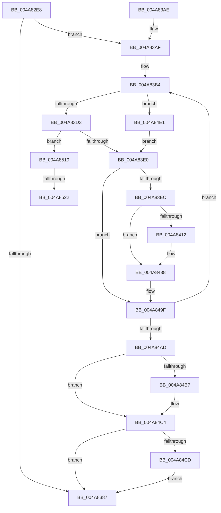

# MiUnmapKernelScp

- RVA: `0x004A82E8`–`0x004A8536` (길이 `590` bytes)
- VA: `0x00000001404A82E8`
- 실행 섹션: `.text`
- PDB 이름 있음: `예`; PDB Function 태그: `예`
- unwind 정보 RVA: `0x000B7500`
- 디코드: `145`개 명령, `590/590` bytes 표시
- 미해석 바이트: `0` (있으면 어셈블리에 `.byte`로 보존)

> 이 문서는 커널 이미지의 기계어와 PDB 기호를 분석해 생성했습니다. 4번과 5번은 함수 원형과 자료형을 바이너리 사용 방식에서 추정한 C 해석이며 원본 소스 복구 결과는 아닙니다.

## 1. Dependencies

- 직접 호출 지점: **17**; 고유 호출 대상: **14**
- 직접 호출자로 확인된 함수: **1**
- RIP 상대 이미지 참조: **6**

### Outgoing calls
- `0x004A8371` → [MiLockWorkingSetShared](../27/MiLockWorkingSetShared_function_0027CBF0.md) (function, `0x0027CBF0`)
- `0x004A8391` → [MiUnlockWorkingSetShared](../27/MiUnlockWorkingSetShared_function_0027D690.md) (function, `0x0027D690`)
- `0x004A83EF` → [MiGetWsleContents](../31/MiGetWsleContents_function_00316540.md) (function, `0x00316540`)
- `0x004A83FE` → [MiWriteWsle](../29/MiWriteWsle_function_00292CA0.md) (function, `0x00292CA0`)
- `0x004A8412` → [MiGetProcessorFlushList](../24/MiGetProcessorFlushList_function_00242C90.md) (function, `0x00242C90`)
- `0x004A8433` → [MiInitializeTbFlushList](../29/MiInitializeTbFlushList_function_00294F00.md) (function, `0x00294F00`)
- `0x004A8445` → [MiInsertTbFlushEntry](../29/MiInsertTbFlushEntry_function_00293670.md) (function, `0x00293670`)
- `0x004A846C` → [MiLockAndDecrementShareCount](../2A/MiLockAndDecrementShareCount_function_002A2854.md) (function, `0x002A2854`)
- `0x004A8474` → [MiGetContainingPageTable](../34/MiGetContainingPageTable_function_003467F0.md) (function, `0x003467F0`)
- `0x004A848C` → [MiLockAndDecrementShareCount](../2A/MiLockAndDecrementShareCount_function_002A2854.md) (function, `0x002A2854`)
- `0x004A849A` → [MiDecreaseUsedPtes](../37/MiDecreaseUsedPtes_function_00378080.md) (function, `0x00378080`)
- `0x004A84BA` → [MiFlushTbList](../31/MiFlushTbList_function_00311FC0.md) (function, `0x00311FC0`)
- `0x004A84BF` → [MiReleaseProcessorFlushList](../31/MiReleaseProcessorFlushList_function_00313C70.md) (function, `0x00313C70`)
- `0x004A84D7` → [MiUnlockPageTable](../21/MiUnlockPageTable_function_00216EC0.md) (function, `0x00216EC0`)
- `0x004A850F` → [MiLockNestedPageTable](../23/MiLockNestedPageTable_function_0023E890.md) (function, `0x0023E890`)
- `0x004A8525` → [MiFlushTbList](../31/MiFlushTbList_function_00311FC0.md) (function, `0x00311FC0`)
- `0x004A852A` → [MiReleaseProcessorFlushList](../31/MiReleaseProcessorFlushList_function_00313C70.md) (function, `0x00313C70`)

### Direct callers
- [MiUnloadSystemImage](../../page/AA/MiUnloadSystemImage_function_00AA2FD4.md) at `0x00AA3146`

### Static image references
- `0x004A8306` → RVA `0x00E375B0` (`.data`; read)
- `0x004A830F` → RVA `0x00E375AC` (`.data`; read)
- `0x004A835C` → RVA `0x00E37E40` (`.data`; read)
- `0x004A8363` → RVA `0x00E2D840` (`.data`; read)
- `0x004A837C` → RVA `0x00E2D83C` (`.data`; read)
- `0x004A8403` → RVA `0x00010880` (`.rdata`; read)

## 2. Other-region calls and transfers

- 다른 실행 섹션으로 향하는 call: **0**
- call이 아닌 외부 분기/꼬리 이동: **2**
  - `0x004A851C` → [sub_006F9C66](../6F/Unknown_function_006F9C66.md) (`tail-transfer`)
  - `0x004A8531` → [sub_006F9C66](../6F/Unknown_function_006F9C66.md) (`tail-transfer`)

## 3. Assembly (complete function range)

```asm
004A82E8  48 89 5C 24 20                  mov qword ptr [rsp + 0x20], rbx
004A82ED  55                              push rbp
004A82EE  56                              push rsi
004A82EF  57                              push rdi
004A82F0  41 54                           push r12
004A82F2  41 55                           push r13
004A82F4  41 56                           push r14
004A82F6  41 57                           push r15
004A82F8  48 83 EC 30                     sub rsp, 0x30
004A82FC  44 8B 61 40                     mov r12d, dword ptr [rcx + 0x40]
004A8300  41 B9 00 F0 FF FF               mov r9d, 0xfffff000
004A8306  44 8B 05 A3 F2 98 00            mov r8d, dword ptr [rip + 0x98f2a3]
004A830D  33 DB                           xor ebx, ebx
004A830F  44 03 05 96 F2 98 00            add r8d, dword ptr [rip + 0x98f296]
004A8316  41 8B C0                        mov eax, r8d
004A8319  25 FF 0F 00 00                  and eax, 0xfff
004A831E  F7 D8                           neg eax
004A8320  48 B8 F8 FF FF FF 7F 00 00 00   movabs rax, 0x7ffffffff8
004A832A  1B D2                           sbb edx, edx
004A832C  45 23 E1                        and r12d, r9d
004A832F  81 E2 00 10 00 00               and edx, 0x1000
004A8335  45 23 C1                        and r8d, r9d
004A8338  44 03 E2                        add r12d, edx
004A833B  45 03 E0                        add r12d, r8d
004A833E  4C 03 61 30                     add r12, qword ptr [rcx + 0x30]
004A8342  4D 8B FC                        mov r15, r12
004A8345  49 C1 EF 09                     shr r15, 9
004A8349  4C 23 F8                        and r15, rax
004A834C  48 B8 00 00 00 00 80 F6 FF FF   movabs rax, 0xfffff68000000000
004A8356  48 8B C0                        mov rax, rax
004A8359  4C 03 F8                        add r15, rax
004A835C  48 8D 0D DD FA 98 00            lea rcx, [rip + 0x98fadd]
004A8363  48 8B 05 D6 54 98 00            mov rax, qword ptr [rip + 0x9854d6]
004A836A  33 FF                           xor edi, edi
004A836C  48 89 44 24 78                  mov qword ptr [rsp + 0x78], rax
004A8371  E8 7A 48 DD FF                  call 0x14027cbf0
004A8376  33 F6                           xor esi, esi
004A8378  88 44 24 70                     mov byte ptr [rsp + 0x70], al
004A837C  39 1D BA 54 98 00               cmp dword ptr [rip + 0x9854ba], ebx
004A8382  44 8A E8                        mov r13b, al
004A8385  77 28                           ja 0x1404a83af
004A8387  41 8A D5                        mov dl, r13b
004A838A  48 8D 0D AF FA 98 00            lea rcx, [rip + 0x98faaf]
004A8391  E8 FA 52 DD FF                  call 0x14027d690
004A8396  48 8B 9C 24 88 00 00 00         mov rbx, qword ptr [rsp + 0x88]
004A839E  48 83 C4 30                     add rsp, 0x30
004A83A2  41 5F                           pop r15
004A83A4  41 5E                           pop r14
004A83A6  41 5D                           pop r13
004A83A8  41 5C                           pop r12
004A83AA  5F                              pop rdi
004A83AB  5E                              pop rsi
004A83AC  5D                              pop rbp
004A83AD  C3                              ret
004A83AE  CC                              int3
004A83AF  4C 8B 6C 24 78                  mov r13, qword ptr [rsp + 0x78]
004A83B4  49 8B 4C F5 30                  mov rcx, qword ptr [r13 + rsi*8 + 0x30]
004A83B9  4D 8D 34 F7                     lea r14, [r15 + rsi*8]
004A83BD  8B EE                           mov ebp, esi
004A83BF  48 89 4C 24 78                  mov qword ptr [rsp + 0x78], rcx
004A83C4  C1 E5 0C                        shl ebp, 0xc
004A83C7  49 03 EC                        add rbp, r12
004A83CA  48 85 DB                        test rbx, rbx
004A83CD  0F 84 0E 01 00 00               je 0x1404a84e1
004A83D3  49 F7 C6 FF 0F 00 00            test r14, 0xfff
004A83DA  0F 84 39 01 00 00               je 0x1404a8519
004A83E0  49 8B 06                        mov rax, qword ptr [r14]
004A83E3  48 85 C0                        test rax, rax
004A83E6  0F 84 B3 00 00 00               je 0x1404a849f
004A83EC  48 8B D5                        mov rdx, rbp
004A83EF  E8 4C E1 E6 FF                  call 0x140316540
004A83F4  24 FA                           and al, 0xfa
004A83F6  48 8B D5                        mov rdx, rbp
004A83F9  0C 0A                           or al, 0xa
004A83FB  44 8A C0                        mov r8b, al
004A83FE  E8 9D A8 DE FF                  call 0x140292ca0
004A8403  48 8B 05 76 84 B6 FF            mov rax, qword ptr [rip - 0x497b8a]
004A840A  49 89 06                        mov qword ptr [r14], rax
004A840D  48 85 FF                        test rdi, rdi
004A8410  75 26                           jne 0x1404a8438
004A8412  E8 79 A8 D9 FF                  call 0x140242c90
004A8417  45 33 C9                        xor r9d, r9d
004A841A  C7 44 24 20 01 00 00 00         mov dword ptr [rsp + 0x20], 1
004A8422  48 8D 15 17 FA 98 00            lea rdx, [rip + 0x98fa17]
004A8429  48 8B C8                        mov rcx, rax
004A842C  48 8B F8                        mov rdi, rax
004A842F  44 8B 40 0C                     mov r8d, dword ptr [rax + 0xc]
004A8433  E8 C8 CA DE FF                  call 0x140294f00
004A8438  45 33 C9                        xor r9d, r9d
004A843B  48 8B D5                        mov rdx, rbp
004A843E  48 8B CF                        mov rcx, rdi
004A8441  45 8D 41 01                     lea r8d, [r9 + 1]
004A8445  E8 26 B2 DE FF                  call 0x140293670
004A844A  48 8B 44 24 78                  mov rax, qword ptr [rsp + 0x78]
004A844F  48 BD 00 00 00 00 00 DE FF FF   movabs rbp, 0xffffde0000000000
004A8459  48 8D 0C 40                     lea rcx, [rax + rax*2]
004A845D  48 C1 E1 04                     shl rcx, 4
004A8461  48 8B C5                        mov rax, rbp
004A8464  48 03 C8                        add rcx, rax
004A8467  BA 02 00 00 00                  mov edx, 2
004A846C  E8 E3 A3 DF FF                  call 0x1402a2854
004A8471  49 8B CE                        mov rcx, r14
004A8474  E8 77 E3 E9 FF                  call 0x1403467f0
004A8479  48 8D 0C 40                     lea rcx, [rax + rax*2]
004A847D  48 C1 E1 04                     shl rcx, 4
004A8481  48 8B C5                        mov rax, rbp
004A8484  48 03 C8                        add rcx, rax
004A8487  BA 02 00 00 00                  mov edx, 2
004A848C  E8 C3 A3 DF FF                  call 0x1402a2854
004A8491  41 B8 01 00 00 00               mov r8d, 1
004A8497  48 8B D3                        mov rdx, rbx
004A849A  E8 E1 FB EC FF                  call 0x140378080
004A849F  FF C6                           inc esi
004A84A1  3B 35 95 53 98 00               cmp esi, dword ptr [rip + 0x985395]
004A84A7  0F 82 07 FF FF FF               jb 0x1404a83b4
004A84AD  44 8A 6C 24 70                  mov r13b, byte ptr [rsp + 0x70]
004A84B2  48 85 FF                        test rdi, rdi
004A84B5  74 0D                           je 0x1404a84c4
004A84B7  48 8B CF                        mov rcx, rdi
004A84BA  E8 01 9B E6 FF                  call 0x140311fc0
004A84BF  E8 AC B7 E6 FF                  call 0x140313c70
004A84C4  48 85 DB                        test rbx, rbx
004A84C7  0F 84 BA FE FF FF               je 0x1404a8387
004A84CD  48 8B D3                        mov rdx, rbx
004A84D0  48 8D 0D 69 F9 98 00            lea rcx, [rip + 0x98f969]
004A84D7  E8 E4 E9 D6 FF                  call 0x140216ec0
004A84DC  E9 A6 FE FF FF                  jmp 0x1404a8387
004A84E1  48 B8 F8 FF FF FF 7F 00 00 00   movabs rax, 0x7ffffffff8
004A84EB  49 8B DE                        mov rbx, r14
004A84EE  48 C1 EB 09                     shr rbx, 9
004A84F2  48 23 D8                        and rbx, rax
004A84F5  48 B8 00 00 00 00 80 F6 FF FF   movabs rax, 0xfffff68000000000
004A84FF  48 8B C0                        mov rax, rax
004A8502  48 03 D8                        add rbx, rax
004A8505  48 8D 0D 34 F9 98 00            lea rcx, [rip + 0x98f934]
004A850C  48 8B D3                        mov rdx, rbx
004A850F  E8 7C 63 D9 FF                  call 0x14023e890
004A8514  E9 C7 FE FF FF                  jmp 0x1404a83e0
004A8519  48 85 FF                        test rdi, rdi
004A851C  0F 84 44 17 25 00               je 0x1406f9c66
004A8522  48 8B CF                        mov rcx, rdi
004A8525  E8 96 9A E6 FF                  call 0x140311fc0
004A852A  E8 41 B7 E6 FF                  call 0x140313c70
004A852F  33 FF                           xor edi, edi
004A8531  E9 30 17 25 00                  jmp 0x1406f9c66
```

## 4. C-style interpretation (structured pseudocode)

```c
__int64 __fastcall MiUnmapKernelScp(__int64 a1, int a2)
{
    __int64 result;
    __int64 v_r12;
    __int64 v_r15;
    __int64 v_rbp;
    __int64 v_rbx;
    __int64 v_rdi;
    __int64 v_rsi;
    __int64 v_rsp;
    unsigned __int64 v_stack_p10;
    unsigned __int64 v_stack_p20;
    unsigned __int8 v_stack_p70;
    unsigned __int64 v_stack_p78;
    unsigned __int8 v_stack_p8;

    v_stack_p20 = v_rbx;
    v_rsp = (v_rsp) - (48);
    v_rbx = 0;
    a3 = (unsigned int)(((unsigned int)(*(unsigned int *)(v_rip + 10023587))) + (*(unsigned int *)(v_rip + 10023574)));
    result = (unsigned int)(((unsigned int)((unsigned int)(a3))) & (0xFFFULL));
    result = (unsigned int)(-(result));
    v_r12 = (unsigned int)(((unsigned int)(*(unsigned int *)(a1 + 64))) & ((unsigned int)((unsigned int)(0xFFFFF000ULL))));
    a2 = (unsigned int)((a2) & (0x1000ULL));
    a3 = (unsigned int)((a3) & ((unsigned int)((unsigned int)(0xFFFFF000ULL))));
    v_r12 = (unsigned int)((v_r12) + (a2));
    v_r12 = (unsigned int)((v_r12) + ((unsigned int)(a3)));
    v_r12 = (v_r12) + (*(unsigned __int64 *)(a1 + 48));
    v_r15 = (v_r12) >> (9);
    v_r15 = (v_r15) & (result);
    v_r15 = (v_r15) + (result);
    v_rdi = 0;
    v_stack_p10 = *(unsigned __int64 *)(v_rip + 9983190);
    result = MiLockWorkingSetShared(v_rip + 10025693, a2, a3, (unsigned int)(0xFFFFF000ULL));
    v_rsi = 0;
    v_stack_p8 = (unsigned __int8)(result);
    if ((*(unsigned int *)(v_rip + 9983162)) > 0) goto loc_004A83AF;
loc_004A8387:
    result = MiUnlockWorkingSetShared(v_rip + 10025647, (unsigned __int8)((unsigned __int8)(result)), a3, (unsigned int)(0xFFFFF000ULL));
    v_rsp = (v_rsp) + (48);
    return result;
loc_004A83AF:
loc_004A83B4:
    v_stack_p78 = *(unsigned __int64 *)(v_stack_p78 + v_rsi * 8 + 48);
    v_rbp = (unsigned int)((0) << (12));
    v_rbp = (v_rbp) + (v_r12);
    if (v_stack_p20 == 0) goto loc_004A84E1;
    if (((v_r15 + v_rsi * 8) & (0xFFFULL)) == 0) goto loc_004A8519;
loc_004A83E0:
    if (*(unsigned __int64 *)(v_r15 + v_rsi * 8) == 0) goto loc_004A849F;
    result = MiGetWsleContents(*(unsigned __int64 *)(v_stack_p78 + v_rsi * 8 + 48), v_rbp, a3, (unsigned int)(0xFFFFF000ULL));
    result = (unsigned __int8)((result) & (250));
    result = (unsigned __int8)((result) | (10));
    result = MiWriteWsle(*(unsigned __int64 *)(v_stack_p78 + v_rsi * 8 + 48), v_rbp, (unsigned __int8)(result), (unsigned int)(0xFFFFF000ULL));
    *(unsigned __int64 *)(v_r15 + v_rsi * 8) = *(unsigned __int64 *)(v_rip - 4815754);
    result = *(unsigned __int64 *)(v_rip - 4815754);
    if (0 == 0) {
        result = MiGetProcessorFlushList(*(unsigned __int64 *)(v_stack_p78 + v_rsi * 8 + 48), v_rbp, (unsigned __int8)(result), (unsigned int)(0xFFFFF000ULL));
        a4 = 0;
        v_stack_p20 = 1;
        a2 = v_rip + 10025495;
        a1 = result;
        v_rdi = result;
        a3 = *(unsigned int *)(result + 12);
        result = MiInitializeTbFlushList(a1, a2, a3, a4);
    }
    a4 = 0;
    result = MiInsertTbFlushEntry(v_rdi, v_rbp, a4 + 1, a4);
    a1 = (v_stack_p78 + v_stack_p78 * 2) << (4);
    a1 = (a1) + (v_rbp);
    result = MiLockAndDecrementShareCount(a1, 2, a4 + 1, a4);
    result = MiGetContainingPageTable(v_r15 + v_rsi * 8, 2, a4 + 1, a4);
    a1 = (result + result * 2) << (4);
    a1 = (a1) + (v_rbp);
    result = MiLockAndDecrementShareCount(a1, 2, a4 + 1, a4);
    result = MiDecreaseUsedPtes(a1, v_stack_p20, 1, a4);
loc_004A849F:
    v_rsi = (unsigned int)((v_rsi) + 1);
    if (((unsigned int)(v_rsi)) < (*(unsigned int *)(v_rip + 9982869))) goto loc_004A83B4;
    if (v_rdi != 0) {
        a1 = v_rdi;
        result = MiFlushTbList(a1, v_stack_p20, 1, a4);
        result = MiReleaseProcessorFlushList(a1, v_stack_p20, 1, a4);
    }
    if (v_stack_p20 == 0) goto loc_004A8387;
    result = MiUnlockPageTable(v_rip + 10025321, v_stack_p20, 1, a4);
    goto loc_004A8387;
loc_004A84E1:
    v_rbx = (v_r15 + v_rsi * 8) >> (9);
    v_rbx = (v_rbx) & (result);
    v_rbx = (v_rbx) + (result);
    result = MiLockNestedPageTable(v_rip + 10025268, v_rbx, 1, a4);
    goto loc_004A83E0;
loc_004A8519:
    result = MiFlushTbList(v_rdi, v_rbx, 1, a4);
    result = MiReleaseProcessorFlushList(v_rdi, v_rbx, 1, a4);
    v_rdi = 0;
}
```

## 5. (Beta) C Style

```c
int64_t MiUnmapKernelScp(void *Arg1, int32_t Arg2)
{
    uint8_t *arg1 = (uint8_t *)Arg1;

    int64_t result;
    int64_t local_r12;
    int64_t local_r15;
    int64_t local_rbp;
    int64_t local_rbx;
    int64_t local_rdi;
    int64_t local_rsi;
    int64_t local_rsp;
    uint64_t v_stack_p10;
    uint64_t v_stack_p20;
    uint8_t v_stack_p70;
    uint64_t v_stack_p78;
    uint8_t v_stack_p8;

    v_stack_p20 = local_rbx;
    local_rsp = (local_rsp) - (48);
    local_rbx = 0;
    a3 = (uint32_t)(((uint32_t)(*(uint32_t *)(v_rip + 0x98F2A3))) + (*(uint32_t *)(v_rip + 0x98F296)));
    result = (uint32_t)(((uint32_t)((uint32_t)(a3))) & (0xFFFULL));
    result = (uint32_t)(-(result));
    local_r12 = (uint32_t)(((uint32_t)(*(uint32_t *)(arg1 + 0x40))) & ((uint32_t)((uint32_t)(0xFFFFF000ULL))));
    Arg2 = (uint32_t)((Arg2) & (0x1000ULL));
    a3 = (uint32_t)((a3) & ((uint32_t)((uint32_t)(0xFFFFF000ULL))));
    local_r12 = (uint32_t)((local_r12) + (Arg2));
    local_r12 = (uint32_t)((local_r12) + ((uint32_t)(a3)));
    local_r12 = (local_r12) + (*(uint64_t *)(arg1 + 0x30));
    local_r15 = (local_r12) >> (9);
    local_r15 = (local_r15) & (result);
    local_r15 = (local_r15) + (result);
    local_rdi = 0;
    v_stack_p10 = *(uint64_t *)(v_rip + 0x9854D6);
    result = MiLockWorkingSetShared(v_rip + 10025693, Arg2, a3, (uint32_t)(0xFFFFF000ULL));
    local_rsi = 0;
    v_stack_p8 = (uint8_t)(result);
    if ((*(uint32_t *)(v_rip + 0x9854BA)) > 0) goto loc_004A83AF;
loc_004A8387:
    result = MiUnlockWorkingSetShared(v_rip + 10025647, (uint8_t)((uint8_t)(result)), a3, (uint32_t)(0xFFFFF000ULL));
    local_rsp = (local_rsp) + (48);
    return result;
loc_004A83AF:
loc_004A83B4:
    v_stack_p78 = *(uint64_t *)(v_stack_p78 + local_rsi * 8 + 0x30);
    local_rbp = (uint32_t)((0) << (12));
    local_rbp = (local_rbp) + (local_r12);
    if (v_stack_p20 == 0) goto loc_004A84E1;
    if (((local_r15 + local_rsi * 8) & (0xFFFULL)) == 0) goto loc_004A8519;
loc_004A83E0:
    if (*(uint64_t *)(local_r15 + local_rsi * 8) == 0) goto loc_004A849F;
    result = MiGetWsleContents(*(uint64_t *)(v_stack_p78 + local_rsi * 8 + 0x30), local_rbp, a3, (uint32_t)(0xFFFFF000ULL));
    result = (uint8_t)((result) & (250));
    result = (uint8_t)((result) | (10));
    result = MiWriteWsle(*(uint64_t *)(v_stack_p78 + local_rsi * 8 + 0x30), local_rbp, (uint8_t)(result), (uint32_t)(0xFFFFF000ULL));
    *(uint64_t *)(local_r15 + local_rsi * 8) = *(uint64_t *)(v_rip - 0x497B8A);
    result = *(uint64_t *)(v_rip - 0x497B8A);
    if (0 == 0) {
        result = MiGetProcessorFlushList(*(uint64_t *)(v_stack_p78 + local_rsi * 8 + 0x30), local_rbp, (uint8_t)(result), (uint32_t)(0xFFFFF000ULL));
        a4 = 0;
        v_stack_p20 = 1;
        Arg2 = v_rip + 10025495;
        Arg1 = result;
        local_rdi = result;
        a3 = *(uint32_t *)(result + 0xC);
        result = MiInitializeTbFlushList(Arg1, Arg2, a3, a4);
    }
    a4 = 0;
    result = MiInsertTbFlushEntry(local_rdi, local_rbp, a4 + 1, a4);
    Arg1 = (v_stack_p78 + v_stack_p78 * 2) << (4);
    Arg1 = (Arg1) + (local_rbp);
    result = MiLockAndDecrementShareCount(Arg1, 2, a4 + 1, a4);
    result = MiGetContainingPageTable(local_r15 + local_rsi * 8, 2, a4 + 1, a4);
    Arg1 = (result + result * 2) << (4);
    Arg1 = (Arg1) + (local_rbp);
    result = MiLockAndDecrementShareCount(Arg1, 2, a4 + 1, a4);
    result = MiDecreaseUsedPtes(Arg1, v_stack_p20, 1, a4);
loc_004A849F:
    local_rsi = (uint32_t)((local_rsi) + 1);
    if (((uint32_t)(local_rsi)) < (*(uint32_t *)(v_rip + 0x985395))) goto loc_004A83B4;
    if (local_rdi != 0) {
        Arg1 = local_rdi;
        result = MiFlushTbList(Arg1, v_stack_p20, 1, a4);
        result = MiReleaseProcessorFlushList(Arg1, v_stack_p20, 1, a4);
    }
    if (v_stack_p20 == 0) goto loc_004A8387;
    result = MiUnlockPageTable(v_rip + 10025321, v_stack_p20, 1, a4);
    goto loc_004A8387;
loc_004A84E1:
    local_rbx = (local_r15 + local_rsi * 8) >> (9);
    local_rbx = (local_rbx) & (result);
    local_rbx = (local_rbx) + (result);
    result = MiLockNestedPageTable(v_rip + 10025268, local_rbx, 1, a4);
    goto loc_004A83E0;
loc_004A8519:
    result = MiFlushTbList(local_rdi, local_rbx, 1, a4);
    result = MiReleaseProcessorFlushList(local_rdi, local_rbx, 1, a4);
    local_rdi = 0;
}
```

### 관측된 메모리 오프셋

구조체 형식이 확인되지 않은 접근은 인자 기준의 오프셋으로만 기록했습니다.

| 기준 인자 | 오프셋 표현 | 폭 (bit) | 접근 |
|---|---:|---:|---|
| `Arg1` | `+ 0x30` | `64` | `R` |
| `Arg1` | `+ 0x40` | `32` | `R` |

## 6. Execution-region graph

[열기: 2D/3D 그래프와 함수 탐색 컨트롤 패널](../../../control-panel.html?section=text&rva=0x004A82E8&view=graph)

- 2D 그래프는 위에서 아래로 흐르고, 3D 그래프는 빈 공간을 드래그해 회전합니다. Shift+드래그는 이동, 휠은 확대·축소, 함수 노드 선택은 대상 보고서 이동입니다.

### Static fallback


