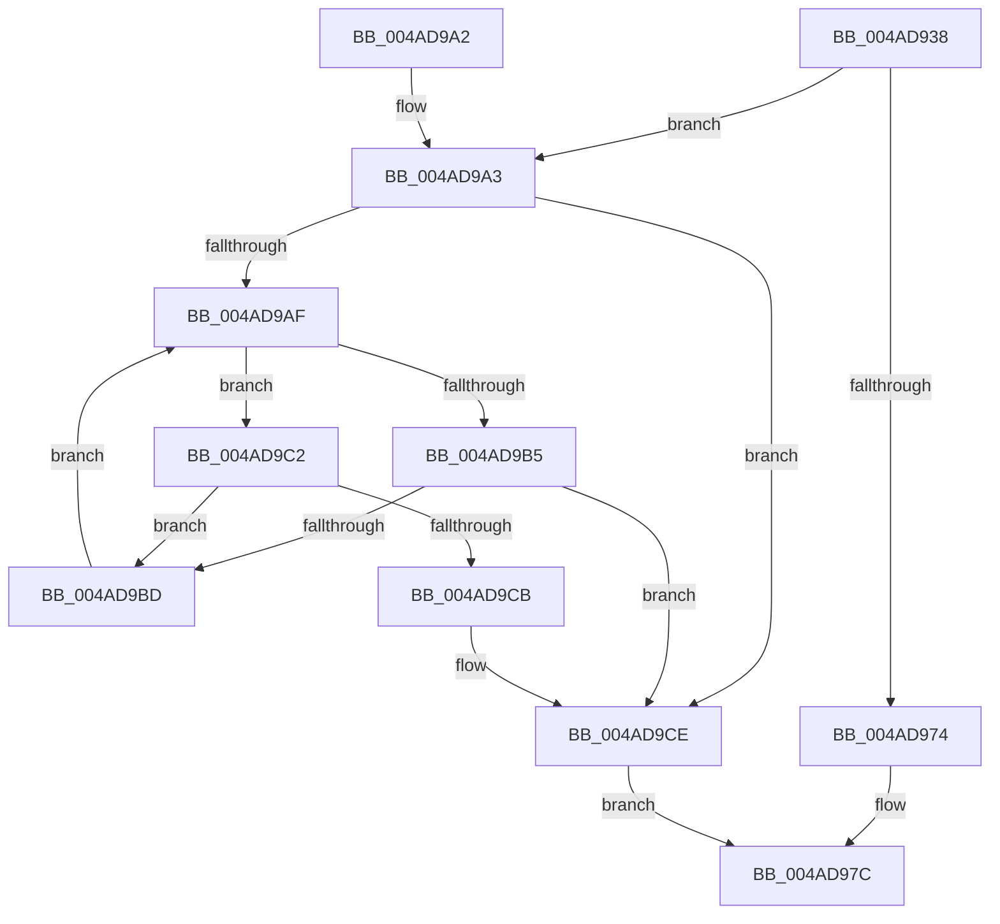

# MiUpdatePerSessionProto

- RVA: `0x004AD938`–`0x004AD9D8` (길이 `160` bytes)
- VA: `0x00000001404AD938`
- 실행 섹션: `.text`
- PDB 이름 있음: `예`; PDB Function 태그: `아니요`
- unwind 정보 RVA: `0x0007EC48`
- 디코드: `49`개 명령, `160/160` bytes 표시
- 미해석 바이트: `0` (있으면 어셈블리에 `.byte`로 보존)

> 이 문서는 커널 이미지의 기계어와 PDB 기호를 분석해 생성했습니다. 4번과 5번은 함수 원형과 자료형을 바이너리 사용 방식에서 추정한 C 해석이며 원본 소스 복구 결과는 아닙니다.

## 1. Dependencies

- 직접 호출 지점: **4**; 고유 호출 대상: **4**
- 직접 호출자로 확인된 함수: **2**
- RIP 상대 이미지 참조: **0**

### Outgoing calls
- `0x004AD961` → [ExAcquireSpinLockExclusive](../24/ExAcquireSpinLockExclusive_function_00248690.md) (function, `0x00248690`)
- `0x004AD977` → [RtlAvlRemoveNode](../29/RtlAvlRemoveNode_function_00296650.md) (function, `0x00296650`)
- `0x004AD982` → [MiReleaseSpinLockExclusive](../24/MiReleaseSpinLockExclusive_function_002482C0.md) (function, `0x002482C0`)
- `0x004AD9D1` → [RtlAvlInsertNodeEx](../26/RtlAvlInsertNodeEx_function_00265790.md) (function, `0x00265790`)

### Direct callers
- [MiDereferenceSubsectionProtos](../../page/A2/MiDereferenceSubsectionProtos_function_00A2EEE4.md) at `0x00A2EF2D`
- [MiCreatePerSessionProtos](../../page/A6/MiCreatePerSessionProtos_function_00A666D8.md) at `0x00A667FE`

### Static image references
- 디코드된 RIP-relative 메모리 참조가 없습니다.

## 2. Other-region calls and transfers

- 다른 실행 섹션으로 향하는 call: **0**
- 별도 외부 분기/꼬리 이동을 확인하지 못했습니다.

## 3. Assembly (complete function range)

```asm
004AD938  48 8B C4                        mov rax, rsp
004AD93B  48 89 58 08                     mov qword ptr [rax + 8], rbx
004AD93F  48 89 68 10                     mov qword ptr [rax + 0x10], rbp
004AD943  48 89 70 18                     mov qword ptr [rax + 0x18], rsi
004AD947  48 89 78 20                     mov qword ptr [rax + 0x20], rdi
004AD94B  41 56                           push r14
004AD94D  48 83 EC 20                     sub rsp, 0x20
004AD951  48 8D 69 48                     lea rbp, [rcx + 0x48]
004AD955  41 8B F9                        mov edi, r9d
004AD958  48 8B CD                        mov rcx, rbp
004AD95B  49 8B F0                        mov rsi, r8
004AD95E  48 8B DA                        mov rbx, rdx
004AD961  E8 2A AD D9 FF                  call 0x140248690
004AD966  45 33 C0                        xor r8d, r8d
004AD969  48 8D 4B 18                     lea rcx, [rbx + 0x18]
004AD96D  44 8A F0                        mov r14b, al
004AD970  85 FF                           test edi, edi
004AD972  75 2F                           jne 0x1404ad9a3
004AD974  48 8B D6                        mov rdx, rsi
004AD977  E8 D4 8C DE FF                  call 0x140296650
004AD97C  41 8A D6                        mov dl, r14b
004AD97F  48 8B CD                        mov rcx, rbp
004AD982  E8 39 A9 D9 FF                  call 0x1402482c0
004AD987  48 8B 5C 24 30                  mov rbx, qword ptr [rsp + 0x30]
004AD98C  48 8B 6C 24 38                  mov rbp, qword ptr [rsp + 0x38]
004AD991  48 8B 74 24 40                  mov rsi, qword ptr [rsp + 0x40]
004AD996  48 8B 7C 24 48                  mov rdi, qword ptr [rsp + 0x48]
004AD99B  48 83 C4 20                     add rsp, 0x20
004AD99F  41 5E                           pop r14
004AD9A1  C3                              ret
004AD9A2  CC                              int3
004AD9A3  48 8B 11                        mov rdx, qword ptr [rcx]
004AD9A6  44 8B 4E 40                     mov r9d, dword ptr [rsi + 0x40]
004AD9AA  48 85 D2                        test rdx, rdx
004AD9AD  74 1F                           je 0x1404ad9ce
004AD9AF  44 3B 4A 40                     cmp r9d, dword ptr [rdx + 0x40]
004AD9B3  73 0D                           jae 0x1404ad9c2
004AD9B5  48 8B 02                        mov rax, qword ptr [rdx]
004AD9B8  48 85 C0                        test rax, rax
004AD9BB  74 11                           je 0x1404ad9ce
004AD9BD  48 8B D0                        mov rdx, rax
004AD9C0  EB ED                           jmp 0x1404ad9af
004AD9C2  48 8B 42 08                     mov rax, qword ptr [rdx + 8]
004AD9C6  48 85 C0                        test rax, rax
004AD9C9  75 F2                           jne 0x1404ad9bd
004AD9CB  41 B0 01                        mov r8b, 1
004AD9CE  4C 8B CE                        mov r9, rsi
004AD9D1  E8 BA 7D DB FF                  call 0x140265790
004AD9D6  EB A4                           jmp 0x1404ad97c
```

## 4. C-style interpretation (structured pseudocode)

```c
__int64 __fastcall MiUpdatePerSessionProto(__int64 a1, __int64 a2, __int64 a3, int a4)
{
    __int64 result;
    __int64 v_rsp;
    unsigned __int64 v_stack_p10;
    unsigned __int64 v_stack_p18;
    unsigned __int64 v_stack_p20;
    unsigned __int64 v_stack_p8;

    *(unsigned __int64 *)(v_rsp + 8) = v_rbx;
    *(unsigned __int64 *)(v_rsp + 16) = v_rbp;
    *(unsigned __int64 *)(v_rsp + 24) = v_rsi;
    *(unsigned __int64 *)(v_rsp + 32) = v_rdi;
    v_rsp = (v_rsp) - (32);
    result = ExAcquireSpinLockExclusive(a1 + 72, a2, a3, a4);
    a3 = 0;
    if ((unsigned int)((unsigned int)(a4)) != 0) goto loc_004AD9A3;
    result = RtlAvlRemoveNode(a2 + 24, 0, a3, a4);
loc_004AD97C:
    result = MiReleaseSpinLockExclusive(a1 + 72, (unsigned __int8)((unsigned __int8)(result)), a3, a4);
    v_rsp = (v_rsp) + (32);
    return result;
loc_004AD9A3:
    if (*(unsigned __int64 *)(a1 + 72) == 0) goto loc_004AD9CE;
loc_004AD9AF:
    if (((unsigned int)((unsigned int)(*(unsigned int *)(v_stack_p18 + 64)))) >= (*(unsigned int *)(*(unsigned __int64 *)(a1 + 72) + 64))) goto loc_004AD9C2;
    if (*(unsigned __int64 *)(*(unsigned __int64 *)(a1 + 72)) == 0) goto loc_004AD9CE;
loc_004AD9BD:
    goto loc_004AD9AF;
loc_004AD9C2:
    if (*(unsigned __int64 *)(*(unsigned __int64 *)(*(unsigned __int64 *)(a1 + 72)) + 8) != 0) goto loc_004AD9BD;
loc_004AD9CE:
    result = RtlAvlInsertNodeEx(a1 + 72, *(unsigned __int64 *)(*(unsigned __int64 *)(a1 + 72)), 1, v_stack_p18);
    goto loc_004AD97C;
}
```

## 5. (Beta) C Style

```c
int64_t MiUpdatePerSessionProto(void *Arg1, void *Arg2, void *Arg3, int32_t Arg4)
{
    uint8_t *arg1 = (uint8_t *)Arg1;
    uint8_t *arg2 = (uint8_t *)Arg2;
    uint8_t *arg3 = (uint8_t *)Arg3;

    int64_t result;
    int64_t local_rsp;
    uint64_t v_stack_p10;
    uint64_t v_stack_p18;
    uint64_t v_stack_p20;
    uint64_t v_stack_p8;

    *(uint64_t *)(local_rsp + 0x8) = local_rbx;
    *(uint64_t *)(local_rsp + 0x10) = local_rbp;
    *(uint64_t *)(local_rsp + 0x18) = local_rsi;
    *(uint64_t *)(local_rsp + 0x20) = local_rdi;
    local_rsp = (local_rsp) - (32);
    result = ExAcquireSpinLockExclusive(Arg1 + 72, Arg2, Arg3, Arg4);
    Arg3 = 0;
    if ((uint32_t)((uint32_t)(Arg4)) != 0) goto loc_004AD9A3;
    result = RtlAvlRemoveNode(Arg2 + 24, 0, Arg3, Arg4);
loc_004AD97C:
    result = MiReleaseSpinLockExclusive(Arg1 + 72, (uint8_t)((uint8_t)(result)), Arg3, Arg4);
    local_rsp = (local_rsp) + (32);
    return result;
loc_004AD9A3:
    if (*(uint64_t *)(arg1 + 0x48) == 0) goto loc_004AD9CE;
loc_004AD9AF:
    if (((uint32_t)((uint32_t)(*(uint32_t *)(v_stack_p18 + 0x40)))) >= (*(uint32_t *)(*(uint64_t *)(arg1 + 0x48) + 0x40))) goto loc_004AD9C2;
    if (*(uint64_t *)(*(uint64_t *)(arg1 + 0x48)) == 0) goto loc_004AD9CE;
loc_004AD9BD:
    goto loc_004AD9AF;
loc_004AD9C2:
    if (*(uint64_t *)(*(uint64_t *)(*(uint64_t *)(arg1 + 0x48)) + 0x8) != 0) goto loc_004AD9BD;
loc_004AD9CE:
    result = RtlAvlInsertNodeEx(Arg1 + 72, *(uint64_t *)(*(uint64_t *)(arg1 + 0x48)), 1, v_stack_p18);
    goto loc_004AD97C;
}
```

### 관측된 메모리 오프셋

구조체 형식이 확인되지 않은 접근은 인자 기준의 오프셋으로만 기록했습니다.

| 기준 인자 | 오프셋 표현 | 폭 (bit) | 접근 |
|---|---:|---:|---|
| `Arg1` | `+ 0x48` | `64` | `R` |
| `Arg2` | `+ 0x0` | `64` | `R` |
| `Arg2` | `+ 0x18` | `64` | `R` |
| `Arg3` | `+ 0x40` | `32` | `R` |

## 6. Execution-region graph

[열기: 2D/3D 그래프와 함수 탐색 컨트롤 패널](../../../control-panel.html?section=text&rva=0x004AD938&view=graph)

- 2D 그래프는 위에서 아래로 흐르고, 3D 그래프는 빈 공간을 드래그해 회전합니다. Shift+드래그는 이동, 휠은 확대·축소, 함수 노드 선택은 대상 보고서 이동입니다.

### Static fallback


