# MiValidateMdlAllocationRequest

- RVA: `0x004A280C`–`0x004A2B36` (길이 `810` bytes)
- VA: `0x00000001404A280C`
- 실행 섹션: `.text`
- PDB 이름 있음: `예`; PDB Function 태그: `예`
- unwind 정보 RVA: `0x000B5F20`
- 디코드: `192`개 명령, `810/810` bytes 표시
- 미해석 바이트: `0` (있으면 어셈블리에 `.byte`로 보존)

> 이 문서는 커널 이미지의 기계어와 PDB 기호를 분석해 생성했습니다. 4번과 5번은 함수 원형과 자료형을 바이너리 사용 방식에서 추정한 C 해석이며 원본 소스 복구 결과는 아닙니다.

## 1. Dependencies

- 직접 호출 지점: **2**; 고유 호출 대상: **2**
- 직접 호출자로 확인된 함수: **1**
- RIP 상대 이미지 참조: **3**

### Outgoing calls
- `0x004A2839` → [memset](../6C/memset_function_006C6C40.md) (function, `0x006C6C40`)
- `0x004A2B2C` → [MiInitializeDemandCoalesceContext](../3D/MiInitializeDemandCoalesceContext_function_003D3350.md) (function, `0x003D3350`)

### Direct callers
- [MiAllocatePagesForMdl](../3E/MiAllocatePagesForMdl_function_003EABEC.md) at `0x003EAC92`

### Static image references
- `0x004A2878` → RVA `0x00E2DCE0` (`.data`; read)
- `0x004A29EE` → RVA `0x00E38D00` (`.data`; read)
- `0x004A2ACA` → RVA `0x00011C60` (`.rdata`; read)

## 2. Other-region calls and transfers

- 다른 실행 섹션으로 향하는 call: **0**
- call이 아닌 외부 분기/꼬리 이동: **8**
  - `0x004A2A5E` → [sub_006F87D6](../6F/Unknown_function_006F87D6.md) (`tail-transfer`)
  - `0x004A2A6B` → [sub_006F87D6 + 0x1E](../6F/Unknown_function_006F87D6.md) (`tail-transfer`)
  - `0x004A2AD1` → [sub_006F87D6 + 0x34](../6F/Unknown_function_006F87D6.md) (`tail-transfer`)
  - `0x004A2ADA` → [sub_006F87D6 + 0x97](../6F/Unknown_function_006F87D6.md) (`tail-transfer`)
  - `0x004A2AE4` → [sub_006F87D6 + 0x74](../6F/Unknown_function_006F87D6.md) (`tail-transfer`)
  - `0x004A2AF5` → [sub_006F87D6 + 0x7F](../6F/Unknown_function_006F87D6.md) (`tail-transfer`)
  - `0x004A2AFE` → [sub_006F87D6 + 0x7F](../6F/Unknown_function_006F87D6.md) (`tail-transfer`)
  - `0x004A2B04` → [sub_006F87D6 + 0x97](../6F/Unknown_function_006F87D6.md) (`tail-transfer`)

## 3. Assembly (complete function range)

```asm
004A280C  48 8B C4                        mov rax, rsp
004A280F  48 89 58 08                     mov qword ptr [rax + 8], rbx
004A2813  48 89 70 10                     mov qword ptr [rax + 0x10], rsi
004A2817  48 89 78 18                     mov qword ptr [rax + 0x18], rdi
004A281B  4C 89 70 20                     mov qword ptr [rax + 0x20], r14
004A281F  41 57                           push r15
004A2821  48 83 EC 20                     sub rsp, 0x20
004A2825  49 8B F0                        mov rsi, r8
004A2828  4C 8B F2                        mov r14, rdx
004A282B  33 D2                           xor edx, edx
004A282D  41 B8 98 00 00 00               mov r8d, 0x98
004A2833  49 8B F9                        mov rdi, r9
004A2836  48 8B D9                        mov rbx, rcx
004A2839  E8 02 44 22 00                  call 0x1406c6c40
004A283E  44 8B 54 24 70                  mov r10d, dword ptr [rsp + 0x70]
004A2843  48 8D 8B 94 00 00 00            lea rcx, [rbx + 0x94]
004A284A  41 0F BA E2 16                  bt r10d, 0x16
004A284F  0F 82 AF 01 00 00               jb 0x1404a2a04
004A2855  B8 02 00 00 00                  mov eax, 2
004A285A  41 0F BA E2 08                  bt r10d, 8
004A285F  0F 82 89 01 00 00               jb 0x1404a29ee
004A2865  41 8B 46 04                     mov eax, dword ptr [r14 + 4]
004A2869  41 B8 10 00 00 00               mov r8d, 0x10
004A286F  41 84 C0                        test r8b, al
004A2872  0F 85 9D 01 00 00               jne 0x1404a2a15
004A2878  48 8B 05 61 B4 98 00            mov rax, qword ptr [rip + 0x98b461]
004A287F  48 C1 EE 0C                     shr rsi, 0xc
004A2883  48 C1 EF 0C                     shr rdi, 0xc
004A2887  48 3B F8                        cmp rdi, rax
004A288A  0F 82 3A 01 00 00               jb 0x1404a29ca
004A2890  48 8B F8                        mov rdi, rax
004A2893  48 85 F6                        test rsi, rsi
004A2896  75 05                           jne 0x1404a289d
004A2898  41 0F BA EA 10                  bts r10d, 0x10
004A289D  4C 8B 5C 24 50                  mov r11, qword ptr [rsp + 0x50]
004A28A2  41 F7 C3 FF 0F 00 00            test r11d, 0xfff
004A28A9  0F 85 2D 01 00 00               jne 0x1404a29dc
004A28AF  49 C1 EB 0C                     shr r11, 0xc
004A28B3  49 8D 43 FF                     lea rax, [r11 - 1]
004A28B7  49 85 C3                        test r11, rax
004A28BA  0F 85 5D 01 00 00               jne 0x1404a2a1d
004A28C0  44 8B 4C 24 60                  mov r9d, dword ptr [rsp + 0x60]
004A28C5  41 0F BA E2 0A                  bt r10d, 0xa
004A28CA  0F 82 5B 01 00 00               jb 0x1404a2a2b
004A28D0  41 BF 01 00 00 00               mov r15d, 1
004A28D6  4C 89 7B 30                     mov qword ptr [rbx + 0x30], r15
004A28DA  41 8B CF                        mov ecx, r15d
004A28DD  45 85 D2                        test r10d, r10d
004A28E0  0F 88 73 01 00 00               js 0x1404a2a59
004A28E6  B8 00 F0 FF FF                  mov eax, 0xfffff000
004A28EB  48 8B D1                        mov rdx, rcx
004A28EE  48 0F AF D0                     imul rdx, rax
004A28F2  48 8B 44 24 58                  mov rax, qword ptr [rsp + 0x58]
004A28F7  48 3B C2                        cmp rax, rdx
004A28FA  0F 87 70 01 00 00               ja 0x1404a2a70
004A2900  48 8D 88 FF 0F 00 00            lea rcx, [rax + 0xfff]
004A2907  48 C1 E9 0C                     shr rcx, 0xc
004A290B  41 F6 C2 40                     test r10b, 0x40
004A290F  0F 85 99 01 00 00               jne 0x1404a2aae
004A2915  41 8B 46 04                     mov eax, dword ptr [r14 + 4]
004A2919  F7 D0                           not eax
004A291B  49 23 C0                        and rax, r8
004A291E  48 C1 E0 06                     shl rax, 6
004A2922  48 89 43 28                     mov qword ptr [rbx + 0x28], rax
004A2926  4D 8B 86 40 49 00 00            mov r8, qword ptr [r14 + 0x4940]
004A292D  4C 2B 43 28                     sub r8, qword ptr [rbx + 0x28]
004A2931  4D 85 C0                        test r8, r8
004A2934  0F 8E A2 00 00 00               jle 0x1404a29dc
004A293A  49 3B C8                        cmp rcx, r8
004A293D  0F 87 93 01 00 00               ja 0x1404a2ad6
004A2943  4C 8B C1                        mov r8, rcx
004A2946  48 85 C9                        test rcx, rcx
004A2949  0F 84 8D 00 00 00               je 0x1404a29dc
004A294F  8B 44 24 68                     mov eax, dword ptr [rsp + 0x68]
004A2953  8B 93 94 00 00 00               mov edx, dword ptr [rbx + 0x94]
004A2959  F6 C2 02                        test dl, 2
004A295C  89 43 3C                        mov dword ptr [rbx + 0x3c], eax
004A295F  48 8B 44 24 78                  mov rax, qword ptr [rsp + 0x78]
004A2964  0F 94 C1                        sete cl
004A2967  41 0F BA E2 10                  bt r10d, 0x10
004A296C  48 89 43 48                     mov qword ptr [rbx + 0x48], rax
004A2970  4C 89 33                        mov qword ptr [rbx], r14
004A2973  0F 93 C0                        setae al
004A2976  44 89 53 38                     mov dword ptr [rbx + 0x38], r10d
004A297A  48 89 73 08                     mov qword ptr [rbx + 8], rsi
004A297E  48 89 7B 10                     mov qword ptr [rbx + 0x10], rdi
004A2982  4C 89 5B 18                     mov qword ptr [rbx + 0x18], r11
004A2986  44 89 8B 90 00 00 00            mov dword ptr [rbx + 0x90], r9d
004A298D  4C 89 43 20                     mov qword ptr [rbx + 0x20], r8
004A2991  84 C8                           test al, cl
004A2993  75 4E                           jne 0x1404a29e3
004A2995  44 0F 20 C1                     mov rcx, cr8
004A2999  80 F9 02                        cmp cl, 2
004A299C  0F 84 67 01 00 00               je 0x1404a2b09
004A29A2  41 F6 C2 40                     test r10b, 0x40
004A29A6  0F 85 6B 01 00 00               jne 0x1404a2b17
004A29AC  33 C0                           xor eax, eax
004A29AE  48 8B 5C 24 30                  mov rbx, qword ptr [rsp + 0x30]
004A29B3  48 8B 74 24 38                  mov rsi, qword ptr [rsp + 0x38]
004A29B8  48 8B 7C 24 40                  mov rdi, qword ptr [rsp + 0x40]
004A29BD  4C 8B 74 24 48                  mov r14, qword ptr [rsp + 0x48]
004A29C2  48 83 C4 20                     add rsp, 0x20
004A29C6  41 5F                           pop r15
004A29C8  C3                              ret
004A29C9  CC                              int3
004A29CA  49 3B BE 48 48 00 00            cmp rdi, qword ptr [r14 + 0x4848]
004A29D1  0F 82 C6 FE FF FF               jb 0x1404a289d
004A29D7  E9 B7 FE FF FF                  jmp 0x1404a2893
004A29DC  B8 0D 00 00 C0                  mov eax, 0xc000000d
004A29E1  EB CB                           jmp 0x1404a29ae
004A29E3  83 CA 02                        or edx, 2
004A29E6  89 93 94 00 00 00               mov dword ptr [rbx + 0x94], edx
004A29EC  EB A7                           jmp 0x1404a2995
004A29EE  48 8D 15 0B 63 99 00            lea rdx, [rip + 0x99630b]
004A29F5  4C 3B F2                        cmp r14, rdx
004A29F8  75 E2                           jne 0x1404a29dc
004A29FA  83 C8 08                        or eax, 8
004A29FD  89 01                           mov dword ptr [rcx], eax
004A29FF  E9 61 FE FF FF                  jmp 0x1404a2865
004A2A04  B8 1A 00 00 00                  mov eax, 0x1a
004A2A09  41 0F BA F2 16                  btr r10d, 0x16
004A2A0E  89 01                           mov dword ptr [rcx], eax
004A2A10  E9 45 FE FF FF                  jmp 0x1404a285a
004A2A15  83 09 02                        or dword ptr [rcx], 2
004A2A18  E9 5B FE FF FF                  jmp 0x1404a2878
004A2A1D  41 F6 C2 40                     test r10b, 0x40
004A2A21  75 B9                           jne 0x1404a29dc
004A2A23  45 33 DB                        xor r11d, r11d
004A2A26  E9 95 FE FF FF                  jmp 0x1404a28c0
004A2A2B  41 F7 C2 70 03 00 00            test r10d, 0x370
004A2A32  75 A8                           jne 0x1404a29dc
004A2A34  B9 01 00 01 00                  mov ecx, 0x10001
004A2A39  41 8B C2                        mov eax, r10d
004A2A3C  23 C1                           and eax, ecx
004A2A3E  3B C1                           cmp eax, ecx
004A2A40  75 9A                           jne 0x1404a29dc
004A2A42  41 8D 41 FF                     lea eax, [r9 - 1]
004A2A46  A9 FD FF FF FF                  test eax, 0xfffffffd
004A2A4B  75 8F                           jne 0x1404a29dc
004A2A4D  44 09 83 94 00 00 00            or dword ptr [rbx + 0x94], r8d
004A2A54  E9 77 FE FF FF                  jmp 0x1404a28d0
004A2A59  41 0F BA E2 0C                  bt r10d, 0xc
004A2A5E  0F 83 72 5D 25 00               jae 0x1406f87d6
004A2A64  4C 89 43 30                     mov qword ptr [rbx + 0x30], r8
004A2A68  49 8B C8                        mov rcx, r8
004A2A6B  E9 84 5D 25 00                  jmp 0x1406f87f4
004A2A70  41 F6 C2 04                     test r10b, 4
004A2A74  0F 85 62 FF FF FF               jne 0x1404a29dc
004A2A7A  48 8B C2                        mov rax, rdx
004A2A7D  41 F6 C2 60                     test r10b, 0x60
004A2A81  0F 84 79 FE FF FF               je 0x1404a2900
004A2A87  49 3B CF                        cmp rcx, r15
004A2A8A  0F 85 70 FE FF FF               jne 0x1404a2900
004A2A90  4D 85 DB                        test r11, r11
004A2A93  0F 84 67 FE FF FF               je 0x1404a2900
004A2A99  49 8B C3                        mov rax, r11
004A2A9C  48 C1 E0 0C                     shl rax, 0xc
004A2AA0  49 2B C7                        sub rax, r15
004A2AA3  48 F7 D0                        not rax
004A2AA6  48 23 C2                        and rax, rdx
004A2AA9  E9 52 FE FF FF                  jmp 0x1404a2900
004A2AAE  48 F7 C6 FF FF EF FF            test rsi, -0x100001
004A2AB5  0F 85 21 FF FF FF               jne 0x1404a29dc
004A2ABB  49 3B BE 48 48 00 00            cmp rdi, qword ptr [r14 + 0x4848]
004A2AC2  0F 82 14 FF FF FF               jb 0x1404a29dc
004A2AC8  33 C0                           xor eax, eax
004A2ACA  48 8D 15 8F F1 B6 FF            lea rdx, [rip - 0x490e71]
004A2AD1  E9 34 5D 25 00                  jmp 0x1406f880a
004A2AD6  41 F6 C2 04                     test r10b, 4
004A2ADA  0F 85 8D 5D 25 00               jne 0x1406f886d
004A2AE0  41 F6 C2 40                     test r10b, 0x40
004A2AE4  0F 84 60 5D 25 00               je 0x1406f884a
004A2AEA  33 D2                           xor edx, edx
004A2AEC  49 8B C0                        mov rax, r8
004A2AEF  49 F7 F3                        div r11
004A2AF2  48 85 D2                        test rdx, rdx
004A2AF5  0F 84 5A 5D 25 00               je 0x1406f8855
004A2AFB  4D 3B C3                        cmp r8, r11
004A2AFE  0F 83 51 5D 25 00               jae 0x1406f8855
004A2B04  E9 64 5D 25 00                  jmp 0x1406f886d
004A2B09  83 CA 04                        or edx, 4
004A2B0C  89 93 94 00 00 00               mov dword ptr [rbx + 0x94], edx
004A2B12  E9 8B FE FF FF                  jmp 0x1404a29a2
004A2B17  33 D2                           xor edx, edx
004A2B19  48 8D 4B 50                     lea rcx, [rbx + 0x50]
004A2B1D  49 8B C0                        mov rax, r8
004A2B20  45 8B CF                        mov r9d, r15d
004A2B23  49 F7 F3                        div r11
004A2B26  49 8B D3                        mov rdx, r11
004A2B29  4C 8B C0                        mov r8, rax
004A2B2C  E8 1F 08 F3 FF                  call 0x1403d3350
004A2B31  E9 76 FE FF FF                  jmp 0x1404a29ac
```

## 4. C-style interpretation (structured pseudocode)

```c
__int64 __fastcall MiValidateMdlAllocationRequest(__int64 a1, __int64 a2, __int64 a3, __int64 a4, __int64 a5, __int64 a6, unsigned int a7, unsigned int a8, unsigned int a9, __int64 a10)
{
    __int64 result;
    __int64 v_r11;
    __int64 v_rdi;
    __int64 v_rsi;
    __int64 v_rsp;
    unsigned __int64 v_stack_p10;
    unsigned __int64 v_stack_p18;
    unsigned __int64 v_stack_p20;
    unsigned __int64 v_stack_p8;

    *(unsigned __int64 *)(v_rsp + 8) = v_rbx;
    *(unsigned __int64 *)(v_rsp + 16) = v_rsi;
    *(unsigned __int64 *)(v_rsp + 24) = v_rdi;
    *(unsigned __int64 *)(v_rsp + 32) = v_r14;
    v_rsp = (v_rsp) - (32);
    a2 = 0;
    result = memset(a1, a2, 152, a4);
    if (condition_is_below) goto loc_004A2A04;
loc_004A285A:
    if (condition_is_below) goto loc_004A29EE;
loc_004A2865:
    if (((16) & ((unsigned __int8)((unsigned int)(*(unsigned int *)(a2 + 4))))) != 0) goto loc_004A2A15;
loc_004A2878:
    v_rsi = (a3) >> (12);
    v_rdi = (a4) >> (12);
    if (v_rdi < (*(unsigned __int64 *)(v_rip + 10007649))) goto loc_004A29CA;
loc_004A2893:
    if (v_rsi == 0) {
    }
    if ((((unsigned int)(a5)) & (0xFFFULL)) != 0) goto loc_004A29DC;
    v_r11 = (a5) >> (12);
    if (((v_r11) & (v_r11 - 1)) != 0) goto loc_004A2A1D;
loc_004A28C0:
    if (condition_is_below) goto loc_004A2A2B;
loc_004A28D0:
    *(unsigned __int64 *)(a1 + 48) = 1;
    if (sign_flag) goto loc_004A2A59;
    a2 = (1) * ((unsigned int)(0xFFFFF000ULL));
    if (a6 > a2) goto loc_004A2A70;
loc_004A2900:
    a1 = (a6 + 4095) >> (12);
    if ((((unsigned __int8)((unsigned int)(a9))) & (64)) != 0) goto loc_004A2AAE;
    result = (unsigned int)(~((unsigned int)(*(unsigned int *)(a2 + 4))));
    result = (result) & (16);
    result = (result) << (6);
    *(unsigned __int64 *)(a1 + 40) = result;
    a3 = (*(unsigned __int64 *)(a2 + 18752)) - (*(unsigned __int64 *)(a1 + 40));
    if (condition_is_less_or_equal) goto loc_004A29DC;
    if (a1 > a3) goto loc_004A2AD6;
    if (a1 == 0) goto loc_004A29DC;
    *(unsigned int *)(a1 + 60) = (unsigned int)((unsigned int)(a8));
    a1 = ((((unsigned __int8)((unsigned int)(*(unsigned int *)(a1 + 148)))) & (2)) == 0) ? 1 : 0;
    *(unsigned __int64 *)(a1 + 72) = a10;
    *(unsigned __int64 *)(a1) = a2;
    result = (condition_is_above_or_equal) ? 1 : 0;
    *(unsigned int *)(a1 + 56) = (unsigned int)((unsigned int)(a9));
    *(unsigned __int64 *)(a1 + 8) = v_rsi;
    *(unsigned __int64 *)(a1 + 16) = *(unsigned __int64 *)(v_rip + 10007649);
    *(unsigned __int64 *)(a1 + 24) = v_r11;
    *(unsigned int *)(a1 + 144) = (unsigned int)((unsigned int)(a7));
    *(unsigned __int64 *)(a1 + 32) = a1;
    if ((((unsigned __int8)(result)) & ((unsigned __int8)(a1))) != 0) goto loc_004A29E3;
loc_004A2995:
    if (((unsigned __int8)(v_cr8)) == 2) goto loc_004A2B09;
loc_004A29A2:
    if ((((unsigned __int8)((unsigned int)(a9))) & (64)) != 0) goto loc_004A2B17;
loc_004A29AC:
    result = 0;
loc_004A29AE:
    v_rsp = (v_rsp) + (32);
    return result;
loc_004A29CA:
    if (v_stack_p18 < (*(unsigned __int64 *)(v_stack_p20 + 18504))) goto loc_004A289D;
    goto loc_004A2893;
loc_004A29DC:
    goto loc_004A29AE;
loc_004A29E3:
    a2 = (unsigned int)(((unsigned int)(*(unsigned int *)(a1 + 148))) | (2));
    *(unsigned int *)(v_stack_p8 + 148) = (unsigned int)(a2);
    goto loc_004A2995;
loc_004A29EE:
    if (v_stack_p20 != (v_rip + 10052363)) goto loc_004A29DC;
    result = (unsigned int)(((unsigned int)(0xC000000DULL)) | (8));
    *(unsigned int *)(v_cr8) = (unsigned int)(result);
    goto loc_004A2865;
loc_004A2A04:
    *(unsigned int *)(v_cr8) = 26;
    goto loc_004A285A;
loc_004A2A15:
    goto loc_004A2878;
loc_004A2A1D:
    if ((((unsigned __int8)((unsigned int)(a9))) & (64)) != 0) goto loc_004A29DC;
    v_r11 = 0;
    goto loc_004A28C0;
loc_004A2A2B:
    if ((((unsigned int)((unsigned int)(a9))) & (880)) != 0) goto loc_004A29DC;
    result = (unsigned int)(((unsigned int)((unsigned int)((unsigned int)(a9)))) & ((unsigned int)((unsigned int)(0x10001ULL))));
    if (((unsigned int)(result)) != ((unsigned int)((unsigned int)(0x10001ULL)))) goto loc_004A29DC;
    if ((((unsigned int)((unsigned int)(a7) - 1)) & (0xFFFFFFFDULL)) != 0) goto loc_004A29DC;
    goto loc_004A28D0;
loc_004A2A59:
    *(unsigned __int64 *)(v_stack_p8 + 48) = a1;
loc_004A2A70:
    if ((((unsigned __int8)((unsigned int)(a9))) & (4)) != 0) goto loc_004A29DC;
    if ((((unsigned __int8)((unsigned int)(a9))) & (96)) == 0) goto loc_004A2900;
    if (a1 != 1) goto loc_004A2900;
    if (0 == 0) goto loc_004A2900;
    result = (0) << (12);
    result = (result) - (1);
    result = ~(result);
    result = (result) & (v_rip + 10052363);
    goto loc_004A2900;
loc_004A2AAE:
    if (((v_stack_p10) & (0xFFFFFFFFFFEFFFFFULL)) != 0) goto loc_004A29DC;
    if (v_stack_p18 < (*(unsigned __int64 *)(v_stack_p20 + 18504))) goto loc_004A29DC;
    result = 0;
loc_004A2AD6:
    a2 = 0;
loc_004A2B09:
    a2 = (unsigned int)((a2) | (4));
    *(unsigned int *)(v_stack_p8 + 148) = (unsigned int)(a2);
    goto loc_004A29A2;
loc_004A2B17:
    a2 = 0;
    result = MiInitializeDemandCoalesceContext(v_stack_p8 + 80, 0, a1, 1);
    goto loc_004A29AC;
}
```

## 5. (Beta) C Style

```c
int64_t MiValidateMdlAllocationRequest(void *Arg1, int64_t Arg2, int64_t Arg3, int64_t Arg4, int64_t Arg5, int64_t Arg6, void *Arg7, uint32_t Arg8, uint32_t Arg9, int64_t Arg10)
{
    uint8_t *arg1 = (uint8_t *)Arg1;
    uint8_t *arg7 = (uint8_t *)Arg7;

    int64_t result;
    int64_t local_r11;
    int64_t local_rdi;
    int64_t local_rsi;
    int64_t local_rsp;
    uint64_t v_stack_p10;
    uint64_t v_stack_p18;
    uint64_t v_stack_p20;
    uint64_t v_stack_p8;

    *(uint64_t *)(local_rsp + 0x8) = local_rbx;
    *(uint64_t *)(local_rsp + 0x10) = local_rsi;
    *(uint64_t *)(local_rsp + 0x18) = local_rdi;
    *(uint64_t *)(local_rsp + 0x20) = local_r14;
    local_rsp = (local_rsp) - (32);
    Arg2 = 0;
    result = memset(Arg1, Arg2, 152, Arg4);
    if (condition_is_below) goto loc_004A2A04;
loc_004A285A:
    if (condition_is_below) goto loc_004A29EE;
loc_004A2865:
    if (((16) & ((uint8_t)((uint32_t)(*(uint32_t *)(Arg2 + 0x4))))) != 0) goto loc_004A2A15;
loc_004A2878:
    local_rsi = (Arg3) >> (12);
    local_rdi = (Arg4) >> (12);
    if (local_rdi < (*(uint64_t *)(v_rip + 0x98B461))) goto loc_004A29CA;
loc_004A2893:
    if (local_rsi == 0) {
    }
    if ((((uint32_t)(Arg5)) & (0xFFFULL)) != 0) goto loc_004A29DC;
    local_r11 = (Arg5) >> (12);
    if (((local_r11) & (local_r11 - 1)) != 0) goto loc_004A2A1D;
loc_004A28C0:
    if (condition_is_below) goto loc_004A2A2B;
loc_004A28D0:
    *(uint64_t *)(arg1 + 0x30) = 1;
    if (sign_flag) goto loc_004A2A59;
    Arg2 = (1) * ((uint32_t)(0xFFFFF000ULL));
    if (Arg6 > Arg2) goto loc_004A2A70;
loc_004A2900:
    Arg1 = (Arg6 + 4095) >> (12);
    if ((((uint8_t)((uint32_t)(Arg9))) & (64)) != 0) goto loc_004A2AAE;
    result = (uint32_t)(~((uint32_t)(*(uint32_t *)(Arg2 + 0x4))));
    result = (result) & (16);
    result = (result) << (6);
    *(uint64_t *)(arg1 + 0x28) = result;
    Arg3 = (*(uint64_t *)(Arg2 + 0x4940)) - (*(uint64_t *)(arg1 + 0x28));
    if (condition_is_less_or_equal) goto loc_004A29DC;
    if (Arg1 > Arg3) goto loc_004A2AD6;
    if (Arg1 == NULL) goto loc_004A29DC;
    *(uint32_t *)(arg1 + 0x3C) = (uint32_t)((uint32_t)(Arg8));
    Arg1 = ((((uint8_t)((uint32_t)(*(uint32_t *)(arg1 + 0x94)))) & (2)) == 0) ? 1 : 0;
    *(uint64_t *)(arg1 + 0x48) = Arg10;
    *(uint64_t *)(arg1) = Arg2;
    result = (condition_is_above_or_equal) ? 1 : 0;
    *(uint32_t *)(arg1 + 0x38) = (uint32_t)((uint32_t)(Arg9));
    *(uint64_t *)(arg1 + 0x8) = local_rsi;
    *(uint64_t *)(arg1 + 0x10) = *(uint64_t *)(v_rip + 0x98B461);
    *(uint64_t *)(arg1 + 0x18) = local_r11;
    *(uint32_t *)(arg1 + 0x90) = (uint32_t)((uint32_t)(Arg7));
    *(void **)(arg1 + 0x20) = Arg1;
    if ((((uint8_t)(result)) & ((uint8_t)(Arg1))) != 0) goto loc_004A29E3;
loc_004A2995:
    if (((uint8_t)(v_cr8)) == 2) goto loc_004A2B09;
loc_004A29A2:
    if ((((uint8_t)((uint32_t)(Arg9))) & (64)) != 0) goto loc_004A2B17;
loc_004A29AC:
    result = 0;
loc_004A29AE:
    local_rsp = (local_rsp) + (32);
    return result;
loc_004A29CA:
    if (v_stack_p18 < (*(uint64_t *)(v_stack_p20 + 0x4848))) goto loc_004A289D;
    goto loc_004A2893;
loc_004A29DC:
    goto loc_004A29AE;
loc_004A29E3:
    Arg2 = (uint32_t)(((uint32_t)(*(uint32_t *)(arg1 + 0x94))) | (2));
    *(uint32_t *)(v_stack_p8 + 0x94) = (uint32_t)(Arg2);
    goto loc_004A2995;
loc_004A29EE:
    if (v_stack_p20 != (v_rip + 10052363)) goto loc_004A29DC;
    result = (uint32_t)(((uint32_t)(0xC000000DULL)) | (8));
    *(uint32_t *)(v_cr8) = (uint32_t)(result);
    goto loc_004A2865;
loc_004A2A04:
    *(uint32_t *)(v_cr8) = 26;
    goto loc_004A285A;
loc_004A2A15:
    goto loc_004A2878;
loc_004A2A1D:
    if ((((uint8_t)((uint32_t)(Arg9))) & (64)) != 0) goto loc_004A29DC;
    local_r11 = 0;
    goto loc_004A28C0;
loc_004A2A2B:
    if ((((uint32_t)((uint32_t)(Arg9))) & (880)) != 0) goto loc_004A29DC;
    result = (uint32_t)(((uint32_t)((uint32_t)((uint32_t)(Arg9)))) & ((uint32_t)((uint32_t)(0x10001ULL))));
    if (((uint32_t)(result)) != ((uint32_t)((uint32_t)(0x10001ULL)))) goto loc_004A29DC;
    if ((((uint32_t)((uint32_t)(Arg7) - 1)) & (0xFFFFFFFDULL)) != 0) goto loc_004A29DC;
    goto loc_004A28D0;
loc_004A2A59:
    *(void **)(v_stack_p8 + 0x30) = Arg1;
loc_004A2A70:
    if ((((uint8_t)((uint32_t)(Arg9))) & (4)) != 0) goto loc_004A29DC;
    if ((((uint8_t)((uint32_t)(Arg9))) & (96)) == 0) goto loc_004A2900;
    if (Arg1 != 1) goto loc_004A2900;
    if (0 == 0) goto loc_004A2900;
    result = (0) << (12);
    result = (result) - (1);
    result = ~(result);
    result = (result) & (v_rip + 10052363);
    goto loc_004A2900;
loc_004A2AAE:
    if (((v_stack_p10) & (0xFFFFFFFFFFEFFFFFULL)) != 0) goto loc_004A29DC;
    if (v_stack_p18 < (*(uint64_t *)(v_stack_p20 + 0x4848))) goto loc_004A29DC;
    result = 0;
loc_004A2AD6:
    Arg2 = 0;
loc_004A2B09:
    Arg2 = (uint32_t)((Arg2) | (4));
    *(uint32_t *)(v_stack_p8 + 0x94) = (uint32_t)(Arg2);
    goto loc_004A29A2;
loc_004A2B17:
    Arg2 = 0;
    result = MiInitializeDemandCoalesceContext(v_stack_p8 + 80, 0, Arg1, 1);
    goto loc_004A29AC;
}
```

### 관측된 메모리 오프셋

구조체 형식이 확인되지 않은 접근은 인자 기준의 오프셋으로만 기록했습니다.

| 기준 인자 | 오프셋 표현 | 폭 (bit) | 접근 |
|---|---:|---:|---|
| `Arg1` | `+ 0x0` | `32` | `R/W` |
| `Arg1` | `+ 0x0` | `32` | `W` |
| `Arg1` | `+ 0x0` | `64` | `W` |
| `Arg1` | `+ 0x8` | `64` | `W` |
| `Arg1` | `+ 0x10` | `64` | `W` |
| `Arg1` | `+ 0x18` | `64` | `W` |
| `Arg1` | `+ 0x20` | `64` | `W` |
| `Arg1` | `+ 0x28` | `64` | `R` |
| `Arg1` | `+ 0x28` | `64` | `W` |
| `Arg1` | `+ 0x30` | `64` | `W` |
| `Arg1` | `+ 0x38` | `32` | `W` |
| `Arg1` | `+ 0x3C` | `32` | `W` |
| `Arg1` | `+ 0x48` | `64` | `W` |
| `Arg1` | `+ 0x50` | `64` | `R` |
| `Arg1` | `+ 0x90` | `32` | `W` |
| `Arg1` | `+ 0x94` | `32` | `R` |
| `Arg1` | `+ 0x94` | `32` | `R/W` |
| `Arg1` | `+ 0x94` | `32` | `W` |
| `Arg1` | `+ 0x94` | `64` | `R` |
| `Arg7` | `- 0x1` | `32` | `R` |

## 6. Execution-region graph

[열기: 2D/3D 그래프와 함수 탐색 컨트롤 패널](../../../control-panel.html?section=text&rva=0x004A280C&view=graph)

- 2D 그래프는 위에서 아래로 흐르고, 3D 그래프는 빈 공간을 드래그해 회전합니다. Shift+드래그는 이동, 휠은 확대·축소, 함수 노드 선택은 대상 보고서 이동입니다.

### Static fallback

```mermaid
flowchart TD
  bb_004A280C[BB_004A280C]
  bb_004A2855[BB_004A2855]
  bb_004A285A[BB_004A285A]
  bb_004A2865[BB_004A2865]
  bb_004A2878[BB_004A2878]
  bb_004A2890[BB_004A2890]
  bb_004A2893[BB_004A2893]
  bb_004A2898[BB_004A2898]
  bb_004A289D[BB_004A289D]
  bb_004A28AF[BB_004A28AF]
  bb_004A28C0[BB_004A28C0]
  bb_004A28D0[BB_004A28D0]
  bb_004A28E6[BB_004A28E6]
  bb_004A2900[BB_004A2900]
  bb_004A2915[BB_004A2915]
  bb_004A293A[BB_004A293A]
  bb_004A2943[BB_004A2943]
  bb_004A294F[BB_004A294F]
  bb_004A2995[BB_004A2995]
  bb_004A29A2[BB_004A29A2]
  bb_004A29AC[BB_004A29AC]
  bb_004A29AE[BB_004A29AE]
  bb_004A29C9[BB_004A29C9]
  bb_004A29CA[BB_004A29CA]
  bb_004A29D7[BB_004A29D7]
  bb_004A29DC[BB_004A29DC]
  bb_004A29E3[BB_004A29E3]
  bb_004A29EE[BB_004A29EE]
  bb_004A29FA[BB_004A29FA]
  bb_004A2A04[BB_004A2A04]
  bb_004A2A15[BB_004A2A15]
  bb_004A2A1D[BB_004A2A1D]
  bb_004A2A23[BB_004A2A23]
  bb_004A2A2B[BB_004A2A2B]
  bb_004A2A34[BB_004A2A34]
  bb_004A2A42[BB_004A2A42]
  bb_004A2A4D[BB_004A2A4D]
  bb_004A2A59[BB_004A2A59]
  bb_004A2A64[BB_004A2A64]
  bb_004A2A70[BB_004A2A70]
  bb_004A2A7A[BB_004A2A7A]
  bb_004A2A87[BB_004A2A87]
  bb_004A2A90[BB_004A2A90]
  bb_004A2A99[BB_004A2A99]
  bb_004A2AAE[BB_004A2AAE]
  bb_004A2ABB[BB_004A2ABB]
  bb_004A2AC8[BB_004A2AC8]
  bb_004A2AD6[BB_004A2AD6]
  bb_004A2AE0[BB_004A2AE0]
  bb_004A2AEA[BB_004A2AEA]
  bb_004A2AFB[BB_004A2AFB]
  bb_004A2B04[BB_004A2B04]
  bb_004A2B09[BB_004A2B09]
  bb_004A2B17[BB_004A2B17]
  bb_004A280C -->|branch| bb_004A2A04
  bb_004A280C -->|fallthrough| bb_004A2855
  bb_004A2855 -->|flow| bb_004A285A
  bb_004A285A -->|branch| bb_004A29EE
  bb_004A285A -->|fallthrough| bb_004A2865
  bb_004A2865 -->|branch| bb_004A2A15
  bb_004A2865 -->|fallthrough| bb_004A2878
  bb_004A2878 -->|branch| bb_004A29CA
  bb_004A2878 -->|fallthrough| bb_004A2890
  bb_004A2890 -->|flow| bb_004A2893
  bb_004A2893 -->|branch| bb_004A289D
  bb_004A2893 -->|fallthrough| bb_004A2898
  bb_004A2898 -->|flow| bb_004A289D
  bb_004A289D -->|branch| bb_004A29DC
  bb_004A289D -->|fallthrough| bb_004A28AF
  bb_004A28AF -->|branch| bb_004A2A1D
  bb_004A28AF -->|fallthrough| bb_004A28C0
  bb_004A28C0 -->|branch| bb_004A2A2B
  bb_004A28C0 -->|fallthrough| bb_004A28D0
  bb_004A28D0 -->|branch| bb_004A2A59
  bb_004A28D0 -->|fallthrough| bb_004A28E6
  bb_004A28E6 -->|branch| bb_004A2A70
  bb_004A28E6 -->|fallthrough| bb_004A2900
  bb_004A2900 -->|branch| bb_004A2AAE
  bb_004A2900 -->|fallthrough| bb_004A2915
  bb_004A2915 -->|branch| bb_004A29DC
  bb_004A2915 -->|fallthrough| bb_004A293A
  bb_004A293A -->|branch| bb_004A2AD6
  bb_004A293A -->|fallthrough| bb_004A2943
  bb_004A2943 -->|branch| bb_004A29DC
  bb_004A2943 -->|fallthrough| bb_004A294F
  bb_004A294F -->|branch| bb_004A29E3
  bb_004A294F -->|fallthrough| bb_004A2995
  bb_004A2995 -->|branch| bb_004A2B09
  bb_004A2995 -->|fallthrough| bb_004A29A2
  bb_004A29A2 -->|branch| bb_004A2B17
  bb_004A29A2 -->|fallthrough| bb_004A29AC
  bb_004A29AC -->|flow| bb_004A29AE
  bb_004A29C9 -->|flow| bb_004A29CA
  bb_004A29CA -->|branch| bb_004A289D
  bb_004A29CA -->|fallthrough| bb_004A29D7
  bb_004A29D7 -->|branch| bb_004A2893
  bb_004A29DC -->|branch| bb_004A29AE
  bb_004A29E3 -->|branch| bb_004A2995
  bb_004A29EE -->|branch| bb_004A29DC
  bb_004A29EE -->|fallthrough| bb_004A29FA
  bb_004A29FA -->|branch| bb_004A2865
  bb_004A2A04 -->|branch| bb_004A285A
  bb_004A2A15 -->|branch| bb_004A2878
  bb_004A2A1D -->|branch| bb_004A29DC
  bb_004A2A1D -->|fallthrough| bb_004A2A23
  bb_004A2A23 -->|branch| bb_004A28C0
  bb_004A2A2B -->|branch| bb_004A29DC
  bb_004A2A2B -->|fallthrough| bb_004A2A34
  bb_004A2A34 -->|branch| bb_004A29DC
  bb_004A2A34 -->|fallthrough| bb_004A2A42
  bb_004A2A42 -->|branch| bb_004A29DC
  bb_004A2A42 -->|fallthrough| bb_004A2A4D
  bb_004A2A4D -->|branch| bb_004A28D0
  bb_004A2A59 -->|fallthrough| bb_004A2A64
  bb_004A2A70 -->|branch| bb_004A29DC
  bb_004A2A70 -->|fallthrough| bb_004A2A7A
  bb_004A2A7A -->|branch| bb_004A2900
  bb_004A2A7A -->|fallthrough| bb_004A2A87
  bb_004A2A87 -->|branch| bb_004A2900
  bb_004A2A87 -->|fallthrough| bb_004A2A90
  bb_004A2A90 -->|branch| bb_004A2900
  bb_004A2A90 -->|fallthrough| bb_004A2A99
  bb_004A2A99 -->|branch| bb_004A2900
  bb_004A2AAE -->|branch| bb_004A29DC
  bb_004A2AAE -->|fallthrough| bb_004A2ABB
  bb_004A2ABB -->|branch| bb_004A29DC
  bb_004A2ABB -->|fallthrough| bb_004A2AC8
  bb_004A2AD6 -->|fallthrough| bb_004A2AE0
  bb_004A2AE0 -->|fallthrough| bb_004A2AEA
  bb_004A2AEA -->|fallthrough| bb_004A2AFB
  bb_004A2AFB -->|fallthrough| bb_004A2B04
  bb_004A2B09 -->|branch| bb_004A29A2
  bb_004A2B17 -->|branch| bb_004A29AC
```


