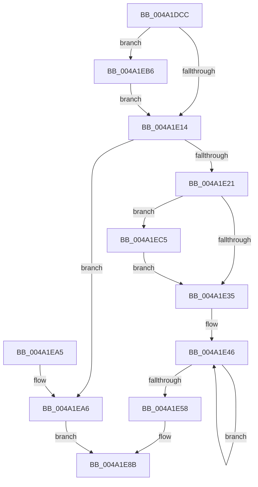

# MiWaitForAvailablePages

- RVA: `0x004A1DCC`–`0x004A1ED6` (길이 `266` bytes)
- VA: `0x00000001404A1DCC`
- 실행 섹션: `.text`
- PDB 이름 있음: `예`; PDB Function 태그: `아니요`
- unwind 정보 RVA: `0x000B5D4C`
- 디코드: `70`개 명령, `266/266` bytes 표시
- 미해석 바이트: `0` (있으면 어셈블리에 `.byte`로 보존)

> 이 문서는 커널 이미지의 기계어와 PDB 기호를 분석해 생성했습니다. 4번과 5번은 함수 원형과 자료형을 바이너리 사용 방식에서 추정한 C 해석이며 원본 소스 복구 결과는 아닙니다.

## 1. Dependencies

- 직접 호출 지점: **5**; 고유 호출 대상: **4**
- 직접 호출자로 확인된 함수: **1**
- RIP 상대 이미지 참조: **0**

### Outgoing calls
- `0x004A1DFC` → [ExAcquireSpinLockExclusive](../24/ExAcquireSpinLockExclusive_function_00248690.md) (function, `0x00248690`)
- `0x004A1E49` → [KeResetEvent](../24/KeResetEvent_function_00248350.md) (function, `0x00248350`)
- `0x004A1E5E` → [MiReleaseSpinLockExclusive](../24/MiReleaseSpinLockExclusive_function_002482C0.md) (function, `0x002482C0`)
- `0x004A1E86` → [KeWaitForMultipleObjects](../20/KeWaitForMultipleObjects_function_0020D110.md) (function, `0x0020D110`)
- `0x004A1EAC` → [MiReleaseSpinLockExclusive](../24/MiReleaseSpinLockExclusive_function_002482C0.md) (function, `0x002482C0`)

### Direct callers
- [MiDelayFaultingThread](../2A/MiDelayFaultingThread_function_002A3054.md) at `0x002A30BE`

### Static image references
- 디코드된 RIP-relative 메모리 참조가 없습니다.

## 2. Other-region calls and transfers

- 다른 실행 섹션으로 향하는 call: **0**
- 별도 외부 분기/꼬리 이동을 확인하지 못했습니다.

## 3. Assembly (complete function range)

```asm
004A1DCC  48 8B C4                        mov rax, rsp
004A1DCF  48 89 58 08                     mov qword ptr [rax + 8], rbx
004A1DD3  48 89 68 10                     mov qword ptr [rax + 0x10], rbp
004A1DD7  48 89 70 18                     mov qword ptr [rax + 0x18], rsi
004A1DDB  57                              push rdi
004A1DDC  41 56                           push r14
004A1DDE  41 57                           push r15
004A1DE0  48 83 EC 50                     sub rsp, 0x50
004A1DE4  48 83 60 E0 00                  and qword ptr [rax - 0x20], 0
004A1DE9  48 8D B1 40 3F 00 00            lea rsi, [rcx + 0x3f40]
004A1DF0  48 8B D9                        mov rbx, rcx
004A1DF3  41 8B F8                        mov edi, r8d
004A1DF6  48 8B CE                        mov rcx, rsi
004A1DF9  4C 8B FA                        mov r15, rdx
004A1DFC  E8 8F 68 DA FF                  call 0x140248690
004A1E01  4C 8B 83 00 49 00 00            mov r8, qword ptr [rbx + 0x4900]
004A1E08  44 8A F0                        mov r14b, al
004A1E0B  83 E7 02                        and edi, 2
004A1E0E  0F 85 A2 00 00 00               jne 0x1404a1eb6
004A1E14  49 81 F8 20 04 00 00            cmp r8, 0x420
004A1E1B  0F 83 85 00 00 00               jae 0x1404a1ea6
004A1E21  48 8D 83 88 3F 00 00            lea rax, [rbx + 0x3f88]
004A1E28  48 89 44 24 40                  mov qword ptr [rsp + 0x40], rax
004A1E2D  85 FF                           test edi, edi
004A1E2F  0F 85 90 00 00 00               jne 0x1404a1ec5
004A1E35  F7 DF                           neg edi
004A1E37  48 8D 5C 24 40                  lea rbx, [rsp + 0x40]
004A1E3C  1B C0                           sbb eax, eax
004A1E3E  F7 D8                           neg eax
004A1E40  FF C0                           inc eax
004A1E42  8B E8                           mov ebp, eax
004A1E44  8B F8                           mov edi, eax
004A1E46  48 8B 0B                        mov rcx, qword ptr [rbx]
004A1E49  E8 02 65 DA FF                  call 0x140248350
004A1E4E  48 8D 5B 08                     lea rbx, [rbx + 8]
004A1E52  48 83 EF 01                     sub rdi, 1
004A1E56  75 EE                           jne 0x1404a1e46
004A1E58  41 8A D6                        mov dl, r14b
004A1E5B  48 8B CE                        mov rcx, rsi
004A1E5E  E8 5D 64 DA FF                  call 0x1402482c0
004A1E63  48 21 7C 24 38                  and qword ptr [rsp + 0x38], rdi
004A1E68  44 8D 4F 08                     lea r9d, [rdi + 8]
004A1E6C  4C 89 7C 24 30                  mov qword ptr [rsp + 0x30], r15
004A1E71  44 8D 47 01                     lea r8d, [rdi + 1]
004A1E75  40 88 7C 24 28                  mov byte ptr [rsp + 0x28], dil
004A1E7A  48 8D 54 24 40                  lea rdx, [rsp + 0x40]
004A1E7F  8B CD                           mov ecx, ebp
004A1E81  40 88 7C 24 20                  mov byte ptr [rsp + 0x20], dil
004A1E86  E8 85 B2 D6 FF                  call 0x14020d110
004A1E8B  4C 8D 5C 24 50                  lea r11, [rsp + 0x50]
004A1E90  49 8B 5B 20                     mov rbx, qword ptr [r11 + 0x20]
004A1E94  49 8B 6B 28                     mov rbp, qword ptr [r11 + 0x28]
004A1E98  49 8B 73 30                     mov rsi, qword ptr [r11 + 0x30]
004A1E9C  49 8B E3                        mov rsp, r11
004A1E9F  41 5F                           pop r15
004A1EA1  41 5E                           pop r14
004A1EA3  5F                              pop rdi
004A1EA4  C3                              ret
004A1EA5  CC                              int3
004A1EA6  41 8A D6                        mov dl, r14b
004A1EA9  48 8B CE                        mov rcx, rsi
004A1EAC  E8 0F 64 DA FF                  call 0x1402482c0
004A1EB1  83 C8 FF                        or eax, 0xffffffff
004A1EB4  EB D5                           jmp 0x1404a1e8b
004A1EB6  48 8B 93 80 47 00 00            mov rdx, qword ptr [rbx + 0x4780]
004A1EBD  4C 03 C2                        add r8, rdx
004A1EC0  E9 4F FF FF FF                  jmp 0x1404a1e14
004A1EC5  48 8D 83 A8 47 00 00            lea rax, [rbx + 0x47a8]
004A1ECC  48 89 44 24 48                  mov qword ptr [rsp + 0x48], rax
004A1ED1  E9 5F FF FF FF                  jmp 0x1404a1e35
```

## 4. C-style interpretation (structured pseudocode)

```c
__int64 __fastcall MiWaitForAvailablePages(__int64 a1, __int64 a2, int a3)
{
    __int64 result;
    __int64 v_rdi;
    __int64 v_rsp;
    unsigned __int64 v_stack_m18;
    unsigned __int64 v_stack_m28;
    unsigned __int64 v_stack_m30;
    unsigned __int64 v_stack_m38;
    unsigned __int8 v_stack_m40;
    unsigned __int8 v_stack_m48;
    unsigned __int64 v_stack_m8;

    *(unsigned __int64 *)(v_rsp + 8) = v_rbx;
    *(unsigned __int64 *)(v_rsp + 16) = v_rbp;
    *(unsigned __int64 *)(v_rsp + 24) = v_rsi;
    v_rsp = (v_rsp) - (80);
    result = ExAcquireSpinLockExclusive(a1 + 16192, a2, a3, a4);
    v_rdi = (unsigned int)(((unsigned int)(a3)) & (2));
    if (condition_is_not_equal) goto loc_004A1EB6;
loc_004A1E14:
    if ((*(unsigned __int64 *)(a1 + 18688)) >= 0x420ULL) goto loc_004A1EA6;
    v_stack_m28 = a1 + 16264;
    if ((unsigned int)(v_rdi) != 0) goto loc_004A1EC5;
loc_004A1E35:
    v_rdi = (unsigned int)(-(v_rdi));
    result = (unsigned int)(-(a1 + 16264));
    result = (unsigned int)((result) + 1);
loc_004A1E46:
    result = KeResetEvent(*(unsigned __int64 *)(v_stack_m28), a2, *(unsigned __int64 *)(a1 + 18688), a4);
    v_rdi = ((unsigned int)((unsigned int)(result))) - (1);
    if (condition_is_not_equal) goto loc_004A1E46;
    result = MiReleaseSpinLockExclusive(a1 + 16192, (unsigned __int8)((unsigned __int8)(result)), *(unsigned __int64 *)(a1 + 18688), a4);
    v_stack_m38 = a2;
    v_stack_m40 = (unsigned __int8)(v_rdi);
    v_stack_m48 = (unsigned __int8)(v_rdi);
    result = KeWaitForMultipleObjects((unsigned int)((unsigned int)((unsigned int)((unsigned int)(result)))), v_stack_m28, v_rdi + 1, v_rdi + 8);
loc_004A1E8B:
    return result;
loc_004A1EA6:
    result = MiReleaseSpinLockExclusive(*(unsigned __int64 *)(v_stack_m18 + 48), (unsigned __int8)((unsigned __int8)(result)), v_rdi + 1, v_rdi + 8);
    result = (unsigned int)((result) | (0xFFFFFFFFULL));
    goto loc_004A1E8B;
loc_004A1EB6:
    a3 = (v_rdi + 1) + (*(unsigned __int64 *)(*(unsigned __int64 *)(v_stack_m18 + 32) + 18304));
    goto loc_004A1E14;
loc_004A1EC5:
    v_stack_m8 = *(unsigned __int64 *)(v_stack_m18 + 32) + 18344;
    goto loc_004A1E35;
}
```

## 5. (Beta) C Style

```c
int64_t MiWaitForAvailablePages(void *Arg1, int64_t Arg2, int32_t Arg3)
{
    uint8_t *arg1 = (uint8_t *)Arg1;

    int64_t result;
    int64_t local_rdi;
    int64_t local_rsp;
    uint64_t v_stack_m18;
    uint64_t v_stack_m28;
    uint64_t v_stack_m30;
    uint64_t v_stack_m38;
    uint8_t v_stack_m40;
    uint8_t v_stack_m48;
    uint64_t v_stack_m8;

    *(uint64_t *)(local_rsp + 0x8) = local_rbx;
    *(uint64_t *)(local_rsp + 0x10) = local_rbp;
    *(uint64_t *)(local_rsp + 0x18) = local_rsi;
    local_rsp = (local_rsp) - (80);
    result = ExAcquireSpinLockExclusive(Arg1 + 16192, Arg2, Arg3, a4);
    local_rdi = (uint32_t)(((uint32_t)(Arg3)) & (2));
    if (condition_is_not_equal) goto loc_004A1EB6;
loc_004A1E14:
    if ((*(uint64_t *)(arg1 + 0x4900)) >= 0x420ULL) goto loc_004A1EA6;
    v_stack_m28 = Arg1 + 16264;
    if ((uint32_t)(local_rdi) != 0) goto loc_004A1EC5;
loc_004A1E35:
    local_rdi = (uint32_t)(-(local_rdi));
    result = (uint32_t)(-(Arg1 + 16264));
    result = (uint32_t)((result) + 1);
loc_004A1E46:
    result = KeResetEvent(*(uint64_t *)(v_stack_m28), Arg2, *(uint64_t *)(arg1 + 0x4900), a4);
    local_rdi = ((uint32_t)((uint32_t)(result))) - (1);
    if (condition_is_not_equal) goto loc_004A1E46;
    result = MiReleaseSpinLockExclusive(Arg1 + 16192, (uint8_t)((uint8_t)(result)), *(uint64_t *)(arg1 + 0x4900), a4);
    v_stack_m38 = Arg2;
    v_stack_m40 = (uint8_t)(local_rdi);
    v_stack_m48 = (uint8_t)(local_rdi);
    result = KeWaitForMultipleObjects((uint32_t)((uint32_t)((uint32_t)((uint32_t)(result)))), v_stack_m28, local_rdi + 1, local_rdi + 8);
loc_004A1E8B:
    return result;
loc_004A1EA6:
    result = MiReleaseSpinLockExclusive(*(uint64_t *)(v_stack_m18 + 0x30), (uint8_t)((uint8_t)(result)), local_rdi + 1, local_rdi + 8);
    result = (uint32_t)((result) | (0xFFFFFFFFULL));
    goto loc_004A1E8B;
loc_004A1EB6:
    Arg3 = (local_rdi + 1) + (*(uint64_t *)(*(uint64_t *)(v_stack_m18 + 0x20) + 0x4780));
    goto loc_004A1E14;
loc_004A1EC5:
    v_stack_m8 = *(uint64_t *)(v_stack_m18 + 0x20) + 18344;
    goto loc_004A1E35;
}
```

### 관측된 메모리 오프셋

구조체 형식이 확인되지 않은 접근은 인자 기준의 오프셋으로만 기록했습니다.

| 기준 인자 | 오프셋 표현 | 폭 (bit) | 접근 |
|---|---:|---:|---|
| `Arg1` | `+ 0x3F40` | `64` | `R` |
| `Arg1` | `+ 0x3F88` | `64` | `R` |
| `Arg1` | `+ 0x4780` | `64` | `R` |
| `Arg1` | `+ 0x47A8` | `64` | `R` |
| `Arg1` | `+ 0x4900` | `64` | `R` |

## 6. Execution-region graph

[열기: 2D/3D 그래프와 함수 탐색 컨트롤 패널](../../../control-panel.html?section=text&rva=0x004A1DCC&view=graph)

- 2D 그래프는 위에서 아래로 흐르고, 3D 그래프는 빈 공간을 드래그해 회전합니다. Shift+드래그는 이동, 휠은 확대·축소, 함수 노드 선택은 대상 보고서 이동입니다.

### Static fallback


