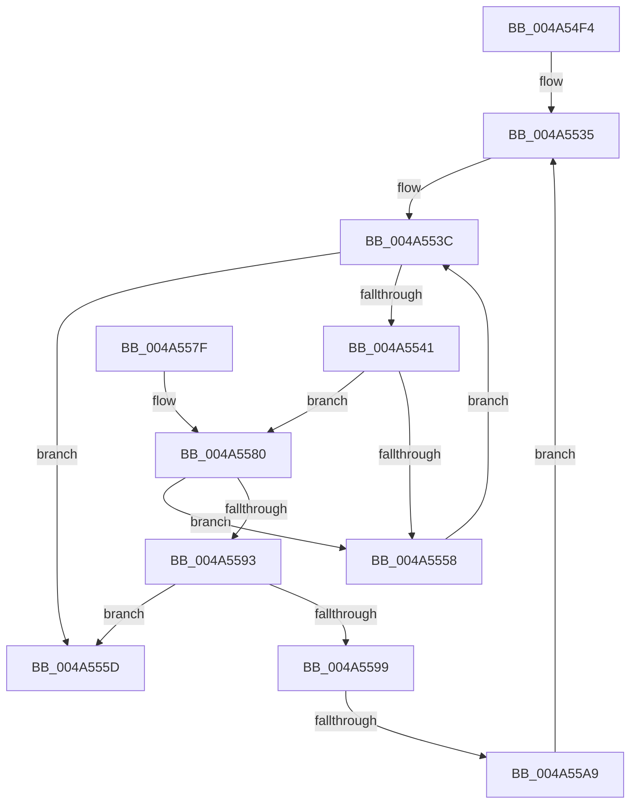

# MiWaitForRotateToComplete

- RVA: `0x004A54F4`–`0x004A55C2` (길이 `206` bytes)
- VA: `0x00000001404A54F4`
- 실행 섹션: `.text`
- PDB 이름 있음: `예`; PDB Function 태그: `예`
- unwind 정보 RVA: `0x000B6978`
- 디코드: `56`개 명령, `206/206` bytes 표시
- 미해석 바이트: `0` (있으면 어셈블리에 `.byte`로 보존)

> 이 문서는 커널 이미지의 기계어와 PDB 기호를 분석해 생성했습니다. 4번과 5번은 함수 원형과 자료형을 바이너리 사용 방식에서 추정한 C 해석이며 원본 소스 복구 결과는 아닙니다.

## 1. Dependencies

- 직접 호출 지점: **2**; 고유 호출 대상: **2**
- 직접 호출자로 확인된 함수: **1**
- RIP 상대 이미지 참조: **0**

### Outgoing calls
- `0x004A55AC` → [MiUnlockFaultWorkingSet](../49/MiUnlockFaultWorkingSet_function_00498664.md) (function, `0x00498664`)
- `0x004A55B4` → [MiLockWorkingSetExclusive](../32/MiLockWorkingSetExclusive_function_003238A0.md) (function, `0x003238A0`)

### Direct callers
- [MiUserFault](../32/MiUserFault_function_00329840.md) at `0x00329D59`

### Static image references
- 디코드된 RIP-relative 메모리 참조가 없습니다.

## 2. Other-region calls and transfers

- 다른 실행 섹션으로 향하는 call: **0**
- call이 아닌 외부 분기/꼬리 이동: **1**
  - `0x004A55A3` → [sub_006F9816](../6F/Unknown_function_006F9816.md) (`tail-transfer`)

## 3. Assembly (complete function range)

```asm
004A54F4  48 8B C4                        mov rax, rsp
004A54F7  48 89 58 08                     mov qword ptr [rax + 8], rbx
004A54FB  48 89 68 10                     mov qword ptr [rax + 0x10], rbp
004A54FF  48 89 70 18                     mov qword ptr [rax + 0x18], rsi
004A5503  48 89 78 20                     mov qword ptr [rax + 0x20], rdi
004A5507  41 54                           push r12
004A5509  41 56                           push r14
004A550B  41 57                           push r15
004A550D  48 83 EC 20                     sub rsp, 0x20
004A5511  65 4C 8B 3C 25 88 01 00 00      mov r15, qword ptr gs:[0x188]
004A551A  48 8B F1                        mov rsi, rcx
004A551D  45 33 F6                        xor r14d, r14d
004A5520  48 8B FA                        mov rdi, rdx
004A5523  48 C1 EE 0C                     shr rsi, 0xc
004A5527  49 8B AF B8 00 00 00            mov rbp, qword ptr [r15 + 0xb8]
004A552E  4C 8D A5 00 04 00 00            lea r12, [rbp + 0x400]
004A5535  4C 8B 85 68 02 00 00            mov r8, qword ptr [rbp + 0x268]
004A553C  4D 85 C0                        test r8, r8
004A553F  74 1C                           je 0x1404a555d
004A5541  49 8B 58 08                     mov rbx, qword ptr [r8 + 8]
004A5545  0F B6 4B 20                     movzx ecx, byte ptr [rbx + 0x20]
004A5549  8B 43 18                        mov eax, dword ptr [rbx + 0x18]
004A554C  48 C1 E1 20                     shl rcx, 0x20
004A5550  48 0B C8                        or rcx, rax
004A5553  48 3B F1                        cmp rsi, rcx
004A5556  73 28                           jae 0x1404a5580
004A5558  4D 8B 00                        mov r8, qword ptr [r8]
004A555B  EB DF                           jmp 0x1404a553c
004A555D  48 8B 5C 24 40                  mov rbx, qword ptr [rsp + 0x40]
004A5562  41 8B C6                        mov eax, r14d
004A5565  48 8B 6C 24 48                  mov rbp, qword ptr [rsp + 0x48]
004A556A  48 8B 74 24 50                  mov rsi, qword ptr [rsp + 0x50]
004A556F  48 8B 7C 24 58                  mov rdi, qword ptr [rsp + 0x58]
004A5574  48 83 C4 20                     add rsp, 0x20
004A5578  41 5F                           pop r15
004A557A  41 5E                           pop r14
004A557C  41 5C                           pop r12
004A557E  C3                              ret
004A557F  CC                              int3
004A5580  0F B6 4B 21                     movzx ecx, byte ptr [rbx + 0x21]
004A5584  8B 43 1C                        mov eax, dword ptr [rbx + 0x1c]
004A5587  48 C1 E1 20                     shl rcx, 0x20
004A558B  48 0B C8                        or rcx, rax
004A558E  48 3B F1                        cmp rsi, rcx
004A5591  77 C5                           ja 0x1404a5558
004A5593  4D 39 78 10                     cmp qword ptr [r8 + 0x10], r15
004A5597  74 C4                           je 0x1404a555d
004A5599  41 BE 01 00 00 00               mov r14d, 1
004A559F  44 84 77 0D                     test byte ptr [rdi + 0xd], r14b
004A55A3  0F 85 6D 42 25 00               jne 0x1406f9816
004A55A9  48 8B CF                        mov rcx, rdi
004A55AC  E8 B3 30 FF FF                  call 0x140498664
004A55B1  49 8B CC                        mov rcx, r12
004A55B4  E8 E7 E2 E7 FF                  call 0x1403238a0
004A55B9  44 08 77 0D                     or byte ptr [rdi + 0xd], r14b
004A55BD  E9 73 FF FF FF                  jmp 0x1404a5535
```

## 4. C-style interpretation (structured pseudocode)

```c
__int64 __fastcall MiWaitForRotateToComplete(__int64 a1, __int64 a2)
{
    __int64 result;
    __int64 v_r14;
    __int64 v_rsi;
    __int64 v_rsp;
    unsigned __int64 v_stack_p10;
    unsigned __int64 v_stack_p18;
    unsigned __int64 v_stack_p20;
    unsigned __int64 v_stack_p8;

    *(unsigned __int64 *)(v_rsp + 8) = v_rbx;
    *(unsigned __int64 *)(v_rsp + 16) = v_rbp;
    *(unsigned __int64 *)(v_rsp + 24) = v_rsi;
    *(unsigned __int64 *)(v_rsp + 32) = v_rdi;
    v_rsp = (v_rsp) - (32);
    v_r14 = 0;
    v_rsi = (a1) >> (12);
loc_004A5535:
loc_004A553C:
    if (*(unsigned __int64 *)(*(unsigned __int64 *)(*(unsigned __int64 *)(gs_base + (0 + 392)) + 184) + 616) == 0) goto loc_004A555D;
    a1 = (*(unsigned __int8 *)(*(unsigned __int64 *)(*(unsigned __int64 *)(*(unsigned __int64 *)(*(unsigned __int64 *)(gs_base + (0 + 392)) + 184) + 616) + 8) + 32)) << (32);
    a1 = (a1) | ((unsigned int)(*(unsigned int *)(*(unsigned __int64 *)(*(unsigned __int64 *)(*(unsigned __int64 *)(*(unsigned __int64 *)(gs_base + (0 + 392)) + 184) + 616) + 8) + 24)));
    if (v_rsi >= a1) goto loc_004A5580;
loc_004A5558:
    goto loc_004A553C;
loc_004A555D:
    v_rsp = (v_rsp) + (32);
    return 0;
loc_004A5580:
    a1 = (*(unsigned __int8 *)(v_stack_p8 + 33)) << (32);
    a1 = (a1) | ((unsigned int)(*(unsigned int *)(v_stack_p8 + 28)));
    if (v_stack_p18 > a1) goto loc_004A5558;
    if ((*(unsigned __int64 *)(*(unsigned __int64 *)(*(unsigned __int64 *)(*(unsigned __int64 *)(*(unsigned __int64 *)(gs_base + (0 + 392)) + 184) + 616)) + 16)) == (*(unsigned __int64 *)(gs_base + (0 + 392)))) goto loc_004A555D;
    result = MiUnlockFaultWorkingSet(v_stack_p20, a2, *(unsigned __int64 *)(*(unsigned __int64 *)(*(unsigned __int64 *)(*(unsigned __int64 *)(gs_base + (0 + 392)) + 184) + 616)), a4);
    result = MiLockWorkingSetExclusive(*(unsigned __int64 *)(*(unsigned __int64 *)(gs_base + (0 + 392)) + 184) + 1024, a2, *(unsigned __int64 *)(*(unsigned __int64 *)(*(unsigned __int64 *)(*(unsigned __int64 *)(gs_base + (0 + 392)) + 184) + 616)), a4);
    goto loc_004A5535;
}
```

## 5. (Beta) C Style

```c
int64_t MiWaitForRotateToComplete(int64_t Arg1, void *Arg2)
{
    uint8_t *arg2 = (uint8_t *)Arg2;

    int64_t result;
    int64_t local_r14;
    int64_t local_rsi;
    int64_t local_rsp;
    uint64_t v_stack_p10;
    uint64_t v_stack_p18;
    uint64_t v_stack_p20;
    uint64_t v_stack_p8;

    *(uint64_t *)(local_rsp + 0x8) = local_rbx;
    *(uint64_t *)(local_rsp + 0x10) = local_rbp;
    *(uint64_t *)(local_rsp + 0x18) = local_rsi;
    *(uint64_t *)(local_rsp + 0x20) = local_rdi;
    local_rsp = (local_rsp) - (32);
    local_r14 = 0;
    local_rsi = (Arg1) >> (12);
loc_004A5535:
loc_004A553C:
    if (*(uint64_t *)(*(uint64_t *)(*(uint64_t *)(gs_base + (0 + 0x188)) + 0xB8) + 0x268) == 0) goto loc_004A555D;
    Arg1 = (*(uint8_t *)(*(uint64_t *)(*(uint64_t *)(*(uint64_t *)(*(uint64_t *)(gs_base + (0 + 0x188)) + 0xB8) + 0x268) + 0x8) + 0x20)) << (32);
    Arg1 = (Arg1) | ((uint32_t)(*(uint32_t *)(*(uint64_t *)(*(uint64_t *)(*(uint64_t *)(*(uint64_t *)(gs_base + (0 + 0x188)) + 0xB8) + 0x268) + 0x8) + 0x18)));
    if (local_rsi >= Arg1) goto loc_004A5580;
loc_004A5558:
    goto loc_004A553C;
loc_004A555D:
    local_rsp = (local_rsp) + (32);
    return 0;
loc_004A5580:
    Arg1 = (*(uint8_t *)(v_stack_p8 + 0x21)) << (32);
    Arg1 = (Arg1) | ((uint32_t)(*(uint32_t *)(v_stack_p8 + 0x1C)));
    if (v_stack_p18 > Arg1) goto loc_004A5558;
    if ((*(uint64_t *)(*(uint64_t *)(*(uint64_t *)(*(uint64_t *)(*(uint64_t *)(gs_base + (0 + 0x188)) + 0xB8) + 0x268)) + 0x10)) == (*(uint64_t *)(gs_base + (0 + 0x188)))) goto loc_004A555D;
    result = MiUnlockFaultWorkingSet(v_stack_p20, Arg2, *(uint64_t *)(*(uint64_t *)(*(uint64_t *)(*(uint64_t *)(gs_base + (0 + 0x188)) + 0xB8) + 0x268)), a4);
    result = MiLockWorkingSetExclusive(*(uint64_t *)(*(uint64_t *)(gs_base + (0 + 0x188)) + 0xB8) + 1024, Arg2, *(uint64_t *)(*(uint64_t *)(*(uint64_t *)(*(uint64_t *)(gs_base + (0 + 0x188)) + 0xB8) + 0x268)), a4);
    goto loc_004A5535;
}
```

### 관측된 메모리 오프셋

구조체 형식이 확인되지 않은 접근은 인자 기준의 오프셋으로만 기록했습니다.

| 기준 인자 | 오프셋 표현 | 폭 (bit) | 접근 |
|---|---:|---:|---|
| `Arg2` | `+ 0xD` | `8` | `R` |
| `Arg2` | `+ 0xD` | `8` | `R/W` |

## 6. Execution-region graph

[열기: 2D/3D 그래프와 함수 탐색 컨트롤 패널](../../../control-panel.html?section=text&rva=0x004A54F4&view=graph)

- 2D 그래프는 위에서 아래로 흐르고, 3D 그래프는 빈 공간을 드래그해 회전합니다. Shift+드래그는 이동, 휠은 확대·축소, 함수 노드 선택은 대상 보고서 이동입니다.

### Static fallback


