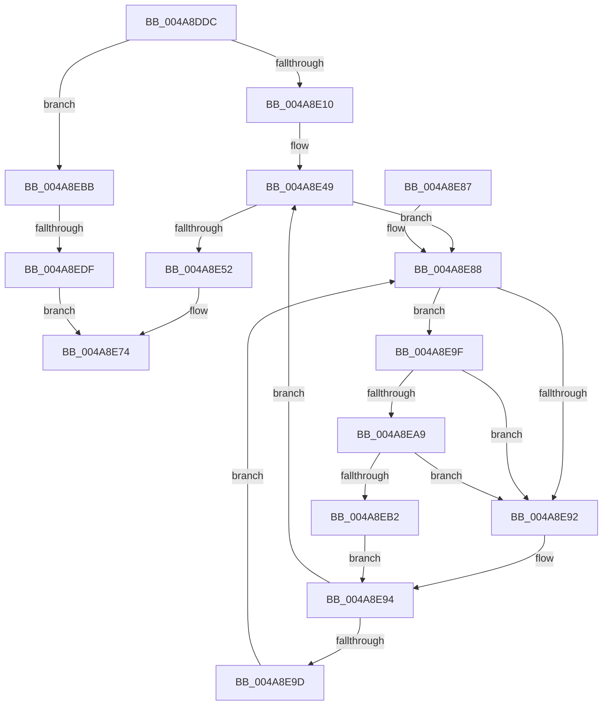

# MiWriteSharedDemandZeroPte

- RVA: `0x004A8DDC`–`0x004A8EEF` (길이 `275` bytes)
- VA: `0x00000001404A8DDC`
- 실행 섹션: `.text`
- PDB 이름 있음: `예`; PDB Function 태그: `예`
- unwind 정보 RVA: `0x000B793C`
- 디코드: `73`개 명령, `275/275` bytes 표시
- 미해석 바이트: `0` (있으면 어셈블리에 `.byte`로 보존)

> 이 문서는 커널 이미지의 기계어와 PDB 기호를 분석해 생성했습니다. 4번과 5번은 함수 원형과 자료형을 바이너리 사용 방식에서 추정한 C 해석이며 원본 소스 복구 결과는 아닙니다.

## 1. Dependencies

- 직접 호출 지점: **7**; 고유 호출 대상: **7**
- 직접 호출자로 확인된 함수: **1**
- RIP 상대 이미지 참조: **3**

### Outgoing calls
- `0x004A8DFA` → [MiLockCloneBlockAtDpc](../37/MiLockCloneBlockAtDpc_function_00370FD8.md) (function, `0x00370FD8`)
- `0x004A8E20` → [MiUpdateCloneReducedCommit](../22/MiUpdateCloneReducedCommit_function_0022CC90.md) (function, `0x0022CC90`)
- `0x004A8E36` → [MiMakePrototypePteDirect](../29/MiMakePrototypePteDirect_function_00294DE0.md) (function, `0x00294DE0`)
- `0x004A8E65` → [MiIncreaseUsedPtesInPfn](../38/MiIncreaseUsedPtesInPfn_function_00382D90.md) (function, `0x00382D90`)
- `0x004A8EA9` → [KiCheckVpBackingLongSpinWaitHypercall](../30/KiCheckVpBackingLongSpinWaitHypercall_function_0030F490.md) (function, `0x0030F490`)
- `0x004A8EB4` → [HvlNotifyLongSpinWait](../30/HvlNotifyLongSpinWait_function_0030F460.md) (function, `0x0030F460`)
- `0x004A8ED2` → [MiGetCloneCharges](../22/MiGetCloneCharges_function_0022CB5C.md) (function, `0x0022CB5C`)

### Direct callers
- [MiBuildForkPte](../22/MiBuildForkPte_function_0022E32C.md) at `0x0022EEED`
- [MiBuildForkPte](../22/MiBuildForkPte_function_0022E32C.md) at `0x0022EF8B`

### Static image references
- `0x004A8E8A` → RVA `0x00FC52AC` (`ALMOSTRO`; reference)
- `0x004A8E9F` → RVA `0x00FC6AB8` (`ALMOSTRO`; read)
- `0x004A8EC7` → RVA `0x00E30088` (`.data`; read)

## 2. Other-region calls and transfers

- 다른 실행 섹션으로 향하는 call: **0**
- call이 아닌 외부 분기/꼬리 이동: **1**
  - `0x004A8ED9` → [sub_006F9FE6](../6F/Unknown_function_006F9FE6.md) (`tail-transfer`)

## 3. Assembly (complete function range)

```asm
004A8DDC  48 89 5C 24 08                  mov qword ptr [rsp + 8], rbx
004A8DE1  48 89 6C 24 10                  mov qword ptr [rsp + 0x10], rbp
004A8DE6  56                              push rsi
004A8DE7  57                              push rdi
004A8DE8  41 56                           push r14
004A8DEA  48 83 EC 20                     sub rsp, 0x20
004A8DEE  48 8B E9                        mov rbp, rcx
004A8DF1  4D 8B F1                        mov r14, r9
004A8DF4  49 8B C8                        mov rcx, r8
004A8DF7  49 8B F8                        mov rdi, r8
004A8DFA  E8 D9 81 EC FF                  call 0x140370fd8
004A8DFF  48 8B 77 18                     mov rsi, qword ptr [rdi + 0x18]
004A8E03  48 8D 5F 10                     lea rbx, [rdi + 0x10]
004A8E07  48 85 F6                        test rsi, rsi
004A8E0A  0F 84 AB 00 00 00               je 0x1404a8ebb
004A8E10  48 8D 46 01                     lea rax, [rsi + 1]
004A8E14  BA 01 00 00 00                  mov edx, 1
004A8E19  48 8B CF                        mov rcx, rdi
004A8E1C  48 89 47 18                     mov qword ptr [rdi + 0x18], rax
004A8E20  E8 6B 3E D8 FF                  call 0x14022cc90
004A8E25  48 BD FF FF FF FF FF FF FF 7F   movabs rbp, 0x7fffffffffffffff
004A8E2F  F0 48 21 2B                     lock and qword ptr [rbx], rbp
004A8E33  48 8B CF                        mov rcx, rdi
004A8E36  E8 A5 BF DE FF                  call 0x140294de0
004A8E3B  48 8B 7C 24 60                  mov rdi, qword ptr [rsp + 0x60]
004A8E40  48 8B D8                        mov rbx, rax
004A8E43  48 83 CB 08                     or rbx, 8
004A8E47  33 F6                           xor esi, esi
004A8E49  F0 48 0F BA 6F 18 3F            lock bts qword ptr [rdi + 0x18], 0x3f
004A8E50  72 36                           jb 0x1404a8e88
004A8E52  48 8B 4C 24 68                  mov rcx, qword ptr [rsp + 0x68]
004A8E57  BA 01 00 00 00                  mov edx, 1
004A8E5C  49 89 1E                        mov qword ptr [r14], rbx
004A8E5F  48 FF 01                        inc qword ptr [rcx]
004A8E62  48 8B CF                        mov rcx, rdi
004A8E65  E8 26 9F ED FF                  call 0x140382d90
004A8E6A  F0 48 21 6F 18                  lock and qword ptr [rdi + 0x18], rbp
004A8E6F  B8 01 00 00 00                  mov eax, 1
004A8E74  48 8B 5C 24 40                  mov rbx, qword ptr [rsp + 0x40]
004A8E79  48 8B 6C 24 48                  mov rbp, qword ptr [rsp + 0x48]
004A8E7E  48 83 C4 20                     add rsp, 0x20
004A8E82  41 5E                           pop r14
004A8E84  5F                              pop rdi
004A8E85  5E                              pop rsi
004A8E86  C3                              ret
004A8E87  CC                              int3
004A8E88  FF C6                           inc esi
004A8E8A  85 35 1C C4 B1 00               test dword ptr [rip + 0xb1c41c], esi
004A8E90  74 0D                           je 0x1404a8e9f
004A8E92  F3 90                           pause
004A8E94  48 8B 47 18                     mov rax, qword ptr [rdi + 0x18]
004A8E98  48 85 C0                        test rax, rax
004A8E9B  79 AC                           jns 0x1404a8e49
004A8E9D  EB E9                           jmp 0x1404a8e88
004A8E9F  8B 05 13 DC B1 00               mov eax, dword ptr [rip + 0xb1dc13]
004A8EA5  A8 40                           test al, 0x40
004A8EA7  74 E9                           je 0x1404a8e92
004A8EA9  E8 E2 65 E6 FF                  call 0x14030f490
004A8EAE  84 C0                           test al, al
004A8EB0  74 E0                           je 0x1404a8e92
004A8EB2  8B CE                           mov ecx, esi
004A8EB4  E8 A7 65 E6 FF                  call 0x14030f460
004A8EB9  EB D9                           jmp 0x1404a8e94
004A8EBB  0F B7 8D AE 04 00 00            movzx ecx, word ptr [rbp + 0x4ae]
004A8EC2  BA 02 00 00 00                  mov edx, 2
004A8EC7  48 8B 05 BA 71 98 00            mov rax, qword ptr [rip + 0x9871ba]
004A8ECE  48 8B 0C C8                     mov rcx, qword ptr [rax + rcx*8]
004A8ED2  E8 85 3C D8 FF                  call 0x14022cb5c
004A8ED7  85 C0                           test eax, eax
004A8ED9  0F 85 07 11 25 00               jne 0x1406f9fe6
004A8EDF  48 BD FF FF FF FF FF FF FF 7F   movabs rbp, 0x7fffffffffffffff
004A8EE9  F0 48 21 2B                     lock and qword ptr [rbx], rbp
004A8EED  EB 85                           jmp 0x1404a8e74
```

## 4. C-style interpretation (structured pseudocode)

```c
__int64 __fastcall MiWriteSharedDemandZeroPte(__int64 a1, __int64 a2, __int64 a3, __int64 a4, __int64 a5, __int64 a6)
{
    __int64 result;
    __int64 v_rbx;
    __int64 v_rsi;
    __int64 v_rsp;
    unsigned __int64 v_stack_p10;
    unsigned __int64 v_stack_p8;

    v_stack_p8 = v_rbx;
    v_stack_p10 = v_rbp;
    v_rsp = (v_rsp) - (32);
    result = MiLockCloneBlockAtDpc(a3, a2, a3, a4);
    if (*(unsigned __int64 *)(a3 + 24) == 0) goto loc_004A8EBB;
    *(unsigned __int64 *)(a3 + 24) = *(unsigned __int64 *)(a3 + 24) + 1;
    result = MiUpdateCloneReducedCommit(a3, 1, a3, a4);
    result = MiMakePrototypePteDirect(a3, 1, a3, a4);
    v_rbx = (result) | (8);
    v_rsi = 0;
loc_004A8E49:
    if (condition_is_below) goto loc_004A8E88;
    *(unsigned __int64 *)(a4) = v_rbx;
    result = MiIncreaseUsedPtesInPfn(a5, 1, a3, a4);
loc_004A8E74:
    v_rsp = (v_rsp) + (32);
    return 1;
loc_004A8E88:
    v_rsi = (unsigned int)((v_rsi) + 1);
    if (((*(unsigned int *)(v_rip + 11650076)) & ((unsigned int)(v_rsi))) == 0) goto loc_004A8E9F;
loc_004A8E92:
loc_004A8E94:
    if (!sign_flag) goto loc_004A8E49;
    goto loc_004A8E88;
loc_004A8E9F:
    if ((((unsigned __int8)((unsigned int)(*(unsigned int *)(v_rip + 11656211)))) & (64)) == 0) goto loc_004A8E92;
    result = KiCheckVpBackingLongSpinWaitHypercall(a5, 1, a3, a4);
    if ((unsigned __int8)(result) == 0) goto loc_004A8E92;
    result = HvlNotifyLongSpinWait((unsigned int)((unsigned int)(v_rsi)), 1, a3, a4);
    goto loc_004A8E94;
loc_004A8EBB:
    result = MiGetCloneCharges(*(unsigned __int64 *)(*(unsigned __int64 *)(v_rip + 9990586) + *(unsigned __int16 *)(v_stack_p10 + 1198) * 8), 2, a3, a4);
    goto loc_004A8E74;
}
```

## 5. (Beta) C Style

```c
int64_t MiWriteSharedDemandZeroPte(void *Arg1, int64_t Arg2, void *Arg3, void *Arg4, void *Arg5, void *Arg6)
{
    uint8_t *arg1 = (uint8_t *)Arg1;
    uint8_t *arg3 = (uint8_t *)Arg3;
    uint8_t *arg4 = (uint8_t *)Arg4;
    uint8_t *arg5 = (uint8_t *)Arg5;
    uint8_t *arg6 = (uint8_t *)Arg6;

    int64_t result;
    int64_t local_rbx;
    int64_t local_rsi;
    int64_t local_rsp;
    uint64_t v_stack_p10;
    uint64_t v_stack_p8;

    v_stack_p8 = local_rbx;
    v_stack_p10 = local_rbp;
    local_rsp = (local_rsp) - (32);
    result = MiLockCloneBlockAtDpc(Arg3, Arg2, Arg3, Arg4);
    if (*(uint64_t *)(arg3 + 0x18) == 0) goto loc_004A8EBB;
    *(uint64_t *)(arg3 + 0x18) = *(uint64_t *)(arg3 + 0x18) + 1;
    result = MiUpdateCloneReducedCommit(Arg3, 1, Arg3, Arg4);
    result = MiMakePrototypePteDirect(Arg3, 1, Arg3, Arg4);
    local_rbx = (result) | (8);
    local_rsi = 0;
loc_004A8E49:
    if (condition_is_below) goto loc_004A8E88;
    *(uint64_t *)(arg4) = local_rbx;
    result = MiIncreaseUsedPtesInPfn(Arg5, 1, Arg3, Arg4);
loc_004A8E74:
    local_rsp = (local_rsp) + (32);
    return 1;
loc_004A8E88:
    local_rsi = (uint32_t)((local_rsi) + 1);
    if (((*(uint32_t *)(v_rip + 0xB1C41C)) & ((uint32_t)(local_rsi))) == 0) goto loc_004A8E9F;
loc_004A8E92:
loc_004A8E94:
    if (!sign_flag) goto loc_004A8E49;
    goto loc_004A8E88;
loc_004A8E9F:
    if ((((uint8_t)((uint32_t)(*(uint32_t *)(v_rip + 0xB1DC13)))) & (64)) == 0) goto loc_004A8E92;
    result = KiCheckVpBackingLongSpinWaitHypercall(Arg5, 1, Arg3, Arg4);
    if ((uint8_t)(result) == 0) goto loc_004A8E92;
    result = HvlNotifyLongSpinWait((uint32_t)((uint32_t)(local_rsi)), 1, Arg3, Arg4);
    goto loc_004A8E94;
loc_004A8EBB:
    result = MiGetCloneCharges(*(uint64_t *)(*(uint64_t *)(v_rip + 0x9871BA) + *(uint16_t *)(v_stack_p10 + 0x4AE) * 8), 2, Arg3, Arg4);
    goto loc_004A8E74;
}
```

### 관측된 메모리 오프셋

구조체 형식이 확인되지 않은 접근은 인자 기준의 오프셋으로만 기록했습니다.

| 기준 인자 | 오프셋 표현 | 폭 (bit) | 접근 |
|---|---:|---:|---|
| `Arg1` | `+ 0x4AE` | `16` | `R` |
| `Arg3` | `+ 0x0` | `64` | `R/W` |
| `Arg3` | `+ 0x10` | `64` | `R` |
| `Arg3` | `+ 0x18` | `64` | `R` |
| `Arg3` | `+ 0x18` | `64` | `W` |
| `Arg4` | `+ 0x0` | `64` | `W` |
| `Arg5` | `+ 0x18` | `64` | `R` |
| `Arg5` | `+ 0x18` | `64` | `R/W` |
| `Arg6` | `+ 0x0` | `64` | `R/W` |

## 6. Execution-region graph

[열기: 2D/3D 그래프와 함수 탐색 컨트롤 패널](../../../control-panel.html?section=text&rva=0x004A8DDC&view=graph)

- 2D 그래프는 위에서 아래로 흐르고, 3D 그래프는 빈 공간을 드래그해 회전합니다. Shift+드래그는 이동, 휠은 확대·축소, 함수 노드 선택은 대상 보고서 이동입니다.

### Static fallback


