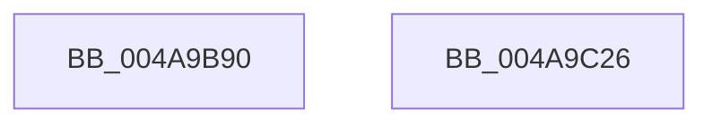

# MiZeroSectionObjectPointer

- RVA: `0x004A9B90`–`0x004A9C27` (길이 `151` bytes)
- VA: `0x00000001404A9B90`
- 실행 섹션: `.text`
- PDB 이름 있음: `예`; PDB Function 태그: `아니요`
- unwind 정보 RVA: `0x0005E6B4`
- 디코드: `37`개 명령, `151/151` bytes 표시
- 미해석 바이트: `0` (있으면 어셈블리에 `.byte`로 보존)

> 이 문서는 커널 이미지의 기계어와 PDB 기호를 분석해 생성했습니다. 4번과 5번은 함수 원형과 자료형을 바이너리 사용 방식에서 추정한 C 해석이며 원본 소스 복구 결과는 아닙니다.

## 1. Dependencies

- 직접 호출 지점: **5**; 고유 호출 대상: **5**
- 직접 호출자로 확인된 함수: **1**
- RIP 상대 이미지 참조: **1**

### Outgoing calls
- `0x004A9BC0` → [KeAbPostRelease](../2E/KeAbPostRelease_function_002E1600.md) (function, `0x002E1600`)
- `0x004A9BC9` → [ExAcquireSpinLockExclusive](../24/ExAcquireSpinLockExclusive_function_00248690.md) (function, `0x00248690`)
- `0x004A9BE0` → [ExAcquireSpinLockExclusiveAtDpcLevel](../24/ExAcquireSpinLockExclusiveAtDpcLevel_function_00248E80.md) (function, `0x00248E80`)
- `0x004A9BF0` → [ExReleaseSpinLockExclusiveFromDpcLevel](../24/ExReleaseSpinLockExclusiveFromDpcLevel_function_002497E0.md) (function, `0x002497E0`)
- `0x004A9C03` → [MiReleaseSpinLockExclusive](../24/MiReleaseSpinLockExclusive_function_002482C0.md) (function, `0x002482C0`)

### Direct callers
- [sub_009848DC](../../page/98/Unknown_function_009848DC.md) at `0x00984A95`

### Static image references
- `0x004A9BD2` → RVA `0x00E2CD00` (`.data`; read)

## 2. Other-region calls and transfers

- 다른 실행 섹션으로 향하는 call: **0**
- 별도 외부 분기/꼬리 이동을 확인하지 못했습니다.

## 3. Assembly (complete function range)

```asm
004A9B90  48 8B C4                        mov rax, rsp
004A9B93  48 89 58 08                     mov qword ptr [rax + 8], rbx
004A9B97  48 89 68 10                     mov qword ptr [rax + 0x10], rbp
004A9B9B  48 89 70 18                     mov qword ptr [rax + 0x18], rsi
004A9B9F  48 89 78 20                     mov qword ptr [rax + 0x20], rdi
004A9BA3  41 56                           push r14
004A9BA5  48 83 EC 20                     sub rsp, 0x20
004A9BA9  48 8B 41 28                     mov rax, qword ptr [rcx + 0x28]
004A9BAD  41 0F BA E0 18                  bt r8d, 0x18
004A9BB2  4C 8B F2                        mov r14, rdx
004A9BB5  48 8D 70 10                     lea rsi, [rax + 0x10]
004A9BB9  48 0F 43 F0                     cmovae rsi, rax
004A9BBD  48 8B CE                        mov rcx, rsi
004A9BC0  E8 3B 7A E3 FF                  call 0x1402e1600
004A9BC5  49 8D 4E 48                     lea rcx, [r14 + 0x48]
004A9BC9  E8 C2 EA D9 FF                  call 0x140248690
004A9BCE  49 8B 7E 50                     mov rdi, qword ptr [r14 + 0x50]
004A9BD2  48 8D 0D 27 31 98 00            lea rcx, [rip + 0x983127]
004A9BD9  49 83 66 50 00                  and qword ptr [r14 + 0x50], 0
004A9BDE  8A D8                           mov bl, al
004A9BE0  E8 9B F2 D9 FF                  call 0x140248e80
004A9BE5  48 83 26 00                     and qword ptr [rsi], 0
004A9BE9  48 8D 0D 10 31 98 00            lea rcx, [rip + 0x983110]
004A9BF0  E8 EB FB D9 FF                  call 0x1402497e0
004A9BF5  41 81 4E 38 00 00 0C 00         or dword ptr [r14 + 0x38], 0xc0000
004A9BFD  49 8D 4E 48                     lea rcx, [r14 + 0x48]
004A9C01  8A D3                           mov dl, bl
004A9C03  E8 B8 E6 D9 FF                  call 0x1402482c0
004A9C08  48 8B 5C 24 30                  mov rbx, qword ptr [rsp + 0x30]
004A9C0D  48 8B C7                        mov rax, rdi
004A9C10  48 8B 7C 24 48                  mov rdi, qword ptr [rsp + 0x48]
004A9C15  48 8B 6C 24 38                  mov rbp, qword ptr [rsp + 0x38]
004A9C1A  48 8B 74 24 40                  mov rsi, qword ptr [rsp + 0x40]
004A9C1F  48 83 C4 20                     add rsp, 0x20
004A9C23  41 5E                           pop r14
004A9C25  C3                              ret
004A9C26  CC                              int3
```

## 4. C-style interpretation (structured pseudocode)

```c
__int64 __fastcall MiZeroSectionObjectPointer(__int64 a1, __int64 a2, int a3)
{
    __int64 result;
    __int64 v_rsi;
    __int64 v_rsp;
    unsigned __int64 v_stack_p10;
    unsigned __int64 v_stack_p18;
    unsigned __int64 v_stack_p20;
    unsigned __int64 v_stack_p8;

    *(unsigned __int64 *)(v_rsp + 8) = v_rbx;
    *(unsigned __int64 *)(v_rsp + 16) = v_rbp;
    *(unsigned __int64 *)(v_rsp + 24) = v_rsi;
    *(unsigned __int64 *)(v_rsp + 32) = v_rdi;
    v_rsp = (v_rsp) - (32);
    v_rsi = *(unsigned __int64 *)(a1 + 40) + 16;
    if (condition_is_above_or_equal) { v_rsi = *(unsigned __int64 *)(a1 + 40); }
    result = KeAbPostRelease(v_rsi, a2, a3, a4);
    result = ExAcquireSpinLockExclusive(a2 + 72, a2, a3, a4);
    result = ExAcquireSpinLockExclusiveAtDpcLevel(v_rip + 9974055, a2, a3, a4);
    result = ExReleaseSpinLockExclusiveFromDpcLevel(v_rip + 9974032, a2, a3, a4);
    result = MiReleaseSpinLockExclusive(a2 + 72, (unsigned __int8)((unsigned __int8)(result)), a3, a4);
    v_rsp = (v_rsp) + (32);
    return *(unsigned __int64 *)(a2 + 80);
}
```

## 5. (Beta) C Style

```c
int64_t MiZeroSectionObjectPointer(void *Arg1, void *Arg2, int32_t Arg3)
{
    uint8_t *arg1 = (uint8_t *)Arg1;
    uint8_t *arg2 = (uint8_t *)Arg2;

    int64_t result;
    int64_t local_rsi;
    int64_t local_rsp;
    uint64_t v_stack_p10;
    uint64_t v_stack_p18;
    uint64_t v_stack_p20;
    uint64_t v_stack_p8;

    *(uint64_t *)(local_rsp + 0x8) = local_rbx;
    *(uint64_t *)(local_rsp + 0x10) = local_rbp;
    *(uint64_t *)(local_rsp + 0x18) = local_rsi;
    *(uint64_t *)(local_rsp + 0x20) = local_rdi;
    local_rsp = (local_rsp) - (32);
    local_rsi = *(uint64_t *)(arg1 + 0x28) + 16;
    if (condition_is_above_or_equal) { local_rsi = *(uint64_t *)(arg1 + 0x28); }
    result = KeAbPostRelease(local_rsi, Arg2, Arg3, a4);
    result = ExAcquireSpinLockExclusive(Arg2 + 72, Arg2, Arg3, a4);
    result = ExAcquireSpinLockExclusiveAtDpcLevel(v_rip + 9974055, Arg2, Arg3, a4);
    result = ExReleaseSpinLockExclusiveFromDpcLevel(v_rip + 9974032, Arg2, Arg3, a4);
    result = MiReleaseSpinLockExclusive(Arg2 + 72, (uint8_t)((uint8_t)(result)), Arg3, a4);
    local_rsp = (local_rsp) + (32);
    return *(uint64_t *)(arg2 + 0x50);
}
```

### 관측된 메모리 오프셋

구조체 형식이 확인되지 않은 접근은 인자 기준의 오프셋으로만 기록했습니다.

| 기준 인자 | 오프셋 표현 | 폭 (bit) | 접근 |
|---|---:|---:|---|
| `Arg1` | `+ 0x28` | `64` | `R` |
| `Arg2` | `+ 0x38` | `32` | `R/W` |
| `Arg2` | `+ 0x48` | `64` | `R` |
| `Arg2` | `+ 0x50` | `64` | `R` |
| `Arg2` | `+ 0x50` | `64` | `R/W` |

## 6. Execution-region graph

[열기: 2D/3D 그래프와 함수 탐색 컨트롤 패널](../../../control-panel.html?section=text&rva=0x004A9B90&view=graph)

- 2D 그래프는 위에서 아래로 흐르고, 3D 그래프는 빈 공간을 드래그해 회전합니다. Shift+드래그는 이동, 휠은 확대·축소, 함수 노드 선택은 대상 보고서 이동입니다.

### Static fallback


