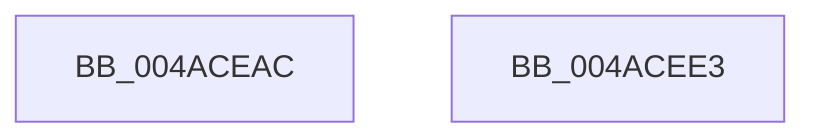

# MmGetAvailablePagesBelowPriority

- RVA: `0x004ACEAC`–`0x004ACEE4` (길이 `56` bytes)
- VA: `0x00000001404ACEAC`
- 실행 섹션: `.text`
- PDB 이름 있음: `예`; PDB Function 태그: `아니요`
- unwind 정보 RVA: `0x0005C788`
- 디코드: `12`개 명령, `56/56` bytes 표시
- 미해석 바이트: `0` (있으면 어셈블리에 `.byte`로 보존)

> 이 문서는 커널 이미지의 기계어와 PDB 기호를 분석해 생성했습니다. 4번과 5번은 함수 원형과 자료형을 바이너리 사용 방식에서 추정한 C 해석이며 원본 소스 복구 결과는 아닙니다.

## 1. Dependencies

- 직접 호출 지점: **1**; 고유 호출 대상: **1**
- 직접 호출자로 확인된 함수: **1**
- RIP 상대 이미지 참조: **1**

### Outgoing calls
- `0x004ACED9` → [MiGetAvailablePagesBelowPriority](../34/MiGetAvailablePagesBelowPriority_function_0034D340.md) (function, `0x0034D340`)

### Direct callers
- [PfSnAsyncPrefetchWorker](../../page/93/PfSnAsyncPrefetchWorker_function_009394B0.md) at `0x0093959F`

### Static image references
- `0x004ACEC3` → RVA `0x00E30088` (`.data`; read)

## 2. Other-region calls and transfers

- 다른 실행 섹션으로 향하는 call: **0**
- 별도 외부 분기/꼬리 이동을 확인하지 못했습니다.

## 3. Assembly (complete function range)

```asm
004ACEAC  48 83 EC 28                     sub rsp, 0x28
004ACEB0  65 48 8B 04 25 88 01 00 00      mov rax, qword ptr gs:[0x188]
004ACEB9  44 8B C9                        mov r9d, ecx
004ACEBC  48 8B 90 B8 00 00 00            mov rdx, qword ptr [rax + 0xb8]
004ACEC3  48 8B 05 BE 31 98 00            mov rax, qword ptr [rip + 0x9831be]
004ACECA  44 0F B7 82 AE 04 00 00         movzx r8d, word ptr [rdx + 0x4ae]
004ACED2  41 8B D1                        mov edx, r9d
004ACED5  4A 8B 0C C0                     mov rcx, qword ptr [rax + r8*8]
004ACED9  E8 62 04 EA FF                  call 0x14034d340
004ACEDE  48 83 C4 28                     add rsp, 0x28
004ACEE2  C3                              ret
004ACEE3  CC                              int3
```

## 4. C-style interpretation (structured pseudocode)

```c
__int64 __fastcall MmGetAvailablePagesBelowPriority(int a1)
{
    __int64 result;
    __int64 v_rsp;

    v_rsp = (v_rsp) - (40);
    result = MiGetAvailablePagesBelowPriority(*(unsigned __int64 *)(*(unsigned __int64 *)(v_rip + 9974206) + *(unsigned __int16 *)(*(unsigned __int64 *)(*(unsigned __int64 *)(gs_base + (0 + 392)) + 184) + 1198) * 8), (unsigned int)((unsigned int)((unsigned int)(a1))), *(unsigned __int16 *)(*(unsigned __int64 *)(*(unsigned __int64 *)(gs_base + (0 + 392)) + 184) + 1198), (unsigned int)(a1));
    v_rsp = (v_rsp) + (40);
    return result;
}
```

## 5. (Beta) C Style

```c
int64_t MmGetAvailablePagesBelowPriority(int32_t Arg1)
{
    int64_t result;
    int64_t local_rsp;

    local_rsp = (local_rsp) - (40);
    result = MiGetAvailablePagesBelowPriority(*(uint64_t *)(*(uint64_t *)(v_rip + 0x9831BE) + *(uint16_t *)(*(uint64_t *)(*(uint64_t *)(gs_base + (0 + 0x188)) + 0xB8) + 0x4AE) * 8), (uint32_t)((uint32_t)((uint32_t)(Arg1))), *(uint16_t *)(*(uint64_t *)(*(uint64_t *)(gs_base + (0 + 0x188)) + 0xB8) + 0x4AE), (uint32_t)(Arg1));
    local_rsp = (local_rsp) + (40);
    return result;
}
```

## 6. Execution-region graph

[열기: 2D/3D 그래프와 함수 탐색 컨트롤 패널](../../../control-panel.html?section=text&rva=0x004ACEAC&view=graph)

- 2D 그래프는 위에서 아래로 흐르고, 3D 그래프는 빈 공간을 드래그해 회전합니다. Shift+드래그는 이동, 휠은 확대·축소, 함수 노드 선택은 대상 보고서 이동입니다.

### Static fallback


