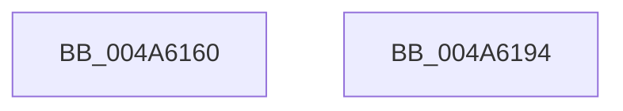

# MmMapMemoryDumpMdl

- RVA: `0x004A6160`–`0x004A6195` (길이 `53` bytes)
- VA: `0x00000001404A6160`
- 실행 섹션: `.text`
- PDB 이름 있음: `예`; PDB Function 태그: `아니요`
- unwind 정보 RVA: `0x0005C788`
- 디코드: `13`개 명령, `53/53` bytes 표시
- 미해석 바이트: `0` (있으면 어셈블리에 `.byte`로 보존)

> 이 문서는 커널 이미지의 기계어와 PDB 기호를 분석해 생성했습니다. 4번과 5번은 함수 원형과 자료형을 바이너리 사용 방식에서 추정한 C 해석이며 원본 소스 복구 결과는 아닙니다.

## 1. Dependencies

- 직접 호출 지점: **1**; 고유 호출 대상: **1**
- 직접 호출자로 확인된 함수: **0**
- RIP 상대 이미지 참조: **1**

### Outgoing calls
- `0x004A618A` → [MiMapMemoryDumpMdl](MiMapMemoryDumpMdl_function_004A619C.md) (function, `0x004A619C`)

### Direct callers
- 이 함수 시작 RVA로 연결되는 직접 call은 확인되지 않았습니다. 간접 호출은 완전히 역산할 수 없습니다.

### Static image references
- `0x004A6167` → RVA `0x00E301B8` (`.data`; read)

## 2. Other-region calls and transfers

- 다른 실행 섹션으로 향하는 call: **0**
- 별도 외부 분기/꼬리 이동을 확인하지 못했습니다.

## 3. Assembly (complete function range)

```asm
004A6160  48 83 EC 28                     sub rsp, 0x28
004A6164  4C 8B C1                        mov r8, rcx
004A6167  48 8B 0D 4A A0 98 00            mov rcx, qword ptr [rip + 0x98a04a]
004A616E  48 C1 E1 19                     shl rcx, 0x19
004A6172  48 B8 00 00 00 00 80 F6 FF FF   movabs rax, 0xfffff68000000000
004A617C  48 C1 E0 19                     shl rax, 0x19
004A6180  45 33 C9                        xor r9d, r9d
004A6183  48 2B C8                        sub rcx, rax
004A6186  48 C1 F9 10                     sar rcx, 0x10
004A618A  E8 0D 00 00 00                  call 0x1404a619c
004A618F  48 83 C4 28                     add rsp, 0x28
004A6193  C3                              ret
004A6194  CC                              int3
```

## 4. C-style interpretation (structured pseudocode)

```c
__int64 __fastcall MmMapMemoryDumpMdl(__int64 a1, __int64 a2, __int64 a3, int a4)
{
    __int64 result;
    __int64 v_rsp;

    v_rsp = (v_rsp) - (40);
    a1 = (*(unsigned __int64 *)(v_rip + 10002506)) << (25);
    result = (result) << (25);
    a4 = 0;
    a1 = (a1) - (result);
    a1 = (a1) >> (16);
    result = MiMapMemoryDumpMdl(a1, a2, a1, a4);
    v_rsp = (v_rsp) + (40);
    return result;
}
```

## 5. (Beta) C Style

```c
int64_t MmMapMemoryDumpMdl(int64_t Arg1, int64_t Arg2, int64_t Arg3, int32_t Arg4)
{
    int64_t result;
    int64_t local_rsp;

    local_rsp = (local_rsp) - (40);
    Arg1 = (*(uint64_t *)(v_rip + 0x98A04A)) << (25);
    result = (result) << (25);
    Arg4 = 0;
    Arg1 = (Arg1) - (result);
    Arg1 = (Arg1) >> (16);
    result = MiMapMemoryDumpMdl(Arg1, Arg2, Arg1, Arg4);
    local_rsp = (local_rsp) + (40);
    return result;
}
```

## 6. Execution-region graph

[열기: 2D/3D 그래프와 함수 탐색 컨트롤 패널](../../../control-panel.html?section=text&rva=0x004A6160&view=graph)

- 2D 그래프는 위에서 아래로 흐르고, 3D 그래프는 빈 공간을 드래그해 회전합니다. Shift+드래그는 이동, 휠은 확대·축소, 함수 노드 선택은 대상 보고서 이동입니다.

### Static fallback


