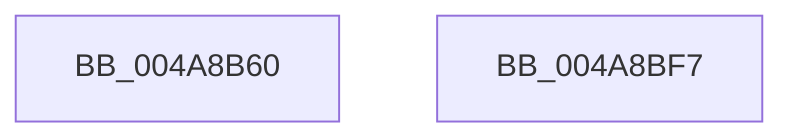

# MmRemoveExecuteGrants

- RVA: `0x004A8B60`–`0x004A8BF8` (길이 `152` bytes)
- VA: `0x00000001404A8B60`
- 실행 섹션: `.text`
- PDB 이름 있음: `예`; PDB Function 태그: `아니요`
- unwind 정보 RVA: `0x000B78D0`
- 디코드: `29`개 명령, `152/152` bytes 표시
- 미해석 바이트: `0` (있으면 어셈블리에 `.byte`로 보존)

> 이 문서는 커널 이미지의 기계어와 PDB 기호를 분석해 생성했습니다. 4번과 5번은 함수 원형과 자료형을 바이너리 사용 방식에서 추정한 C 해석이며 원본 소스 복구 결과는 아닙니다.

## 1. Dependencies

- 직접 호출 지점: **4**; 고유 호출 대상: **4**
- 직접 호출자로 확인된 함수: **1**
- RIP 상대 이미지 참조: **2**

### Outgoing calls
- `0x004A8B76` → [memset](../6C/memset_function_006C6C40.md) (function, `0x006C6C40`)
- `0x004A8BCF` → [MiLockWorkingSetShared](../27/MiLockWorkingSetShared_function_0027CBF0.md) (function, `0x0027CBF0`)
- `0x004A8BDD` → [MiWalkPageTables](../2C/MiWalkPageTables_function_002C2710.md) (function, `0x002C2710`)
- `0x004A8BE9` → [MiUnlockWorkingSetShared](../27/MiUnlockWorkingSetShared_function_0027D690.md) (function, `0x0027D690`)

### Direct callers
- [NtSetInformationProcess](../../page/AE/NtSetInformationProcess_function_00AE5370.md) at `0x00AE6B81`

### Static image references
- `0x004A8B8B` → RVA `0x00460BA0` (`MiRevokeExecutePte`; read)
- `0x004A8BA1` → RVA `0x004949A0` (`MiRevokeExecuteTail`; read)

## 2. Other-region calls and transfers

- 다른 실행 섹션으로 향하는 call: **0**
- 별도 외부 분기/꼬리 이동을 확인하지 못했습니다.

## 3. Assembly (complete function range)

```asm
004A8B60  40 53                           push rbx
004A8B62  48 81 EC E0 00 00 00            sub rsp, 0xe0
004A8B69  33 D2                           xor edx, edx
004A8B6B  48 8D 4C 24 20                  lea rcx, [rsp + 0x20]
004A8B70  41 B8 C0 00 00 00               mov r8d, 0xc0
004A8B76  E8 C5 E0 21 00                  call 0x1406c6c40
004A8B7B  65 48 8B 04 25 88 01 00 00      mov rax, qword ptr gs:[0x188]
004A8B84  48 8B 98 B8 00 00 00            mov rbx, qword ptr [rax + 0xb8]
004A8B8B  48 8D 05 0E 80 FB FF            lea rax, [rip - 0x47ff2]
004A8B92  48 89 84 24 C8 00 00 00         mov qword ptr [rsp + 0xc8], rax
004A8B9A  48 81 C3 00 04 00 00            add rbx, 0x400
004A8BA1  48 8D 05 F8 BD FE FF            lea rax, [rip - 0x14208]
004A8BA8  C7 44 24 20 06 00 01 00         mov dword ptr [rsp + 0x20], 0x10006
004A8BB0  48 89 84 24 D0 00 00 00         mov qword ptr [rsp + 0xd0], rax
004A8BB8  48 8B CB                        mov rcx, rbx
004A8BBB  48 B8 FF FF FF FF FF 7F FF FF   movabs rax, 0xffff7fffffffffff
004A8BC5  48 89 5C 24 40                  mov qword ptr [rsp + 0x40], rbx
004A8BCA  48 89 44 24 50                  mov qword ptr [rsp + 0x50], rax
004A8BCF  E8 1C 40 DD FF                  call 0x14027cbf0
004A8BD4  48 8D 4C 24 20                  lea rcx, [rsp + 0x20]
004A8BD9  88 44 24 29                     mov byte ptr [rsp + 0x29], al
004A8BDD  E8 2E 9B E1 FF                  call 0x1402c2710
004A8BE2  8A 54 24 29                     mov dl, byte ptr [rsp + 0x29]
004A8BE6  48 8B CB                        mov rcx, rbx
004A8BE9  E8 A2 4A DD FF                  call 0x14027d690
004A8BEE  48 81 C4 E0 00 00 00            add rsp, 0xe0
004A8BF5  5B                              pop rbx
004A8BF6  C3                              ret
004A8BF7  CC                              int3
```

## 4. C-style interpretation (structured pseudocode)

```c
__int64 __fastcall MmRemoveExecuteGrants(__int64 a1, int a2)
{
    __int64 result;
    __int64 v_rbx;
    __int64 v_rsp;
    unsigned __int64 v_stack_m18;
    unsigned __int64 v_stack_m20;
    unsigned __int64 v_stack_m98;
    unsigned __int64 v_stack_mA8;
    unsigned __int8 v_stack_mBF;
    unsigned __int64 v_stack_mC8;

    v_rsp = (v_rsp) - (224);
    a2 = 0;
    result = memset(v_stack_mC8, a2, 192, a4);
    v_stack_m20 = v_rip - 294898;
    v_rbx = (*(unsigned __int64 *)(*(unsigned __int64 *)(gs_base + (0 + 392)) + 184)) + (0x400ULL);
    v_stack_mC8 = 0x10006ULL;
    v_stack_m18 = v_rip - 82440;
    v_stack_mA8 = v_rbx;
    v_stack_m98 = v_rip - 82440;
    result = MiLockWorkingSetShared(v_rbx, a2, 192, a4);
    v_stack_mBF = (unsigned __int8)(result);
    result = MiWalkPageTables(v_stack_mC8, a2, 192, a4);
    result = MiUnlockWorkingSetShared(v_rbx, v_stack_mBF, 192, a4);
    v_rsp = (v_rsp) + (224);
    return result;
}
```

## 5. (Beta) C Style

```c
int64_t MmRemoveExecuteGrants(int64_t Arg1, int32_t Arg2)
{
    int64_t result;
    int64_t local_rbx;
    int64_t local_rsp;
    uint64_t v_stack_m18;
    uint64_t v_stack_m20;
    uint64_t v_stack_m98;
    uint64_t v_stack_mA8;
    uint8_t v_stack_mBF;
    uint64_t v_stack_mC8;

    local_rsp = (local_rsp) - (224);
    Arg2 = 0;
    result = memset(v_stack_mC8, Arg2, 192, a4);
    v_stack_m20 = v_rip - 294898;
    local_rbx = (*(uint64_t *)(*(uint64_t *)(gs_base + (0 + 0x188)) + 0xB8)) + (0x400ULL);
    v_stack_mC8 = 0x10006ULL;
    v_stack_m18 = v_rip - 82440;
    v_stack_mA8 = local_rbx;
    v_stack_m98 = v_rip - 82440;
    result = MiLockWorkingSetShared(local_rbx, Arg2, 192, a4);
    v_stack_mBF = (uint8_t)(result);
    result = MiWalkPageTables(v_stack_mC8, Arg2, 192, a4);
    result = MiUnlockWorkingSetShared(local_rbx, v_stack_mBF, 192, a4);
    local_rsp = (local_rsp) + (224);
    return result;
}
```

## 6. Execution-region graph

[열기: 2D/3D 그래프와 함수 탐색 컨트롤 패널](../../../control-panel.html?section=text&rva=0x004A8B60&view=graph)

- 2D 그래프는 위에서 아래로 흐르고, 3D 그래프는 빈 공간을 드래그해 회전합니다. Shift+드래그는 이동, 휠은 확대·축소, 함수 노드 선택은 대상 보고서 이동입니다.

### Static fallback


