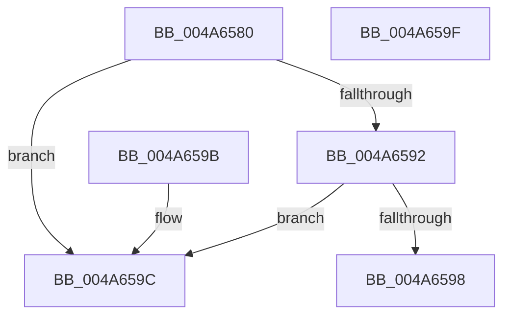

# ObIsKernelHandle

- RVA: `0x004A6580`–`0x004A65A0` (길이 `32` bytes)
- VA: `0x00000001404A6580`
- 실행 섹션: `.text`
- PDB 이름 있음: `예`; PDB Function 태그: `아니요`
- unwind 정보 RVA: `0x000DB714`
- 디코드: `13`개 명령, `32/32` bytes 표시
- 미해석 바이트: `0` (있으면 어셈블리에 `.byte`로 보존)

> 이 문서는 커널 이미지의 기계어와 PDB 기호를 분석해 생성했습니다. 4번과 5번은 함수 원형과 자료형을 바이너리 사용 방식에서 추정한 C 해석이며 원본 소스 복구 결과는 아닙니다.

## 1. Dependencies

- 직접 호출 지점: **0**; 고유 호출 대상: **0**
- 직접 호출자로 확인된 함수: **1**
- RIP 상대 이미지 참조: **0**

### Outgoing calls
- 직접 디코드된 call 명령이 없습니다.

### Direct callers
- [MmPrefetchVirtualMemory](../../page/93/MmPrefetchVirtualMemory_function_0093A698.md) at `0x0093A77E`

### Static image references
- 디코드된 RIP-relative 메모리 참조가 없습니다.

## 2. Other-region calls and transfers

- 다른 실행 섹션으로 향하는 call: **0**
- 별도 외부 분기/꼬리 이동을 확인하지 못했습니다.

## 3. Assembly (complete function range)

```asm
004A6580  48 C7 C2 00 00 00 80            mov rdx, 0xffffffff80000000
004A6587  48 8B C1                        mov rax, rcx
004A658A  48 23 C2                        and rax, rdx
004A658D  48 3B C2                        cmp rax, rdx
004A6590  75 0A                           jne 0x1404a659c
004A6592  48 83 F9 FD                     cmp rcx, -3
004A6596  77 04                           ja 0x1404a659c
004A6598  B0 01                           mov al, 1
004A659A  C3                              ret
004A659B  CC                              int3
004A659C  32 C0                           xor al, al
004A659E  C3                              ret
004A659F  CC                              int3
```

## 4. C-style interpretation (structured pseudocode)

```c
__int64 __fastcall ObIsKernelHandle(__int64 a1)
{
    __int64 result;

    result = (a1) & (0xFFFFFFFF80000000ULL);
    if (result != 0xFFFFFFFF80000000ULL) goto loc_004A659C;
    if (a1 > -3) goto loc_004A659C;
    return 1;
loc_004A659C:
    result = 0;
    return result;
}
```

## 5. (Beta) C Style

```c
int64_t ObIsKernelHandle(int64_t Arg1)
{
    int64_t result;

    result = (Arg1) & (0xFFFFFFFF80000000ULL);
    if (result != 0xFFFFFFFF80000000ULL) goto loc_004A659C;
    if (Arg1 > -3) goto loc_004A659C;
    return 1;
loc_004A659C:
    result = 0;
    return result;
}
```

## 6. Execution-region graph

[열기: 2D/3D 그래프와 함수 탐색 컨트롤 패널](../../../control-panel.html?section=text&rva=0x004A6580&view=graph)

- 2D 그래프는 위에서 아래로 흐르고, 3D 그래프는 빈 공간을 드래그해 회전합니다. Shift+드래그는 이동, 휠은 확대·축소, 함수 노드 선택은 대상 보고서 이동입니다.

### Static fallback


