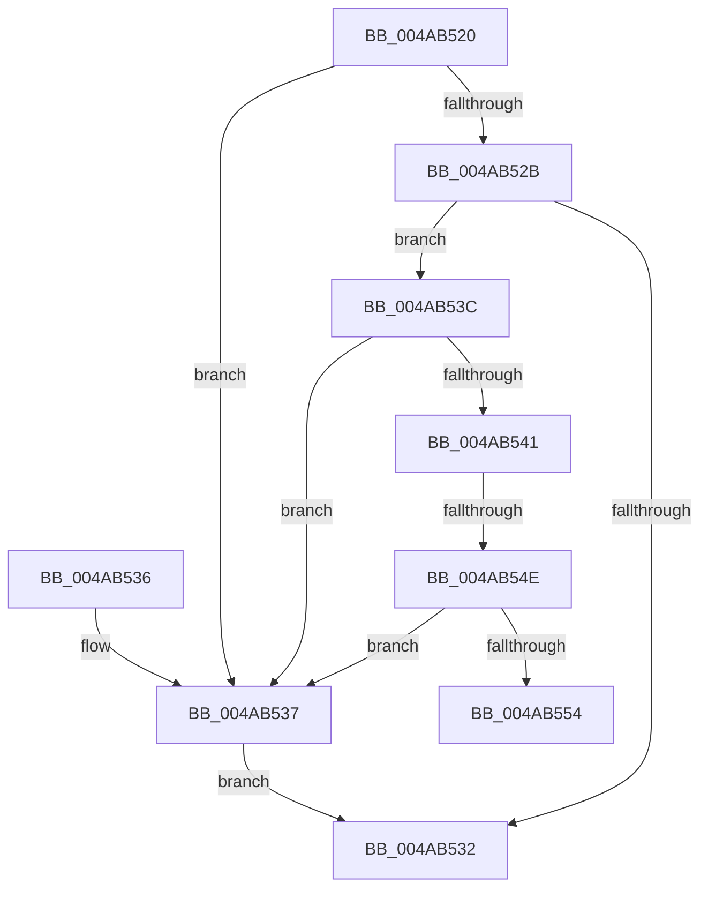

# Pdcv2pValidateExtraActivationParameters

- RVA: `0x004AB520`–`0x004AB559` (길이 `57` bytes)
- VA: `0x00000001404AB520`
- 실행 섹션: `.text`
- PDB 이름 있음: `예`; PDB Function 태그: `예`
- unwind 정보 RVA: `0x000DB714`
- 디코드: `19`개 명령, `57/57` bytes 표시
- 미해석 바이트: `0` (있으면 어셈블리에 `.byte`로 보존)

> 이 문서는 커널 이미지의 기계어와 PDB 기호를 분석해 생성했습니다. 4번과 5번은 함수 원형과 자료형을 바이너리 사용 방식에서 추정한 C 해석이며 원본 소스 복구 결과는 아닙니다.

## 1. Dependencies

- 직접 호출 지점: **0**; 고유 호출 대상: **0**
- 직접 호출자로 확인된 함수: **1**
- RIP 상대 이미지 참조: **0**

### Outgoing calls
- 직접 디코드된 call 명령이 없습니다.

### Direct callers
- [Pdcv2ActivationClientActivate](../../page/95/Pdcv2ActivationClientActivate_function_00953C70.md) at `0x00953D1C`

### Static image references
- 디코드된 RIP-relative 메모리 참조가 없습니다.

## 2. Other-region calls and transfers

- 다른 실행 섹션으로 향하는 call: **0**
- call이 아닌 외부 분기/꼬리 이동: **2**
  - `0x004AB548` → `0x006FA52A` (`tail-transfer`)
  - `0x004AB554` → `0x006FA52A` (`tail-transfer`)

## 3. Assembly (complete function range)

```asm
004AB520  41 B8 01 00 00 00               mov r8d, 1
004AB526  48 85 C9                        test rcx, rcx
004AB529  74 0C                           je 0x1404ab537
004AB52B  8B 01                           mov eax, dword ptr [rcx]
004AB52D  41 3B C0                        cmp eax, r8d
004AB530  75 0A                           jne 0x1404ab53c
004AB532  41 8A C0                        mov al, r8b
004AB535  C3                              ret
004AB536  CC                              int3
004AB537  45 32 C0                        xor r8b, r8b
004AB53A  EB F6                           jmp 0x1404ab532
004AB53C  83 F8 02                        cmp eax, 2
004AB53F  75 F6                           jne 0x1404ab537
004AB541  48 8B 49 20                     mov rcx, qword ptr [rcx + 0x20]
004AB545  48 85 C9                        test rcx, rcx
004AB548  0F 84 DC EF 24 00               je 0x1406fa52a
004AB54E  48 83 39 08                     cmp qword ptr [rcx], 8
004AB552  73 E3                           jae 0x1404ab537
004AB554  E9 D1 EF 24 00                  jmp 0x1406fa52a
```

## 4. C-style interpretation (structured pseudocode)

```c
__int64 __fastcall Pdcv2pValidateExtraActivationParameters(__int64 a1)
{
    if (a1 == 0) goto loc_004AB537;
    if (((unsigned int)((unsigned int)(*(unsigned int *)(a1)))) != 1) goto loc_004AB53C;
loc_004AB532:
    return 1;
loc_004AB537:
    a3 = 0;
    goto loc_004AB532;
loc_004AB53C:
    if (1 != 2) goto loc_004AB537;
    if ((*(unsigned __int64 *)(*(unsigned __int64 *)(a1 + 32))) >= 8) goto loc_004AB537;
}
```

## 5. (Beta) C Style

```c
int64_t Pdcv2pValidateExtraActivationParameters(int64_t Arg1)
{
    if (Arg1 == 0) goto loc_004AB537;
    if (((uint32_t)((uint32_t)(*(uint32_t *)(Arg1)))) != 1) goto loc_004AB53C;
loc_004AB532:
    return 1;
loc_004AB537:
    a3 = 0;
    goto loc_004AB532;
loc_004AB53C:
    if (1 != 2) goto loc_004AB537;
    if ((*(uint64_t *)(*(uint64_t *)(Arg1 + 0x20))) >= 8) goto loc_004AB537;
}
```

## 6. Execution-region graph

[열기: 2D/3D 그래프와 함수 탐색 컨트롤 패널](../../../control-panel.html?section=text&rva=0x004AB520&view=graph)

- 2D 그래프는 위에서 아래로 흐르고, 3D 그래프는 빈 공간을 드래그해 회전합니다. Shift+드래그는 이동, 휠은 확대·축소, 함수 노드 선택은 대상 보고서 이동입니다.

### Static fallback


