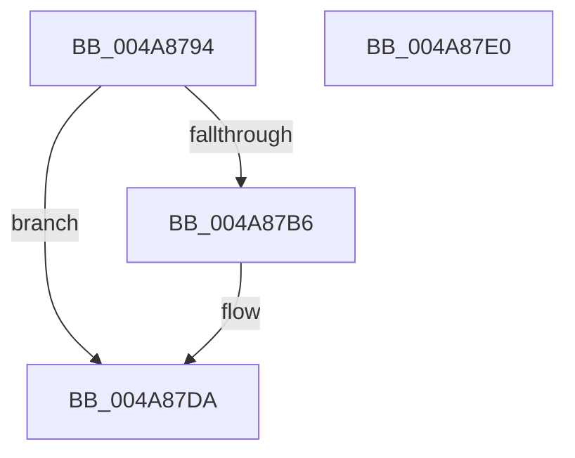

# PfSnLogScenarioMeasures

- RVA: `0x004A8794`–`0x004A87E1` (길이 `77` bytes)
- VA: `0x00000001404A8794`
- 실행 섹션: `.text`
- PDB 이름 있음: `예`; PDB Function 태그: `아니요`
- unwind 정보 RVA: `0x0005CF00`
- 디코드: `22`개 명령, `77/77` bytes 표시
- 미해석 바이트: `0` (있으면 어셈블리에 `.byte`로 보존)

> 이 문서는 커널 이미지의 기계어와 PDB 기호를 분석해 생성했습니다. 4번과 5번은 함수 원형과 자료형을 바이너리 사용 방식에서 추정한 C 해석이며 원본 소스 복구 결과는 아닙니다.

## 1. Dependencies

- 직접 호출 지점: **1**; 고유 호출 대상: **1**
- 직접 호출자로 확인된 함수: **1**
- RIP 상대 이미지 참조: **0**

### Outgoing calls
- `0x004A87AD` → [PfSnTraceGetLogEntry](../34/PfSnTraceGetLogEntry_function_003437A0.md) (function, `0x003437A0`)

### Direct callers
- [PfSnBeginScenario](../../page/95/PfSnBeginScenario_function_0095EFC0.md) at `0x0095F1B4`

### Static image references
- 디코드된 RIP-relative 메모리 참조가 없습니다.

## 2. Other-region calls and transfers

- 다른 실행 섹션으로 향하는 call: **0**
- 별도 외부 분기/꼬리 이동을 확인하지 못했습니다.

## 3. Assembly (complete function range)

```asm
004A8794  40 53                           push rbx
004A8796  48 83 EC 20                     sub rsp, 0x20
004A879A  48 83 64 24 40 00               and qword ptr [rsp + 0x40], 0
004A87A0  4C 8D 44 24 40                  lea r8, [rsp + 0x40]
004A87A5  48 8B DA                        mov rbx, rdx
004A87A8  BA 03 00 00 00                  mov edx, 3
004A87AD  E8 EE AF E9 FF                  call 0x1403437a0
004A87B2  85 C0                           test eax, eax
004A87B4  78 24                           js 0x1404a87da
004A87B6  48 8B 44 24 40                  mov rax, qword ptr [rsp + 0x40]
004A87BB  0F 57 C0                        xorps xmm0, xmm0
004A87BE  0F 11 00                        movups xmmword ptr [rax], xmm0
004A87C1  0F 11 40 10                     movups xmmword ptr [rax + 0x10], xmm0
004A87C5  0F 11 40 20                     movups xmmword ptr [rax + 0x20], xmm0
004A87C9  48 C7 00 27 00 00 00            mov qword ptr [rax], 0x27
004A87D0  0F 10 03                        movups xmm0, xmmword ptr [rbx]
004A87D3  F3 0F 7F 40 10                  movdqu xmmword ptr [rax + 0x10], xmm0
004A87D8  33 C0                           xor eax, eax
004A87DA  48 83 C4 20                     add rsp, 0x20
004A87DE  5B                              pop rbx
004A87DF  C3                              ret
004A87E0  CC                              int3
```

## 4. C-style interpretation (structured pseudocode)

```c
__int64 __fastcall PfSnLogScenarioMeasures(__int64 a1, __int64 a2)
{
    __int64 result;
    __int64 v_rsp;
    unsigned __int64 v_stack_p18;

    v_rsp = (v_rsp) - (32);
    result = PfSnTraceGetLogEntry(a1, 3, v_stack_p18, a4);
    if (!(sign_flag)) {
        result = v_stack_p18;
        *(unsigned __int64 *)(result) = v_xmm0;
        *(unsigned __int64 *)(result + 16) = v_xmm0;
        *(unsigned __int64 *)(result + 32) = v_xmm0;
        *(unsigned __int64 *)(result) = 39;
        *(unsigned __int64 *)(result + 16) = v_xmm0;
        result = 0;
    }
    v_rsp = (v_rsp) + (32);
    return result;
}
```

## 5. (Beta) C Style

```c
int64_t PfSnLogScenarioMeasures(int64_t Arg1, void *Arg2)
{
    uint8_t *arg2 = (uint8_t *)Arg2;

    int64_t result;
    int64_t local_rsp;
    uint64_t v_stack_p18;

    local_rsp = (local_rsp) - (32);
    result = PfSnTraceGetLogEntry(Arg1, 3, v_stack_p18, a4);
    if (!(sign_flag)) {
        result = v_stack_p18;
        *(uint64_t *)(result) = v_xmm0;
        *(uint64_t *)(result + 0x10) = v_xmm0;
        *(uint64_t *)(result + 0x20) = v_xmm0;
        *(uint64_t *)(result) = 39;
        *(uint64_t *)(result + 0x10) = v_xmm0;
        result = 0;
    }
    local_rsp = (local_rsp) + (32);
    return result;
}
```

### 관측된 메모리 오프셋

구조체 형식이 확인되지 않은 접근은 인자 기준의 오프셋으로만 기록했습니다.

| 기준 인자 | 오프셋 표현 | 폭 (bit) | 접근 |
|---|---:|---:|---|
| `Arg2` | `+ 0x0` | `128` | `R` |

## 6. Execution-region graph

[열기: 2D/3D 그래프와 함수 탐색 컨트롤 패널](../../../control-panel.html?section=text&rva=0x004A8794&view=graph)

- 2D 그래프는 위에서 아래로 흐르고, 3D 그래프는 빈 공간을 드래그해 회전합니다. Shift+드래그는 이동, 휠은 확대·축소, 함수 노드 선택은 대상 보고서 이동입니다.

### Static fallback


