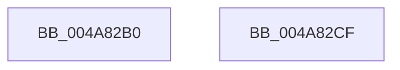

# PfpPartitionLogEventCallback

- RVA: `0x004A82B0`–`0x004A82D0` (길이 `32` bytes)
- VA: `0x00000001404A82B0`
- 실행 섹션: `.text`
- PDB 이름 있음: `예`; PDB Function 태그: `아니요`
- unwind 정보 RVA: `0x0005D2F4`
- 디코드: `10`개 명령, `32/32` bytes 표시
- 미해석 바이트: `0` (있으면 어셈블리에 `.byte`로 보존)

> 이 문서는 커널 이미지의 기계어와 PDB 기호를 분석해 생성했습니다. 4번과 5번은 함수 원형과 자료형을 바이너리 사용 방식에서 추정한 C 해석이며 원본 소스 복구 결과는 아닙니다.

## 1. Dependencies

- 직접 호출 지점: **1**; 고유 호출 대상: **1**
- 직접 호출자로 확인된 함수: **0**
- RIP 상대 이미지 참조: **0**

### Outgoing calls
- `0x004A82C5` → [PfLogEvent](../34/PfLogEvent_function_00349BA8.md) (function, `0x00349BA8`)

### Direct callers
- 이 함수 시작 RVA로 연결되는 직접 call은 확인되지 않았습니다. 간접 호출은 완전히 역산할 수 없습니다.

### Static image references
- 디코드된 RIP-relative 메모리 참조가 없습니다.

## 2. Other-region calls and transfers

- 다른 실행 섹션으로 향하는 call: **0**
- 별도 외부 분기/꼬리 이동을 확인하지 못했습니다.

## 3. Assembly (complete function range)

```asm
004A82B0  48 83 EC 38                     sub rsp, 0x38
004A82B4  8B 42 08                        mov eax, dword ptr [rdx + 8]
004A82B7  4C 8B 4A 10                     mov r9, qword ptr [rdx + 0x10]
004A82BB  44 8B 42 04                     mov r8d, dword ptr [rdx + 4]
004A82BF  8B 12                           mov edx, dword ptr [rdx]
004A82C1  89 44 24 20                     mov dword ptr [rsp + 0x20], eax
004A82C5  E8 DE 18 EA FF                  call 0x140349ba8
004A82CA  48 83 C4 38                     add rsp, 0x38
004A82CE  C3                              ret
004A82CF  CC                              int3
```

## 4. C-style interpretation (structured pseudocode)

```c
__int64 __fastcall PfpPartitionLogEventCallback(__int64 a1, __int64 a2)
{
    __int64 result;
    __int64 v_rsp;
    unsigned int v_stack_m18;

    v_rsp = (v_rsp) - (56);
    v_stack_m18 = (unsigned int)((unsigned int)(*(unsigned int *)(a2 + 8)));
    result = PfLogEvent(a1, (unsigned int)(*(unsigned int *)(a2)), (unsigned int)(*(unsigned int *)(a2 + 4)), *(unsigned __int64 *)(a2 + 16));
    v_rsp = (v_rsp) + (56);
    return result;
}
```

## 5. (Beta) C Style

```c
int64_t PfpPartitionLogEventCallback(int64_t Arg1, void *Arg2)
{
    uint8_t *arg2 = (uint8_t *)Arg2;

    int64_t result;
    int64_t local_rsp;
    uint32_t v_stack_m18;

    local_rsp = (local_rsp) - (56);
    v_stack_m18 = (uint32_t)((uint32_t)(*(uint32_t *)(arg2 + 0x8)));
    result = PfLogEvent(Arg1, (uint32_t)(*(uint32_t *)(arg2)), (uint32_t)(*(uint32_t *)(arg2 + 0x4)), *(uint64_t *)(arg2 + 0x10));
    local_rsp = (local_rsp) + (56);
    return result;
}
```

### 관측된 메모리 오프셋

구조체 형식이 확인되지 않은 접근은 인자 기준의 오프셋으로만 기록했습니다.

| 기준 인자 | 오프셋 표현 | 폭 (bit) | 접근 |
|---|---:|---:|---|
| `Arg2` | `+ 0x0` | `32` | `R` |
| `Arg2` | `+ 0x4` | `32` | `R` |
| `Arg2` | `+ 0x8` | `32` | `R` |
| `Arg2` | `+ 0x10` | `64` | `R` |

## 6. Execution-region graph

[열기: 2D/3D 그래프와 함수 탐색 컨트롤 패널](../../../control-panel.html?section=text&rva=0x004A82B0&view=graph)

- 2D 그래프는 위에서 아래로 흐르고, 3D 그래프는 빈 공간을 드래그해 회전합니다. Shift+드래그는 이동, 휠은 확대·축소, 함수 노드 선택은 대상 보고서 이동입니다.

### Static fallback


