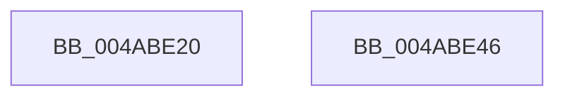

# PfpReadSupportInitialize

- RVA: `0x004ABE20`–`0x004ABE47` (길이 `39` bytes)
- VA: `0x00000001404ABE20`
- 실행 섹션: `.text`
- PDB 이름 있음: `예`; PDB Function 태그: `아니요`
- unwind 정보 RVA: `0x0005C788`
- 디코드: `12`개 명령, `39/39` bytes 표시
- 미해석 바이트: `0` (있으면 어셈블리에 `.byte`로 보존)

> 이 문서는 커널 이미지의 기계어와 PDB 기호를 분석해 생성했습니다. 4번과 5번은 함수 원형과 자료형을 바이너리 사용 방식에서 추정한 C 해석이며 원본 소스 복구 결과는 아닙니다.

## 1. Dependencies

- 직접 호출 지점: **1**; 고유 호출 대상: **1**
- 직접 호출자로 확인된 함수: **2**
- RIP 상대 이미지 참조: **0**

### Outgoing calls
- `0x004ABE3C` → [PfpOpenHandleInitialize](../../page/A3/PfpOpenHandleInitialize_function_00A35578.md) (function, `0x00A35578`)

### Direct callers
- [PfpPrefetchFiles](../../page/93/PfpPrefetchFiles_function_0093AD58.md) at `0x0093AF95`
- [PfpPrefetchFiles](../../page/93/PfpPrefetchFiles_function_0093AD58.md) at `0x0093B09A`
- [PfpPrefetchFilesTrickle](../../page/93/PfpPrefetchFilesTrickle_function_0093C4E8.md) at `0x0093C5FB`

### Static image references
- 디코드된 RIP-relative 메모리 참조가 없습니다.

## 2. Other-region calls and transfers

- 다른 실행 섹션으로 향하는 call: **1**
  - `0x004ABE3C` → [PfpOpenHandleInitialize](../../page/A3/PfpOpenHandleInitialize_function_00A35578.md) (`.text` → `PAGE`)
- 별도 외부 분기/꼬리 이동을 확인하지 못했습니다.

## 3. Assembly (complete function range)

```asm
004ABE20  48 83 EC 28                     sub rsp, 0x28
004ABE24  0F 57 C0                        xorps xmm0, xmm0
004ABE27  33 C0                           xor eax, eax
004ABE29  0F 11 01                        movups xmmword ptr [rcx], xmm0
004ABE2C  0F 11 41 10                     movups xmmword ptr [rcx + 0x10], xmm0
004ABE30  0F 11 41 20                     movups xmmword ptr [rcx + 0x20], xmm0
004ABE34  48 89 41 30                     mov qword ptr [rcx + 0x30], rax
004ABE38  48 83 C1 08                     add rcx, 8
004ABE3C  E8 37 97 58 00                  call 0x140a35578
004ABE41  48 83 C4 28                     add rsp, 0x28
004ABE45  C3                              ret
004ABE46  CC                              int3
```

## 4. C-style interpretation (structured pseudocode)

```c
__int64 __fastcall PfpReadSupportInitialize(__int64 a1)
{
    __int64 result;
    __int64 v_rsp;

    v_rsp = (v_rsp) - (40);
    result = 0;
    *(unsigned __int64 *)(a1) = v_xmm0;
    *(unsigned __int64 *)(a1 + 16) = v_xmm0;
    *(unsigned __int64 *)(a1 + 32) = v_xmm0;
    *(unsigned __int64 *)(a1 + 48) = 0;
    a1 = (a1) + (8);
    result = PfpOpenHandleInitialize(a1, a2, a3, a4);
    v_rsp = (v_rsp) + (40);
    return result;
}
```

## 5. (Beta) C Style

```c
int64_t PfpReadSupportInitialize(void *Arg1)
{
    uint8_t *arg1 = (uint8_t *)Arg1;

    int64_t result;
    int64_t local_rsp;

    local_rsp = (local_rsp) - (40);
    result = 0;
    *(uint64_t *)(arg1) = v_xmm0;
    *(uint64_t *)(arg1 + 0x10) = v_xmm0;
    *(uint64_t *)(arg1 + 0x20) = v_xmm0;
    *(uint64_t *)(arg1 + 0x30) = 0;
    Arg1 = (Arg1) + (8);
    result = PfpOpenHandleInitialize(Arg1, a2, a3, a4);
    local_rsp = (local_rsp) + (40);
    return result;
}
```

### 관측된 메모리 오프셋

구조체 형식이 확인되지 않은 접근은 인자 기준의 오프셋으로만 기록했습니다.

| 기준 인자 | 오프셋 표현 | 폭 (bit) | 접근 |
|---|---:|---:|---|
| `Arg1` | `+ 0x0` | `128` | `R` |
| `Arg1` | `+ 0x10` | `128` | `R` |
| `Arg1` | `+ 0x20` | `128` | `R` |
| `Arg1` | `+ 0x30` | `64` | `W` |

## 6. Execution-region graph

[열기: 2D/3D 그래프와 함수 탐색 컨트롤 패널](../../../control-panel.html?section=text&rva=0x004ABE20&view=graph)

- 2D 그래프는 위에서 아래로 흐르고, 3D 그래프는 빈 공간을 드래그해 회전합니다. Shift+드래그는 이동, 휠은 확대·축소, 함수 노드 선택은 대상 보고서 이동입니다.

### Static fallback


