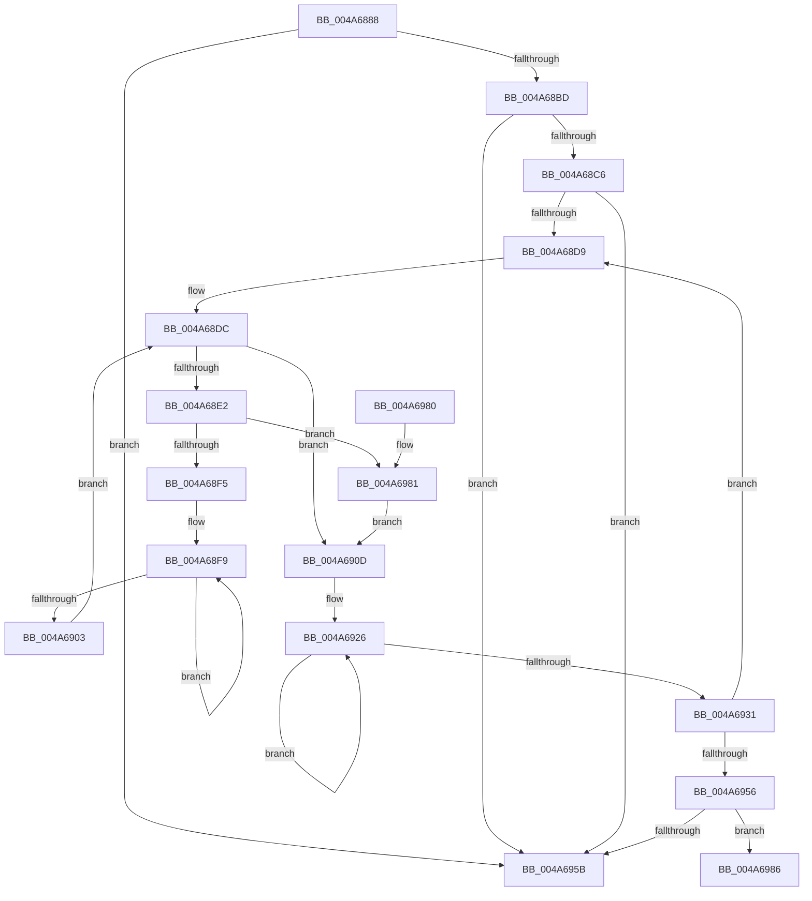

# PiDevCfgGetMigrationDeviceIdScore

- RVA: `0x004A6888`–`0x004A69B0` (길이 `296` bytes)
- VA: `0x00000001404A6888`
- 실행 섹션: `.text`
- PDB 이름 있음: `예`; PDB Function 태그: `예`
- unwind 정보 RVA: `0x000B6EA0`
- 디코드: `83`개 명령, `296/296` bytes 표시
- 미해석 바이트: `0` (있으면 어셈블리에 `.byte`로 보존)

> 이 문서는 커널 이미지의 기계어와 PDB 기호를 분석해 생성했습니다. 4번과 5번은 함수 원형과 자료형을 바이너리 사용 방식에서 추정한 C 해석이며 원본 소스 복구 결과는 아닙니다.

## 1. Dependencies

- 직접 호출 지점: **2**; 고유 호출 대상: **1**
- 직접 호출자로 확인된 함수: **1**
- RIP 상대 이미지 참조: **0**

### Outgoing calls
- `0x004A68E8` → [wcsicmp](../50/wcsicmp_function_00500080.md) (function, `0x00500080`)
- `0x004A698C` → [wcsicmp](../50/wcsicmp_function_00500080.md) (function, `0x00500080`)

### Direct callers
- [PiDevCfgFindDeviceMigrationNode](../../page/73/PiDevCfgFindDeviceMigrationNode_function_00732920.md) at `0x00732C1F`

### Static image references
- 디코드된 RIP-relative 메모리 참조가 없습니다.

## 2. Other-region calls and transfers

- 다른 실행 섹션으로 향하는 call: **0**
- call이 아닌 외부 분기/꼬리 이동: **1**
  - `0x004A69AB` → [sub_006F98F4](../6F/Unknown_function_006F98F4.md) (`tail-transfer`)

## 3. Assembly (complete function range)

```asm
004A6888  48 89 5C 24 08                  mov qword ptr [rsp + 8], rbx
004A688D  48 89 6C 24 10                  mov qword ptr [rsp + 0x10], rbp
004A6892  48 89 74 24 18                  mov qword ptr [rsp + 0x18], rsi
004A6897  57                              push rdi
004A6898  41 54                           push r12
004A689A  41 55                           push r13
004A689C  41 56                           push r14
004A689E  41 57                           push r15
004A68A0  48 83 EC 20                     sub rsp, 0x20
004A68A4  45 33 ED                        xor r13d, r13d
004A68A7  48 8B DA                        mov rbx, rdx
004A68AA  48 8B F9                        mov rdi, rcx
004A68AD  45 0F B7 E5                     movzx r12d, r13w
004A68B1  45 8A F5                        mov r14b, r13b
004A68B4  48 85 C9                        test rcx, rcx
004A68B7  0F 84 9E 00 00 00               je 0x1404a695b
004A68BD  48 85 D2                        test rdx, rdx
004A68C0  0F 84 95 00 00 00               je 0x1404a695b
004A68C6  41 BF 00 40 00 00               mov r15d, 0x4000
004A68CC  48 8B EA                        mov rbp, rdx
004A68CF  66 44 39 2A                     cmp word ptr [rdx], r13w
004A68D3  0F 84 82 00 00 00               je 0x1404a695b
004A68D9  48 8B F7                        mov rsi, rdi
004A68DC  66 44 39 2E                     cmp word ptr [rsi], r13w
004A68E0  74 2B                           je 0x1404a690d
004A68E2  48 8B D5                        mov rdx, rbp
004A68E5  48 8B CE                        mov rcx, rsi
004A68E8  E8 93 97 05 00                  call 0x140500080
004A68ED  85 C0                           test eax, eax
004A68EF  0F 84 8C 00 00 00               je 0x1404a6981
004A68F5  48 83 C8 FF                     or rax, 0xffffffffffffffff
004A68F9  48 FF C0                        inc rax
004A68FC  66 44 39 2C 46                  cmp word ptr [rsi + rax*2], r13w
004A6901  75 F6                           jne 0x1404a68f9
004A6903  48 8D 34 46                     lea rsi, [rsi + rax*2]
004A6907  48 83 C6 02                     add rsi, 2
004A690B  EB CF                           jmp 0x1404a68dc
004A690D  41 0F B7 CF                     movzx ecx, r15w
004A6911  66 41 0B CC                     or cx, r12w
004A6915  66 44 39 2E                     cmp word ptr [rsi], r13w
004A6919  66 41 0F 45 CC                  cmovne cx, r12w
004A691E  48 83 C8 FF                     or rax, 0xffffffffffffffff
004A6922  44 0F B7 E1                     movzx r12d, cx
004A6926  48 FF C0                        inc rax
004A6929  66 44 39 6C 45 00               cmp word ptr [rbp + rax*2], r13w
004A692F  75 F5                           jne 0x1404a6926
004A6931  48 8D 6C 45 00                  lea rbp, [rbp + rax*2]
004A6936  41 0F B7 C7                     movzx eax, r15w
004A693A  66 D1 E8                        shr ax, 1
004A693D  48 83 C5 02                     add rbp, 2
004A6941  66 41 83 FF 02                  cmp r15w, 2
004A6946  66 41 0F 46 C7                  cmovbe ax, r15w
004A694B  44 0F B7 F8                     movzx r15d, ax
004A694F  66 44 39 6D 00                  cmp word ptr [rbp], r13w
004A6954  75 83                           jne 0x1404a68d9
004A6956  45 84 F6                        test r14b, r14b
004A6959  75 2B                           jne 0x1404a6986
004A695B  B9 FF FF 00 00                  mov ecx, 0xffff
004A6960  48 8B 5C 24 50                  mov rbx, qword ptr [rsp + 0x50]
004A6965  0F B7 C1                        movzx eax, cx
004A6968  48 8B 6C 24 58                  mov rbp, qword ptr [rsp + 0x58]
004A696D  48 8B 74 24 60                  mov rsi, qword ptr [rsp + 0x60]
004A6972  48 83 C4 20                     add rsp, 0x20
004A6976  41 5F                           pop r15
004A6978  41 5E                           pop r14
004A697A  41 5D                           pop r13
004A697C  41 5C                           pop r12
004A697E  5F                              pop rdi
004A697F  C3                              ret
004A6980  CC                              int3
004A6981  41 B6 01                        mov r14b, 1
004A6984  EB 87                           jmp 0x1404a690d
004A6986  48 8B D3                        mov rdx, rbx
004A6989  48 8B CF                        mov rcx, rdi
004A698C  E8 EF 96 05 00                  call 0x140500080
004A6991  B9 00 80 00 00                  mov ecx, 0x8000
004A6996  41 0F B7 F4                     movzx esi, r12w
004A699A  66 0B F1                        or si, cx
004A699D  85 C0                           test eax, eax
004A699F  66 41 0F 44 F4                  cmove si, r12w
004A69A4  48 83 C9 FF                     or rcx, 0xffffffffffffffff
004A69A8  48 8B C1                        mov rax, rcx
004A69AB  E9 44 2F 25 00                  jmp 0x1406f98f4
```

## 4. C-style interpretation (structured pseudocode)

```c
__int64 __fastcall PiDevCfgGetMigrationDeviceIdScore(__int64 a1, __int64 a2)
{
    __int64 result;
    __int64 v_r13;
    __int64 v_rbp;
    __int64 v_rsi;
    __int64 v_rsp;
    unsigned __int64 v_stack_p10;
    unsigned __int64 v_stack_p18;
    unsigned __int64 v_stack_p8;

    v_stack_p8 = v_rbx;
    v_stack_p10 = v_rbp;
    v_stack_p18 = v_rsi;
    v_rsp = (v_rsp) - (32);
    v_r13 = 0;
    if (a1 == 0) goto loc_004A695B;
    if (a2 == 0) goto loc_004A695B;
    if ((*(unsigned __int16 *)(a2)) == 0) goto loc_004A695B;
loc_004A68D9:
loc_004A68DC:
    if ((*(unsigned __int16 *)(a1)) == 0) goto loc_004A690D;
    result = wcsicmp(a1, a2, a3, a4);
    if ((unsigned int)(result) == 0) goto loc_004A6981;
    result = (result) | (-1);
loc_004A68F9:
    result = (result) + 1;
    if ((*(unsigned __int16 *)(a1 + result * 2)) != 0) goto loc_004A68F9;
    v_rsi = (a1 + result * 2) + (2);
    goto loc_004A68DC;
loc_004A690D:
    a1 = (unsigned __int16)(((unsigned __int16)((unsigned int)(0x4000ULL))) | (0));
    if ((*(unsigned __int16 *)(v_rsi)) != 0) { a1 = 0; }
    result = (result) | (-1);
loc_004A6926:
    result = (result) + 1;
    if ((*(unsigned __int16 *)(a2 + result * 2)) != 0) goto loc_004A6926;
    result = (unsigned __int16)(((unsigned __int16)((unsigned int)(0x4000ULL))) >> (1));
    v_rbp = (a2 + result * 2) + (2);
    if (((unsigned __int16)((unsigned int)(0x4000ULL))) <= 2) { result = (unsigned __int16)((unsigned int)(0x4000ULL)); }
    if ((*(unsigned __int16 *)(v_rbp)) != 0) goto loc_004A68D9;
    if (0 != 0) goto loc_004A6986;
loc_004A695B:
    v_rsp = (v_rsp) + (32);
    return (unsigned __int16)((unsigned int)(0xFFFFULL));
loc_004A6981:
    goto loc_004A690D;
loc_004A6986:
    result = wcsicmp(a1, v_stack_p8, a3, a4);
    v_rsi = (unsigned __int16)(((unsigned __int16)((unsigned __int16)(a1))) | ((unsigned __int16)((unsigned int)(0x8000ULL))));
    if ((unsigned int)(result) == 0) { v_rsi = (unsigned __int16)((unsigned __int16)(a1)); }
    a1 = ((unsigned int)(0x8000ULL)) | (-1);
}
```

## 5. (Beta) C Style

```c
int64_t PiDevCfgGetMigrationDeviceIdScore(void *Arg1, int64_t Arg2)
{
    uint8_t *arg1 = (uint8_t *)Arg1;

    int64_t result;
    int64_t local_r13;
    int64_t local_rbp;
    int64_t local_rsi;
    int64_t local_rsp;
    uint64_t v_stack_p10;
    uint64_t v_stack_p18;
    uint64_t v_stack_p8;

    v_stack_p8 = local_rbx;
    v_stack_p10 = local_rbp;
    v_stack_p18 = local_rsi;
    local_rsp = (local_rsp) - (32);
    local_r13 = 0;
    if (Arg1 == NULL) goto loc_004A695B;
    if (Arg2 == 0) goto loc_004A695B;
    if ((*(uint16_t *)(Arg2)) == 0) goto loc_004A695B;
loc_004A68D9:
loc_004A68DC:
    if ((*(uint16_t *)(arg1)) == 0) goto loc_004A690D;
    result = wcsicmp(Arg1, Arg2, a3, a4);
    if ((uint32_t)(result) == 0) goto loc_004A6981;
    result = (result) | (-1);
loc_004A68F9:
    result = (result) + 1;
    if ((*(uint16_t *)(arg1 + result * 2)) != 0) goto loc_004A68F9;
    local_rsi = (Arg1 + result * 2) + (2);
    goto loc_004A68DC;
loc_004A690D:
    Arg1 = (uint16_t)(((uint16_t)((uint32_t)(0x4000ULL))) | (0));
    if ((*(uint16_t *)(local_rsi)) != 0) { Arg1 = 0; }
    result = (result) | (-1);
loc_004A6926:
    result = (result) + 1;
    if ((*(uint16_t *)(Arg2 + result * 2)) != 0) goto loc_004A6926;
    result = (uint16_t)(((uint16_t)((uint32_t)(0x4000ULL))) >> (1));
    local_rbp = (Arg2 + result * 2) + (2);
    if (((uint16_t)((uint32_t)(0x4000ULL))) <= 2) { result = (uint16_t)((uint32_t)(0x4000ULL)); }
    if ((*(uint16_t *)(local_rbp)) != 0) goto loc_004A68D9;
    if (0 != 0) goto loc_004A6986;
loc_004A695B:
    local_rsp = (local_rsp) + (32);
    return (uint16_t)((uint32_t)(0xFFFFULL));
loc_004A6981:
    goto loc_004A690D;
loc_004A6986:
    result = wcsicmp(Arg1, v_stack_p8, a3, a4);
    local_rsi = (uint16_t)(((uint16_t)((uint16_t)(Arg1))) | ((uint16_t)((uint32_t)(0x8000ULL))));
    if ((uint32_t)(result) == 0) { local_rsi = (uint16_t)((uint16_t)(Arg1)); }
    Arg1 = ((uint32_t)(0x8000ULL)) | (-1);
}
```

### 관측된 메모리 오프셋

구조체 형식이 확인되지 않은 접근은 인자 기준의 오프셋으로만 기록했습니다.

| 기준 인자 | 오프셋 표현 | 폭 (bit) | 접근 |
|---|---:|---:|---|
| `Arg1` | `+ 0x0` | `16` | `R` |
| `Arg1` | `+ 0x0 + rax*2` | `16` | `R` |
| `Arg1` | `+ 0x0 + rax*2` | `64` | `R` |

## 6. Execution-region graph

[열기: 2D/3D 그래프와 함수 탐색 컨트롤 패널](../../../control-panel.html?section=text&rva=0x004A6888&view=graph)

- 2D 그래프는 위에서 아래로 흐르고, 3D 그래프는 빈 공간을 드래그해 회전합니다. Shift+드래그는 이동, 휠은 확대·축소, 함수 노드 선택은 대상 보고서 이동입니다.

### Static fallback


