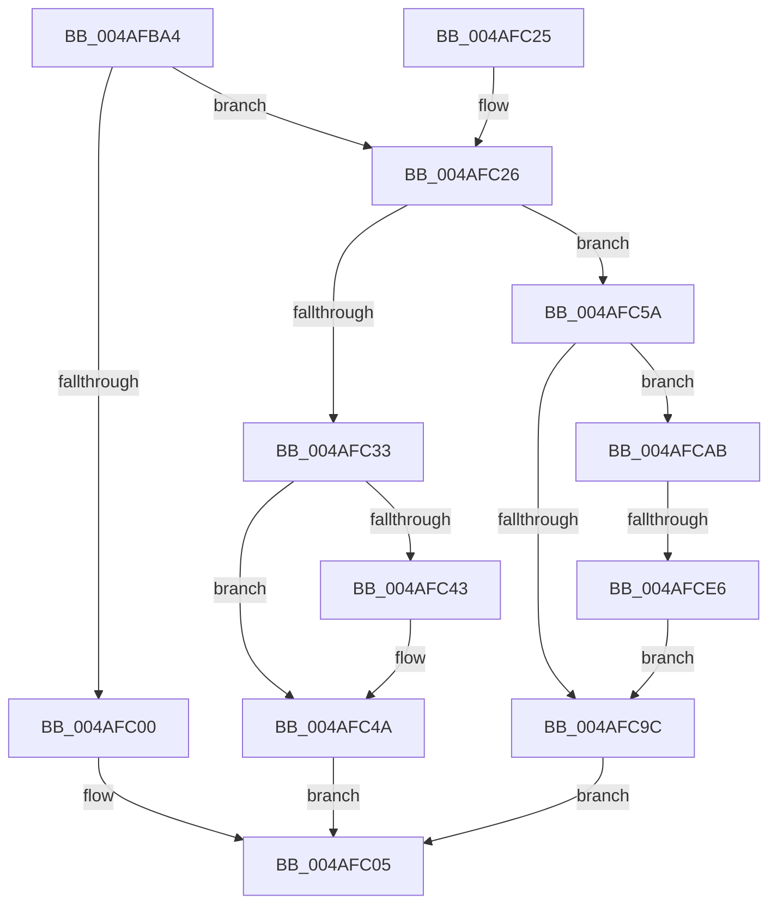

# PiDevCfgPushCopyKeyEntry

- RVA: `0x004AFBA4`–`0x004AFCF0` (길이 `332` bytes)
- VA: `0x00000001404AFBA4`
- 실행 섹션: `.text`
- PDB 이름 있음: `예`; PDB Function 태그: `예`
- unwind 정보 RVA: `0x000B884C`
- 디코드: `95`개 명령, `332/332` bytes 표시
- 미해석 바이트: `0` (있으면 어셈블리에 `.byte`로 보존)

> 이 문서는 커널 이미지의 기계어와 PDB 기호를 분석해 생성했습니다. 4번과 5번은 함수 원형과 자료형을 바이너리 사용 방식에서 추정한 C 해석이며 원본 소스 복구 결과는 아닙니다.

## 1. Dependencies

- 직접 호출 지점: **5**; 고유 호출 대상: **4**
- 직접 호출자로 확인된 함수: **3**
- RIP 상대 이미지 참조: **1**

### Outgoing calls
- `0x004AFBF3` → [ExAllocatePool2](../../poolcode/B8/ExAllocatePool2_function_00B820F0.md) (function, `0x00B820F0`)
- `0x004AFC91` → [ZwOpenKey](../6A/ZwOpenKey_function_006AD310.md) (function, `0x006AD310`)
- `0x004AFCA1` → [ExFreePoolWithTag](../../poolcode/B8/ExFreePoolWithTag_function_00B82870.md) (function, `0x00B82870`)
- `0x004AFCD7` → [ZwOpenKey](../6A/ZwOpenKey_function_006AD310.md) (function, `0x006AD310`)
- `0x004AFCE9` → [ZwClose](../6A/ZwClose_function_006AD2B0.md) (function, `0x006AD2B0`)

### Direct callers
- [PiDevCfgCopyDeviceKeys](../../page/99/PiDevCfgCopyDeviceKeys_function_00995E1C.md) at `0x00995E76`
- [PiDevCfgCopyDeviceKey](../../page/99/PiDevCfgCopyDeviceKey_function_00997374.md) at `0x00997959`
- [PiDevCfgCopyDeviceKey](../../page/99/PiDevCfgCopyDeviceKey_function_00997374.md) at `0x00997A56`
- [sub_00B2C5F4](../../page/B2/Unknown_function_00B2C5F4.md) at `0x00B2CB11`

### Static image references
- `0x004AFC5E` → RVA `0x00B4AD08` (`PiDevCfgEmptyString`; read)

## 2. Other-region calls and transfers

- 다른 실행 섹션으로 향하는 call: **2**
  - `0x004AFBF3` → [ExAllocatePool2](../../poolcode/B8/ExAllocatePool2_function_00B820F0.md) (`.text` → `POOLCODE`)
  - `0x004AFCA1` → [ExFreePoolWithTag](../../poolcode/B8/ExFreePoolWithTag_function_00B82870.md) (`.text` → `POOLCODE`)
- call이 아닌 외부 분기/꼬리 이동: **1**
  - `0x004AFCE0` → [sub_006FB0B2](../6F/Unknown_function_006FB0B2.md) (`tail-transfer`)

## 3. Assembly (complete function range)

```asm
004AFBA4  48 89 5C 24 08                  mov qword ptr [rsp + 8], rbx
004AFBA9  48 89 74 24 10                  mov qword ptr [rsp + 0x10], rsi
004AFBAE  48 89 7C 24 18                  mov qword ptr [rsp + 0x18], rdi
004AFBB3  55                              push rbp
004AFBB4  41 54                           push r12
004AFBB6  41 55                           push r13
004AFBB8  41 56                           push r14
004AFBBA  41 57                           push r15
004AFBBC  48 8B EC                        mov rbp, rsp
004AFBBF  48 83 EC 50                     sub rsp, 0x50
004AFBC3  33 C0                           xor eax, eax
004AFBC5  0F 57 C0                        xorps xmm0, xmm0
004AFBC8  4D 8B E8                        mov r13, r8
004AFBCB  48 89 45 F0                     mov qword ptr [rbp - 0x10], rax
004AFBCF  4C 8B E2                        mov r12, rdx
004AFBD2  89 45 F8                        mov dword ptr [rbp - 8], eax
004AFBD5  48 8B F9                        mov rdi, rcx
004AFBD8  33 F6                           xor esi, esi
004AFBDA  B9 00 01 00 00                  mov ecx, 0x100
004AFBDF  41 B8 50 70 64 63               mov r8d, 0x63647050
004AFBE5  45 8B F9                        mov r15d, r9d
004AFBE8  0F 11 45 D0                     movups xmmword ptr [rbp - 0x30], xmm0
004AFBEC  8D 56 28                        lea edx, [rsi + 0x28]
004AFBEF  0F 11 45 E0                     movups xmmword ptr [rbp - 0x20], xmm0
004AFBF3  E8 F8 24 6D 00                  call 0x140b820f0
004AFBF8  48 8B D8                        mov rbx, rax
004AFBFB  48 85 C0                        test rax, rax
004AFBFE  75 26                           jne 0x1404afc26
004AFC00  BE 9A 00 00 C0                  mov esi, 0xc000009a
004AFC05  4C 8D 5C 24 50                  lea r11, [rsp + 0x50]
004AFC0A  8B C6                           mov eax, esi
004AFC0C  49 8B 5B 30                     mov rbx, qword ptr [r11 + 0x30]
004AFC10  49 8B 73 38                     mov rsi, qword ptr [r11 + 0x38]
004AFC14  49 8B 7B 40                     mov rdi, qword ptr [r11 + 0x40]
004AFC18  49 8B E3                        mov rsp, r11
004AFC1B  41 5F                           pop r15
004AFC1D  41 5E                           pop r14
004AFC1F  41 5D                           pop r13
004AFC21  41 5C                           pop r12
004AFC23  5D                              pop rbp
004AFC24  C3                              ret
004AFC25  CC                              int3
004AFC26  44 89 78 20                     mov dword ptr [rax + 0x20], r15d
004AFC2A  4C 8D 70 10                     lea r14, [rax + 0x10]
004AFC2E  45 85 FF                        test r15d, r15d
004AFC31  78 27                           js 0x1404afc5a
004AFC33  4D 89 26                        mov qword ptr [r14], r12
004AFC36  4C 89 68 18                     mov qword ptr [rax + 0x18], r13
004AFC3A  48 8B 47 08                     mov rax, qword ptr [rdi + 8]
004AFC3E  48 39 38                        cmp qword ptr [rax], rdi
004AFC41  74 07                           je 0x1404afc4a
004AFC43  B9 03 00 00 00                  mov ecx, 3
004AFC48  CD 29                           int 0x29
004AFC4A  48 89 3B                        mov qword ptr [rbx], rdi
004AFC4D  48 89 43 08                     mov qword ptr [rbx + 8], rax
004AFC51  48 89 18                        mov qword ptr [rax], rbx
004AFC54  48 89 5F 08                     mov qword ptr [rdi + 8], rbx
004AFC58  EB AB                           jmp 0x1404afc05
004AFC5A  4C 89 65 D8                     mov qword ptr [rbp - 0x28], r12
004AFC5E  48 8D 05 A3 B0 69 00            lea rax, [rip + 0x69b0a3]
004AFC65  0F 57 C0                        xorps xmm0, xmm0
004AFC68  48 89 45 E0                     mov qword ptr [rbp - 0x20], rax
004AFC6C  41 BC 00 02 00 00               mov r12d, 0x200
004AFC72  4C 8D 45 D0                     lea r8, [rbp - 0x30]
004AFC76  41 BF 30 00 00 00               mov r15d, 0x30
004AFC7C  44 89 65 E8                     mov dword ptr [rbp - 0x18], r12d
004AFC80  BA 19 00 02 00                  mov edx, 0x20019
004AFC85  44 89 7D D0                     mov dword ptr [rbp - 0x30], r15d
004AFC89  49 8B CE                        mov rcx, r14
004AFC8C  F3 0F 7F 45 F0                  movdqu xmmword ptr [rbp - 0x10], xmm0
004AFC91  E8 7A D6 1F 00                  call 0x1406ad310
004AFC96  8B F0                           mov esi, eax
004AFC98  85 C0                           test eax, eax
004AFC9A  79 0F                           jns 0x1404afcab
004AFC9C  33 D2                           xor edx, edx
004AFC9E  48 8B CB                        mov rcx, rbx
004AFCA1  E8 CA 2B 6D 00                  call 0x140b82870
004AFCA6  E9 5A FF FF FF                  jmp 0x1404afc05
004AFCAB  48 8D 05 56 B0 69 00            lea rax, [rip + 0x69b056]
004AFCB2  44 89 7D D0                     mov dword ptr [rbp - 0x30], r15d
004AFCB6  0F 57 C0                        xorps xmm0, xmm0
004AFCB9  48 89 45 E0                     mov qword ptr [rbp - 0x20], rax
004AFCBD  48 8D 4B 18                     lea rcx, [rbx + 0x18]
004AFCC1  4C 89 6D D8                     mov qword ptr [rbp - 0x28], r13
004AFCC5  4C 8D 45 D0                     lea r8, [rbp - 0x30]
004AFCC9  44 89 65 E8                     mov dword ptr [rbp - 0x18], r12d
004AFCCD  BA 3F 00 0F 00                  mov edx, 0xf003f
004AFCD2  F3 0F 7F 45 F0                  movdqu xmmword ptr [rbp - 0x10], xmm0
004AFCD7  E8 34 D6 1F 00                  call 0x1406ad310
004AFCDC  8B F0                           mov esi, eax
004AFCDE  85 C0                           test eax, eax
004AFCE0  0F 89 CC B3 24 00               jns 0x1406fb0b2
004AFCE6  49 8B 0E                        mov rcx, qword ptr [r14]
004AFCE9  E8 C2 D5 1F 00                  call 0x1406ad2b0
004AFCEE  EB AC                           jmp 0x1404afc9c
```

## 4. C-style interpretation (structured pseudocode)

```c
__int64 __fastcall PiDevCfgPushCopyKeyEntry(__int64 a1, __int64 a2, __int64 a3, int a4)
{
    __int64 result;
    __int64 v_rsi;
    __int64 v_rsp;
    unsigned __int64 v_stack_m28;
    unsigned int v_stack_m30;
    unsigned __int64 v_stack_m38;
    unsigned int v_stack_m40;
    unsigned __int64 v_stack_m48;
    unsigned __int64 v_stack_m50;
    unsigned __int64 v_stack_m58;
    unsigned __int64 v_stack_p10;
    unsigned __int64 v_stack_p18;
    unsigned __int64 v_stack_p8;

    v_stack_p8 = v_rbx;
    v_stack_p10 = v_rsi;
    v_stack_p18 = v_rdi;
    v_rsp = (v_rsp) - (80);
    result = 0;
    v_stack_m38 = 0;
    v_stack_m30 = 0;
    v_rsi = 0;
    v_stack_m58 = v_xmm0;
    v_stack_m48 = v_xmm0;
    result = ExAllocatePool2(256, v_rsi + 40, (unsigned int)(0x63647050ULL), a4);
    if (result != 0) goto loc_004AFC26;
loc_004AFC05:
    return (unsigned int)((unsigned int)((unsigned int)(0xC000009AULL)));
loc_004AFC26:
    *(unsigned int *)((unsigned int)((unsigned int)((unsigned int)(0xC000009AULL))) + 32) = (unsigned int)((unsigned int)(a4));
    if (sign_flag) goto loc_004AFC5A;
    *(unsigned __int64 *)((unsigned int)((unsigned int)((unsigned int)(0xC000009AULL))) + 16) = a2;
    *(unsigned __int64 *)((unsigned int)((unsigned int)((unsigned int)(0xC000009AULL))) + 24) = a3;
    if ((*(unsigned __int64 *)(*(unsigned __int64 *)(*(unsigned __int64 *)(v_stack_m28 + 64) + 8))) != (*(unsigned __int64 *)(v_stack_m28 + 64))) {
        a1 = 3;
    }
    *(unsigned __int64 *)(*(unsigned __int64 *)(v_stack_m28 + 48)) = *(unsigned __int64 *)(v_stack_m28 + 64);
    *(unsigned __int64 *)(*(unsigned __int64 *)(v_stack_m28 + 48) + 8) = *(unsigned __int64 *)(*(unsigned __int64 *)(v_stack_m28 + 64) + 8);
    *(unsigned __int64 *)(*(unsigned __int64 *)(*(unsigned __int64 *)(v_stack_m28 + 64) + 8)) = *(unsigned __int64 *)(v_stack_m28 + 48);
    *(unsigned __int64 *)(*(unsigned __int64 *)(v_stack_m28 + 64) + 8) = *(unsigned __int64 *)(v_stack_m28 + 48);
    goto loc_004AFC05;
loc_004AFC5A:
    v_stack_m50 = a2;
    v_stack_m48 = v_rip + 6926499;
    v_stack_m40 = 512;
    v_stack_m58 = 48;
    v_stack_m38 = v_xmm0;
    result = ZwOpenKey((unsigned int)((unsigned int)((unsigned int)(0xC000009AULL))) + 16, (unsigned int)(0x20019ULL), v_stack_m58, a4);
    if (!sign_flag) goto loc_004AFCAB;
loc_004AFC9C:
    a2 = 0;
    result = ExFreePoolWithTag(*(unsigned __int64 *)(v_stack_m28 + 48), a2, v_stack_m58, a4);
    goto loc_004AFC05;
loc_004AFCAB:
    v_stack_m58 = 48;
    v_stack_m48 = v_rip + 6926422;
    v_stack_m50 = a3;
    v_stack_m40 = 512;
    v_stack_m38 = v_xmm0;
    result = ZwOpenKey(*(unsigned __int64 *)(v_stack_m28 + 48) + 24, (unsigned int)(0xF003FULL), v_stack_m58, a4);
    result = ZwClose(*(unsigned __int64 *)((unsigned int)((unsigned int)((unsigned int)(0xC000009AULL))) + 16), (unsigned int)(0xF003FULL), v_stack_m58, a4);
    goto loc_004AFC9C;
}
```

## 5. (Beta) C Style

```c
int64_t PiDevCfgPushCopyKeyEntry(void *Arg1, int64_t Arg2, int64_t Arg3, int32_t Arg4)
{
    uint8_t *arg1 = (uint8_t *)Arg1;

    int64_t result;
    int64_t local_rsi;
    int64_t local_rsp;
    uint64_t v_stack_m28;
    uint32_t v_stack_m30;
    uint64_t v_stack_m38;
    uint32_t v_stack_m40;
    uint64_t v_stack_m48;
    uint64_t v_stack_m50;
    uint64_t v_stack_m58;
    uint64_t v_stack_p10;
    uint64_t v_stack_p18;
    uint64_t v_stack_p8;

    v_stack_p8 = local_rbx;
    v_stack_p10 = local_rsi;
    v_stack_p18 = local_rdi;
    local_rsp = (local_rsp) - (80);
    result = 0;
    v_stack_m38 = 0;
    v_stack_m30 = 0;
    local_rsi = 0;
    v_stack_m58 = v_xmm0;
    v_stack_m48 = v_xmm0;
    result = ExAllocatePool2(256, local_rsi + 40, (uint32_t)(0x63647050ULL), Arg4);
    if (result != 0) goto loc_004AFC26;
loc_004AFC05:
    return (uint32_t)((uint32_t)((uint32_t)(0xC000009AULL)));
loc_004AFC26:
    *(uint32_t *)((uint32_t)((uint32_t)((uint32_t)(0xC000009AULL))) + 0x20) = (uint32_t)((uint32_t)(Arg4));
    if (sign_flag) goto loc_004AFC5A;
    *(uint64_t *)((uint32_t)((uint32_t)((uint32_t)(0xC000009AULL))) + 0x10) = Arg2;
    *(uint64_t *)((uint32_t)((uint32_t)((uint32_t)(0xC000009AULL))) + 0x18) = Arg3;
    if ((*(uint64_t *)(*(uint64_t *)(*(uint64_t *)(v_stack_m28 + 0x40) + 0x8))) != (*(uint64_t *)(v_stack_m28 + 0x40))) {
        Arg1 = 3;
    }
    *(uint64_t *)(*(uint64_t *)(v_stack_m28 + 0x30)) = *(uint64_t *)(v_stack_m28 + 0x40);
    *(uint64_t *)(*(uint64_t *)(v_stack_m28 + 0x30) + 0x8) = *(uint64_t *)(*(uint64_t *)(v_stack_m28 + 0x40) + 0x8);
    *(uint64_t *)(*(uint64_t *)(*(uint64_t *)(v_stack_m28 + 0x40) + 0x8)) = *(uint64_t *)(v_stack_m28 + 0x30);
    *(uint64_t *)(*(uint64_t *)(v_stack_m28 + 0x40) + 0x8) = *(uint64_t *)(v_stack_m28 + 0x30);
    goto loc_004AFC05;
loc_004AFC5A:
    v_stack_m50 = Arg2;
    v_stack_m48 = v_rip + 6926499;
    v_stack_m40 = 512;
    v_stack_m58 = 48;
    v_stack_m38 = v_xmm0;
    result = ZwOpenKey((uint32_t)((uint32_t)((uint32_t)(0xC000009AULL))) + 16, (uint32_t)(0x20019ULL), v_stack_m58, Arg4);
    if (!sign_flag) goto loc_004AFCAB;
loc_004AFC9C:
    Arg2 = 0;
    result = ExFreePoolWithTag(*(uint64_t *)(v_stack_m28 + 0x30), Arg2, v_stack_m58, Arg4);
    goto loc_004AFC05;
loc_004AFCAB:
    v_stack_m58 = 48;
    v_stack_m48 = v_rip + 6926422;
    v_stack_m50 = Arg3;
    v_stack_m40 = 512;
    v_stack_m38 = v_xmm0;
    result = ZwOpenKey(*(uint64_t *)(v_stack_m28 + 0x30) + 24, (uint32_t)(0xF003FULL), v_stack_m58, Arg4);
    result = ZwClose(*(uint64_t *)((uint32_t)((uint32_t)((uint32_t)(0xC000009AULL))) + 0x10), (uint32_t)(0xF003FULL), v_stack_m58, Arg4);
    goto loc_004AFC9C;
}
```

### 관측된 메모리 오프셋

구조체 형식이 확인되지 않은 접근은 인자 기준의 오프셋으로만 기록했습니다.

| 기준 인자 | 오프셋 표현 | 폭 (bit) | 접근 |
|---|---:|---:|---|
| `Arg1` | `+ 0x8` | `64` | `R` |
| `Arg1` | `+ 0x8` | `64` | `W` |

## 6. Execution-region graph

[열기: 2D/3D 그래프와 함수 탐색 컨트롤 패널](../../../control-panel.html?section=text&rva=0x004AFBA4&view=graph)

- 2D 그래프는 위에서 아래로 흐르고, 3D 그래프는 빈 공간을 드래그해 회전합니다. Shift+드래그는 이동, 휠은 확대·축소, 함수 노드 선택은 대상 보고서 이동입니다.

### Static fallback


