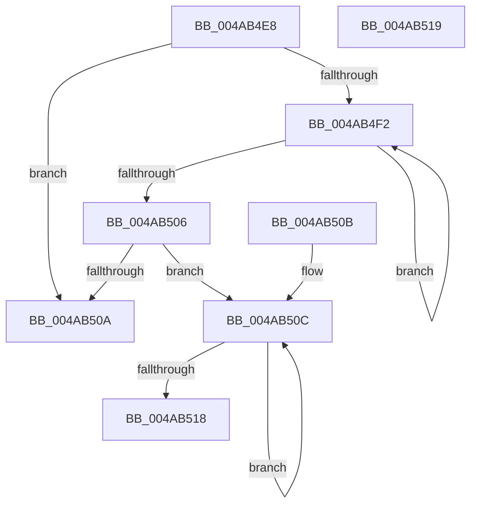

# PipUpdatePostStartCharacteristics

- RVA: `0x004AB4E8`–`0x004AB51A` (길이 `50` bytes)
- VA: `0x00000001404AB4E8`
- 실행 섹션: `.text`
- PDB 이름 있음: `예`; PDB Function 태그: `아니요`
- unwind 정보 RVA: `0x000DB714`
- 디코드: `20`개 명령, `50/50` bytes 표시
- 미해석 바이트: `0` (있으면 어셈블리에 `.byte`로 보존)

> 이 문서는 커널 이미지의 기계어와 PDB 기호를 분석해 생성했습니다. 4번과 5번은 함수 원형과 자료형을 바이너리 사용 방식에서 추정한 C 해석이며 원본 소스 복구 결과는 아닙니다.

## 1. Dependencies

- 직접 호출 지점: **0**; 고유 호출 대상: **0**
- 직접 호출자로 확인된 함수: **2**
- RIP 상대 이미지 참조: **0**

### Outgoing calls
- 직접 디코드된 call 명령이 없습니다.

### Direct callers
- [PnpDeviceCompletionProcessCompletedRequest](../../page/8F/PnpDeviceCompletionProcessCompletedRequest_function_008FB654.md) at `0x008FB6E4`
- [PnpStartDeviceNode](../../page/8F/PnpStartDeviceNode_function_008FE38C.md) at `0x008FE5C7`

### Static image references
- 디코드된 RIP-relative 메모리 참조가 없습니다.

## 2. Other-region calls and transfers

- 다른 실행 섹션으로 향하는 call: **0**
- 별도 외부 분기/꼬리 이동을 확인하지 못했습니다.

## 3. Assembly (complete function range)

```asm
004AB4E8  33 D2                           xor edx, edx
004AB4EA  4C 8B C1                        mov r8, rcx
004AB4ED  48 85 C9                        test rcx, rcx
004AB4F0  74 18                           je 0x1404ab50a
004AB4F2  41 8B 40 34                     mov eax, dword ptr [r8 + 0x34]
004AB4F6  4D 8B 40 18                     mov r8, qword ptr [r8 + 0x18]
004AB4FA  25 00 00 04 00                  and eax, 0x40000
004AB4FF  0B D0                           or edx, eax
004AB501  4D 85 C0                        test r8, r8
004AB504  75 EC                           jne 0x1404ab4f2
004AB506  85 D2                           test edx, edx
004AB508  75 02                           jne 0x1404ab50c
004AB50A  C3                              ret
004AB50B  CC                              int3
004AB50C  09 51 34                        or dword ptr [rcx + 0x34], edx
004AB50F  48 8B 49 18                     mov rcx, qword ptr [rcx + 0x18]
004AB513  48 85 C9                        test rcx, rcx
004AB516  75 F4                           jne 0x1404ab50c
004AB518  C3                              ret
004AB519  CC                              int3
```

## 4. C-style interpretation (structured pseudocode)

```c
__int64 __fastcall PipUpdatePostStartCharacteristics(__int64 a1, int a2)
{
    __int64 result;

    a2 = 0;
    if (a1 == 0) goto loc_004AB50A;
loc_004AB4F2:
    result = (unsigned int)(((unsigned int)(*(unsigned int *)(a1 + 52))) & (0x40000ULL));
    a2 = (unsigned int)((a2) | ((unsigned int)(result)));
    if (*(unsigned __int64 *)(a1 + 24) != 0) goto loc_004AB4F2;
    if (a2 != 0) goto loc_004AB50C;
loc_004AB50A:
    return result;
loc_004AB50C:
    if (*(unsigned __int64 *)(a1 + 24) != 0) goto loc_004AB50C;
    return result;
}
```

## 5. (Beta) C Style

```c
int64_t PipUpdatePostStartCharacteristics(int64_t Arg1, int32_t Arg2)
{
    int64_t result;

    Arg2 = 0;
    if (Arg1 == 0) goto loc_004AB50A;
loc_004AB4F2:
    result = (uint32_t)(((uint32_t)(*(uint32_t *)(Arg1 + 0x34))) & (0x40000ULL));
    Arg2 = (uint32_t)((Arg2) | ((uint32_t)(result)));
    if (*(uint64_t *)(Arg1 + 0x18) != 0) goto loc_004AB4F2;
    if (Arg2 != 0) goto loc_004AB50C;
loc_004AB50A:
    return result;
loc_004AB50C:
    if (*(uint64_t *)(Arg1 + 0x18) != 0) goto loc_004AB50C;
    return result;
}
```

## 6. Execution-region graph

[열기: 2D/3D 그래프와 함수 탐색 컨트롤 패널](../../../control-panel.html?section=text&rva=0x004AB4E8&view=graph)

- 2D 그래프는 위에서 아래로 흐르고, 3D 그래프는 빈 공간을 드래그해 회전합니다. Shift+드래그는 이동, 휠은 확대·축소, 함수 노드 선택은 대상 보고서 이동입니다.

### Static fallback


