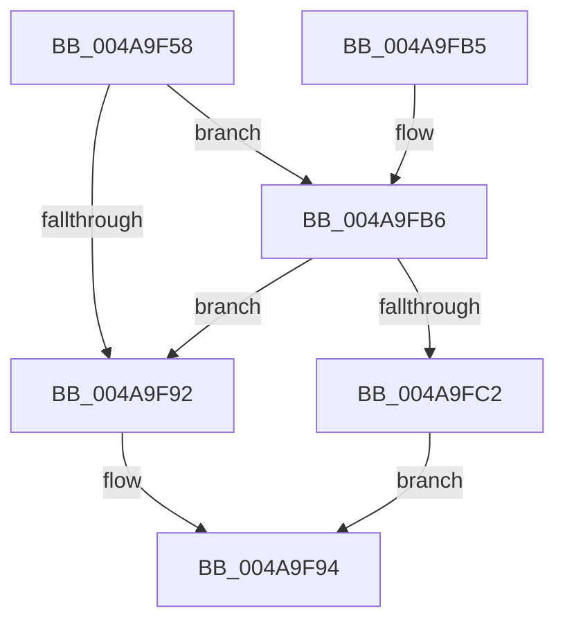

# PnpDiagnosticTraceObjectWithStatus

- RVA: `0x004A9F58`–`0x004AA03B` (길이 `227` bytes)
- VA: `0x00000001404A9F58`
- 실행 섹션: `.text`
- PDB 이름 있음: `예`; PDB Function 태그: `아니요`
- unwind 정보 RVA: `0x000B7BF8`
- 디코드: `56`개 명령, `227/227` bytes 표시
- 미해석 바이트: `0` (있으면 어셈블리에 `.byte`로 보존)

> 이 문서는 커널 이미지의 기계어와 PDB 기호를 분석해 생성했습니다. 4번과 5번은 함수 원형과 자료형을 바이너리 사용 방식에서 추정한 C 해석이며 원본 소스 복구 결과는 아닙니다.

## 1. Dependencies

- 직접 호출 지점: **3**; 고유 호출 대상: **3**
- 직접 호출자로 확인된 함수: **7**
- RIP 상대 이미지 참조: **2**

### Outgoing calls
- `0x004A9F9B` → [_security_check_cookie](../6A/_security_check_cookie_function_006AC640.md) (function, `0x006AC640`)
- `0x004A9FB9` → [EtwEventEnabled](../39/EtwEventEnabled_function_00392450.md) (function, `0x00392450`)
- `0x004AA031` → [EtwWriteEx](../25/EtwWriteEx_function_0025F0D0.md) (function, `0x0025F0D0`)

### Direct callers
- [PiDrvDbUnloadNodeWaitWorkerCallback](../5A/PiDrvDbUnloadNodeWaitWorkerCallback_function_005AA910.md) at `0x005AA96F`
- [PiDrvDbUnloadNodeWaitWorkerCallback](../5A/PiDrvDbUnloadNodeWaitWorkerCallback_function_005AA910.md) at `0x005AA982`
- [PnpRebalance](../../page/73/PnpRebalance_function_0073F508.md) at `0x0073F87B`
- [PiDrvDbLoadNode](../../page/93/PiDrvDbLoadNode_function_00931AB0.md) at `0x00931C68`
- [PiDrvDbLoadNode](../../page/93/PiDrvDbLoadNode_function_00931AB0.md) at `0x00931C7B`
- [PiDevCfgProcessDevice](../../page/97/PiDevCfgProcessDevice_function_00976D34.md) at `0x00977006`
- [IopLoadDriver](../../page/99/IopLoadDriver_function_00997B54.md) at `0x0099825D`
- [PiDrvDbLoadNodeWorkerCallback](../../page/A9/PiDrvDbLoadNodeWorkerCallback_function_00A91D40.md) at `0x00A91DED`
- [PiDrvDbLoadNodeWorkerCallback](../../page/A9/PiDrvDbLoadNodeWorkerCallback_function_00A91D40.md) at `0x00A91ED4`
- [PnpInitializeBootStartDriver](../../init/C7/PnpInitializeBootStartDriver_function_00C760F0.md) at `0x00C76225`

### Static image references
- `0x004A9F72` → RVA `0x00E0A740` (`.data`; read)
- `0x004A9F86` → RVA `0x00E662D8` (`.data`; read)

## 2. Other-region calls and transfers

- 다른 실행 섹션으로 향하는 call: **0**
- 별도 외부 분기/꼬리 이동을 확인하지 못했습니다.

## 3. Assembly (complete function range)

```asm
004A9F58  48 89 5C 24 10                  mov qword ptr [rsp + 0x10], rbx
004A9F5D  48 89 7C 24 20                  mov qword ptr [rsp + 0x20], rdi
004A9F62  44 89 44 24 18                  mov dword ptr [rsp + 0x18], r8d
004A9F67  55                              push rbp
004A9F68  48 8B EC                        mov rbp, rsp
004A9F6B  48 81 EC 80 00 00 00            sub rsp, 0x80
004A9F72  48 8B 05 C7 07 96 00            mov rax, qword ptr [rip + 0x9607c7]
004A9F79  48 33 C4                        xor rax, rsp
004A9F7C  48 89 45 F8                     mov qword ptr [rbp - 8], rax
004A9F80  48 8B D9                        mov rbx, rcx
004A9F83  48 8B FA                        mov rdi, rdx
004A9F86  48 8B 0D 4B C3 9B 00            mov rcx, qword ptr [rip + 0x9bc34b]
004A9F8D  48 85 C9                        test rcx, rcx
004A9F90  75 24                           jne 0x1404a9fb6
004A9F92  33 C0                           xor eax, eax
004A9F94  48 8B 4D F8                     mov rcx, qword ptr [rbp - 8]
004A9F98  48 33 CC                        xor rcx, rsp
004A9F9B  E8 A0 26 20 00                  call 0x1406ac640
004A9FA0  4C 8D 9C 24 80 00 00 00         lea r11, [rsp + 0x80]
004A9FA8  49 8B 5B 18                     mov rbx, qword ptr [r11 + 0x18]
004A9FAC  49 8B 7B 28                     mov rdi, qword ptr [r11 + 0x28]
004A9FB0  49 8B E3                        mov rsp, r11
004A9FB3  5D                              pop rbp
004A9FB4  C3                              ret
004A9FB5  CC                              int3
004A9FB6  48 8B D3                        mov rdx, rbx
004A9FB9  E8 92 84 EE FF                  call 0x140392450
004A9FBE  84 C0                           test al, al
004A9FC0  74 D0                           je 0x1404a9f92
004A9FC2  0F B7 0F                        movzx ecx, word ptr [rdi]
004A9FC5  45 33 C9                        xor r9d, r9d
004A9FC8  83 65 D4 00                     and dword ptr [rbp - 0x2c], 0
004A9FCC  0F B7 C1                        movzx eax, cx
004A9FCF  83 65 E4 00                     and dword ptr [rbp - 0x1c], 0
004A9FD3  45 33 C0                        xor r8d, r8d
004A9FD6  83 65 F4 00                     and dword ptr [rbp - 0xc], 0
004A9FDA  48 8B D3                        mov rdx, rbx
004A9FDD  66 D1 E8                        shr ax, 1
004A9FE0  66 89 45 C0                     mov word ptr [rbp - 0x40], ax
004A9FE4  48 8D 45 C0                     lea rax, [rbp - 0x40]
004A9FE8  48 89 45 C8                     mov qword ptr [rbp - 0x38], rax
004A9FEC  48 8B 47 08                     mov rax, qword ptr [rdi + 8]
004A9FF0  48 89 45 D8                     mov qword ptr [rbp - 0x28], rax
004A9FF4  48 8D 45 20                     lea rax, [rbp + 0x20]
004A9FF8  48 89 45 E8                     mov qword ptr [rbp - 0x18], rax
004A9FFC  48 8D 45 C8                     lea rax, [rbp - 0x38]
004AA000  48 89 44 24 38                  mov qword ptr [rsp + 0x38], rax
004AA005  C7 44 24 30 03 00 00 00         mov dword ptr [rsp + 0x30], 3
004AA00D  48 83 64 24 28 00               and qword ptr [rsp + 0x28], 0
004AA013  48 83 64 24 20 00               and qword ptr [rsp + 0x20], 0
004AA019  89 4D E0                        mov dword ptr [rbp - 0x20], ecx
004AA01C  48 8B 0D B5 C2 9B 00            mov rcx, qword ptr [rip + 0x9bc2b5]
004AA023  C7 45 D0 02 00 00 00            mov dword ptr [rbp - 0x30], 2
004AA02A  C7 45 F0 04 00 00 00            mov dword ptr [rbp - 0x10], 4
004AA031  E8 9A 50 DB FF                  call 0x14025f0d0
004AA036  E9 59 FF FF FF                  jmp 0x1404a9f94
```

## 4. C-style interpretation (structured pseudocode)

```c
__int64 __fastcall PnpDiagnosticTraceObjectWithStatus(__int64 a1, __int64 a2, int a3, int a4)
{
    __int64 result;
    __int64 v_rsp;
    unsigned __int64 v_stack_m10;
    unsigned int v_stack_m14;
    unsigned int v_stack_m18;
    unsigned __int64 v_stack_m20;
    unsigned int v_stack_m24;
    unsigned int v_stack_m28;
    unsigned __int64 v_stack_m30;
    unsigned int v_stack_m34;
    unsigned int v_stack_m38;
    unsigned __int64 v_stack_m40;
    unsigned __int16 v_stack_m48;
    unsigned int v_stack_m50;
    unsigned __int64 v_stack_m58;
    unsigned __int64 v_stack_m60;
    unsigned __int64 v_stack_m8;
    unsigned __int64 v_stack_p10;
    unsigned int v_stack_p18;
    unsigned __int64 v_stack_p20;

    v_stack_p10 = v_rbx;
    v_stack_p20 = v_rdi;
    v_stack_p18 = a3;
    v_rsp = (v_rsp) - (128);
    result = (*(unsigned __int64 *)(v_rip + 9832391)) ^ (v_rsp);
    v_stack_m10 = result;
    if (*(unsigned __int64 *)(v_rip + 10208075) != 0) goto loc_004A9FB6;
loc_004A9F92:
    result = 0;
loc_004A9F94:
    a1 = (v_stack_m10) ^ (v_rsp);
    result = _security_check_cookie(a1, a2, a3, a4);
    return result;
loc_004A9FB6:
    result = EtwEventEnabled(a1, *(unsigned __int64 *)(v_stack_m8 + 24), a3, a4);
    if ((unsigned __int8)(result) == 0) goto loc_004A9F92;
    a4 = 0;
    a3 = 0;
    result = (unsigned __int16)(((unsigned __int16)(*(unsigned __int16 *)(*(unsigned __int64 *)(v_stack_m8 + 40)))) >> (1));
    v_stack_m48 = (unsigned __int16)(result);
    v_stack_m40 = v_stack_m48;
    v_stack_m30 = *(unsigned __int64 *)(*(unsigned __int64 *)(v_stack_m8 + 40) + 8);
    v_stack_m20 = v_stack_p18;
    v_stack_m48 = v_stack_m40;
    v_stack_m50 = 3;
    v_stack_m28 = (unsigned int)(*(unsigned __int16 *)(*(unsigned __int64 *)(v_stack_m8 + 40)));
    v_stack_m38 = 2;
    v_stack_m18 = 4;
    result = EtwWriteEx(*(unsigned __int64 *)(v_rip + 10207925), *(unsigned __int64 *)(v_stack_m8 + 24), a3, a4);
    goto loc_004A9F94;
}
```

## 5. (Beta) C Style

```c
int64_t PnpDiagnosticTraceObjectWithStatus(int64_t Arg1, void *Arg2, int32_t Arg3, int32_t Arg4)
{
    uint8_t *arg2 = (uint8_t *)Arg2;

    int64_t result;
    int64_t local_rsp;
    uint64_t v_stack_m10;
    uint32_t v_stack_m14;
    uint32_t v_stack_m18;
    uint64_t v_stack_m20;
    uint32_t v_stack_m24;
    uint32_t v_stack_m28;
    uint64_t v_stack_m30;
    uint32_t v_stack_m34;
    uint32_t v_stack_m38;
    uint64_t v_stack_m40;
    uint16_t v_stack_m48;
    uint32_t v_stack_m50;
    uint64_t v_stack_m58;
    uint64_t v_stack_m60;
    uint64_t v_stack_m8;
    uint64_t v_stack_p10;
    uint32_t v_stack_p18;
    uint64_t v_stack_p20;

    v_stack_p10 = local_rbx;
    v_stack_p20 = local_rdi;
    v_stack_p18 = Arg3;
    local_rsp = (local_rsp) - (128);
    result = (*(uint64_t *)(v_rip + 0x9607C7)) ^ (local_rsp);
    v_stack_m10 = result;
    if (*(uint64_t *)(v_rip + 0x9BC34B) != 0) goto loc_004A9FB6;
loc_004A9F92:
    result = 0;
loc_004A9F94:
    Arg1 = (v_stack_m10) ^ (local_rsp);
    result = _security_check_cookie(Arg1, Arg2, Arg3, Arg4);
    return result;
loc_004A9FB6:
    result = EtwEventEnabled(Arg1, *(uint64_t *)(v_stack_m8 + 0x18), Arg3, Arg4);
    if ((uint8_t)(result) == 0) goto loc_004A9F92;
    Arg4 = 0;
    Arg3 = 0;
    result = (uint16_t)(((uint16_t)(*(uint16_t *)(*(uint64_t *)(v_stack_m8 + 0x28)))) >> (1));
    v_stack_m48 = (uint16_t)(result);
    v_stack_m40 = v_stack_m48;
    v_stack_m30 = *(uint64_t *)(*(uint64_t *)(v_stack_m8 + 0x28) + 0x8);
    v_stack_m20 = v_stack_p18;
    v_stack_m48 = v_stack_m40;
    v_stack_m50 = 3;
    v_stack_m28 = (uint32_t)(*(uint16_t *)(*(uint64_t *)(v_stack_m8 + 0x28)));
    v_stack_m38 = 2;
    v_stack_m18 = 4;
    result = EtwWriteEx(*(uint64_t *)(v_rip + 0x9BC2B5), *(uint64_t *)(v_stack_m8 + 0x18), Arg3, Arg4);
    goto loc_004A9F94;
}
```

### 관측된 메모리 오프셋

구조체 형식이 확인되지 않은 접근은 인자 기준의 오프셋으로만 기록했습니다.

| 기준 인자 | 오프셋 표현 | 폭 (bit) | 접근 |
|---|---:|---:|---|
| `Arg2` | `+ 0x0` | `16` | `R` |
| `Arg2` | `+ 0x8` | `64` | `R` |

## 6. Execution-region graph

[열기: 2D/3D 그래프와 함수 탐색 컨트롤 패널](../../../control-panel.html?section=text&rva=0x004A9F58&view=graph)

- 2D 그래프는 위에서 아래로 흐르고, 3D 그래프는 빈 공간을 드래그해 회전합니다. Shift+드래그는 이동, 휠은 확대·축소, 함수 노드 선택은 대상 보고서 이동입니다.

### Static fallback


