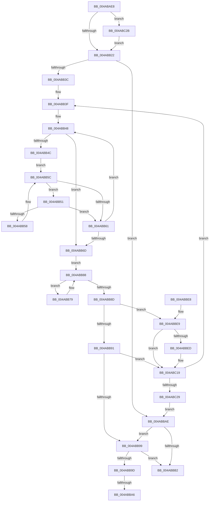

# PnpIsChainDereferenced

- RVA: `0x004ABAE8`–`0x004ABC34` (길이 `332` bytes)
- VA: `0x00000001404ABAE8`
- 실행 섹션: `.text`
- PDB 이름 있음: `예`; PDB Function 태그: `예`
- unwind 정보 RVA: `0x000B80D4`
- 디코드: `104`개 명령, `332/332` bytes 표시
- 미해석 바이트: `0` (있으면 어셈블리에 `.byte`로 보존)

> 이 문서는 커널 이미지의 기계어와 PDB 기호를 분석해 생성했습니다. 4번과 5번은 함수 원형과 자료형을 바이너리 사용 방식에서 추정한 C 해석이며 원본 소스 복구 결과는 아닙니다.

## 1. Dependencies

- 직접 호출 지점: **5**; 고유 호출 대상: **3**
- 직접 호출자로 확인된 함수: **2**
- RIP 상대 이미지 참조: **0**

### Outgoing calls
- `0x004ABB29` → [KeAcquireQueuedSpinLock](../27/KeAcquireQueuedSpinLock_function_00273D80.md) (function, `0x00273D80`)
- `0x004ABBBA` → [KeReleaseQueuedSpinLock](../27/KeReleaseQueuedSpinLock_function_00272540.md) (function, `0x00272540`)
- `0x004ABBF5` → [KeReleaseQueuedSpinLock](../27/KeReleaseQueuedSpinLock_function_00272540.md) (function, `0x00272540`)
- `0x004ABC01` → [PnpChainDereferenceComplete](../../page/A0/PnpChainDereferenceComplete_function_00A047F4.md) (function, `0x00A047F4`)
- `0x004ABC0B` → [KeAcquireQueuedSpinLock](../27/KeAcquireQueuedSpinLock_function_00273D80.md) (function, `0x00273D80`)

### Direct callers
- [PipSendQueryRemoveIrpAndCheckOpenHandles](../../page/74/PipSendQueryRemoveIrpAndCheckOpenHandles_function_007443E8.md) at `0x007444F4`
- [PnpProcessQueryRemoveAndEject](../../page/A0/PnpProcessQueryRemoveAndEject_function_00A05170.md) at `0x00A05397`

### Static image references
- 디코드된 RIP-relative 메모리 참조가 없습니다.

## 2. Other-region calls and transfers

- 다른 실행 섹션으로 향하는 call: **1**
  - `0x004ABC01` → [PnpChainDereferenceComplete](../../page/A0/PnpChainDereferenceComplete_function_00A047F4.md) (`.text` → `PAGE`)
- call이 아닌 외부 분기/꼬리 이동: **2**
  - `0x004ABBA0` → [sub_006FA5FC](../6F/Unknown_function_006FA5FC.md) (`tail-transfer`)
  - `0x004ABBA9` → [sub_006FA5FC](../6F/Unknown_function_006FA5FC.md) (`tail-transfer`)

## 3. Assembly (complete function range)

```asm
004ABAE8  48 8B C4                        mov rax, rsp
004ABAEB  48 89 58 08                     mov qword ptr [rax + 8], rbx
004ABAEF  48 89 68 10                     mov qword ptr [rax + 0x10], rbp
004ABAF3  48 89 70 18                     mov qword ptr [rax + 0x18], rsi
004ABAF7  44 89 48 20                     mov dword ptr [rax + 0x20], r9d
004ABAFB  57                              push rdi
004ABAFC  41 54                           push r12
004ABAFE  41 55                           push r13
004ABB00  41 56                           push r14
004ABB02  41 57                           push r15
004ABB04  48 83 EC 30                     sub rsp, 0x30
004ABB08  4C 8B B4 24 80 00 00 00         mov r14, qword ptr [rsp + 0x80]
004ABB10  41 8B E8                        mov ebp, r8d
004ABB13  44 8B E2                        mov r12d, edx
004ABB16  4C 8B E9                        mov r13, rcx
004ABB19  4D 85 F6                        test r14, r14
004ABB1C  0F 85 09 01 00 00               jne 0x1404abc2b
004ABB22  33 F6                           xor esi, esi
004ABB24  33 DB                           xor ebx, ebx
004ABB26  8D 4E 0A                        lea ecx, [rsi + 0xa]
004ABB29  E8 52 82 DC FF                  call 0x140273d80
004ABB2E  33 FF                           xor edi, edi
004ABB30  44 8D 56 01                     lea r10d, [rsi + 1]
004ABB34  44 8A C0                        mov r8b, al
004ABB37  45 85 E4                        test r12d, r12d
004ABB3A  7E 72                           jle 0x1404abbae
004ABB3C  4D 8B FD                        mov r15, r13
004ABB3F  33 F6                           xor esi, esi
004ABB41  33 C9                           xor ecx, ecx
004ABB43  33 D2                           xor edx, edx
004ABB45  49 8B C7                        mov rax, r15
004ABB48  85 C9                           test ecx, ecx
004ABB4A  75 21                           jne 0x1404abb6d
004ABB4C  48 8B 30                        mov rsi, qword ptr [rax]
004ABB4F  EB 0B                           jmp 0x1404abb5c
004ABB51  8B 4E 04                        mov ecx, dword ptr [rsi + 4]
004ABB54  85 C9                           test ecx, ecx
004ABB56  75 09                           jne 0x1404abb61
004ABB58  48 8B 76 18                     mov rsi, qword ptr [rsi + 0x18]
004ABB5C  48 85 F6                        test rsi, rsi
004ABB5F  75 F0                           jne 0x1404abb51
004ABB61  41 03 D2                        add edx, r10d
004ABB64  48 83 C0 08                     add rax, 8
004ABB68  41 3B D2                        cmp edx, r10d
004ABB6B  72 DB                           jb 0x1404abb48
004ABB6D  49 8B 17                        mov rdx, qword ptr [r15]
004ABB70  33 DB                           xor ebx, ebx
004ABB72  85 C9                           test ecx, ecx
004ABB74  0F 95 C3                        setne bl
004ABB77  EB 0F                           jmp 0x1404abb88
004ABB79  48 8B 82 38 01 00 00            mov rax, qword ptr [rdx + 0x138]
004ABB80  83 48 20 04                     or dword ptr [rax + 0x20], 4
004ABB84  48 8B 52 18                     mov rdx, qword ptr [rdx + 0x18]
004ABB88  48 85 D2                        test rdx, rdx
004ABB8B  75 EC                           jne 0x1404abb79
004ABB8D  85 ED                           test ebp, ebp
004ABB8F  74 58                           je 0x1404abbe9
004ABB91  85 C9                           test ecx, ecx
004ABB93  0F 84 80 00 00 00               je 0x1404abc19
004ABB99  85 DB                           test ebx, ebx
004ABB9B  74 15                           je 0x1404abbb2
004ABB9D  4D 85 F6                        test r14, r14
004ABBA0  0F 84 56 EA 24 00               je 0x1406fa5fc
004ABBA6  49 89 36                        mov qword ptr [r14], rsi
004ABBA9  E9 4E EA 24 00                  jmp 0x1406fa5fc
004ABBAE  85 ED                           test ebp, ebp
004ABBB0  75 E7                           jne 0x1404abb99
004ABBB2  41 8A D0                        mov dl, r8b
004ABBB5  B9 0A 00 00 00                  mov ecx, 0xa
004ABBBA  E8 81 69 DC FF                  call 0x140272540
004ABBBF  48 8B 74 24 70                  mov rsi, qword ptr [rsp + 0x70]
004ABBC4  85 ED                           test ebp, ebp
004ABBC6  48 8B 6C 24 68                  mov rbp, qword ptr [rsp + 0x68]
004ABBCB  B8 01 00 00 00                  mov eax, 1
004ABBD0  0F 44 D8                        cmove ebx, eax
004ABBD3  8B C3                           mov eax, ebx
004ABBD5  48 8B 5C 24 60                  mov rbx, qword ptr [rsp + 0x60]
004ABBDA  48 83 C4 30                     add rsp, 0x30
004ABBDE  41 5F                           pop r15
004ABBE0  41 5E                           pop r14
004ABBE2  41 5D                           pop r13
004ABBE4  41 5C                           pop r12
004ABBE6  5F                              pop rdi
004ABBE7  C3                              ret
004ABBE8  CC                              int3
004ABBE9  85 C9                           test ecx, ecx
004ABBEB  75 2C                           jne 0x1404abc19
004ABBED  41 8A D0                        mov dl, r8b
004ABBF0  B9 0A 00 00 00                  mov ecx, 0xa
004ABBF5  E8 46 69 DC FF                  call 0x140272540
004ABBFA  8B 54 24 78                     mov edx, dword ptr [rsp + 0x78]
004ABBFE  49 8B 0F                        mov rcx, qword ptr [r15]
004ABC01  E8 EE 8B 55 00                  call 0x140a047f4
004ABC06  B9 0A 00 00 00                  mov ecx, 0xa
004ABC0B  E8 70 81 DC FF                  call 0x140273d80
004ABC10  44 8A C0                        mov r8b, al
004ABC13  41 BA 01 00 00 00               mov r10d, 1
004ABC19  41 03 FA                        add edi, r10d
004ABC1C  49 83 C7 08                     add r15, 8
004ABC20  41 3B FC                        cmp edi, r12d
004ABC23  0F 8C 16 FF FF FF               jl 0x1404abb3f
004ABC29  EB 83                           jmp 0x1404abbae
004ABC2B  49 83 26 00                     and qword ptr [r14], 0
004ABC2F  E9 EE FE FF FF                  jmp 0x1404abb22
```

## 4. C-style interpretation (structured pseudocode)

```c
__int64 __fastcall PnpIsChainDereferenced(__int64 a1, int a2, int a3, int a4, __int64 a5)
{
    __int64 result;
    __int64 v_r10;
    __int64 v_r15;
    __int64 v_rbx;
    __int64 v_rdi;
    __int64 v_rsi;
    __int64 v_rsp;
    unsigned __int64 v_stack_p10;
    unsigned __int64 v_stack_p18;
    unsigned int v_stack_p78;
    unsigned __int64 v_stack_p8;

    *(unsigned __int64 *)(v_rsp + 8) = v_rbx;
    *(unsigned __int64 *)(v_rsp + 16) = v_rbp;
    *(unsigned __int64 *)(v_rsp + 24) = v_rsi;
    *(unsigned int *)(v_rsp + 32) = a4;
    v_rsp = (v_rsp) - (48);
    if (a5 != 0) goto loc_004ABC2B;
loc_004ABB22:
    v_rsi = 0;
    v_rbx = 0;
    result = KeAcquireQueuedSpinLock(v_rsi + 10, a2, a3, a4);
    v_rdi = 0;
    if (condition_is_less_or_equal) goto loc_004ABBAE;
loc_004ABB3F:
    v_rsi = 0;
    a1 = 0;
    a2 = 0;
loc_004ABB48:
    if (0 != 0) goto loc_004ABB6D;
    goto loc_004ABB5C;
loc_004ABB51:
    if ((unsigned int)((unsigned int)(*(unsigned int *)(*(unsigned __int64 *)(0) + 4))) != 0) goto loc_004ABB61;
loc_004ABB5C:
    if (*(unsigned __int64 *)(*(unsigned __int64 *)(0) + 24) != 0) goto loc_004ABB51;
loc_004ABB61:
    a2 = (unsigned int)((a2) + ((unsigned int)(v_rsi + 1)));
    result = (0) + (8);
    if (a2 < ((unsigned int)(v_rsi + 1))) goto loc_004ABB48;
loc_004ABB6D:
    v_rbx = 0;
    v_rbx = ((unsigned int)((unsigned int)(*(unsigned int *)(*(unsigned __int64 *)(0) + 4))) != 0) ? 1 : 0;
    goto loc_004ABB88;
loc_004ABB79:
loc_004ABB88:
    if (*(unsigned __int64 *)(*(unsigned __int64 *)(a1) + 24) != 0) goto loc_004ABB79;
    if ((unsigned int)((unsigned int)(a3)) == 0) goto loc_004ABBE9;
    if ((unsigned int)((unsigned int)(*(unsigned int *)(*(unsigned __int64 *)(0) + 4))) == 0) goto loc_004ABC19;
loc_004ABB99:
    if ((unsigned int)(v_rbx) == 0) goto loc_004ABBB2;
    *(unsigned __int64 *)(a5) = *(unsigned __int64 *)(*(unsigned __int64 *)(0) + 24);
loc_004ABBAE:
    if ((unsigned int)((unsigned int)(a3)) != 0) goto loc_004ABB99;
loc_004ABBB2:
    result = KeReleaseQueuedSpinLock(10, (unsigned __int8)((unsigned __int8)(result)), (unsigned __int8)(result), a4);
    if ((unsigned int)((unsigned int)(a3)) == 0) { v_rbx = 1; }
    v_rsp = (v_rsp) + (48);
    return (unsigned int)((unsigned int)(v_rbx));
loc_004ABBE9:
    result = (unsigned int)((unsigned int)(v_rbx));
    v_r10 = v_rsi + 1;
    if (10 == 0) {
        a2 = (unsigned __int8)((unsigned __int8)(result));
        a1 = 10;
        result = KeReleaseQueuedSpinLock(a1, a2, (unsigned __int8)(result), a4);
        a2 = v_stack_p78;
        a1 = *(unsigned __int64 *)(a1);
        result = PnpChainDereferenceComplete(a1, a2, (unsigned __int8)(result), a4);
        a1 = 10;
        result = KeAcquireQueuedSpinLock(a1, a2, (unsigned __int8)(result), a4);
        a3 = (unsigned __int8)(result);
        v_r10 = 1;
    }
    v_rdi = (unsigned int)((v_rdi) + ((unsigned int)(v_r10)));
    v_r15 = (a1) + (8);
    if (((unsigned int)(v_rdi)) < ((unsigned int)((unsigned int)(a2)))) goto loc_004ABB3F;
    goto loc_004ABBAE;
loc_004ABC2B:
    goto loc_004ABB22;
}
```

## 5. (Beta) C Style

```c
int64_t PnpIsChainDereferenced(void *Arg1, int32_t Arg2, int32_t Arg3, int32_t Arg4, int64_t Arg5)
{
    uint8_t *arg1 = (uint8_t *)Arg1;

    int64_t result;
    int64_t local_r10;
    int64_t local_r15;
    int64_t local_rbx;
    int64_t local_rdi;
    int64_t local_rsi;
    int64_t local_rsp;
    uint64_t v_stack_p10;
    uint64_t v_stack_p18;
    uint32_t v_stack_p78;
    uint64_t v_stack_p8;

    *(uint64_t *)(local_rsp + 0x8) = local_rbx;
    *(uint64_t *)(local_rsp + 0x10) = local_rbp;
    *(uint64_t *)(local_rsp + 0x18) = local_rsi;
    *(uint32_t *)(local_rsp + 0x20) = Arg4;
    local_rsp = (local_rsp) - (48);
    if (Arg5 != 0) goto loc_004ABC2B;
loc_004ABB22:
    local_rsi = 0;
    local_rbx = 0;
    result = KeAcquireQueuedSpinLock(local_rsi + 10, Arg2, Arg3, Arg4);
    local_rdi = 0;
    if (condition_is_less_or_equal) goto loc_004ABBAE;
loc_004ABB3F:
    local_rsi = 0;
    Arg1 = 0;
    Arg2 = 0;
loc_004ABB48:
    if (0 != 0) goto loc_004ABB6D;
    goto loc_004ABB5C;
loc_004ABB51:
    if ((uint32_t)((uint32_t)(*(uint32_t *)(*(uint64_t *)(0) + 0x4))) != 0) goto loc_004ABB61;
loc_004ABB5C:
    if (*(uint64_t *)(*(uint64_t *)(0) + 0x18) != 0) goto loc_004ABB51;
loc_004ABB61:
    Arg2 = (uint32_t)((Arg2) + ((uint32_t)(local_rsi + 1)));
    result = (0) + (8);
    if (Arg2 < ((uint32_t)(local_rsi + 1))) goto loc_004ABB48;
loc_004ABB6D:
    local_rbx = 0;
    local_rbx = ((uint32_t)((uint32_t)(*(uint32_t *)(*(uint64_t *)(0) + 0x4))) != 0) ? 1 : 0;
    goto loc_004ABB88;
loc_004ABB79:
loc_004ABB88:
    if (*(uint64_t *)(*(uint64_t *)(arg1) + 0x18) != 0) goto loc_004ABB79;
    if ((uint32_t)((uint32_t)(Arg3)) == 0) goto loc_004ABBE9;
    if ((uint32_t)((uint32_t)(*(uint32_t *)(*(uint64_t *)(0) + 0x4))) == 0) goto loc_004ABC19;
loc_004ABB99:
    if ((uint32_t)(local_rbx) == 0) goto loc_004ABBB2;
    *(uint64_t *)(Arg5) = *(uint64_t *)(*(uint64_t *)(0) + 0x18);
loc_004ABBAE:
    if ((uint32_t)((uint32_t)(Arg3)) != 0) goto loc_004ABB99;
loc_004ABBB2:
    result = KeReleaseQueuedSpinLock(10, (uint8_t)((uint8_t)(result)), (uint8_t)(result), Arg4);
    if ((uint32_t)((uint32_t)(Arg3)) == 0) { local_rbx = 1; }
    local_rsp = (local_rsp) + (48);
    return (uint32_t)((uint32_t)(local_rbx));
loc_004ABBE9:
    result = (uint32_t)((uint32_t)(local_rbx));
    local_r10 = local_rsi + 1;
    if (10 == 0) {
        Arg2 = (uint8_t)((uint8_t)(result));
        Arg1 = 10;
        result = KeReleaseQueuedSpinLock(Arg1, Arg2, (uint8_t)(result), Arg4);
        Arg2 = v_stack_p78;
        Arg1 = *(uint64_t *)(arg1);
        result = PnpChainDereferenceComplete(Arg1, Arg2, (uint8_t)(result), Arg4);
        Arg1 = 10;
        result = KeAcquireQueuedSpinLock(Arg1, Arg2, (uint8_t)(result), Arg4);
        Arg3 = (uint8_t)(result);
        local_r10 = 1;
    }
    local_rdi = (uint32_t)((local_rdi) + ((uint32_t)(local_r10)));
    local_r15 = (Arg1) + (8);
    if (((uint32_t)(local_rdi)) < ((uint32_t)((uint32_t)(Arg2)))) goto loc_004ABB3F;
    goto loc_004ABBAE;
loc_004ABC2B:
    goto loc_004ABB22;
}
```

### 관측된 메모리 오프셋

구조체 형식이 확인되지 않은 접근은 인자 기준의 오프셋으로만 기록했습니다.

| 기준 인자 | 오프셋 표현 | 폭 (bit) | 접근 |
|---|---:|---:|---|
| `Arg1` | `+ 0x0` | `64` | `R` |

## 6. Execution-region graph

[열기: 2D/3D 그래프와 함수 탐색 컨트롤 패널](../../../control-panel.html?section=text&rva=0x004ABAE8&view=graph)

- 2D 그래프는 위에서 아래로 흐르고, 3D 그래프는 빈 공간을 드래그해 회전합니다. Shift+드래그는 이동, 휠은 확대·축소, 함수 노드 선택은 대상 보고서 이동입니다.

### Static fallback


