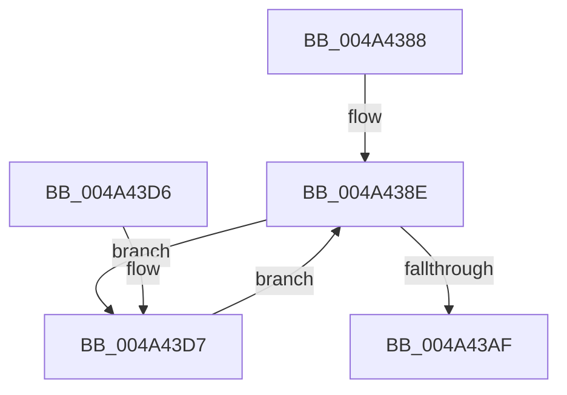

# PnpLockDeviceActionQueue

- RVA: `0x004A4388`–`0x004A440B` (길이 `131` bytes)
- VA: `0x00000001404A4388`
- 실행 섹션: `.text`
- PDB 이름 있음: `예`; PDB Function 태그: `아니요`
- unwind 정보 RVA: `0x000B6590`
- 디코드: `31`개 명령, `131/131` bytes 표시
- 미해석 바이트: `0` (있으면 어셈블리에 `.byte`로 보존)

> 이 문서는 커널 이미지의 기계어와 PDB 기호를 분석해 생성했습니다. 4번과 5번은 함수 원형과 자료형을 바이너리 사용 방식에서 추정한 C 해석이며 원본 소스 복구 결과는 아닙니다.

## 1. Dependencies

- 직접 호출 지점: **7**; 고유 호출 대상: **6**
- 직접 호출자로 확인된 함수: **5**
- RIP 상대 이미지 참조: **4**

### Outgoing calls
- `0x004A4393` → [PpDevNodeLockTree](../../page/A1/PpDevNodeLockTree_function_00A19310.md) (function, `0x00A19310`)
- `0x004A439F` → [KeAcquireSpinLockRaiseToDpc](../20/KeAcquireSpinLockRaiseToDpc_function_00208470.md) (function, `0x00208470`)
- `0x004A43BD` → [KeResetEvent](../24/KeResetEvent_function_00248350.md) (function, `0x00248350`)
- `0x004A43CB` → [KeReleaseSpinLock](../39/KeReleaseSpinLock_function_00392BA0.md) (function, `0x00392BA0`)
- `0x004A43E0` → [KeReleaseSpinLock](../39/KeReleaseSpinLock_function_00392BA0.md) (function, `0x00392BA0`)
- `0x004A43EA` → [PpDevNodeUnlockTree](../../page/A2/PpDevNodeUnlockTree_function_00A21290.md) (function, `0x00A21290`)
- `0x004A4404` → [KeWaitForSingleObject](../20/KeWaitForSingleObject_function_0020E6B0.md) (function, `0x0020E6B0`)

### Direct callers
- [IoControlPnpDeviceActionQueue](IoControlPnpDeviceActionQueue_function_004A42D4.md) at `0x004A42E7`
- [IoBuildPoDeviceNotifyList](../../pagelk/B7/IoBuildPoDeviceNotifyList_function_00B78B0C.md) at `0x00B790E0`
- [sub_00B8075E](../../pagelk/B8/Unknown_function_00B8075E.md) at `0x00B8075E`
- [IopInitializeBootDrivers](../../init/C2/IopInitializeBootDrivers_function_00C2E6F4.md) at `0x00C2EC9A`
- [PipInitializeCoreDriversByGroup](../../init/C7/PipInitializeCoreDriversByGroup_function_00C740DC.md) at `0x00C741DD`

### Static image references
- `0x004A4398` → RVA `0x00F8AD90` (`.data`; read)
- `0x004A43A4` → RVA `0x00F8AD40` (`.data`; read)
- `0x004A43AF` → RVA `0x00F8AD60` (`.data`; read)
- `0x004A43B6` → RVA `0x00F8AD40` (`.data`; write)

## 2. Other-region calls and transfers

- 다른 실행 섹션으로 향하는 call: **2**
  - `0x004A4393` → [PpDevNodeLockTree](../../page/A1/PpDevNodeLockTree_function_00A19310.md) (`.text` → `PAGE`)
  - `0x004A43EA` → [PpDevNodeUnlockTree](../../page/A2/PpDevNodeUnlockTree_function_00A21290.md) (`.text` → `PAGE`)
- 별도 외부 분기/꼬리 이동을 확인하지 못했습니다.

## 3. Assembly (complete function range)

```asm
004A4388  40 53                           push rbx
004A438A  48 83 EC 30                     sub rsp, 0x30
004A438E  B9 01 00 00 00                  mov ecx, 1
004A4393  E8 78 4F 57 00                  call 0x140a19310
004A4398  48 8D 0D F1 69 AE 00            lea rcx, [rip + 0xae69f1]
004A439F  E8 CC 40 D6 FF                  call 0x140208470
004A43A4  80 3D 95 69 AE 00 00            cmp byte ptr [rip + 0xae6995], 0
004A43AB  8A D8                           mov bl, al
004A43AD  75 28                           jne 0x1404a43d7
004A43AF  48 8D 0D AA 69 AE 00            lea rcx, [rip + 0xae69aa]
004A43B6  C6 05 83 69 AE 00 01            mov byte ptr [rip + 0xae6983], 1
004A43BD  E8 8E 3F DA FF                  call 0x140248350
004A43C2  8A D3                           mov dl, bl
004A43C4  48 8D 0D C5 69 AE 00            lea rcx, [rip + 0xae69c5]
004A43CB  E8 D0 E7 EE FF                  call 0x140392ba0
004A43D0  48 83 C4 30                     add rsp, 0x30
004A43D4  5B                              pop rbx
004A43D5  C3                              ret
004A43D6  CC                              int3
004A43D7  8A D3                           mov dl, bl
004A43D9  48 8D 0D B0 69 AE 00            lea rcx, [rip + 0xae69b0]
004A43E0  E8 BB E7 EE FF                  call 0x140392ba0
004A43E5  B9 01 00 00 00                  mov ecx, 1
004A43EA  E8 A1 CE 57 00                  call 0x140a21290
004A43EF  48 83 64 24 20 00               and qword ptr [rsp + 0x20], 0
004A43F5  48 8D 0D 64 69 AE 00            lea rcx, [rip + 0xae6964]
004A43FC  45 33 C9                        xor r9d, r9d
004A43FF  45 33 C0                        xor r8d, r8d
004A4402  33 D2                           xor edx, edx
004A4404  E8 A7 A2 D6 FF                  call 0x14020e6b0
004A4409  EB 83                           jmp 0x1404a438e
```

## 4. C-style interpretation (structured pseudocode)

```c
__int64 __fastcall PnpLockDeviceActionQueue(__int64 a1, __int64 a2, int a3, int a4)
{
    __int64 result;
    __int64 v_rsp;
    unsigned __int64 v_stack_p20;

    v_rsp = (v_rsp) - (48);
loc_004A438E:
    result = PpDevNodeLockTree(1, a2, a3, a4);
    result = KeAcquireSpinLockRaiseToDpc(v_rip + 11430385, a2, a3, a4);
    if ((*(unsigned __int8 *)(v_rip + 11430293)) != 0) goto loc_004A43D7;
    *(unsigned __int8 *)(v_rip + 11430275) = 1;
    result = KeResetEvent(v_rip + 11430314, a2, a3, a4);
    result = KeReleaseSpinLock(v_rip + 11430341, (unsigned __int8)((unsigned __int8)(result)), a3, a4);
    v_rsp = (v_rsp) + (48);
    return result;
loc_004A43D7:
    result = KeReleaseSpinLock(v_rip + 11430320, (unsigned __int8)((unsigned __int8)(result)), a3, a4);
    result = PpDevNodeUnlockTree(1, (unsigned __int8)((unsigned __int8)(result)), a3, a4);
    a4 = 0;
    a3 = 0;
    a2 = 0;
    result = KeWaitForSingleObject(v_rip + 11430244, a2, a3, a4);
    goto loc_004A438E;
}
```

## 5. (Beta) C Style

```c
int64_t PnpLockDeviceActionQueue(int64_t Arg1, int64_t Arg2, int32_t Arg3, int32_t Arg4)
{
    int64_t result;
    int64_t local_rsp;
    uint64_t v_stack_p20;

    local_rsp = (local_rsp) - (48);
loc_004A438E:
    result = PpDevNodeLockTree(1, Arg2, Arg3, Arg4);
    result = KeAcquireSpinLockRaiseToDpc(v_rip + 11430385, Arg2, Arg3, Arg4);
    if ((*(uint8_t *)(v_rip + 0xAE6995)) != 0) goto loc_004A43D7;
    *(uint8_t *)(v_rip + 0xAE6983) = 1;
    result = KeResetEvent(v_rip + 11430314, Arg2, Arg3, Arg4);
    result = KeReleaseSpinLock(v_rip + 11430341, (uint8_t)((uint8_t)(result)), Arg3, Arg4);
    local_rsp = (local_rsp) + (48);
    return result;
loc_004A43D7:
    result = KeReleaseSpinLock(v_rip + 11430320, (uint8_t)((uint8_t)(result)), Arg3, Arg4);
    result = PpDevNodeUnlockTree(1, (uint8_t)((uint8_t)(result)), Arg3, Arg4);
    Arg4 = 0;
    Arg3 = 0;
    Arg2 = 0;
    result = KeWaitForSingleObject(v_rip + 11430244, Arg2, Arg3, Arg4);
    goto loc_004A438E;
}
```

## 6. Execution-region graph

[열기: 2D/3D 그래프와 함수 탐색 컨트롤 패널](../../../control-panel.html?section=text&rva=0x004A4388&view=graph)

- 2D 그래프는 위에서 아래로 흐르고, 3D 그래프는 빈 공간을 드래그해 회전합니다. Shift+드래그는 이동, 휠은 확대·축소, 함수 노드 선택은 대상 보고서 이동입니다.

### Static fallback


