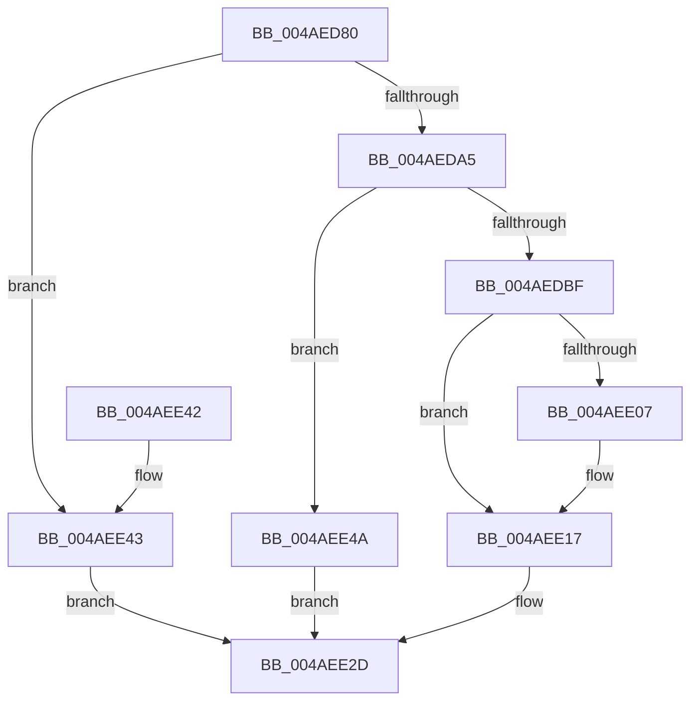

# PnpSetDeviceInstanceStartedEventFromDeviceInstance

- RVA: `0x004AED80`–`0x004AEE51` (길이 `209` bytes)
- VA: `0x00000001404AED80`
- 실행 섹션: `.text`
- PDB 이름 있음: `예`; PDB Function 태그: `아니요`
- unwind 정보 RVA: `0x0007A3F0`
- 디코드: `49`개 명령, `209/209` bytes 표시
- 미해석 바이트: `0` (있으면 어셈블리에 `.byte`로 보존)

> 이 문서는 커널 이미지의 기계어와 PDB 기호를 분석해 생성했습니다. 4번과 5번은 함수 원형과 자료형을 바이너리 사용 방식에서 추정한 C 해석이며 원본 소스 복구 결과는 아닙니다.

## 1. Dependencies

- 직접 호출 지점: **3**; 고유 호출 대상: **3**
- 직접 호출자로 확인된 함수: **1**
- RIP 상대 이미지 참조: **2**

### Outgoing calls
- `0x004AEDAE` → [PnpCreateDeviceEventEntry](../../page/95/PnpCreateDeviceEventEntry_function_00951B48.md) (function, `0x00951B48`)
- `0x004AEE12` → [memcpy](../6C/memcpy_function_006C6840.md) (function, `0x006C6840`)
- `0x004AEE28` → [PnpInsertEventInQueue](../../page/95/PnpInsertEventInQueue_function_00951B78.md) (function, `0x00951B78`)

### Direct callers
- [PnpSetDeviceInstanceStartedEvent](PnpSetDeviceInstanceStartedEvent_function_004AED64.md) at `0x004AED6C`

### Static image references
- `0x004AED99` → RVA `0x00F8C5E4` (`.data`; read)
- `0x004AEDCE` → RVA `0x00014D58` (`.rdata`; read)

## 2. Other-region calls and transfers

- 다른 실행 섹션으로 향하는 call: **2**
  - `0x004AEDAE` → [PnpCreateDeviceEventEntry](../../page/95/PnpCreateDeviceEventEntry_function_00951B48.md) (`.text` → `PAGE`)
  - `0x004AEE28` → [PnpInsertEventInQueue](../../page/95/PnpInsertEventInQueue_function_00951B78.md) (`.text` → `PAGE`)
- 별도 외부 분기/꼬리 이동을 확인하지 못했습니다.

## 3. Assembly (complete function range)

```asm
004AED80  48 89 5C 24 08                  mov qword ptr [rsp + 8], rbx
004AED85  48 89 6C 24 10                  mov qword ptr [rsp + 0x10], rbp
004AED8A  48 89 74 24 18                  mov qword ptr [rsp + 0x18], rsi
004AED8F  57                              push rdi
004AED90  48 83 EC 20                     sub rsp, 0x20
004AED94  33 ED                           xor ebp, ebp
004AED96  48 8B F9                        mov rdi, rcx
004AED99  39 2D 45 D8 AD 00               cmp dword ptr [rip + 0xadd845], ebp
004AED9F  0F 85 9E 00 00 00               jne 0x1404aee43
004AEDA5  0F B7 31                        movzx esi, word ptr [rcx]
004AEDA8  83 C6 52                        add esi, 0x52
004AEDAB  8D 4E 78                        lea ecx, [rsi + 0x78]
004AEDAE  E8 95 2D 4A 00                  call 0x140951b48
004AEDB3  48 8B D8                        mov rbx, rax
004AEDB6  48 85 C0                        test rax, rax
004AEDB9  0F 84 8B 00 00 00               je 0x1404aee4a
004AEDBF  48 89 68 18                     mov qword ptr [rax + 0x18], rbp
004AEDC3  89 68 10                        mov dword ptr [rax + 0x10], ebp
004AEDC6  48 89 68 30                     mov qword ptr [rax + 0x30], rbp
004AEDCA  48 89 68 38                     mov qword ptr [rax + 0x38], rbp
004AEDCE  0F 10 05 83 5F B6 FF            movups xmm0, xmmword ptr [rip - 0x49a07d]
004AEDD5  C7 80 88 00 00 00 0B 00 00 00   mov dword ptr [rax + 0x88], 0xb
004AEDDF  48 89 A8 90 00 00 00            mov qword ptr [rax + 0x90], rbp
004AEDE6  F3 0F 7F 40 78                  movdqu xmmword ptr [rax + 0x78], xmm0
004AEDEB  89 A8 98 00 00 00               mov dword ptr [rax + 0x98], ebp
004AEDF1  89 B0 9C 00 00 00               mov dword ptr [rax + 0x9c], esi
004AEDF7  48 89 A8 A0 00 00 00            mov qword ptr [rax + 0xa0], rbp
004AEDFE  48 8B 57 08                     mov rdx, qword ptr [rdi + 8]
004AEE02  48 85 D2                        test rdx, rdx
004AEE05  74 10                           je 0x1404aee17
004AEE07  44 0F B7 07                     movzx r8d, word ptr [rdi]
004AEE0B  48 8D 88 A8 00 00 00            lea rcx, [rax + 0xa8]
004AEE12  E8 29 7A 21 00                  call 0x1406c6840
004AEE17  0F B7 07                        movzx eax, word ptr [rdi]
004AEE1A  48 8B CB                        mov rcx, rbx
004AEE1D  48 D1 E8                        shr rax, 1
004AEE20  66 89 AC 43 A8 00 00 00         mov word ptr [rbx + rax*2 + 0xa8], bp
004AEE28  E8 4B 2D 4A 00                  call 0x140951b78
004AEE2D  48 8B 5C 24 30                  mov rbx, qword ptr [rsp + 0x30]
004AEE32  48 8B 6C 24 38                  mov rbp, qword ptr [rsp + 0x38]
004AEE37  48 8B 74 24 40                  mov rsi, qword ptr [rsp + 0x40]
004AEE3C  48 83 C4 20                     add rsp, 0x20
004AEE40  5F                              pop rdi
004AEE41  C3                              ret
004AEE42  CC                              int3
004AEE43  B8 89 01 00 C0                  mov eax, 0xc0000189
004AEE48  EB E3                           jmp 0x1404aee2d
004AEE4A  B8 9A 00 00 C0                  mov eax, 0xc000009a
004AEE4F  EB DC                           jmp 0x1404aee2d
```

## 4. C-style interpretation (structured pseudocode)

```c
__int64 __fastcall PnpSetDeviceInstanceStartedEventFromDeviceInstance(__int64 a1)
{
    __int64 result;
    __int64 v_rbp;
    __int64 v_rsi;
    __int64 v_rsp;
    unsigned __int64 v_stack_p10;
    unsigned __int64 v_stack_p18;
    unsigned __int64 v_stack_p8;

    v_stack_p8 = v_rbx;
    v_stack_p10 = v_rbp;
    v_stack_p18 = v_rsi;
    v_rsp = (v_rsp) - (32);
    v_rbp = 0;
    if ((*(unsigned int *)(v_rip + 11393093)) != 0) goto loc_004AEE43;
    v_rsi = (unsigned int)((*(unsigned __int16 *)(a1)) + (82));
    result = PnpCreateDeviceEventEntry(v_rsi + 120, a2, a3, a4);
    if (result == 0) goto loc_004AEE4A;
    *(unsigned __int64 *)(result + 24) = 0;
    *(unsigned int *)(result + 16) = 0;
    *(unsigned __int64 *)(result + 48) = 0;
    *(unsigned __int64 *)(result + 56) = 0;
    *(unsigned int *)(result + 136) = 11;
    *(unsigned __int64 *)(result + 144) = 0;
    *(unsigned __int64 *)(result + 120) = v_xmm0;
    *(unsigned int *)(result + 152) = 0;
    *(unsigned int *)(result + 156) = (unsigned int)(v_rsi);
    *(unsigned __int64 *)(result + 160) = 0;
    if (*(unsigned __int64 *)(a1 + 8) != 0) {
        a3 = *(unsigned __int16 *)(a1);
        a1 = result + 168;
        result = memcpy(a1, *(unsigned __int64 *)(a1 + 8), a3, a4);
    }
    result = (*(unsigned __int16 *)(a1)) >> (1);
    *(unsigned __int16 *)(result + result * 2 + 168) = 0;
    result = PnpInsertEventInQueue(result, *(unsigned __int64 *)(a1 + 8), a3, a4);
loc_004AEE2D:
    v_rsp = (v_rsp) + (32);
    return result;
loc_004AEE43:
    goto loc_004AEE2D;
loc_004AEE4A:
    goto loc_004AEE2D;
}
```

## 5. (Beta) C Style

```c
int64_t PnpSetDeviceInstanceStartedEventFromDeviceInstance(void *Arg1)
{
    uint8_t *arg1 = (uint8_t *)Arg1;

    int64_t result;
    int64_t local_rbp;
    int64_t local_rsi;
    int64_t local_rsp;
    uint64_t v_stack_p10;
    uint64_t v_stack_p18;
    uint64_t v_stack_p8;

    v_stack_p8 = local_rbx;
    v_stack_p10 = local_rbp;
    v_stack_p18 = local_rsi;
    local_rsp = (local_rsp) - (32);
    local_rbp = 0;
    if ((*(uint32_t *)(v_rip + 0xADD845)) != 0) goto loc_004AEE43;
    local_rsi = (uint32_t)((*(uint16_t *)(arg1)) + (82));
    result = PnpCreateDeviceEventEntry(local_rsi + 120, a2, a3, a4);
    if (result == 0) goto loc_004AEE4A;
    *(uint64_t *)(result + 0x18) = 0;
    *(uint32_t *)(result + 0x10) = 0;
    *(uint64_t *)(result + 0x30) = 0;
    *(uint64_t *)(result + 0x38) = 0;
    *(uint32_t *)(result + 0x88) = 11;
    *(uint64_t *)(result + 0x90) = 0;
    *(uint64_t *)(result + 0x78) = v_xmm0;
    *(uint32_t *)(result + 0x98) = 0;
    *(uint32_t *)(result + 0x9C) = (uint32_t)(local_rsi);
    *(uint64_t *)(result + 0xA0) = 0;
    if (*(uint64_t *)(arg1 + 0x8) != 0) {
        a3 = *(uint16_t *)(arg1);
        Arg1 = result + 168;
        result = memcpy(Arg1, *(uint64_t *)(arg1 + 0x8), a3, a4);
    }
    result = (*(uint16_t *)(arg1)) >> (1);
    *(uint16_t *)(result + result * 2 + 0xA8) = 0;
    result = PnpInsertEventInQueue(result, *(uint64_t *)(arg1 + 0x8), a3, a4);
loc_004AEE2D:
    local_rsp = (local_rsp) + (32);
    return result;
loc_004AEE43:
    goto loc_004AEE2D;
loc_004AEE4A:
    goto loc_004AEE2D;
}
```

### 관측된 메모리 오프셋

구조체 형식이 확인되지 않은 접근은 인자 기준의 오프셋으로만 기록했습니다.

| 기준 인자 | 오프셋 표현 | 폭 (bit) | 접근 |
|---|---:|---:|---|
| `Arg1` | `+ 0x0` | `16` | `R` |
| `Arg1` | `+ 0x8` | `64` | `R` |

## 6. Execution-region graph

[열기: 2D/3D 그래프와 함수 탐색 컨트롤 패널](../../../control-panel.html?section=text&rva=0x004AED80&view=graph)

- 2D 그래프는 위에서 아래로 흐르고, 3D 그래프는 빈 공간을 드래그해 회전합니다. Shift+드래그는 이동, 휠은 확대·축소, 함수 노드 선택은 대상 보고서 이동입니다.

### Static fallback


