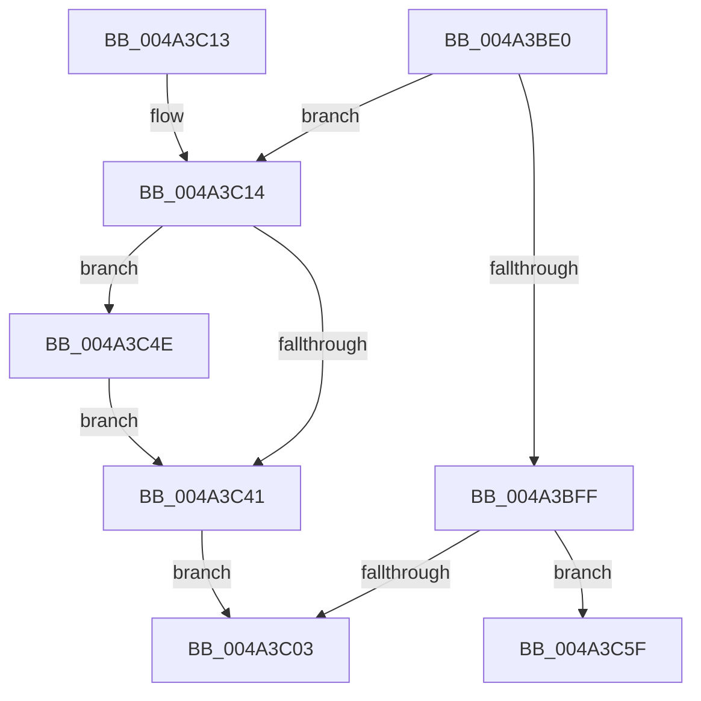

# PoFxCompleteDevicePowerNotRequired

- RVA: `0x004A3BE0`–`0x004A3C73` (길이 `147` bytes)
- VA: `0x00000001404A3BE0`
- 실행 섹션: `.text`
- PDB 이름 있음: `예`; PDB Function 태그: `아니요`
- unwind 정보 RVA: `0x000B6478`
- 디코드: `43`개 명령, `147/147` bytes 표시
- 미해석 바이트: `0` (있으면 어셈블리에 `.byte`로 보존)

> 이 문서는 커널 이미지의 기계어와 PDB 기호를 분석해 생성했습니다. 4번과 5번은 함수 원형과 자료형을 바이너리 사용 방식에서 추정한 C 해석이며 원본 소스 복구 결과는 아닙니다.

## 1. Dependencies

- 직접 호출 지점: **5**; 고유 호출 대상: **5**
- 직접 호출자로 확인된 함수: **1**
- RIP 상대 이미지 참조: **0**

### Outgoing calls
- `0x004A3C22` → [PopFxAddLogEntry](../39/PopFxAddLogEntry_function_00390B94.md) (function, `0x00390B94`)
- `0x004A3C31` → [KeAcquireSpinLockRaiseToDpc](../20/KeAcquireSpinLockRaiseToDpc_function_00208470.md) (function, `0x00208470`)
- `0x004A3C47` → [KeReleaseSpinLock](../39/KeReleaseSpinLock_function_00392BA0.md) (function, `0x00392BA0`)
- `0x004A3C58` → [PopFxQueueWorkOrder](../2B/PopFxQueueWorkOrder_function_002BFD34.md) (function, `0x002BFD34`)
- `0x004A3C6D` → [PopFxBugCheck](../2B/PopFxBugCheck_function_002BFC6C.md) (function, `0x002BFC6C`)

### Direct callers
- [DifPoFxCompleteDevicePowerNotRequiredWrapper](../63/DifPoFxCompleteDevicePowerNotRequiredWrapper_function_00638F90.md) at `0x00639056`

### Static image references
- 디코드된 RIP-relative 메모리 참조가 없습니다.

## 2. Other-region calls and transfers

- 다른 실행 섹션으로 향하는 call: **0**
- 별도 외부 분기/꼬리 이동을 확인하지 못했습니다.

## 3. Assembly (complete function range)

```asm
004A3BE0  48 89 5C 24 08                  mov qword ptr [rsp + 8], rbx
004A3BE5  48 89 74 24 10                  mov qword ptr [rsp + 0x10], rsi
004A3BEA  57                              push rdi
004A3BEB  48 83 EC 20                     sub rsp, 0x20
004A3BEF  48 8B D9                        mov rbx, rcx
004A3BF2  83 C8 FF                        or eax, 0xffffffff
004A3BF5  F0 0F C1 41 28                  lock xadd dword ptr [rcx + 0x28], eax
004A3BFA  83 E8 01                        sub eax, 1
004A3BFD  74 15                           je 0x1404a3c14
004A3BFF  85 C0                           test eax, eax
004A3C01  78 5C                           js 0x1404a3c5f
004A3C03  48 8B 5C 24 30                  mov rbx, qword ptr [rsp + 0x30]
004A3C08  48 8B 74 24 38                  mov rsi, qword ptr [rsp + 0x38]
004A3C0D  48 83 C4 20                     add rsp, 0x20
004A3C11  5F                              pop rdi
004A3C12  C3                              ret
004A3C13  CC                              int3
004A3C14  48 8B 49 30                     mov rcx, qword ptr [rcx + 0x30]
004A3C18  33 D2                           xor edx, edx
004A3C1A  44 8D 4A 01                     lea r9d, [rdx + 1]
004A3C1E  44 8D 42 11                     lea r8d, [rdx + 0x11]
004A3C22  E8 6D CF EE FF                  call 0x140390b94
004A3C27  48 8D BB 90 01 00 00            lea rdi, [rbx + 0x190]
004A3C2E  48 8B CF                        mov rcx, rdi
004A3C31  E8 3A 48 D6 FF                  call 0x140208470
004A3C36  8B 53 24                        mov edx, dword ptr [rbx + 0x24]
004A3C39  40 8A F0                        mov sil, al
004A3C3C  83 FA 02                        cmp edx, 2
004A3C3F  74 0D                           je 0x1404a3c4e
004A3C41  40 8A D6                        mov dl, sil
004A3C44  48 8B CF                        mov rcx, rdi
004A3C47  E8 54 EF EE FF                  call 0x140392ba0
004A3C4C  EB B5                           jmp 0x1404a3c03
004A3C4E  48 8D 8B 58 01 00 00            lea rcx, [rbx + 0x158]
004A3C55  48 8B D3                        mov rdx, rbx
004A3C58  E8 D7 C0 E1 FF                  call 0x1402bfd34
004A3C5D  EB E2                           jmp 0x1404a3c41
004A3C5F  45 33 C9                        xor r9d, r9d
004A3C62  45 33 C0                        xor r8d, r8d
004A3C65  48 8B D3                        mov rdx, rbx
004A3C68  B9 13 06 00 00                  mov ecx, 0x613
004A3C6D  E8 FA BF E1 FF                  call 0x1402bfc6c
004A3C72  CC                              int3
```

## 4. C-style interpretation (structured pseudocode)

```c
__int64 __fastcall PoFxCompleteDevicePowerNotRequired(__int64 a1, int a2)
{
    __int64 result;
    __int64 v_rsp;
    unsigned __int64 v_stack_p10;
    unsigned __int64 v_stack_p8;

    v_stack_p8 = v_rbx;
    v_stack_p10 = v_rsi;
    v_rsp = (v_rsp) - (32);
    result = (unsigned int)((result) | (0xFFFFFFFFULL));
    result = (unsigned int)((result) - (1));
    if (condition_is_equal) goto loc_004A3C14;
    if (sign_flag) goto loc_004A3C5F;
loc_004A3C03:
    v_rsp = (v_rsp) + (32);
    return result;
loc_004A3C14:
    a2 = 0;
    result = PopFxAddLogEntry(*(unsigned __int64 *)(a1 + 48), a2, a2 + 17, a2 + 1);
    result = KeAcquireSpinLockRaiseToDpc(v_stack_p8 + 400, a2, a2 + 17, a2 + 1);
    if (((unsigned int)((unsigned int)(*(unsigned int *)(v_stack_p8 + 36)))) == 2) goto loc_004A3C4E;
loc_004A3C41:
    result = KeReleaseSpinLock(v_stack_p8 + 400, (unsigned __int8)((unsigned __int8)(result)), a2 + 17, a2 + 1);
    goto loc_004A3C03;
loc_004A3C4E:
    result = PopFxQueueWorkOrder(v_stack_p8 + 344, v_stack_p8, a2 + 17, a2 + 1);
    goto loc_004A3C41;
loc_004A3C5F:
    a4 = 0;
    a3 = 0;
    result = PopFxBugCheck((unsigned int)(0x613ULL), v_stack_p8, a3, a4);
    return result;
}
```

## 5. (Beta) C Style

```c
int64_t PoFxCompleteDevicePowerNotRequired(void *Arg1, int32_t Arg2)
{
    uint8_t *arg1 = (uint8_t *)Arg1;

    int64_t result;
    int64_t local_rsp;
    uint64_t v_stack_p10;
    uint64_t v_stack_p8;

    v_stack_p8 = local_rbx;
    v_stack_p10 = local_rsi;
    local_rsp = (local_rsp) - (32);
    result = (uint32_t)((result) | (0xFFFFFFFFULL));
    result = (uint32_t)((result) - (1));
    if (condition_is_equal) goto loc_004A3C14;
    if (sign_flag) goto loc_004A3C5F;
loc_004A3C03:
    local_rsp = (local_rsp) + (32);
    return result;
loc_004A3C14:
    Arg2 = 0;
    result = PopFxAddLogEntry(*(uint64_t *)(arg1 + 0x30), Arg2, Arg2 + 17, Arg2 + 1);
    result = KeAcquireSpinLockRaiseToDpc(v_stack_p8 + 400, Arg2, Arg2 + 17, Arg2 + 1);
    if (((uint32_t)((uint32_t)(*(uint32_t *)(v_stack_p8 + 0x24)))) == 2) goto loc_004A3C4E;
loc_004A3C41:
    result = KeReleaseSpinLock(v_stack_p8 + 400, (uint8_t)((uint8_t)(result)), Arg2 + 17, Arg2 + 1);
    goto loc_004A3C03;
loc_004A3C4E:
    result = PopFxQueueWorkOrder(v_stack_p8 + 344, v_stack_p8, Arg2 + 17, Arg2 + 1);
    goto loc_004A3C41;
loc_004A3C5F:
    a4 = 0;
    a3 = 0;
    result = PopFxBugCheck((uint32_t)(0x613ULL), v_stack_p8, a3, a4);
    return result;
}
```

### 관측된 메모리 오프셋

구조체 형식이 확인되지 않은 접근은 인자 기준의 오프셋으로만 기록했습니다.

| 기준 인자 | 오프셋 표현 | 폭 (bit) | 접근 |
|---|---:|---:|---|
| `Arg1` | `+ 0x24` | `32` | `R` |
| `Arg1` | `+ 0x28` | `32` | `R/W` |
| `Arg1` | `+ 0x30` | `64` | `R` |
| `Arg1` | `+ 0x158` | `64` | `R` |
| `Arg1` | `+ 0x190` | `64` | `R` |

## 6. Execution-region graph

[열기: 2D/3D 그래프와 함수 탐색 컨트롤 패널](../../../control-panel.html?section=text&rva=0x004A3BE0&view=graph)

- 2D 그래프는 위에서 아래로 흐르고, 3D 그래프는 빈 공간을 드래그해 회전합니다. Shift+드래그는 이동, 휠은 확대·축소, 함수 노드 선택은 대상 보고서 이동입니다.

### Static fallback


