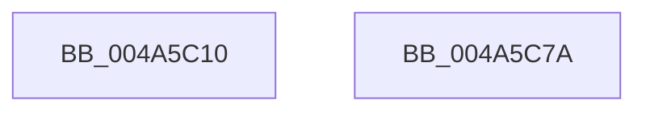

# PoFxSetDeviceIdleTimeout

- RVA: `0x004A5C10`–`0x004A5C7B` (길이 `107` bytes)
- VA: `0x00000001404A5C10`
- 실행 섹션: `.text`
- PDB 이름 있음: `예`; PDB Function 태그: `아니요`
- unwind 정보 RVA: `0x0005C954`
- 디코드: `27`개 명령, `107/107` bytes 표시
- 미해석 바이트: `0` (있으면 어셈블리에 `.byte`로 보존)

> 이 문서는 커널 이미지의 기계어와 PDB 기호를 분석해 생성했습니다. 4번과 5번은 함수 원형과 자료형을 바이너리 사용 방식에서 추정한 C 해석이며 원본 소스 복구 결과는 아닙니다.

## 1. Dependencies

- 직접 호출 지점: **3**; 고유 호출 대상: **3**
- 직접 호출자로 확인된 함수: **1**
- RIP 상대 이미지 참조: **0**

### Outgoing calls
- `0x004A5C34` → [KeAcquireSpinLockRaiseToDpc](../20/KeAcquireSpinLockRaiseToDpc_function_00208470.md) (function, `0x00208470`)
- `0x004A5C56` → [PopFxUpdateDeviceIdleTimer](PopFxUpdateDeviceIdleTimer_function_004A5C84.md) (function, `0x004A5C84`)
- `0x004A5C60` → [KeReleaseSpinLock](../39/KeReleaseSpinLock_function_00392BA0.md) (function, `0x00392BA0`)

### Direct callers
- [DifPoFxSetDeviceIdleTimeoutWrapper](../63/DifPoFxSetDeviceIdleTimeoutWrapper_function_00639FE0.md) at `0x0063A0B7`

### Static image references
- 디코드된 RIP-relative 메모리 참조가 없습니다.

## 2. Other-region calls and transfers

- 다른 실행 섹션으로 향하는 call: **0**
- 별도 외부 분기/꼬리 이동을 확인하지 못했습니다.

## 3. Assembly (complete function range)

```asm
004A5C10  48 89 5C 24 08                  mov qword ptr [rsp + 8], rbx
004A5C15  48 89 6C 24 10                  mov qword ptr [rsp + 0x10], rbp
004A5C1A  48 89 74 24 18                  mov qword ptr [rsp + 0x18], rsi
004A5C1F  57                              push rdi
004A5C20  48 83 EC 20                     sub rsp, 0x20
004A5C24  48 8D A9 90 01 00 00            lea rbp, [rcx + 0x190]
004A5C2B  48 8B F1                        mov rsi, rcx
004A5C2E  48 8B CD                        mov rcx, rbp
004A5C31  48 8B FA                        mov rdi, rdx
004A5C34  E8 37 28 D6 FF                  call 0x140208470
004A5C39  49 B8 FF FF FF FF FF FF FF 3F   movabs r8, 0x3fffffffffffffff
004A5C43  48 8B CE                        mov rcx, rsi
004A5C46  49 3B F8                        cmp rdi, r8
004A5C49  8A D8                           mov bl, al
004A5C4B  4C 0F 46 C7                     cmovbe r8, rdi
004A5C4F  4C 89 86 18 02 00 00            mov qword ptr [rsi + 0x218], r8
004A5C56  E8 29 00 00 00                  call 0x1404a5c84
004A5C5B  8A D3                           mov dl, bl
004A5C5D  48 8B CD                        mov rcx, rbp
004A5C60  E8 3B CF EE FF                  call 0x140392ba0
004A5C65  48 8B 5C 24 30                  mov rbx, qword ptr [rsp + 0x30]
004A5C6A  48 8B 6C 24 38                  mov rbp, qword ptr [rsp + 0x38]
004A5C6F  48 8B 74 24 40                  mov rsi, qword ptr [rsp + 0x40]
004A5C74  48 83 C4 20                     add rsp, 0x20
004A5C78  5F                              pop rdi
004A5C79  C3                              ret
004A5C7A  CC                              int3
```

## 4. C-style interpretation (structured pseudocode)

```c
__int64 __fastcall PoFxSetDeviceIdleTimeout(__int64 a1, __int64 a2)
{
    __int64 result;
    __int64 v_rsp;
    unsigned __int64 v_stack_p10;
    unsigned __int64 v_stack_p18;
    unsigned __int64 v_stack_p8;

    v_stack_p8 = v_rbx;
    v_stack_p10 = v_rbp;
    v_stack_p18 = v_rsi;
    v_rsp = (v_rsp) - (32);
    result = KeAcquireSpinLockRaiseToDpc(a1 + 400, a2, a3, a4);
    if (a2 <= a3) { a3 = a2; }
    *(unsigned __int64 *)(a1 + 536) = a3;
    result = PopFxUpdateDeviceIdleTimer(a1, a2, a3, a4);
    result = KeReleaseSpinLock(a1 + 400, (unsigned __int8)((unsigned __int8)(result)), a3, a4);
    v_rsp = (v_rsp) + (32);
    return result;
}
```

## 5. (Beta) C Style

```c
int64_t PoFxSetDeviceIdleTimeout(void *Arg1, int64_t Arg2)
{
    uint8_t *arg1 = (uint8_t *)Arg1;

    int64_t result;
    int64_t local_rsp;
    uint64_t v_stack_p10;
    uint64_t v_stack_p18;
    uint64_t v_stack_p8;

    v_stack_p8 = local_rbx;
    v_stack_p10 = local_rbp;
    v_stack_p18 = local_rsi;
    local_rsp = (local_rsp) - (32);
    result = KeAcquireSpinLockRaiseToDpc(Arg1 + 400, Arg2, a3, a4);
    if (Arg2 <= a3) { a3 = Arg2; }
    *(uint64_t *)(arg1 + 0x218) = a3;
    result = PopFxUpdateDeviceIdleTimer(Arg1, Arg2, a3, a4);
    result = KeReleaseSpinLock(Arg1 + 400, (uint8_t)((uint8_t)(result)), a3, a4);
    local_rsp = (local_rsp) + (32);
    return result;
}
```

### 관측된 메모리 오프셋

구조체 형식이 확인되지 않은 접근은 인자 기준의 오프셋으로만 기록했습니다.

| 기준 인자 | 오프셋 표현 | 폭 (bit) | 접근 |
|---|---:|---:|---|
| `Arg1` | `+ 0x190` | `64` | `R` |
| `Arg1` | `+ 0x218` | `64` | `W` |

## 6. Execution-region graph

[열기: 2D/3D 그래프와 함수 탐색 컨트롤 패널](../../../control-panel.html?section=text&rva=0x004A5C10&view=graph)

- 2D 그래프는 위에서 아래로 흐르고, 3D 그래프는 빈 공간을 드래그해 회전합니다. Shift+드래그는 이동, 휠은 확대·축소, 함수 노드 선택은 대상 보고서 이동입니다.

### Static fallback


