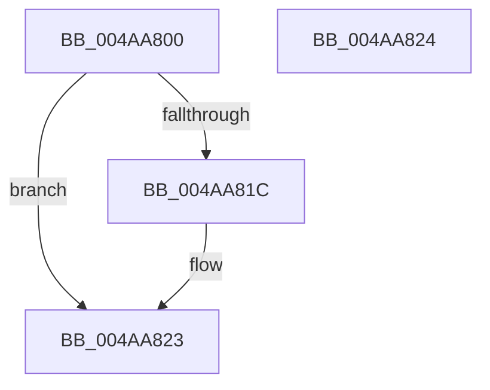

# PoGetSystemWake

- RVA: `0x004AA800`–`0x004AA825` (길이 `37` bytes)
- VA: `0x00000001404AA800`
- 실행 섹션: `.text`
- PDB 이름 있음: `예`; PDB Function 태그: `아니요`
- unwind 정보 RVA: `0x000DB714`
- 디코드: `9`개 명령, `37/37` bytes 표시
- 미해석 바이트: `0` (있으면 어셈블리에 `.byte`로 보존)

> 이 문서는 커널 이미지의 기계어와 PDB 기호를 분석해 생성했습니다. 4번과 5번은 함수 원형과 자료형을 바이너리 사용 방식에서 추정한 C 해석이며 원본 소스 복구 결과는 아닙니다.

## 1. Dependencies

- 직접 호출 지점: **0**; 고유 호출 대상: **0**
- 직접 호출자로 확인된 함수: **0**
- RIP 상대 이미지 참조: **0**

### Outgoing calls
- 직접 디코드된 call 명령이 없습니다.

### Direct callers
- 이 함수 시작 RVA로 연결되는 직접 call은 확인되지 않았습니다. 간접 호출은 완전히 역산할 수 없습니다.

### Static image references
- 디코드된 RIP-relative 메모리 참조가 없습니다.

## 2. Other-region calls and transfers

- 다른 실행 섹션으로 향하는 call: **0**
- 별도 외부 분기/꼬리 이동을 확인하지 못했습니다.

## 3. Assembly (complete function range)

```asm
004AA800  48 0F BE 41 42                  movsx rax, byte ptr [rcx + 0x42]
004AA805  48 8D 14 C0                     lea rdx, [rax + rax*8]
004AA809  32 C0                           xor al, al
004AA80B  4C 8B 84 D1 C8 00 00 00         mov r8, qword ptr [rcx + rdx*8 + 0xc8]
004AA813  41 38 80 B8 00 00 00            cmp byte ptr [r8 + 0xb8], al
004AA81A  75 07                           jne 0x1404aa823
004AA81C  41 8A 80 F0 00 00 00            mov al, byte ptr [r8 + 0xf0]
004AA823  C3                              ret
004AA824  CC                              int3
```

## 4. C-style interpretation (structured pseudocode)

```c
__int64 __fastcall PoGetSystemWake(__int64 a1)
{
    __int64 result;

    result = 0;
    if ((*(unsigned __int8 *)(*(unsigned __int64 *)(a1 + (__int8)(*(unsigned __int8 *)(a1 + 66)) + (__int8)(*(unsigned __int8 *)(a1 + 66)) * 8 * 8 + 200) + 184)) == 0) {
        result = *(unsigned __int8 *)(*(unsigned __int64 *)(a1 + (__int8)(*(unsigned __int8 *)(a1 + 66)) + (__int8)(*(unsigned __int8 *)(a1 + 66)) * 8 * 8 + 200) + 240);
    }
    return result;
}
```

## 5. (Beta) C Style

```c
int64_t PoGetSystemWake(void *Arg1)
{
    uint8_t *arg1 = (uint8_t *)Arg1;

    int64_t result;

    result = 0;
    if ((*(uint8_t *)(*(uint64_t *)(arg1 + (int8_t)(*(uint8_t *)(arg1 + 0x42)) + (int8_t)(*(uint8_t *)(arg1 + 0x42)) * 8 * 8 + 0xC8) + 0xB8)) == 0) {
        result = *(uint8_t *)(*(uint64_t *)(arg1 + (int8_t)(*(uint8_t *)(arg1 + 0x42)) + (int8_t)(*(uint8_t *)(arg1 + 0x42)) * 8 * 8 + 0xC8) + 0xF0);
    }
    return result;
}
```

### 관측된 메모리 오프셋

구조체 형식이 확인되지 않은 접근은 인자 기준의 오프셋으로만 기록했습니다.

| 기준 인자 | 오프셋 표현 | 폭 (bit) | 접근 |
|---|---:|---:|---|
| `Arg1` | `+ 0x42` | `8` | `R` |
| `Arg1` | `+ 0xC8 + rdx*8` | `64` | `R` |

## 6. Execution-region graph

[열기: 2D/3D 그래프와 함수 탐색 컨트롤 패널](../../../control-panel.html?section=text&rva=0x004AA800&view=graph)

- 2D 그래프는 위에서 아래로 흐르고, 3D 그래프는 빈 공간을 드래그해 회전합니다. Shift+드래그는 이동, 휠은 확대·축소, 함수 노드 선택은 대상 보고서 이동입니다.

### Static fallback


