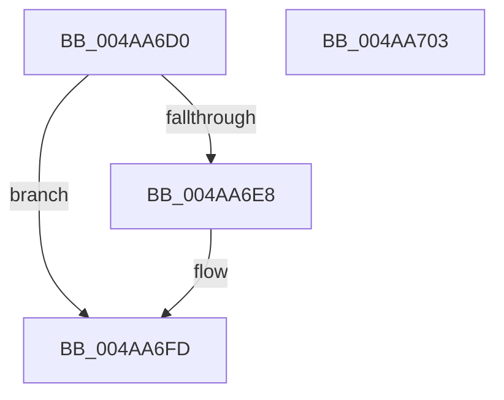

# PoSetSystemWakeDevice

- RVA: `0x004AA6D0`–`0x004AA704` (길이 `52` bytes)
- VA: `0x00000001404AA6D0`
- 실행 섹션: `.text`
- PDB 이름 있음: `예`; PDB Function 태그: `아니요`
- unwind 정보 RVA: `0x0005CF00`
- 디코드: `16`개 명령, `52/52` bytes 표시
- 미해석 바이트: `0` (있으면 어셈블리에 `.byte`로 보존)

> 이 문서는 커널 이미지의 기계어와 PDB 기호를 분석해 생성했습니다. 4번과 5번은 함수 원형과 자료형을 바이너리 사용 방식에서 추정한 C 해석이며 원본 소스 복구 결과는 아닙니다.

## 1. Dependencies

- 직접 호출 지점: **3**; 고유 호출 대상: **3**
- 직접 호출자로 확인된 함수: **0**
- RIP 상대 이미지 참조: **0**

### Outgoing calls
- `0x004AA6DB` → [IoGetDeviceAttachmentBaseRefWithTag](../27/IoGetDeviceAttachmentBaseRefWithTag_function_00272788.md) (function, `0x00272788`)
- `0x004AA6EB` → [PopUpdateWakeSource](PopUpdateWakeSource_function_004AA70C.md) (function, `0x004AA70C`)
- `0x004AA6F8` → [ObfDereferenceObjectWithTag](../2F/ObfDereferenceObjectWithTag_function_002F78E0.md) (function, `0x002F78E0`)

### Direct callers
- 이 함수 시작 RVA로 연결되는 직접 call은 확인되지 않았습니다. 간접 호출은 완전히 역산할 수 없습니다.

### Static image references
- 디코드된 RIP-relative 메모리 참조가 없습니다.

## 2. Other-region calls and transfers

- 다른 실행 섹션으로 향하는 call: **0**
- 별도 외부 분기/꼬리 이동을 확인하지 못했습니다.

## 3. Assembly (complete function range)

```asm
004AA6D0  40 53                           push rbx
004AA6D2  48 83 EC 20                     sub rsp, 0x20
004AA6D6  BA 50 6F 49 72                  mov edx, 0x72496f50
004AA6DB  E8 A8 80 DC FF                  call 0x140272788
004AA6E0  48 8B D8                        mov rbx, rax
004AA6E3  48 85 C0                        test rax, rax
004AA6E6  74 15                           je 0x1404aa6fd
004AA6E8  48 8B C8                        mov rcx, rax
004AA6EB  E8 1C 00 00 00                  call 0x1404aa70c
004AA6F0  BA 50 6F 49 72                  mov edx, 0x72496f50
004AA6F5  48 8B CB                        mov rcx, rbx
004AA6F8  E8 E3 D1 E4 FF                  call 0x1402f78e0
004AA6FD  48 83 C4 20                     add rsp, 0x20
004AA701  5B                              pop rbx
004AA702  C3                              ret
004AA703  CC                              int3
```

## 4. C-style interpretation (structured pseudocode)

```c
__int64 __fastcall PoSetSystemWakeDevice(void)
{
    __int64 result;
    __int64 v_rsp;

    v_rsp = (v_rsp) - (32);
    result = IoGetDeviceAttachmentBaseRefWithTag(a1, (unsigned int)(0x72496F50ULL), a3, a4);
    if (result != 0) {
        a1 = result;
        result = PopUpdateWakeSource(a1, (unsigned int)(0x72496F50ULL), a3, a4);
        a2 = 0x72496F50ULL;
        a1 = result;
        result = ObfDereferenceObjectWithTag(a1, a2, a3, a4);
    }
    v_rsp = (v_rsp) + (32);
    return result;
}
```

## 5. (Beta) C Style

```c
void PoSetSystemWakeDevice(void)
{
    int64_t result;
    int64_t local_rsp;

    local_rsp = (local_rsp) - (32);
    result = IoGetDeviceAttachmentBaseRefWithTag(a1, (uint32_t)(0x72496F50ULL), a3, a4);
    if (result != 0) {
        a1 = result;
        result = PopUpdateWakeSource(a1, (uint32_t)(0x72496F50ULL), a3, a4);
        a2 = 0x72496F50ULL;
        a1 = result;
        result = ObfDereferenceObjectWithTag(a1, a2, a3, a4);
    }
    local_rsp = (local_rsp) + (32);
    return result;
}
```

## 6. Execution-region graph

[열기: 2D/3D 그래프와 함수 탐색 컨트롤 패널](../../../control-panel.html?section=text&rva=0x004AA6D0&view=graph)

- 2D 그래프는 위에서 아래로 흐르고, 3D 그래프는 빈 공간을 드래그해 회전합니다. Shift+드래그는 이동, 휠은 확대·축소, 함수 노드 선택은 대상 보고서 이동입니다.

### Static fallback


