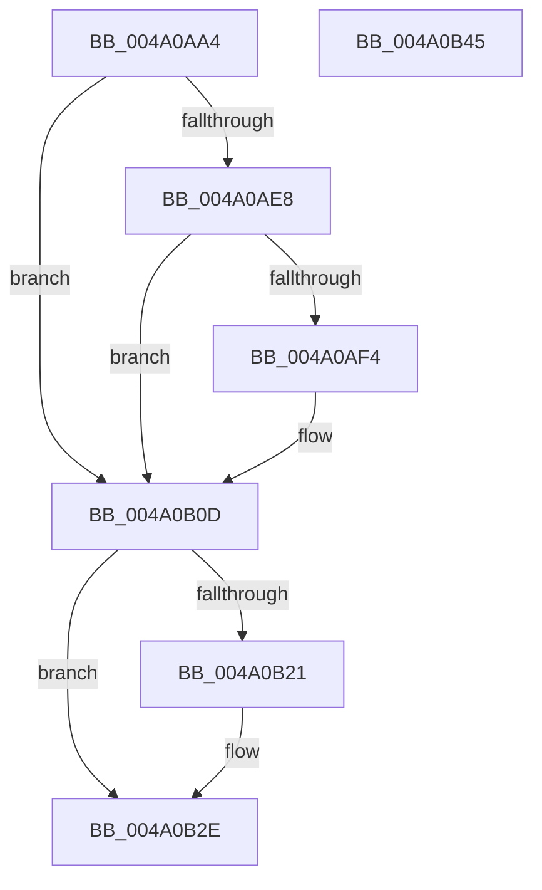

# PopAccumulateNonActivatedCpuTime

- RVA: `0x004A0AA4`–`0x004A0B46` (길이 `162` bytes)
- VA: `0x00000001404A0AA4`
- 실행 섹션: `.text`
- PDB 이름 있음: `예`; PDB Function 태그: `아니요`
- unwind 정보 RVA: `0x0007A168`
- 디코드: `50`개 명령, `162/162` bytes 표시
- 미해석 바이트: `0` (있으면 어셈블리에 `.byte`로 보존)

> 이 문서는 커널 이미지의 기계어와 PDB 기호를 분석해 생성했습니다. 4번과 5번은 함수 원형과 자료형을 바이너리 사용 방식에서 추정한 C 해석이며 원본 소스 복구 결과는 아닙니다.

## 1. Dependencies

- 직접 호출 지점: **4**; 고유 호출 대상: **4**
- 직접 호출자로 확인된 함수: **3**
- RIP 상대 이미지 참조: **1**

### Outgoing calls
- `0x004A0AD2` → [KeAcquireSpinLockRaiseToDpc](../20/KeAcquireSpinLockRaiseToDpc_function_00208470.md) (function, `0x00208470`)
- `0x004A0ADE` → [PpmParkGetParkNode](PpmParkGetParkNode_function_004A0B4C.md) (function, `0x004A0B4C`)
- `0x004A0AFE` → [PpmIdleSnapConcurrencyIdleTime](PpmIdleSnapConcurrencyIdleTime_function_004A0BD4.md) (function, `0x004A0BD4`)
- `0x004A0B17` → [KeReleaseSpinLock](../39/KeReleaseSpinLock_function_00392BA0.md) (function, `0x00392BA0`)

### Direct callers
- [PopUpdateNonAttributedCpuTimeReference](../30/PopUpdateNonAttributedCpuTimeReference_function_00304720.md) at `0x00304762`
- [PopUpdateNonAttributedCpuTimeReference](../30/PopUpdateNonAttributedCpuTimeReference_function_00304720.md) at `0x00304784`
- [PopDripsWatchdogUpdateMetrics](../../page/76/PopDripsWatchdogUpdateMetrics_function_0076C830.md) at `0x0076C957`
- [PopPdcIdleResiliencyCallback](../../page/A3/PopPdcIdleResiliencyCallback_function_00A31518.md) at `0x00A31596`

### Static image references
- `0x004A0AC0` → RVA `0x00F0CC20` (`.data`; read)

## 2. Other-region calls and transfers

- 다른 실행 섹션으로 향하는 call: **0**
- 별도 외부 분기/꼬리 이동을 확인하지 못했습니다.

## 3. Assembly (complete function range)

```asm
004A0AA4  48 89 5C 24 08                  mov qword ptr [rsp + 8], rbx
004A0AA9  55                              push rbp
004A0AAA  56                              push rsi
004A0AAB  57                              push rdi
004A0AAC  41 56                           push r14
004A0AAE  41 57                           push r15
004A0AB0  48 83 EC 20                     sub rsp, 0x20
004A0AB4  44 8A F1                        mov r14b, cl
004A0AB7  33 DB                           xor ebx, ebx
004A0AB9  33 FF                           xor edi, edi
004A0ABB  48 89 5C 24 68                  mov qword ptr [rsp + 0x68], rbx
004A0AC0  48 8D 0D 59 C1 A6 00            lea rcx, [rip + 0xa6c159]
004A0AC7  48 89 7C 24 58                  mov qword ptr [rsp + 0x58], rdi
004A0ACC  49 8B E8                        mov rbp, r8
004A0ACF  48 8B F2                        mov rsi, rdx
004A0AD2  E8 99 79 D6 FF                  call 0x140208470
004A0AD7  33 D2                           xor edx, edx
004A0AD9  33 C9                           xor ecx, ecx
004A0ADB  44 8A F8                        mov r15b, al
004A0ADE  E8 69 00 00 00                  call 0x1404a0b4c
004A0AE3  48 85 C0                        test rax, rax
004A0AE6  74 25                           je 0x1404a0b0d
004A0AE8  48 8B 88 50 04 00 00            mov rcx, qword ptr [rax + 0x450]
004A0AEF  48 85 C9                        test rcx, rcx
004A0AF2  74 19                           je 0x1404a0b0d
004A0AF4  4C 8D 44 24 58                  lea r8, [rsp + 0x58]
004A0AF9  48 8D 54 24 68                  lea rdx, [rsp + 0x68]
004A0AFE  E8 D1 00 00 00                  call 0x1404a0bd4
004A0B03  48 8B 7C 24 58                  mov rdi, qword ptr [rsp + 0x58]
004A0B08  48 8B 5C 24 68                  mov rbx, qword ptr [rsp + 0x68]
004A0B0D  41 8A D7                        mov dl, r15b
004A0B10  48 8D 0D 09 C1 A6 00            lea rcx, [rip + 0xa6c109]
004A0B17  E8 84 20 EF FF                  call 0x140392ba0
004A0B1C  45 84 F6                        test r14b, r14b
004A0B1F  75 0D                           jne 0x1404a0b2e
004A0B21  48 8B C3                        mov rax, rbx
004A0B24  48 2B 06                        sub rax, qword ptr [rsi]
004A0B27  48 2B C7                        sub rax, rdi
004A0B2A  48 01 45 00                     add qword ptr [rbp], rax
004A0B2E  48 2B DF                        sub rbx, rdi
004A0B31  48 89 1E                        mov qword ptr [rsi], rbx
004A0B34  48 8B 5C 24 50                  mov rbx, qword ptr [rsp + 0x50]
004A0B39  48 83 C4 20                     add rsp, 0x20
004A0B3D  41 5F                           pop r15
004A0B3F  41 5E                           pop r14
004A0B41  5F                              pop rdi
004A0B42  5E                              pop rsi
004A0B43  5D                              pop rbp
004A0B44  C3                              ret
004A0B45  CC                              int3
```

## 4. C-style interpretation (structured pseudocode)

```c
__int64 __fastcall PopAccumulateNonActivatedCpuTime(unsigned __int8 a1, __int64 a2, __int64 a3)
{
    __int64 result;
    __int64 v_rbx;
    __int64 v_rdi;
    __int64 v_rsp;
    unsigned __int64 v_stack_p10;
    unsigned __int64 v_stack_p20;
    unsigned __int64 v_stack_p8;

    v_stack_p8 = v_rbx;
    v_rsp = (v_rsp) - (32);
    v_rbx = 0;
    v_rdi = 0;
    v_stack_p20 = 0;
    v_stack_p10 = 0;
    result = KeAcquireSpinLockRaiseToDpc(v_rip + 10928473, a2, a3, a4);
    a2 = 0;
    a1 = 0;
    result = PpmParkGetParkNode(a1, a2, a3, a4);
    if (result == 0) goto loc_004A0B0D;
    if (*(unsigned __int64 *)(result + 1104) != 0) {
        a3 = v_stack_p10;
        a2 = v_stack_p20;
        result = PpmIdleSnapConcurrencyIdleTime(*(unsigned __int64 *)(result + 1104), a2, a3, a4);
        v_rdi = v_stack_p10;
        v_rbx = v_stack_p20;
    }
    result = KeReleaseSpinLock(v_rip + 10928393, (unsigned __int8)((unsigned __int8)(result)), a3, a4);
    if (0 == 0) {
        result = v_rbx;
        result = (result) - (*(unsigned __int64 *)(a2));
        result = (result) - (v_rdi);
    }
    v_rbx = (v_rbx) - (v_rdi);
    *(unsigned __int64 *)(a2) = v_rbx;
    v_rsp = (v_rsp) + (32);
    return result;
}
```

## 5. (Beta) C Style

```c
int64_t PopAccumulateNonActivatedCpuTime(uint8_t Arg1, void *Arg2, void *Arg3)
{
    uint8_t *arg2 = (uint8_t *)Arg2;
    uint8_t *arg3 = (uint8_t *)Arg3;

    int64_t result;
    int64_t local_rbx;
    int64_t local_rdi;
    int64_t local_rsp;
    uint64_t v_stack_p10;
    uint64_t v_stack_p20;
    uint64_t v_stack_p8;

    v_stack_p8 = local_rbx;
    local_rsp = (local_rsp) - (32);
    local_rbx = 0;
    local_rdi = 0;
    v_stack_p20 = 0;
    v_stack_p10 = 0;
    result = KeAcquireSpinLockRaiseToDpc(v_rip + 10928473, Arg2, Arg3, a4);
    Arg2 = 0;
    Arg1 = 0;
    result = PpmParkGetParkNode(Arg1, Arg2, Arg3, a4);
    if (result == 0) goto loc_004A0B0D;
    if (*(uint64_t *)(result + 0x450) != 0) {
        Arg3 = v_stack_p10;
        Arg2 = v_stack_p20;
        result = PpmIdleSnapConcurrencyIdleTime(*(uint64_t *)(result + 0x450), Arg2, Arg3, a4);
        local_rdi = v_stack_p10;
        local_rbx = v_stack_p20;
    }
    result = KeReleaseSpinLock(v_rip + 10928393, (uint8_t)((uint8_t)(result)), Arg3, a4);
    if (0 == 0) {
        result = local_rbx;
        result = (result) - (*(uint64_t *)(arg2));
        result = (result) - (local_rdi);
    }
    local_rbx = (local_rbx) - (local_rdi);
    *(uint64_t *)(arg2) = local_rbx;
    local_rsp = (local_rsp) + (32);
    return result;
}
```

### 관측된 메모리 오프셋

구조체 형식이 확인되지 않은 접근은 인자 기준의 오프셋으로만 기록했습니다.

| 기준 인자 | 오프셋 표현 | 폭 (bit) | 접근 |
|---|---:|---:|---|
| `Arg2` | `+ 0x0` | `64` | `R` |
| `Arg2` | `+ 0x0` | `64` | `W` |
| `Arg3` | `+ 0x0` | `64` | `R/W` |

## 6. Execution-region graph

[열기: 2D/3D 그래프와 함수 탐색 컨트롤 패널](../../../control-panel.html?section=text&rva=0x004A0AA4&view=graph)

- 2D 그래프는 위에서 아래로 흐르고, 3D 그래프는 빈 공간을 드래그해 회전합니다. Shift+드래그는 이동, 휠은 확대·축소, 함수 노드 선택은 대상 보고서 이동입니다.

### Static fallback


