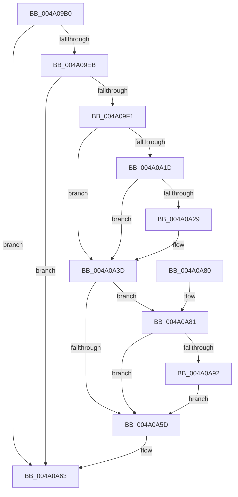

# PopAccumulateNonDripsIdleCpuTime

- RVA: `0x004A09B0`–`0x004A0A9B` (길이 `235` bytes)
- VA: `0x00000001404A09B0`
- 실행 섹션: `.text`
- PDB 이름 있음: `예`; PDB Function 태그: `아니요`
- unwind 정보 RVA: `0x000B585C`
- 디코드: `69`개 명령, `235/235` bytes 표시
- 미해석 바이트: `0` (있으면 어셈블리에 `.byte`로 보존)

> 이 문서는 커널 이미지의 기계어와 PDB 기호를 분석해 생성했습니다. 4번과 5번은 함수 원형과 자료형을 바이너리 사용 방식에서 추정한 C 해석이며 원본 소스 복구 결과는 아닙니다.

## 1. Dependencies

- 직접 호출 지점: **4**; 고유 호출 대상: **4**
- 직접 호출자로 확인된 함수: **1**
- RIP 상대 이미지 참조: **3**

### Outgoing calls
- `0x004A0A07` → [KeAcquireSpinLockRaiseToDpc](../20/KeAcquireSpinLockRaiseToDpc_function_00208470.md) (function, `0x00208470`)
- `0x004A0A13` → [PpmParkGetParkNode](PpmParkGetParkNode_function_004A0B4C.md) (function, `0x004A0B4C`)
- `0x004A0A33` → [PpmIdleSnapConcurrencyIdleTime](PpmIdleSnapConcurrencyIdleTime_function_004A0BD4.md) (function, `0x004A0BD4`)
- `0x004A0A47` → [KeReleaseSpinLock](../39/KeReleaseSpinLock_function_00392BA0.md) (function, `0x00392BA0`)

### Direct callers
- [PopUpdateNonAttributedCpuTimeReference](../30/PopUpdateNonAttributedCpuTimeReference_function_00304720.md) at `0x003047A0`

### Static image references
- `0x004A09CC` → RVA `0x00E27EC0` (`.data`; read)
- `0x004A09D6` → RVA `0x00FC6AD0` (`ALMOSTRO`; read)
- `0x004A09F5` → RVA `0x00F0CC20` (`.data`; read)

## 2. Other-region calls and transfers

- 다른 실행 섹션으로 향하는 call: **0**
- 별도 외부 분기/꼬리 이동을 확인하지 못했습니다.

## 3. Assembly (complete function range)

```asm
004A09B0  4C 8B DC                        mov r11, rsp
004A09B3  49 89 5B 08                     mov qword ptr [r11 + 8], rbx
004A09B7  49 89 6B 10                     mov qword ptr [r11 + 0x10], rbp
004A09BB  49 89 73 18                     mov qword ptr [r11 + 0x18], rsi
004A09BF  57                              push rdi
004A09C0  41 54                           push r12
004A09C2  41 55                           push r13
004A09C4  41 56                           push r14
004A09C6  41 57                           push r15
004A09C8  48 83 EC 30                     sub rsp, 0x30
004A09CC  44 8B 35 ED 74 98 00            mov r14d, dword ptr [rip + 0x9874ed]
004A09D3  49 8B E9                        mov rbp, r9
004A09D6  48 8B 05 F3 60 B2 00            mov rax, qword ptr [rip + 0xb260f3]
004A09DD  49 8B F8                        mov rdi, r8
004A09E0  48 8B F2                        mov rsi, rdx
004A09E3  44 8A F9                        mov r15b, cl
004A09E6  48 85 C0                        test rax, rax
004A09E9  74 78                           je 0x1404a0a63
004A09EB  41 83 FE FF                     cmp r14d, -1
004A09EF  74 72                           je 0x1404a0a63
004A09F1  4C 8B 60 30                     mov r12, qword ptr [rax + 0x30]
004A09F5  48 8D 0D 24 C2 A6 00            lea rcx, [rip + 0xa6c224]
004A09FC  49 83 63 D0 00                  and qword ptr [r11 - 0x30], 0
004A0A01  33 DB                           xor ebx, ebx
004A0A03  49 89 5B C8                     mov qword ptr [r11 - 0x38], rbx
004A0A07  E8 64 7A D6 FF                  call 0x140208470
004A0A0C  33 D2                           xor edx, edx
004A0A0E  33 C9                           xor ecx, ecx
004A0A10  44 8A E8                        mov r13b, al
004A0A13  E8 34 01 00 00                  call 0x1404a0b4c
004A0A18  48 85 C0                        test rax, rax
004A0A1B  74 20                           je 0x1404a0a3d
004A0A1D  48 8B 88 50 04 00 00            mov rcx, qword ptr [rax + 0x450]
004A0A24  48 85 C9                        test rcx, rcx
004A0A27  74 14                           je 0x1404a0a3d
004A0A29  4C 8D 44 24 20                  lea r8, [rsp + 0x20]
004A0A2E  48 8D 54 24 28                  lea rdx, [rsp + 0x28]
004A0A33  E8 9C 01 00 00                  call 0x1404a0bd4
004A0A38  48 8B 5C 24 20                  mov rbx, qword ptr [rsp + 0x20]
004A0A3D  41 8A D5                        mov dl, r13b
004A0A40  48 8D 0D D9 C1 A6 00            lea rcx, [rip + 0xa6c1d9]
004A0A47  E8 54 21 EF FF                  call 0x140392ba0
004A0A4C  49 8B C6                        mov rax, r14
004A0A4F  48 C1 E0 0A                     shl rax, 0xa
004A0A53  4A 8B 54 20 48                  mov rdx, qword ptr [rax + r12 + 0x48]
004A0A58  45 84 FF                        test r15b, r15b
004A0A5B  74 24                           je 0x1404a0a81
004A0A5D  48 89 1E                        mov qword ptr [rsi], rbx
004A0A60  48 89 17                        mov qword ptr [rdi], rdx
004A0A63  48 8B 5C 24 60                  mov rbx, qword ptr [rsp + 0x60]
004A0A68  48 8B 6C 24 68                  mov rbp, qword ptr [rsp + 0x68]
004A0A6D  48 8B 74 24 70                  mov rsi, qword ptr [rsp + 0x70]
004A0A72  48 83 C4 30                     add rsp, 0x30
004A0A76  41 5F                           pop r15
004A0A78  41 5E                           pop r14
004A0A7A  41 5D                           pop r13
004A0A7C  41 5C                           pop r12
004A0A7E  5F                              pop rdi
004A0A7F  C3                              ret
004A0A80  CC                              int3
004A0A81  48 8B C3                        mov rax, rbx
004A0A84  48 8B CA                        mov rcx, rdx
004A0A87  48 2B 06                        sub rax, qword ptr [rsi]
004A0A8A  48 2B 0F                        sub rcx, qword ptr [rdi]
004A0A8D  48 3B C1                        cmp rax, rcx
004A0A90  76 CB                           jbe 0x1404a0a5d
004A0A92  48 2B C1                        sub rax, rcx
004A0A95  48 01 45 00                     add qword ptr [rbp], rax
004A0A99  EB C2                           jmp 0x1404a0a5d
```

## 4. C-style interpretation (structured pseudocode)

```c
__int64 __fastcall PopAccumulateNonDripsIdleCpuTime(unsigned __int8 a1, __int64 a2, __int64 a3, __int64 a4)
{
    __int64 result;
    __int64 v_rbx;
    __int64 v_rsp;
    unsigned __int64 v_stack_m30;
    unsigned __int64 v_stack_m38;
    unsigned __int64 v_stack_p10;
    unsigned __int64 v_stack_p18;
    unsigned __int64 v_stack_p8;

    *(unsigned __int64 *)(v_rsp + 8) = v_rbx;
    *(unsigned __int64 *)(v_rsp + 16) = v_rbp;
    *(unsigned __int64 *)(v_rsp + 24) = v_rsi;
    v_rsp = (v_rsp) - (48);
    if (*(unsigned __int64 *)(v_rip + 11690227) == 0) goto loc_004A0A63;
    if (((unsigned int)((unsigned int)(*(unsigned int *)(v_rip + 9991405)))) == -1) goto loc_004A0A63;
    v_rbx = 0;
    *(unsigned __int64 *)(v_rsp - 56) = 0;
    result = KeAcquireSpinLockRaiseToDpc(v_rip + 10928676, a2, a3, a4);
    a2 = 0;
    a1 = 0;
    result = PpmParkGetParkNode(a1, a2, a3, a4);
    if (result == 0) goto loc_004A0A3D;
    if (*(unsigned __int64 *)(result + 1104) != 0) {
        a3 = v_stack_m38;
        a2 = v_stack_m30;
        result = PpmIdleSnapConcurrencyIdleTime(*(unsigned __int64 *)(result + 1104), a2, a3, a4);
        v_rbx = v_stack_m38;
    }
    result = KeReleaseSpinLock(v_rip + 10928601, (unsigned __int8)((unsigned __int8)(result)), a3, a4);
    result = ((unsigned int)(*(unsigned int *)(v_rip + 9991405))) << (10);
    if (0 == 0) goto loc_004A0A81;
loc_004A0A5D:
    *(unsigned __int64 *)(a2) = v_rbx;
    *(unsigned __int64 *)(a3) = *(unsigned __int64 *)(result + *(unsigned __int64 *)(*(unsigned __int64 *)(v_rip + 11690227) + 48) * 1 + 72);
loc_004A0A63:
    v_rsp = (v_rsp) + (48);
    return result;
loc_004A0A81:
    result = (v_stack_p8) - (*(unsigned __int64 *)(v_stack_p18));
    a1 = (*(unsigned __int64 *)(result + *(unsigned __int64 *)(*(unsigned __int64 *)(v_rip + 11690227) + 48) * 1 + 72)) - (*(unsigned __int64 *)(a3));
    if (result <= a1) goto loc_004A0A5D;
    result = (result) - (a1);
    goto loc_004A0A5D;
}
```

## 5. (Beta) C Style

```c
int64_t PopAccumulateNonDripsIdleCpuTime(uint8_t Arg1, void *Arg2, void *Arg3, void *Arg4)
{
    uint8_t *arg2 = (uint8_t *)Arg2;
    uint8_t *arg3 = (uint8_t *)Arg3;
    uint8_t *arg4 = (uint8_t *)Arg4;

    int64_t result;
    int64_t local_rbx;
    int64_t local_rsp;
    uint64_t v_stack_m30;
    uint64_t v_stack_m38;
    uint64_t v_stack_p10;
    uint64_t v_stack_p18;
    uint64_t v_stack_p8;

    *(uint64_t *)(local_rsp + 0x8) = local_rbx;
    *(uint64_t *)(local_rsp + 0x10) = local_rbp;
    *(uint64_t *)(local_rsp + 0x18) = local_rsi;
    local_rsp = (local_rsp) - (48);
    if (*(uint64_t *)(v_rip + 0xB260F3) == 0) goto loc_004A0A63;
    if (((uint32_t)((uint32_t)(*(uint32_t *)(v_rip + 0x9874ED)))) == -1) goto loc_004A0A63;
    local_rbx = 0;
    *(uint64_t *)(local_rsp - 0x38) = 0;
    result = KeAcquireSpinLockRaiseToDpc(v_rip + 10928676, Arg2, Arg3, Arg4);
    Arg2 = 0;
    Arg1 = 0;
    result = PpmParkGetParkNode(Arg1, Arg2, Arg3, Arg4);
    if (result == 0) goto loc_004A0A3D;
    if (*(uint64_t *)(result + 0x450) != 0) {
        Arg3 = v_stack_m38;
        Arg2 = v_stack_m30;
        result = PpmIdleSnapConcurrencyIdleTime(*(uint64_t *)(result + 0x450), Arg2, Arg3, Arg4);
        local_rbx = v_stack_m38;
    }
    result = KeReleaseSpinLock(v_rip + 10928601, (uint8_t)((uint8_t)(result)), Arg3, Arg4);
    result = ((uint32_t)(*(uint32_t *)(v_rip + 0x9874ED))) << (10);
    if (0 == 0) goto loc_004A0A81;
loc_004A0A5D:
    *(uint64_t *)(arg2) = local_rbx;
    *(uint64_t *)(arg3) = *(uint64_t *)(result + *(uint64_t *)(*(uint64_t *)(v_rip + 0xB260F3) + 0x30) * 1 + 0x48);
loc_004A0A63:
    local_rsp = (local_rsp) + (48);
    return result;
loc_004A0A81:
    result = (v_stack_p8) - (*(uint64_t *)(v_stack_p18));
    Arg1 = (*(uint64_t *)(result + *(uint64_t *)(*(uint64_t *)(v_rip + 0xB260F3) + 0x30) * 1 + 0x48)) - (*(uint64_t *)(arg3));
    if (result <= Arg1) goto loc_004A0A5D;
    result = (result) - (Arg1);
    goto loc_004A0A5D;
}
```

### 관측된 메모리 오프셋

구조체 형식이 확인되지 않은 접근은 인자 기준의 오프셋으로만 기록했습니다.

| 기준 인자 | 오프셋 표현 | 폭 (bit) | 접근 |
|---|---:|---:|---|
| `Arg2` | `+ 0x0` | `64` | `R` |
| `Arg2` | `+ 0x0` | `64` | `W` |
| `Arg3` | `+ 0x0` | `64` | `R` |
| `Arg3` | `+ 0x0` | `64` | `W` |
| `Arg4` | `+ 0x0` | `64` | `R/W` |

## 6. Execution-region graph

[열기: 2D/3D 그래프와 함수 탐색 컨트롤 패널](../../../control-panel.html?section=text&rva=0x004A09B0&view=graph)

- 2D 그래프는 위에서 아래로 흐르고, 3D 그래프는 빈 공간을 드래그해 회전합니다. Shift+드래그는 이동, 휠은 확대·축소, 함수 노드 선택은 대상 보고서 이동입니다.

### Static fallback


