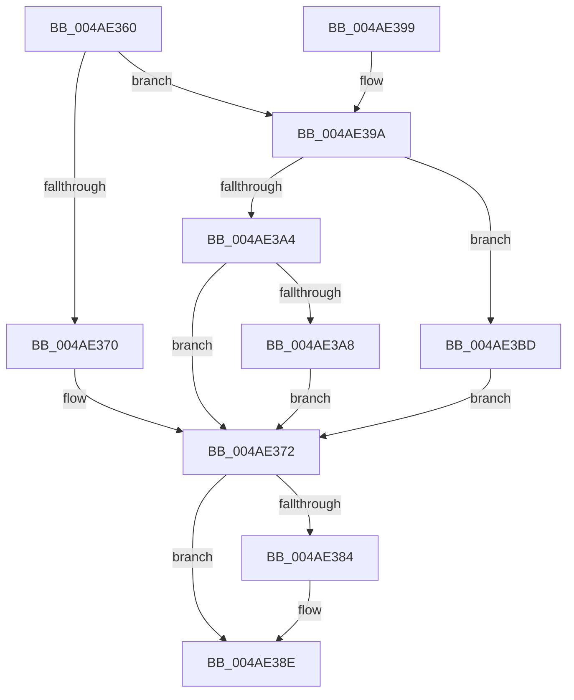

# PopBatteryIrpComplete

- RVA: `0x004AE360`–`0x004AE3D4` (길이 `116` bytes)
- VA: `0x00000001404AE360`
- 실행 섹션: `.text`
- PDB 이름 있음: `예`; PDB Function 태그: `아니요`
- unwind 정보 RVA: `0x00089F6C`
- 디코드: `38`개 명령, `116/116` bytes 표시
- 미해석 바이트: `0` (있으면 어셈블리에 `.byte`로 보존)

> 이 문서는 커널 이미지의 기계어와 PDB 기호를 분석해 생성했습니다. 4번과 5번은 함수 원형과 자료형을 바이너리 사용 방식에서 추정한 C 해석이며 원본 소스 복구 결과는 아닙니다.

## 1. Dependencies

- 직접 호출 지점: **2**; 고유 호출 대상: **2**
- 직접 호출자로 확인된 함수: **0**
- RIP 상대 이미지 참조: **0**

### Outgoing calls
- `0x004AE37B` → [KeSetEvent](../33/KeSetEvent_function_0033F310.md) (function, `0x0033F310`)
- `0x004AE389` → [PopBatteryQueueWork](PopBatteryQueueWork_function_004AE3DC.md) (function, `0x004AE3DC`)

### Direct callers
- 이 함수 시작 RVA로 연결되는 직접 call은 확인되지 않았습니다. 간접 호출은 완전히 역산할 수 없습니다.

### Static image references
- 디코드된 RIP-relative 메모리 참조가 없습니다.

## 2. Other-region calls and transfers

- 다른 실행 섹션으로 향하는 call: **0**
- 별도 외부 분기/꼬리 이동을 확인하지 못했습니다.

## 3. Assembly (complete function range)

```asm
004AE360  40 53                           push rbx
004AE362  48 83 EC 20                     sub rsp, 0x20
004AE366  8B 42 30                        mov eax, dword ptr [rdx + 0x30]
004AE369  3D 20 01 00 C0                  cmp eax, 0xc0000120
004AE36E  75 2A                           jne 0x1404ae39a
004AE370  32 DB                           xor bl, bl
004AE372  49 8D 48 50                     lea rcx, [r8 + 0x50]
004AE376  33 D2                           xor edx, edx
004AE378  45 33 C0                        xor r8d, r8d
004AE37B  E8 90 0F E9 FF                  call 0x14033f310
004AE380  84 DB                           test bl, bl
004AE382  74 0A                           je 0x1404ae38e
004AE384  B9 01 00 00 00                  mov ecx, 1
004AE389  E8 4E 00 00 00                  call 0x1404ae3dc
004AE38E  B8 16 00 00 C0                  mov eax, 0xc0000016
004AE393  48 83 C4 20                     add rsp, 0x20
004AE397  5B                              pop rbx
004AE398  C3                              ret
004AE399  CC                              int3
004AE39A  41 8B 50 68                     mov edx, dword ptr [r8 + 0x68]
004AE39E  B3 01                           mov bl, 1
004AE3A0  85 C0                           test eax, eax
004AE3A2  78 19                           js 0x1404ae3bd
004AE3A4  85 D2                           test edx, edx
004AE3A6  75 CA                           jne 0x1404ae372
004AE3A8  41 8B 80 D4 00 00 00            mov eax, dword ptr [r8 + 0xd4]
004AE3AF  41 89 40 6C                     mov dword ptr [r8 + 0x6c], eax
004AE3B3  41 C7 40 68 01 00 00 00         mov dword ptr [r8 + 0x68], 1
004AE3BB  EB B5                           jmp 0x1404ae372
004AE3BD  8B C2                           mov eax, edx
004AE3BF  F7 D8                           neg eax
004AE3C1  1B C9                           sbb ecx, ecx
004AE3C3  83 E1 FE                        and ecx, 0xfffffffe
004AE3C6  83 C1 04                        add ecx, 4
004AE3C9  85 D2                           test edx, edx
004AE3CB  41 89 48 68                     mov dword ptr [r8 + 0x68], ecx
004AE3CF  0F 95 C3                        setne bl
004AE3D2  EB 9E                           jmp 0x1404ae372
```

## 4. C-style interpretation (structured pseudocode)

```c
__int64 __fastcall PopBatteryIrpComplete(__int64 a1, __int64 a2, __int64 a3)
{
    __int64 result;
    __int64 v_rbx;
    __int64 v_rsp;

    v_rsp = (v_rsp) - (32);
    if (((unsigned int)((unsigned int)(*(unsigned int *)(a2 + 48)))) != 0xC0000120ULL) goto loc_004AE39A;
    v_rbx = 0;
loc_004AE372:
    a2 = 0;
    a3 = 0;
    result = KeSetEvent(a3 + 80, a2, a3, a4);
    if (0 != 0) {
        a1 = 1;
        result = PopBatteryQueueWork(a1, a2, a3, a4);
    }
    v_rsp = (v_rsp) + (32);
    return (unsigned int)(0xC0000016ULL);
loc_004AE39A:
    if (sign_flag) goto loc_004AE3BD;
    if ((unsigned int)((unsigned int)(*(unsigned int *)(a3 + 104))) != 0) goto loc_004AE372;
    *(unsigned int *)(a3 + 108) = (unsigned int)((unsigned int)(*(unsigned int *)(a3 + 212)));
    *(unsigned int *)(a3 + 104) = 1;
    goto loc_004AE372;
loc_004AE3BD:
    result = (unsigned int)(-((unsigned int)((unsigned int)((unsigned int)(*(unsigned int *)(a3 + 104))))));
    a1 = (unsigned int)((a1) & (0xFFFFFFFEULL));
    a1 = (unsigned int)((a1) + (4));
    *(unsigned int *)(a3 + 104) = (unsigned int)(a1);
    v_rbx = ((unsigned int)((unsigned int)(*(unsigned int *)(a3 + 104))) != 0) ? 1 : 0;
    goto loc_004AE372;
}
```

## 5. (Beta) C Style

```c
int64_t PopBatteryIrpComplete(int64_t Arg1, void *Arg2, void *Arg3)
{
    uint8_t *arg2 = (uint8_t *)Arg2;
    uint8_t *arg3 = (uint8_t *)Arg3;

    int64_t result;
    int64_t local_rbx;
    int64_t local_rsp;

    local_rsp = (local_rsp) - (32);
    if (((uint32_t)((uint32_t)(*(uint32_t *)(arg2 + 0x30)))) != 0xC0000120ULL) goto loc_004AE39A;
    local_rbx = 0;
loc_004AE372:
    Arg2 = 0;
    Arg3 = 0;
    result = KeSetEvent(Arg3 + 80, Arg2, Arg3, a4);
    if (0 != 0) {
        Arg1 = 1;
        result = PopBatteryQueueWork(Arg1, Arg2, Arg3, a4);
    }
    local_rsp = (local_rsp) + (32);
    return (uint32_t)(0xC0000016ULL);
loc_004AE39A:
    if (sign_flag) goto loc_004AE3BD;
    if ((uint32_t)((uint32_t)(*(uint32_t *)(arg3 + 0x68))) != 0) goto loc_004AE372;
    *(uint32_t *)(arg3 + 0x6C) = (uint32_t)((uint32_t)(*(uint32_t *)(arg3 + 0xD4)));
    *(uint32_t *)(arg3 + 0x68) = 1;
    goto loc_004AE372;
loc_004AE3BD:
    result = (uint32_t)(-((uint32_t)((uint32_t)((uint32_t)(*(uint32_t *)(arg3 + 0x68))))));
    Arg1 = (uint32_t)((Arg1) & (0xFFFFFFFEULL));
    Arg1 = (uint32_t)((Arg1) + (4));
    *(uint32_t *)(arg3 + 0x68) = (uint32_t)(Arg1);
    local_rbx = ((uint32_t)((uint32_t)(*(uint32_t *)(arg3 + 0x68))) != 0) ? 1 : 0;
    goto loc_004AE372;
}
```

### 관측된 메모리 오프셋

구조체 형식이 확인되지 않은 접근은 인자 기준의 오프셋으로만 기록했습니다.

| 기준 인자 | 오프셋 표현 | 폭 (bit) | 접근 |
|---|---:|---:|---|
| `Arg2` | `+ 0x30` | `32` | `R` |
| `Arg3` | `+ 0x50` | `64` | `R` |
| `Arg3` | `+ 0x68` | `32` | `R` |
| `Arg3` | `+ 0x68` | `32` | `W` |
| `Arg3` | `+ 0x6C` | `32` | `W` |
| `Arg3` | `+ 0xD4` | `32` | `R` |

## 6. Execution-region graph

[열기: 2D/3D 그래프와 함수 탐색 컨트롤 패널](../../../control-panel.html?section=text&rva=0x004AE360&view=graph)

- 2D 그래프는 위에서 아래로 흐르고, 3D 그래프는 빈 공간을 드래그해 회전합니다. Shift+드래그는 이동, 휠은 확대·축소, 함수 노드 선택은 대상 보고서 이동입니다.

### Static fallback


