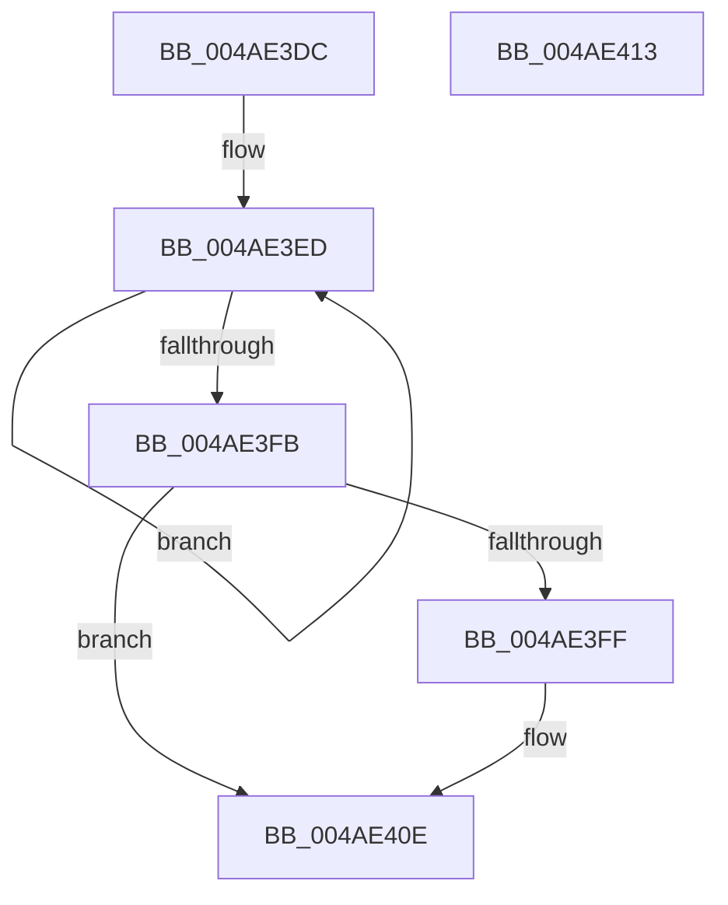

# PopBatteryQueueWork

- RVA: `0x004AE3DC`–`0x004AE414` (길이 `56` bytes)
- VA: `0x00000001404AE3DC`
- 실행 섹션: `.text`
- PDB 이름 있음: `예`; PDB Function 태그: `아니요`
- unwind 정보 RVA: `0x0005C788`
- 디코드: `15`개 명령, `56/56` bytes 표시
- 미해석 바이트: `0` (있으면 어셈블리에 `.byte`로 보존)

> 이 문서는 커널 이미지의 기계어와 PDB 기호를 분석해 생성했습니다. 4번과 5번은 함수 원형과 자료형을 바이너리 사용 방식에서 추정한 C 해석이며 원본 소스 복구 결과는 아닙니다.

## 1. Dependencies

- 직접 호출 지점: **1**; 고유 호출 대상: **1**
- 직접 호출자로 확인된 함수: **15**
- RIP 상대 이미지 참조: **2**

### Outgoing calls
- `0x004AE409` → [ExQueueWorkItem](../2F/ExQueueWorkItem_function_002F9520.md) (function, `0x002F9520`)

### Direct callers
- [PopBatteryIrpComplete](PopBatteryIrpComplete_function_004AE360.md) at `0x004AE389`
- [PopPowerAdapterIrpComplete](../4E/PopPowerAdapterIrpComplete_function_004E9630.md) at `0x004E968F`
- [PopBatteryWakeDpc](../5D/PopBatteryWakeDpc_function_005D9550.md) at `0x005D958F`
- [PopRefreshEstimateAfterSpoilingDpc](../5D/PopRefreshEstimateAfterSpoilingDpc_function_005D95C0.md) at `0x005D95C9`
- [PopBatteryAdd](../../page/76/PopBatteryAdd_function_00766580.md) at `0x00766643`
- [PopBatteryChargeLimitSettingWnfCallback](../../page/76/PopBatteryChargeLimitSettingWnfCallback_function_00766670.md) at `0x00766710`
- [PopBatteryRemove](../../page/76/PopBatteryRemove_function_00766D40.md) at `0x00766DB3`
- [PopBatteryRemove](../../page/76/PopBatteryRemove_function_00766D40.md) at `0x00766DBD`
- [PopBatteryUpdateTestExempt](../../page/76/PopBatteryUpdateTestExempt_function_00766F54.md) at `0x0076707B`
- [PopBatteryUpdateTestExempt](../../page/76/PopBatteryUpdateTestExempt_function_00766F54.md) at `0x00767249`
- [PopPowerAdapterRecOverrideWnfCallback](../../page/76/PopPowerAdapterRecOverrideWnfCallback_function_00767D30.md) at `0x00767D7C`
- [PopPowerAdapterRemove](../../page/76/PopPowerAdapterRemove_function_00768180.md) at `0x00768286`
- [PopUsbErrorWNFNotificationCallback](../../page/76/PopUsbErrorWNFNotificationCallback_function_00768470.md) at `0x007684E0`
- [PopSpoilBatteryEstimate](../../page/A3/PopSpoilBatteryEstimate_function_00A313EC.md) at `0x00A3142F`
- [PopBatteryUpdateCurrentState](../../page/A3/PopBatteryUpdateCurrentState_function_00A35658.md) at `0x00A35690`
- [PopBatteryWorker](../../page/AE/PopBatteryWorker_function_00AE1650.md) at `0x00AE19DB`
- [PoInitSystem](../../init/C7/PoInitSystem_function_00C72358.md) at `0x00C73222`

### Static image references
- `0x004AE3E0` → RVA `0x00F09058` (`.data`; read)
- `0x004AE402` → RVA `0x00F09020` (`.data`; read)

## 2. Other-region calls and transfers

- 다른 실행 섹션으로 향하는 call: **0**
- 별도 외부 분기/꼬리 이동을 확인하지 못했습니다.

## 3. Assembly (complete function range)

```asm
004AE3DC  48 83 EC 28                     sub rsp, 0x28
004AE3E0  0F 0D 0D 71 AC A5 00            prefetchw byte ptr [rip + 0xa5ac71]
004AE3E7  8B 05 6B AC A5 00               mov eax, dword ptr [rip + 0xa5ac6b]
004AE3ED  8B D0                           mov edx, eax
004AE3EF  0B D1                           or edx, ecx
004AE3F1  F0 0F B1 15 5F AC A5 00         lock cmpxchg dword ptr [rip + 0xa5ac5f], edx
004AE3F9  75 F2                           jne 0x1404ae3ed
004AE3FB  85 C0                           test eax, eax
004AE3FD  75 0F                           jne 0x1404ae40e
004AE3FF  8D 50 01                        lea edx, [rax + 1]
004AE402  48 8D 0D 17 AC A5 00            lea rcx, [rip + 0xa5ac17]
004AE409  E8 12 B1 E4 FF                  call 0x1402f9520
004AE40E  48 83 C4 28                     add rsp, 0x28
004AE412  C3                              ret
004AE413  CC                              int3
```

## 4. C-style interpretation (structured pseudocode)

```c
__int64 __fastcall PopBatteryQueueWork(int a1)
{
    __int64 result;
    __int64 v_rsp;

    v_rsp = (v_rsp) - (40);
loc_004AE3ED:
    a2 = (unsigned int)(((unsigned int)((unsigned int)((unsigned int)(*(unsigned int *)(v_rip + 10857579))))) | (a1));
    if (condition_is_not_equal) goto loc_004AE3ED;
    result = (unsigned int)(*(unsigned int *)(v_rip + 10857579));
    if ((unsigned int)((unsigned int)(*(unsigned int *)(v_rip + 10857579))) == 0) {
        a2 = (unsigned int)(*(unsigned int *)(v_rip + 10857579)) + 1;
        a1 = v_rip + 10857495;
        result = ExQueueWorkItem(a1, a2, a3, a4);
    }
    v_rsp = (v_rsp) + (40);
    return result;
}
```

## 5. (Beta) C Style

```c
int64_t PopBatteryQueueWork(int32_t Arg1)
{
    int64_t result;
    int64_t local_rsp;

    local_rsp = (local_rsp) - (40);
loc_004AE3ED:
    a2 = (uint32_t)(((uint32_t)((uint32_t)((uint32_t)(*(uint32_t *)(v_rip + 0xA5AC6B))))) | (Arg1));
    if (condition_is_not_equal) goto loc_004AE3ED;
    result = (uint32_t)(*(uint32_t *)(v_rip + 0xA5AC6B));
    if ((uint32_t)((uint32_t)(*(uint32_t *)(v_rip + 0xA5AC6B))) == 0) {
        a2 = (uint32_t)(*(uint32_t *)(v_rip + 0xA5AC6B)) + 1;
        Arg1 = v_rip + 10857495;
        result = ExQueueWorkItem(Arg1, a2, a3, a4);
    }
    local_rsp = (local_rsp) + (40);
    return result;
}
```

## 6. Execution-region graph

[열기: 2D/3D 그래프와 함수 탐색 컨트롤 패널](../../../control-panel.html?section=text&rva=0x004AE3DC&view=graph)

- 2D 그래프는 위에서 아래로 흐르고, 3D 그래프는 빈 공간을 드래그해 회전합니다. Shift+드래그는 이동, 휠은 확대·축소, 함수 노드 선택은 대상 보고서 이동입니다.

### Static fallback


