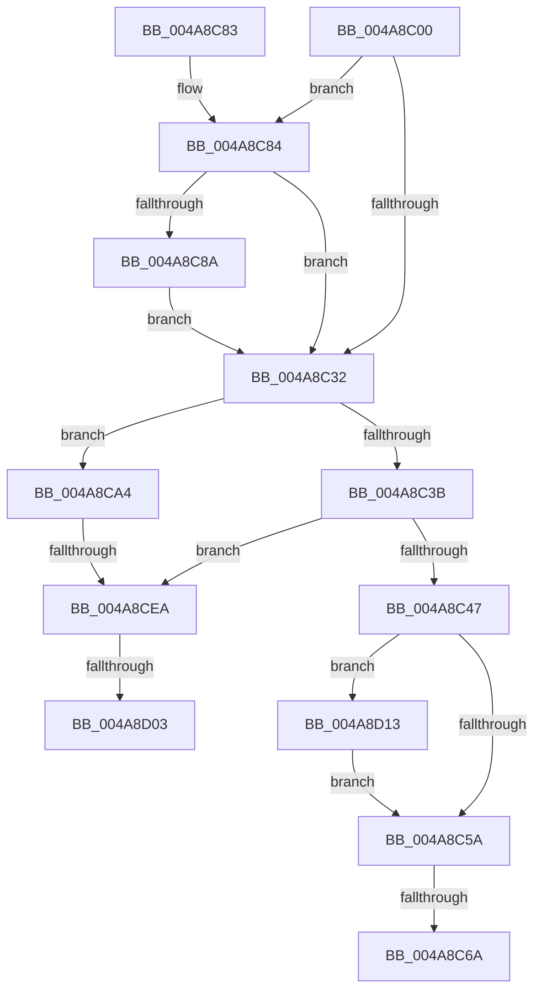

# PopCheckAndHandleThermalConditions

- RVA: `0x004A8C00`–`0x004A8D23` (길이 `291` bytes)
- VA: `0x00000001404A8C00`
- 실행 섹션: `.text`
- PDB 이름 있음: `예`; PDB Function 태그: `예`
- unwind 정보 RVA: `0x000B78E0`
- 디코드: `75`개 명령, `291/291` bytes 표시
- 미해석 바이트: `0` (있으면 어셈블리에 `.byte`로 보존)

> 이 문서는 커널 이미지의 기계어와 PDB 기호를 분석해 생성했습니다. 4번과 5번은 함수 원형과 자료형을 바이너리 사용 방식에서 추정한 C 해석이며 원본 소스 복구 결과는 아닙니다.

## 1. Dependencies

- 직접 호출 지점: **9**; 고유 호출 대상: **9**
- 직접 호출자로 확인된 함수: **1**
- RIP 상대 이미지 참조: **1**

### Outgoing calls
- `0x004A8C8D` → [PopSqmThermalCriticalShutdown](../../page/77/PopSqmThermalCriticalShutdown_function_00772840.md) (function, `0x00772840`)
- `0x004A8C99` → [PopDiagTraceZoneCriticalTripPointExceeded](../../page/76/PopDiagTraceZoneCriticalTripPointExceeded_function_007637D8.md) (function, `0x007637D8`)
- `0x004A8CAB` → [PopDiagTraceZoneS4TripPointExceeded](../../page/76/PopDiagTraceZoneS4TripPointExceeded_function_007638CC.md) (function, `0x007638CC`)
- `0x004A8CB3` → [PopSqmThermalHibernate](../../page/77/PopSqmThermalHibernate_function_00772864.md) (function, `0x00772864`)
- `0x004A8CB8` → [PopAcquirePolicyLock](../../pagelk/B7/PopAcquirePolicyLock_function_00B783C0.md) (function, `0x00B783C0`)
- `0x004A8CC4` → [PopIsHibernateSupported](../../page/AA/PopIsHibernateSupported_function_00AA3DFC.md) (function, `0x00AA3DFC`)
- `0x004A8CD5` → [PopReleasePolicyLock](../../pagelk/B7/PopReleasePolicyLock_function_00B78410.md) (function, `0x00B78410`)
- `0x004A8CF2` → [IoGetDeviceAttachmentBaseRefWithTag](../27/IoGetDeviceAttachmentBaseRefWithTag_function_00272788.md) (function, `0x00272788`)
- `0x004A8D19` → [PopUpdateOverThrottledCount](../../page/75/PopUpdateOverThrottledCount_function_0075FC24.md) (function, `0x0075FC24`)

### Direct callers
- [PopThermalWorker](../../page/A4/PopThermalWorker_function_00A4E200.md) at `0x00A4E523`

### Static image references
- `0x004A8CBD` → RVA `0x00F0CEC0` (`.data`; read)

## 2. Other-region calls and transfers

- 다른 실행 섹션으로 향하는 call: **8**
  - `0x004A8C8D` → [PopSqmThermalCriticalShutdown](../../page/77/PopSqmThermalCriticalShutdown_function_00772840.md) (`.text` → `PAGE`)
  - `0x004A8C99` → [PopDiagTraceZoneCriticalTripPointExceeded](../../page/76/PopDiagTraceZoneCriticalTripPointExceeded_function_007637D8.md) (`.text` → `PAGE`)
  - `0x004A8CAB` → [PopDiagTraceZoneS4TripPointExceeded](../../page/76/PopDiagTraceZoneS4TripPointExceeded_function_007638CC.md) (`.text` → `PAGE`)
  - `0x004A8CB3` → [PopSqmThermalHibernate](../../page/77/PopSqmThermalHibernate_function_00772864.md) (`.text` → `PAGE`)
  - `0x004A8CB8` → [PopAcquirePolicyLock](../../pagelk/B7/PopAcquirePolicyLock_function_00B783C0.md) (`.text` → `PAGELK`)
  - `0x004A8CC4` → [PopIsHibernateSupported](../../page/AA/PopIsHibernateSupported_function_00AA3DFC.md) (`.text` → `PAGE`)
  - `0x004A8CD5` → [PopReleasePolicyLock](../../pagelk/B7/PopReleasePolicyLock_function_00B78410.md) (`.text` → `PAGELK`)
  - `0x004A8D19` → [PopUpdateOverThrottledCount](../../page/75/PopUpdateOverThrottledCount_function_0075FC24.md) (`.text` → `PAGE`)
- call이 아닌 외부 분기/꼬리 이동: **4**
  - `0x004A8C64` → [sub_006F9E40 + 0x80](../6F/Unknown_function_006F9E40.md) (`tail-transfer`)
  - `0x004A8CE4` → [sub_006F9E40 + 0x3C](../6F/Unknown_function_006F9E40.md) (`tail-transfer`)
  - `0x004A8CFD` → [sub_006F9E40](../6F/Unknown_function_006F9E40.md) (`tail-transfer`)
  - `0x004A8D0E` → [sub_006F9E40 + 0x3](../6F/Unknown_function_006F9E40.md) (`tail-transfer`)

## 3. Assembly (complete function range)

```asm
004A8C00  48 89 5C 24 10                  mov qword ptr [rsp + 0x10], rbx
004A8C05  48 89 6C 24 18                  mov qword ptr [rsp + 0x18], rbp
004A8C0A  48 89 74 24 20                  mov qword ptr [rsp + 0x20], rsi
004A8C0F  57                              push rdi
004A8C10  41 56                           push r14
004A8C12  41 57                           push r15
004A8C14  48 83 EC 20                     sub rsp, 0x20
004A8C18  48 8B 69 30                     mov rbp, qword ptr [rcx + 0x30]
004A8C1C  45 33 F6                        xor r14d, r14d
004A8C1F  48 8B F9                        mov rdi, rcx
004A8C22  41 8A F6                        mov sil, r14b
004A8C25  45 8D 7E 01                     lea r15d, [r14 + 1]
004A8C29  44 38 B1 D2 00 00 00            cmp byte ptr [rcx + 0xd2], r14b
004A8C30  75 52                           jne 0x1404a8c84
004A8C32  44 38 B7 D1 00 00 00            cmp byte ptr [rdi + 0xd1], r14b
004A8C39  75 69                           jne 0x1404a8ca4
004A8C3B  41 8A DE                        mov bl, r14b
004A8C3E  40 84 F6                        test sil, sil
004A8C41  0F 85 A3 00 00 00               jne 0x1404a8cea
004A8C47  44 38 B7 E0 00 00 00            cmp byte ptr [rdi + 0xe0], r14b
004A8C4E  0F 95 C2                        setne dl
004A8C51  38 57 49                        cmp byte ptr [rdi + 0x49], dl
004A8C54  0F 85 B9 00 00 00               jne 0x1404a8d13
004A8C5A  0F B6 87 D3 00 00 00            movzx eax, byte ptr [rdi + 0xd3]
004A8C61  38 47 48                        cmp byte ptr [rdi + 0x48], al
004A8C64  0F 85 56 12 25 00               jne 0x1406f9ec0
004A8C6A  48 8B 5C 24 48                  mov rbx, qword ptr [rsp + 0x48]
004A8C6F  48 8B 6C 24 50                  mov rbp, qword ptr [rsp + 0x50]
004A8C74  48 8B 74 24 58                  mov rsi, qword ptr [rsp + 0x58]
004A8C79  48 83 C4 20                     add rsp, 0x20
004A8C7D  41 5F                           pop r15
004A8C7F  41 5E                           pop r14
004A8C81  5F                              pop rdi
004A8C82  C3                              ret
004A8C83  CC                              int3
004A8C84  44 38 71 47                     cmp byte ptr [rcx + 0x47], r14b
004A8C88  75 A8                           jne 0x1404a8c32
004A8C8A  41 8A F7                        mov sil, r15b
004A8C8D  E8 AE 9B 2C 00                  call 0x140772840
004A8C92  48 8D 4F 70                     lea rcx, [rdi + 0x70]
004A8C96  48 8B D5                        mov rdx, rbp
004A8C99  E8 3A AB 2B 00                  call 0x1407637d8
004A8C9E  44 88 7F 47                     mov byte ptr [rdi + 0x47], r15b
004A8CA2  EB 8E                           jmp 0x1404a8c32
004A8CA4  48 8D 4F 70                     lea rcx, [rdi + 0x70]
004A8CA8  48 8B D5                        mov rdx, rbp
004A8CAB  E8 1C AC 2B 00                  call 0x1407638cc
004A8CB0  48 8B CF                        mov rcx, rdi
004A8CB3  E8 AC 9B 2C 00                  call 0x140772864
004A8CB8  E8 03 F7 6C 00                  call 0x140b783c0
004A8CBD  48 8D 0D FC 41 A6 00            lea rcx, [rip + 0xa641fc]
004A8CC4  E8 33 B1 5F 00                  call 0x140aa3dfc
004A8CC9  84 C0                           test al, al
004A8CCB  40 0F B6 F6                     movzx esi, sil
004A8CCF  8A D8                           mov bl, al
004A8CD1  41 0F 44 F7                     cmove esi, r15d
004A8CD5  E8 36 F7 6C 00                  call 0x140b78410
004A8CDA  F6 DB                           neg bl
004A8CDC  1A DB                           sbb bl, bl
004A8CDE  41 22 DF                        and bl, r15b
004A8CE1  40 84 F6                        test sil, sil
004A8CE4  0F 84 92 11 25 00               je 0x1406f9e7c
004A8CEA  BA 50 6F 54 6D                  mov edx, 0x6d546f50
004A8CEF  48 8B CD                        mov rcx, rbp
004A8CF2  E8 91 9A DC FF                  call 0x140272788
004A8CF7  48 8B E8                        mov rbp, rax
004A8CFA  48 85 C0                        test rax, rax
004A8CFD  0F 84 3D 11 25 00               je 0x1406f9e40
004A8D03  48 8B 88 38 01 00 00            mov rcx, qword ptr [rax + 0x138]
004A8D0A  4C 8B 41 28                     mov r8, qword ptr [rcx + 0x28]
004A8D0E  E9 30 11 25 00                  jmp 0x1406f9e43
004A8D13  48 8B CF                        mov rcx, rdi
004A8D16  88 57 49                        mov byte ptr [rdi + 0x49], dl
004A8D19  E8 06 6F 2B 00                  call 0x14075fc24
004A8D1E  E9 37 FF FF FF                  jmp 0x1404a8c5a
```

## 4. C-style interpretation (structured pseudocode)

```c
__int64 __fastcall PopCheckAndHandleThermalConditions(__int64 a1)
{
    __int64 result;
    __int64 v_r14;
    __int64 v_rbx;
    __int64 v_rsi;
    __int64 v_rsp;
    unsigned __int64 v_stack_p10;
    unsigned __int64 v_stack_p18;
    unsigned __int64 v_stack_p20;

    v_stack_p10 = v_rbx;
    v_stack_p18 = v_rbp;
    v_stack_p20 = v_rsi;
    v_rsp = (v_rsp) - (32);
    v_r14 = 0;
    if ((*(unsigned __int8 *)(a1 + 210)) != 0) goto loc_004A8C84;
loc_004A8C32:
    if ((*(unsigned __int8 *)(a1 + 209)) != 0) goto loc_004A8CA4;
    if (0 != 0) goto loc_004A8CEA;
    a2 = ((*(unsigned __int8 *)(a1 + 224)) != 0) ? 1 : 0;
    if ((*(unsigned __int8 *)(a1 + 73)) != ((unsigned __int8)(a2))) goto loc_004A8D13;
loc_004A8C5A:
    v_rsp = (v_rsp) + (32);
    return *(unsigned __int8 *)(a1 + 211);
loc_004A8C84:
    if ((*(unsigned __int8 *)(a1 + 71)) != 0) goto loc_004A8C32;
    result = PopSqmThermalCriticalShutdown(a1, a2, a3, a4);
    result = PopDiagTraceZoneCriticalTripPointExceeded(a1 + 112, v_stack_p18, a3, a4);
    *(unsigned __int8 *)(a1 + 71) = (unsigned __int8)(v_r14 + 1);
    goto loc_004A8C32;
loc_004A8CA4:
    result = PopDiagTraceZoneS4TripPointExceeded(a1 + 112, v_stack_p18, a3, a4);
    result = PopSqmThermalHibernate(a1, v_stack_p18, a3, a4);
    result = PopAcquirePolicyLock(a1, v_stack_p18, a3, a4);
    result = PopIsHibernateSupported(v_rip + 10895868, v_stack_p18, a3, a4);
    v_rsi = (unsigned __int8)((unsigned __int8)(v_r14 + 1));
    if ((unsigned __int8)(result) == 0) { v_rsi = (unsigned int)(v_r14 + 1); }
    result = PopReleasePolicyLock(v_rip + 10895868, v_stack_p18, a3, a4);
    v_rbx = (unsigned __int8)(-((unsigned __int8)(result)));
    v_rbx = (unsigned __int8)((v_rbx) & ((unsigned __int8)(v_r14 + 1)));
loc_004A8CEA:
    result = IoGetDeviceAttachmentBaseRefWithTag(v_stack_p18, (unsigned int)(0x6D546F50ULL), a3, a4);
loc_004A8D13:
    *(unsigned __int8 *)(a1 + 73) = (unsigned __int8)((unsigned int)(0x6D546F50ULL));
    result = PopUpdateOverThrottledCount(a1, (unsigned int)(0x6D546F50ULL), *(unsigned __int64 *)(*(unsigned __int64 *)(result + 312) + 40), a4);
    goto loc_004A8C5A;
}
```

## 5. (Beta) C Style

```c
int64_t PopCheckAndHandleThermalConditions(void *Arg1)
{
    uint8_t *arg1 = (uint8_t *)Arg1;

    int64_t result;
    int64_t local_r14;
    int64_t local_rbx;
    int64_t local_rsi;
    int64_t local_rsp;
    uint64_t v_stack_p10;
    uint64_t v_stack_p18;
    uint64_t v_stack_p20;

    v_stack_p10 = local_rbx;
    v_stack_p18 = local_rbp;
    v_stack_p20 = local_rsi;
    local_rsp = (local_rsp) - (32);
    local_r14 = 0;
    if ((*(uint8_t *)(arg1 + 0xD2)) != 0) goto loc_004A8C84;
loc_004A8C32:
    if ((*(uint8_t *)(arg1 + 0xD1)) != 0) goto loc_004A8CA4;
    if (0 != 0) goto loc_004A8CEA;
    a2 = ((*(uint8_t *)(arg1 + 0xE0)) != 0) ? 1 : 0;
    if ((*(uint8_t *)(arg1 + 0x49)) != ((uint8_t)(a2))) goto loc_004A8D13;
loc_004A8C5A:
    local_rsp = (local_rsp) + (32);
    return *(uint8_t *)(arg1 + 0xD3);
loc_004A8C84:
    if ((*(uint8_t *)(arg1 + 0x47)) != 0) goto loc_004A8C32;
    result = PopSqmThermalCriticalShutdown(Arg1, a2, a3, a4);
    result = PopDiagTraceZoneCriticalTripPointExceeded(Arg1 + 112, v_stack_p18, a3, a4);
    *(uint8_t *)(arg1 + 0x47) = (uint8_t)(local_r14 + 1);
    goto loc_004A8C32;
loc_004A8CA4:
    result = PopDiagTraceZoneS4TripPointExceeded(Arg1 + 112, v_stack_p18, a3, a4);
    result = PopSqmThermalHibernate(Arg1, v_stack_p18, a3, a4);
    result = PopAcquirePolicyLock(Arg1, v_stack_p18, a3, a4);
    result = PopIsHibernateSupported(v_rip + 10895868, v_stack_p18, a3, a4);
    local_rsi = (uint8_t)((uint8_t)(local_r14 + 1));
    if ((uint8_t)(result) == 0) { local_rsi = (uint32_t)(local_r14 + 1); }
    result = PopReleasePolicyLock(v_rip + 10895868, v_stack_p18, a3, a4);
    local_rbx = (uint8_t)(-((uint8_t)(result)));
    local_rbx = (uint8_t)((local_rbx) & ((uint8_t)(local_r14 + 1)));
loc_004A8CEA:
    result = IoGetDeviceAttachmentBaseRefWithTag(v_stack_p18, (uint32_t)(0x6D546F50ULL), a3, a4);
loc_004A8D13:
    *(uint8_t *)(arg1 + 0x49) = (uint8_t)((uint32_t)(0x6D546F50ULL));
    result = PopUpdateOverThrottledCount(Arg1, (uint32_t)(0x6D546F50ULL), *(uint64_t *)(*(uint64_t *)(result + 0x138) + 0x28), a4);
    goto loc_004A8C5A;
}
```

### 관측된 메모리 오프셋

구조체 형식이 확인되지 않은 접근은 인자 기준의 오프셋으로만 기록했습니다.

| 기준 인자 | 오프셋 표현 | 폭 (bit) | 접근 |
|---|---:|---:|---|
| `Arg1` | `+ 0x30` | `64` | `R` |
| `Arg1` | `+ 0x47` | `8` | `R` |
| `Arg1` | `+ 0x47` | `8` | `W` |
| `Arg1` | `+ 0x48` | `8` | `R` |
| `Arg1` | `+ 0x49` | `8` | `R` |
| `Arg1` | `+ 0x49` | `8` | `W` |
| `Arg1` | `+ 0x70` | `64` | `R` |
| `Arg1` | `+ 0xD1` | `8` | `R` |
| `Arg1` | `+ 0xD2` | `8` | `R` |
| `Arg1` | `+ 0xD3` | `8` | `R` |
| `Arg1` | `+ 0xE0` | `8` | `R` |

## 6. Execution-region graph

[열기: 2D/3D 그래프와 함수 탐색 컨트롤 패널](../../../control-panel.html?section=text&rva=0x004A8C00&view=graph)

- 2D 그래프는 위에서 아래로 흐르고, 3D 그래프는 빈 공간을 드래그해 회전합니다. Shift+드래그는 이동, 휠은 확대·축소, 함수 노드 선택은 대상 보고서 이동입니다.

### Static fallback


