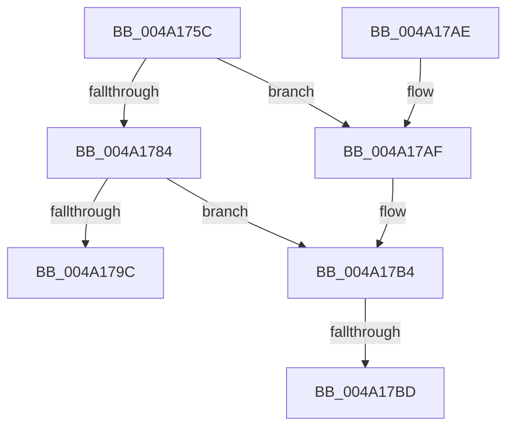

# PopCreateDynamicIrpWorker

- RVA: `0x004A175C`–`0x004A17D2` (길이 `118` bytes)
- VA: `0x00000001404A175C`
- 실행 섹션: `.text`
- PDB 이름 있음: `예`; PDB Function 태그: `예`
- unwind 정보 RVA: `0x000B544C`
- 디코드: `33`개 명령, `118/118` bytes 표시
- 미해석 바이트: `0` (있으면 어셈블리에 `.byte`로 보존)

> 이 문서는 커널 이미지의 기계어와 PDB 기호를 분석해 생성했습니다. 4번과 5번은 함수 원형과 자료형을 바이너리 사용 방식에서 추정한 C 해석이며 원본 소스 복구 결과는 아닙니다.

## 1. Dependencies

- 직접 호출 지점: **3**; 고유 호출 대상: **3**
- 직접 호출자로 확인된 함수: **2**
- RIP 상대 이미지 참조: **2**

### Outgoing calls
- `0x004A1775` → [ExAllocateFromNPagedLookasideList](../38/ExAllocateFromNPagedLookasideList_function_0038E6C0.md) (function, `0x0038E6C0`)
- `0x004A1791` → [PopCreatePowerThread](PopCreatePowerThread_function_004A17D8.md) (function, `0x004A17D8`)
- `0x004A17C7` → [ExFreeToNPagedLookasideList](../38/ExFreeToNPagedLookasideList_function_0038D9D0.md) (function, `0x0038D9D0`)

### Direct callers
- [PopRunMaximumIrpWorkers](PopRunMaximumIrpWorkers_function_004A1688.md) at `0x004A1709`
- [PopIrpWorkerControl](../5D/PopIrpWorkerControl_function_005D93E0.md) at `0x005D9436`

### Static image references
- `0x004A176E` → RVA `0x00E27F00` (`.data`; read)
- `0x004A178A` → RVA `0x0026D410` (`PopIrpWorker`; read)

## 2. Other-region calls and transfers

- 다른 실행 섹션으로 향하는 call: **0**
- call이 아닌 외부 분기/꼬리 이동: **2**
  - `0x004A17B7` → [sub_006F875C](../6F/Unknown_function_006F875C.md) (`tail-transfer`)
  - `0x004A17CD` → [sub_006F875C](../6F/Unknown_function_006F875C.md) (`tail-transfer`)

## 3. Assembly (complete function range)

```asm
004A175C  48 89 5C 24 08                  mov qword ptr [rsp + 8], rbx
004A1761  48 89 74 24 10                  mov qword ptr [rsp + 0x10], rsi
004A1766  57                              push rdi
004A1767  48 83 EC 20                     sub rsp, 0x20
004A176B  48 8B F1                        mov rsi, rcx
004A176E  48 8D 0D 8B 67 98 00            lea rcx, [rip + 0x98678b]
004A1775  E8 46 CF EE FF                  call 0x14038e6c0
004A177A  33 DB                           xor ebx, ebx
004A177C  48 8B F8                        mov rdi, rax
004A177F  48 85 C0                        test rax, rax
004A1782  74 2B                           je 0x1404a17af
004A1784  48 8B D0                        mov rdx, rax
004A1787  48 89 30                        mov qword ptr [rax], rsi
004A178A  48 8D 0D 7F BC DC FF            lea rcx, [rip - 0x234381]
004A1791  E8 42 00 00 00                  call 0x1404a17d8
004A1796  8B F0                           mov esi, eax
004A1798  85 C0                           test eax, eax
004A179A  78 18                           js 0x1404a17b4
004A179C  48 8B 74 24 38                  mov rsi, qword ptr [rsp + 0x38]
004A17A1  8B C3                           mov eax, ebx
004A17A3  48 8B 5C 24 30                  mov rbx, qword ptr [rsp + 0x30]
004A17A8  48 83 C4 20                     add rsp, 0x20
004A17AC  5F                              pop rdi
004A17AD  C3                              ret
004A17AE  CC                              int3
004A17AF  BE 9A 00 00 C0                  mov esi, 0xc000009a
004A17B4  48 85 FF                        test rdi, rdi
004A17B7  0F 84 9F 6F 25 00               je 0x1406f875c
004A17BD  48 8B D7                        mov rdx, rdi
004A17C0  48 8D 0D 39 67 98 00            lea rcx, [rip + 0x986739]
004A17C7  E8 04 C2 EE FF                  call 0x14038d9d0
004A17CC  90                              nop
004A17CD  E9 8A 6F 25 00                  jmp 0x1406f875c
```

## 4. C-style interpretation (structured pseudocode)

```c
__int64 __fastcall PopCreateDynamicIrpWorker(__int64 a1)
{
    __int64 result;
    __int64 v_rbx;
    __int64 v_rsp;
    unsigned __int64 v_stack_p10;
    unsigned __int64 v_stack_p8;

    v_stack_p8 = v_rbx;
    v_stack_p10 = v_rsi;
    v_rsp = (v_rsp) - (32);
    result = ExAllocateFromNPagedLookasideList(v_rip + 9987979, a2, a3, a4);
    v_rbx = 0;
    if (result == 0) goto loc_004A17AF;
    *(unsigned __int64 *)(result) = a1;
    result = PopCreatePowerThread(v_rip - 2311041, result, a3, a4);
    if (sign_flag) goto loc_004A17B4;
    v_rsp = (v_rsp) + (32);
    return 0;
loc_004A17AF:
loc_004A17B4:
    result = ExFreeToNPagedLookasideList(v_rip + 9987897, result, a3, a4);
}
```

## 5. (Beta) C Style

```c
int64_t PopCreateDynamicIrpWorker(int64_t Arg1)
{
    int64_t result;
    int64_t local_rbx;
    int64_t local_rsp;
    uint64_t v_stack_p10;
    uint64_t v_stack_p8;

    v_stack_p8 = local_rbx;
    v_stack_p10 = local_rsi;
    local_rsp = (local_rsp) - (32);
    result = ExAllocateFromNPagedLookasideList(v_rip + 9987979, a2, a3, a4);
    local_rbx = 0;
    if (result == 0) goto loc_004A17AF;
    *(uint64_t *)(result) = Arg1;
    result = PopCreatePowerThread(v_rip - 2311041, result, a3, a4);
    if (sign_flag) goto loc_004A17B4;
    local_rsp = (local_rsp) + (32);
    return 0;
loc_004A17AF:
loc_004A17B4:
    result = ExFreeToNPagedLookasideList(v_rip + 9987897, result, a3, a4);
}
```

## 6. Execution-region graph

[열기: 2D/3D 그래프와 함수 탐색 컨트롤 패널](../../../control-panel.html?section=text&rva=0x004A175C&view=graph)

- 2D 그래프는 위에서 아래로 흐르고, 3D 그래프는 빈 공간을 드래그해 회전합니다. Shift+드래그는 이동, 휠은 확대·축소, 함수 노드 선택은 대상 보고서 이동입니다.

### Static fallback


