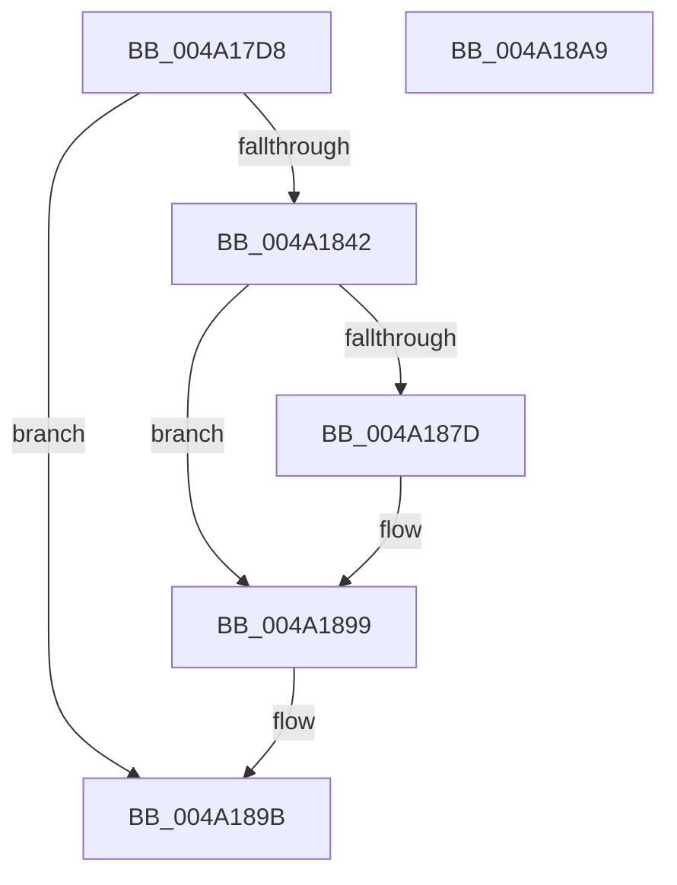

# PopCreatePowerThread

- RVA: `0x004A17D8`–`0x004A18AA` (길이 `210` bytes)
- VA: `0x00000001404A17D8`
- 실행 섹션: `.text`
- PDB 이름 있음: `예`; PDB Function 태그: `아니요`
- unwind 정보 RVA: `0x000B5C38`
- 디코드: `52`개 명령, `210/210` bytes 표시
- 미해석 바이트: `0` (있으면 어셈블리에 `.byte`로 보존)

> 이 문서는 커널 이미지의 기계어와 PDB 기호를 분석해 생성했습니다. 4번과 5번은 함수 원형과 자료형을 바이너리 사용 방식에서 추정한 C 해석이며 원본 소스 복구 결과는 아닙니다.

## 1. Dependencies

- 직접 호출 지점: **5**; 고유 호출 대상: **5**
- 직접 호출자로 확인된 함수: **2**
- RIP 상대 이미지 참조: **1**

### Outgoing calls
- `0x004A1839` → [PsCreateSystemThread](../../page/9E/PsCreateSystemThread_function_009ED0D0.md) (function, `0x009ED0D0`)
- `0x004A1869` → [ObReferenceObjectByHandleWithTag](../../page/86/ObReferenceObjectByHandleWithTag_function_00869610.md) (function, `0x00869610`)
- `0x004A1874` → [ZwClose](../6A/ZwClose_function_006AD2B0.md) (function, `0x006AD2B0`)
- `0x004A1886` → [KeSetActualBasePriorityThread](../3C/KeSetActualBasePriorityThread_function_003C4370.md) (function, `0x003C4370`)
- `0x004A1894` → [ObfDereferenceObjectWithTag](../2F/ObfDereferenceObjectWithTag_function_002F78E0.md) (function, `0x002F78E0`)

### Direct callers
- [PopCreateDynamicIrpWorker](PopCreateDynamicIrpWorker_function_004A175C.md) at `0x004A1791`
- [PopInitializeIrpWorkers](../../init/C4/PopInitializeIrpWorkers_function_00C40C64.md) at `0x00C40D94`
- [PopInitializeIrpWorkers](../../init/C4/PopInitializeIrpWorkers_function_00C40C64.md) at `0x00C40DB7`

### Static image references
- `0x004A184C` → RVA `0x00FC6AC8` (`ALMOSTRO`; read)

## 2. Other-region calls and transfers

- 다른 실행 섹션으로 향하는 call: **2**
  - `0x004A1839` → [PsCreateSystemThread](../../page/9E/PsCreateSystemThread_function_009ED0D0.md) (`.text` → `PAGE`)
  - `0x004A1869` → [ObReferenceObjectByHandleWithTag](../../page/86/ObReferenceObjectByHandleWithTag_function_00869610.md) (`.text` → `PAGE`)
- 별도 외부 분기/꼬리 이동을 확인하지 못했습니다.

## 3. Assembly (complete function range)

```asm
004A17D8  48 8B C4                        mov rax, rsp
004A17DB  48 89 58 08                     mov qword ptr [rax + 8], rbx
004A17DF  55                              push rbp
004A17E0  48 8B EC                        mov rbp, rsp
004A17E3  48 83 EC 70                     sub rsp, 0x70
004A17E7  83 65 EC 00                     and dword ptr [rbp - 0x14], 0
004A17EB  4C 8D 45 D0                     lea r8, [rbp - 0x30]
004A17EF  48 83 65 28 00                  and qword ptr [rbp + 0x28], 0
004A17F4  0F 57 C0                        xorps xmm0, xmm0
004A17F7  48 83 65 20 00                  and qword ptr [rbp + 0x20], 0
004A17FC  BB FF FF 1F 00                  mov ebx, 0x1fffff
004A1801  48 83 65 D8 00                  and qword ptr [rbp - 0x28], 0
004A1806  45 33 C9                        xor r9d, r9d
004A1809  48 83 65 E0 00                  and qword ptr [rbp - 0x20], 0
004A180E  48 89 50 B8                     mov qword ptr [rax - 0x48], rdx
004A1812  8B D3                           mov edx, ebx
004A1814  48 89 48 B0                     mov qword ptr [rax - 0x50], rcx
004A1818  48 8D 4D 20                     lea rcx, [rbp + 0x20]
004A181C  48 83 60 A8 00                  and qword ptr [rax - 0x58], 0
004A1821  48 C7 45 D0 30 00 00 00         mov qword ptr [rbp - 0x30], 0x30
004A1829  83 65 D4 00                     and dword ptr [rbp - 0x2c], 0
004A182D  C7 45 E8 00 02 00 00            mov dword ptr [rbp - 0x18], 0x200
004A1834  F3 0F 7F 45 F0                  movdqu xmmword ptr [rbp - 0x10], xmm0
004A1839  E8 92 B8 54 00                  call 0x1409ed0d0
004A183E  85 C0                           test eax, eax
004A1840  78 59                           js 0x1404a189b
004A1842  48 83 64 24 30 00               and qword ptr [rsp + 0x30], 0
004A1848  48 8D 45 28                     lea rax, [rbp + 0x28]
004A184C  4C 8B 05 75 52 B2 00            mov r8, qword ptr [rip + 0xb25275]
004A1853  45 33 C9                        xor r9d, r9d
004A1856  48 8B 4D 20                     mov rcx, qword ptr [rbp + 0x20]
004A185A  8B D3                           mov edx, ebx
004A185C  48 89 44 24 28                  mov qword ptr [rsp + 0x28], rax
004A1861  C7 44 24 20 50 6F 49 72         mov dword ptr [rsp + 0x20], 0x72496f50
004A1869  E8 A2 7D 3C 00                  call 0x140869610
004A186E  48 8B 4D 20                     mov rcx, qword ptr [rbp + 0x20]
004A1872  8B D8                           mov ebx, eax
004A1874  E8 37 BA 20 00                  call 0x1406ad2b0
004A1879  85 DB                           test ebx, ebx
004A187B  78 1C                           js 0x1404a1899
004A187D  48 8B 4D 28                     mov rcx, qword ptr [rbp + 0x28]
004A1881  BA 0D 00 00 00                  mov edx, 0xd
004A1886  E8 E5 2A F2 FF                  call 0x1403c4370
004A188B  48 8B 4D 28                     mov rcx, qword ptr [rbp + 0x28]
004A188F  BA 50 6F 49 72                  mov edx, 0x72496f50
004A1894  E8 47 60 E5 FF                  call 0x1402f78e0
004A1899  33 C0                           xor eax, eax
004A189B  48 8B 9C 24 80 00 00 00         mov rbx, qword ptr [rsp + 0x80]
004A18A3  48 83 C4 70                     add rsp, 0x70
004A18A7  5D                              pop rbp
004A18A8  C3                              ret
004A18A9  CC                              int3
```

## 4. C-style interpretation (structured pseudocode)

```c
__int64 __fastcall PopCreatePowerThread(__int64 a1, __int64 a2, __int64 a3, int a4)
{
    __int64 result;
    __int64 v_rsp;
    unsigned __int64 v_stack_m18;
    unsigned int v_stack_m1C;
    unsigned int v_stack_m20;
    unsigned __int64 v_stack_m28;
    unsigned __int64 v_stack_m30;
    unsigned int v_stack_m34;
    unsigned __int64 v_stack_m38;
    unsigned __int64 v_stack_m48;
    unsigned __int64 v_stack_m50;
    unsigned int v_stack_m58;
    unsigned __int64 v_stack_p18;
    unsigned __int64 v_stack_p20;
    unsigned __int64 v_stack_p8;

    *(unsigned __int64 *)(v_rsp + 8) = v_rbx;
    v_rsp = (v_rsp) - (112);
    a4 = 0;
    *(unsigned __int64 *)(v_rsp - 72) = a2;
    *(unsigned __int64 *)(v_rsp - 80) = a1;
    v_stack_m38 = 48;
    v_stack_m20 = 512;
    v_stack_m18 = v_xmm0;
    result = PsCreateSystemThread(v_stack_p18, (unsigned int)((unsigned int)((unsigned int)(0x1FFFFFULL))), v_stack_m38, a4);
    if (sign_flag) goto loc_004A189B;
    a4 = 0;
    v_stack_m50 = v_stack_p20;
    v_stack_m58 = 0x72496F50ULL;
    result = ObReferenceObjectByHandleWithTag(v_stack_p18, (unsigned int)((unsigned int)((unsigned int)(0x1FFFFFULL))), *(unsigned __int64 *)(v_rip + 11686517), a4);
    result = ZwClose(v_stack_p18, (unsigned int)((unsigned int)((unsigned int)(0x1FFFFFULL))), *(unsigned __int64 *)(v_rip + 11686517), a4);
    if (!(sign_flag)) {
        a1 = v_stack_p20;
        a2 = 13;
        result = KeSetActualBasePriorityThread(a1, a2, *(unsigned __int64 *)(v_rip + 11686517), a4);
        a1 = v_stack_p20;
        a2 = 0x72496F50ULL;
        result = ObfDereferenceObjectWithTag(a1, a2, *(unsigned __int64 *)(v_rip + 11686517), a4);
    }
    result = 0;
loc_004A189B:
    v_rsp = (v_rsp) + (112);
    return result;
}
```

## 5. (Beta) C Style

```c
int64_t PopCreatePowerThread(int64_t Arg1, int64_t Arg2, int64_t Arg3, int32_t Arg4)
{
    int64_t result;
    int64_t local_rsp;
    uint64_t v_stack_m18;
    uint32_t v_stack_m1C;
    uint32_t v_stack_m20;
    uint64_t v_stack_m28;
    uint64_t v_stack_m30;
    uint32_t v_stack_m34;
    uint64_t v_stack_m38;
    uint64_t v_stack_m48;
    uint64_t v_stack_m50;
    uint32_t v_stack_m58;
    uint64_t v_stack_p18;
    uint64_t v_stack_p20;
    uint64_t v_stack_p8;

    *(uint64_t *)(local_rsp + 0x8) = local_rbx;
    local_rsp = (local_rsp) - (112);
    Arg4 = 0;
    *(uint64_t *)(local_rsp - 0x48) = Arg2;
    *(uint64_t *)(local_rsp - 0x50) = Arg1;
    v_stack_m38 = 48;
    v_stack_m20 = 512;
    v_stack_m18 = v_xmm0;
    result = PsCreateSystemThread(v_stack_p18, (uint32_t)((uint32_t)((uint32_t)(0x1FFFFFULL))), v_stack_m38, Arg4);
    if (sign_flag) goto loc_004A189B;
    Arg4 = 0;
    v_stack_m50 = v_stack_p20;
    v_stack_m58 = 0x72496F50ULL;
    result = ObReferenceObjectByHandleWithTag(v_stack_p18, (uint32_t)((uint32_t)((uint32_t)(0x1FFFFFULL))), *(uint64_t *)(v_rip + 0xB25275), Arg4);
    result = ZwClose(v_stack_p18, (uint32_t)((uint32_t)((uint32_t)(0x1FFFFFULL))), *(uint64_t *)(v_rip + 0xB25275), Arg4);
    if (!(sign_flag)) {
        Arg1 = v_stack_p20;
        Arg2 = 13;
        result = KeSetActualBasePriorityThread(Arg1, Arg2, *(uint64_t *)(v_rip + 0xB25275), Arg4);
        Arg1 = v_stack_p20;
        Arg2 = 0x72496F50ULL;
        result = ObfDereferenceObjectWithTag(Arg1, Arg2, *(uint64_t *)(v_rip + 0xB25275), Arg4);
    }
    result = 0;
loc_004A189B:
    local_rsp = (local_rsp) + (112);
    return result;
}
```

## 6. Execution-region graph

[열기: 2D/3D 그래프와 함수 탐색 컨트롤 패널](../../../control-panel.html?section=text&rva=0x004A17D8&view=graph)

- 2D 그래프는 위에서 아래로 흐르고, 3D 그래프는 빈 공간을 드래그해 회전합니다. Shift+드래그는 이동, 휠은 확대·축소, 함수 노드 선택은 대상 보고서 이동입니다.

### Static fallback


