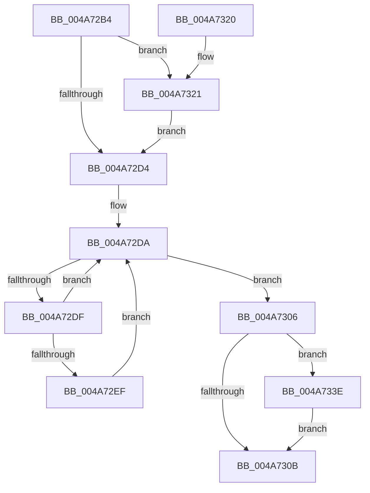

# PopDeepSleepResiliencyPhaseAccountingBegin

- RVA: `0x004A72B4`–`0x004A735B` (길이 `167` bytes)
- VA: `0x00000001404A72B4`
- 실행 섹션: `.text`
- PDB 이름 있음: `예`; PDB Function 태그: `아니요`
- unwind 정보 RVA: `0x000B7038`
- 디코드: `45`개 명령, `167/167` bytes 표시
- 미해석 바이트: `0` (있으면 어셈블리에 `.byte`로 보존)

> 이 문서는 커널 이미지의 기계어와 PDB 기호를 분석해 생성했습니다. 4번과 5번은 함수 원형과 자료형을 바이너리 사용 방식에서 추정한 C 해석이며 원본 소스 복구 결과는 아닙니다.

## 1. Dependencies

- 직접 호출 지점: **5**; 고유 호출 대상: **5**
- 직접 호출자로 확인된 함수: **2**
- RIP 상대 이미지 참조: **5**

### Outgoing calls
- `0x004A72F1` → [KeQueryPerformanceCounter](../37/KeQueryPerformanceCounter_function_0037E7E0.md) (function, `0x0037E7E0`)
- `0x004A7328` → [KeAcquireSpinLockRaiseToDpc](../20/KeAcquireSpinLockRaiseToDpc_function_00208470.md) (function, `0x00208470`)
- `0x004A7337` → [KeAcquireSpinLockAtDpcLevel](../20/KeAcquireSpinLockAtDpcLevel_function_00208430.md) (function, `0x00208430`)
- `0x004A7345` → [KxReleaseSpinLock](../20/KxReleaseSpinLock_function_00206670.md) (function, `0x00206670`)
- `0x004A7354` → [KeReleaseSpinLock](../39/KeReleaseSpinLock_function_00392BA0.md) (function, `0x00392BA0`)

### Direct callers
- [PopDeepSleepResiliencyPhaseAccountingUpdate](../39/PopDeepSleepResiliencyPhaseAccountingUpdate_function_003901D0.md) at `0x003902B7`
- [PdcPoCurrentPdcPhase](../5D/PdcPoCurrentPdcPhase_function_005D9E70.md) at `0x005D9EFC`

### Static image references
- `0x004A72D4` → RVA `0x00F0C7DC` (`.data`; read/write)
- `0x004A72DF` → RVA `0x00F09330` (`.data`; read)
- `0x004A72F9` → RVA `0x00F0C7E0` (`.data`; read)
- `0x004A7321` → RVA `0x00F09328` (`.data`; read)
- `0x004A732D` → RVA `0x00F0CA58` (`.data`; read)

## 2. Other-region calls and transfers

- 다른 실행 섹션으로 향하는 call: **0**
- 별도 외부 분기/꼬리 이동을 확인하지 못했습니다.

## 3. Assembly (complete function range)

```asm
004A72B4  48 89 5C 24 08                  mov qword ptr [rsp + 8], rbx
004A72B9  48 89 6C 24 18                  mov qword ptr [rsp + 0x18], rbp
004A72BE  48 89 74 24 20                  mov qword ptr [rsp + 0x20], rsi
004A72C3  57                              push rdi
004A72C4  48 83 EC 20                     sub rsp, 0x20
004A72C8  40 32 ED                        xor bpl, bpl
004A72CB  40 8A F2                        mov sil, dl
004A72CE  8B D9                           mov ebx, ecx
004A72D0  84 D2                           test dl, dl
004A72D2  74 4D                           je 0x1404a7321
004A72D4  09 1D 02 55 A6 00               or dword ptr [rip + 0xa65502], ebx
004A72DA  0F BC FB                        bsf edi, ebx
004A72DD  74 27                           je 0x1404a7306
004A72DF  8B 05 4B 20 A6 00               mov eax, dword ptr [rip + 0xa6204b]
004A72E5  8D 4B FF                        lea ecx, [rbx - 1]
004A72E8  23 D9                           and ebx, ecx
004A72EA  0F A3 F8                        bt eax, edi
004A72ED  73 EB                           jae 0x1404a72da
004A72EF  33 C9                           xor ecx, ecx
004A72F1  E8 EA 74 ED FF                  call 0x14037e7e0
004A72F6  48 63 D7                        movsxd rdx, edi
004A72F9  4C 8D 05 E0 54 A6 00            lea r8, [rip + 0xa654e0]
004A7300  49 89 04 D0                     mov qword ptr [r8 + rdx*8], rax
004A7304  EB D4                           jmp 0x1404a72da
004A7306  40 84 F6                        test sil, sil
004A7309  74 33                           je 0x1404a733e
004A730B  48 8B 5C 24 30                  mov rbx, qword ptr [rsp + 0x30]
004A7310  48 8B 6C 24 40                  mov rbp, qword ptr [rsp + 0x40]
004A7315  48 8B 74 24 48                  mov rsi, qword ptr [rsp + 0x48]
004A731A  48 83 C4 20                     add rsp, 0x20
004A731E  5F                              pop rdi
004A731F  C3                              ret
004A7320  CC                              int3
004A7321  48 8D 0D 00 20 A6 00            lea rcx, [rip + 0xa62000]
004A7328  E8 43 11 D6 FF                  call 0x140208470
004A732D  48 8D 0D 24 57 A6 00            lea rcx, [rip + 0xa65724]
004A7334  40 8A E8                        mov bpl, al
004A7337  E8 F4 10 D6 FF                  call 0x140208430
004A733C  EB 96                           jmp 0x1404a72d4
004A733E  48 8D 0D 13 57 A6 00            lea rcx, [rip + 0xa65713]
004A7345  E8 26 F3 D5 FF                  call 0x140206670
004A734A  40 8A D5                        mov dl, bpl
004A734D  48 8D 0D D4 1F A6 00            lea rcx, [rip + 0xa61fd4]
004A7354  E8 47 B8 EE FF                  call 0x140392ba0
004A7359  EB B0                           jmp 0x1404a730b
```

## 4. C-style interpretation (structured pseudocode)

```c
__int64 __fastcall PopDeepSleepResiliencyPhaseAccountingBegin(int a1, unsigned __int8 a2)
{
    __int64 result;
    __int64 v_rbp;
    __int64 v_rbx;
    __int64 v_rsp;
    unsigned __int64 v_stack_p18;
    unsigned __int64 v_stack_p20;
    unsigned __int64 v_stack_p8;

    v_stack_p8 = v_rbx;
    v_stack_p18 = v_rbp;
    v_stack_p20 = v_rsi;
    v_rsp = (v_rsp) - (32);
    v_rbp = 0;
    if (a2 == 0) goto loc_004A7321;
loc_004A72D4:
loc_004A72DA:
    if (a2 == 0) goto loc_004A7306;
    v_rbx = (unsigned int)(((unsigned int)(a1)) & ((unsigned int)((unsigned int)(a1) - 1)));
    if (condition_is_above_or_equal) goto loc_004A72DA;
    a1 = 0;
    result = KeQueryPerformanceCounter(a1, a2, a3, a4);
    *(unsigned __int64 *)(v_rip + 10900704 + (int)((unsigned int)(v_rdi)) * 8) = result;
    goto loc_004A72DA;
loc_004A7306:
    if (a2 == 0) goto loc_004A733E;
loc_004A730B:
    v_rsp = (v_rsp) + (32);
    return result;
loc_004A7321:
    result = KeAcquireSpinLockRaiseToDpc(v_rip + 10887168, (int)((unsigned int)(v_rdi)), v_rip + 10900704, a4);
    result = KeAcquireSpinLockAtDpcLevel(v_rip + 10901284, (int)((unsigned int)(v_rdi)), v_rip + 10900704, a4);
    goto loc_004A72D4;
loc_004A733E:
    result = KxReleaseSpinLock(v_rip + 10901267, (int)((unsigned int)(v_rdi)), v_rip + 10900704, a4);
    result = KeReleaseSpinLock(v_rip + 10887124, (unsigned __int8)((unsigned __int8)(result)), v_rip + 10900704, a4);
    goto loc_004A730B;
}
```

## 5. (Beta) C Style

```c
int64_t PopDeepSleepResiliencyPhaseAccountingBegin(void *Arg1, uint8_t Arg2)
{
    uint8_t *arg1 = (uint8_t *)Arg1;

    int64_t result;
    int64_t local_rbp;
    int64_t local_rbx;
    int64_t local_rsp;
    uint64_t v_stack_p18;
    uint64_t v_stack_p20;
    uint64_t v_stack_p8;

    v_stack_p8 = local_rbx;
    v_stack_p18 = local_rbp;
    v_stack_p20 = local_rsi;
    local_rsp = (local_rsp) - (32);
    local_rbp = 0;
    if (Arg2 == 0) goto loc_004A7321;
loc_004A72D4:
loc_004A72DA:
    if (Arg2 == 0) goto loc_004A7306;
    local_rbx = (uint32_t)(((uint32_t)(Arg1)) & ((uint32_t)((uint32_t)(Arg1) - 1)));
    if (condition_is_above_or_equal) goto loc_004A72DA;
    Arg1 = 0;
    result = KeQueryPerformanceCounter(Arg1, Arg2, a3, a4);
    *(uint64_t *)(v_rip + 0xA654E0 + (int32_t)((uint32_t)(local_rdi)) * 8) = result;
    goto loc_004A72DA;
loc_004A7306:
    if (Arg2 == 0) goto loc_004A733E;
loc_004A730B:
    local_rsp = (local_rsp) + (32);
    return result;
loc_004A7321:
    result = KeAcquireSpinLockRaiseToDpc(v_rip + 10887168, (int32_t)((uint32_t)(local_rdi)), v_rip + 10900704, a4);
    result = KeAcquireSpinLockAtDpcLevel(v_rip + 10901284, (int32_t)((uint32_t)(local_rdi)), v_rip + 10900704, a4);
    goto loc_004A72D4;
loc_004A733E:
    result = KxReleaseSpinLock(v_rip + 10901267, (int32_t)((uint32_t)(local_rdi)), v_rip + 10900704, a4);
    result = KeReleaseSpinLock(v_rip + 10887124, (uint8_t)((uint8_t)(result)), v_rip + 10900704, a4);
    goto loc_004A730B;
}
```

### 관측된 메모리 오프셋

구조체 형식이 확인되지 않은 접근은 인자 기준의 오프셋으로만 기록했습니다.

| 기준 인자 | 오프셋 표현 | 폭 (bit) | 접근 |
|---|---:|---:|---|
| `Arg1` | `- 0x1` | `32` | `R` |

## 6. Execution-region graph

[열기: 2D/3D 그래프와 함수 탐색 컨트롤 패널](../../../control-panel.html?section=text&rva=0x004A72B4&view=graph)

- 2D 그래프는 위에서 아래로 흐르고, 3D 그래프는 빈 공간을 드래그해 회전합니다. Shift+드래그는 이동, 휠은 확대·축소, 함수 노드 선택은 대상 보고서 이동입니다.

### Static fallback


