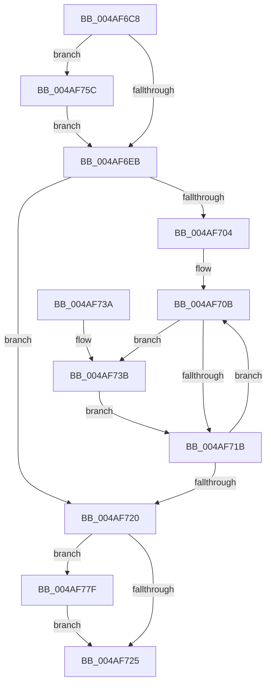

# PopDeepSleepResiliencyPhaseAccountingEnd

- RVA: `0x004AF6C8`–`0x004AF79F` (길이 `215` bytes)
- VA: `0x00000001404AF6C8`
- 실행 섹션: `.text`
- PDB 이름 있음: `예`; PDB Function 태그: `아니요`
- unwind 정보 RVA: `0x000B87FC`
- 디코드: `56`개 명령, `215/215` bytes 표시
- 미해석 바이트: `0` (있으면 어셈블리에 `.byte`로 보존)

> 이 문서는 커널 이미지의 기계어와 PDB 기호를 분석해 생성했습니다. 4번과 5번은 함수 원형과 자료형을 바이너리 사용 방식에서 추정한 C 해석이며 원본 소스 복구 결과는 아닙니다.

## 1. Dependencies

- 직접 호출 지점: **5**; 고유 호출 대상: **3**
- 직접 호출자로 확인된 함수: **2**
- RIP 상대 이미지 참조: **5**

### Outgoing calls
- `0x004AF6ED` → [KeQueryPerformanceCounter](../37/KeQueryPerformanceCounter_function_0037E7E0.md) (function, `0x0037E7E0`)
- `0x004AF763` → [KeAcquireSpinLockRaiseToDpc](../20/KeAcquireSpinLockRaiseToDpc_function_00208470.md) (function, `0x00208470`)
- `0x004AF772` → [KeAcquireSpinLockRaiseToDpc](../20/KeAcquireSpinLockRaiseToDpc_function_00208470.md) (function, `0x00208470`)
- `0x004AF789` → [KeReleaseSpinLock](../39/KeReleaseSpinLock_function_00392BA0.md) (function, `0x00392BA0`)
- `0x004AF798` → [KeReleaseSpinLock](../39/KeReleaseSpinLock_function_00392BA0.md) (function, `0x00392BA0`)

### Direct callers
- [PopDeepSleepResiliencyPhaseAccountingUpdate](../39/PopDeepSleepResiliencyPhaseAccountingUpdate_function_003901D0.md) at `0x003902EB`
- [PdcPoCurrentPdcPhase](../5D/PdcPoCurrentPdcPhase_function_005D9E70.md) at `0x005D9F36`

### Static image references
- `0x004AF6F9` → RVA `0x00F0C7DC` (`.data`; read/write)
- `0x004AF704` → RVA `0x00F0C740` (`.data`; read)
- `0x004AF70B` → RVA `0x00F09330` (`.data`; read)
- `0x004AF75C` → RVA `0x00F09328` (`.data`; read)
- `0x004AF768` → RVA `0x00F0CA58` (`.data`; read)

## 2. Other-region calls and transfers

- 다른 실행 섹션으로 향하는 call: **0**
- 별도 외부 분기/꼬리 이동을 확인하지 못했습니다.

## 3. Assembly (complete function range)

```asm
004AF6C8  48 89 5C 24 08                  mov qword ptr [rsp + 8], rbx
004AF6CD  48 89 6C 24 18                  mov qword ptr [rsp + 0x18], rbp
004AF6D2  48 89 74 24 20                  mov qword ptr [rsp + 0x20], rsi
004AF6D7  57                              push rdi
004AF6D8  48 83 EC 20                     sub rsp, 0x20
004AF6DC  40 32 F6                        xor sil, sil
004AF6DF  40 32 ED                        xor bpl, bpl
004AF6E2  40 8A FA                        mov dil, dl
004AF6E5  8B D9                           mov ebx, ecx
004AF6E7  84 D2                           test dl, dl
004AF6E9  74 71                           je 0x1404af75c
004AF6EB  33 C9                           xor ecx, ecx
004AF6ED  E8 EE F0 EC FF                  call 0x14037e7e0
004AF6F2  8B CB                           mov ecx, ebx
004AF6F4  4C 8B C0                        mov r8, rax
004AF6F7  F7 D1                           not ecx
004AF6F9  21 0D DD D0 A5 00               and dword ptr [rip + 0xa5d0dd], ecx
004AF6FF  0F BC D3                        bsf edx, ebx
004AF702  74 1C                           je 0x1404af720
004AF704  4C 8D 0D 35 D0 A5 00            lea r9, [rip + 0xa5d035]
004AF70B  8B 05 1F 9C A5 00               mov eax, dword ptr [rip + 0xa59c1f]
004AF711  8D 4B FF                        lea ecx, [rbx - 1]
004AF714  23 D9                           and ebx, ecx
004AF716  0F A3 D0                        bt eax, edx
004AF719  72 20                           jb 0x1404af73b
004AF71B  0F BC D3                        bsf edx, ebx
004AF71E  75 EB                           jne 0x1404af70b
004AF720  40 84 FF                        test dil, dil
004AF723  74 5A                           je 0x1404af77f
004AF725  48 8B 5C 24 30                  mov rbx, qword ptr [rsp + 0x30]
004AF72A  48 8B 6C 24 40                  mov rbp, qword ptr [rsp + 0x40]
004AF72F  48 8B 74 24 48                  mov rsi, qword ptr [rsp + 0x48]
004AF734  48 83 C4 20                     add rsp, 0x20
004AF738  5F                              pop rdi
004AF739  C3                              ret
004AF73A  CC                              int3
004AF73B  48 63 D2                        movsxd rdx, edx
004AF73E  49 8B C0                        mov rax, r8
004AF741  49 2B 84 D1 A0 00 00 00         sub rax, qword ptr [r9 + rdx*8 + 0xa0]
004AF749  49 01 84 D1 F8 00 00 00         add qword ptr [r9 + rdx*8 + 0xf8], rax
004AF751  49 83 A4 D1 A0 00 00 00 00      and qword ptr [r9 + rdx*8 + 0xa0], 0
004AF75A  EB BF                           jmp 0x1404af71b
004AF75C  48 8D 0D C5 9B A5 00            lea rcx, [rip + 0xa59bc5]
004AF763  E8 08 8D D5 FF                  call 0x140208470
004AF768  48 8D 0D E9 D2 A5 00            lea rcx, [rip + 0xa5d2e9]
004AF76F  40 8A F0                        mov sil, al
004AF772  E8 F9 8C D5 FF                  call 0x140208470
004AF777  40 8A E8                        mov bpl, al
004AF77A  E9 6C FF FF FF                  jmp 0x1404af6eb
004AF77F  40 8A D5                        mov dl, bpl
004AF782  48 8D 0D CF D2 A5 00            lea rcx, [rip + 0xa5d2cf]
004AF789  E8 12 34 EE FF                  call 0x140392ba0
004AF78E  40 8A D6                        mov dl, sil
004AF791  48 8D 0D 90 9B A5 00            lea rcx, [rip + 0xa59b90]
004AF798  E8 03 34 EE FF                  call 0x140392ba0
004AF79D  EB 86                           jmp 0x1404af725
```

## 4. C-style interpretation (structured pseudocode)

```c
__int64 __fastcall PopDeepSleepResiliencyPhaseAccountingEnd(int a1, unsigned __int8 a2)
{
    __int64 result;
    __int64 v_rbp;
    __int64 v_rbx;
    __int64 v_rsi;
    __int64 v_rsp;
    unsigned __int64 v_stack_p18;
    unsigned __int64 v_stack_p20;
    unsigned __int64 v_stack_p8;

    v_stack_p8 = v_rbx;
    v_stack_p18 = v_rbp;
    v_stack_p20 = v_rsi;
    v_rsp = (v_rsp) - (32);
    v_rsi = 0;
    v_rbp = 0;
    if (a2 == 0) goto loc_004AF75C;
loc_004AF6EB:
    a1 = 0;
    result = KeQueryPerformanceCounter(a1, a2, a3, a4);
    a1 = (unsigned int)(~((unsigned int)((unsigned int)((unsigned int)(a1)))));
    if (condition_is_equal) goto loc_004AF720;
loc_004AF70B:
    v_rbx = (unsigned int)(((unsigned int)(a1)) & ((unsigned int)((unsigned int)(a1) - 1)));
    if (condition_is_below) goto loc_004AF73B;
loc_004AF71B:
    if (condition_is_not_equal) goto loc_004AF70B;
loc_004AF720:
    if (a2 == 0) goto loc_004AF77F;
loc_004AF725:
    v_rsp = (v_rsp) + (32);
    return (unsigned int)(*(unsigned int *)(v_rip + 10853407));
loc_004AF73B:
    result = (result) - (*(unsigned __int64 *)(v_rip + 10866741 + (int)(a2) * 8 + 160));
    goto loc_004AF71B;
loc_004AF75C:
    result = KeAcquireSpinLockRaiseToDpc(v_rip + 10853317, (int)(a2), result, v_rip + 10866741);
    result = KeAcquireSpinLockRaiseToDpc(v_rip + 10867433, (int)(a2), result, v_rip + 10866741);
    goto loc_004AF6EB;
loc_004AF77F:
    result = KeReleaseSpinLock(v_rip + 10867407, (unsigned __int8)((unsigned __int8)(result)), result, v_rip + 10866741);
    result = KeReleaseSpinLock(v_rip + 10853264, (unsigned __int8)((unsigned __int8)(result)), result, v_rip + 10866741);
    goto loc_004AF725;
}
```

## 5. (Beta) C Style

```c
int64_t PopDeepSleepResiliencyPhaseAccountingEnd(void *Arg1, uint8_t Arg2)
{
    uint8_t *arg1 = (uint8_t *)Arg1;

    int64_t result;
    int64_t local_rbp;
    int64_t local_rbx;
    int64_t local_rsi;
    int64_t local_rsp;
    uint64_t v_stack_p18;
    uint64_t v_stack_p20;
    uint64_t v_stack_p8;

    v_stack_p8 = local_rbx;
    v_stack_p18 = local_rbp;
    v_stack_p20 = local_rsi;
    local_rsp = (local_rsp) - (32);
    local_rsi = 0;
    local_rbp = 0;
    if (Arg2 == 0) goto loc_004AF75C;
loc_004AF6EB:
    Arg1 = 0;
    result = KeQueryPerformanceCounter(Arg1, Arg2, a3, a4);
    Arg1 = (uint32_t)(~((uint32_t)((uint32_t)((uint32_t)(Arg1)))));
    if (condition_is_equal) goto loc_004AF720;
loc_004AF70B:
    local_rbx = (uint32_t)(((uint32_t)(Arg1)) & ((uint32_t)((uint32_t)(Arg1) - 1)));
    if (condition_is_below) goto loc_004AF73B;
loc_004AF71B:
    if (condition_is_not_equal) goto loc_004AF70B;
loc_004AF720:
    if (Arg2 == 0) goto loc_004AF77F;
loc_004AF725:
    local_rsp = (local_rsp) + (32);
    return (uint32_t)(*(uint32_t *)(v_rip + 0xA59C1F));
loc_004AF73B:
    result = (result) - (*(uint64_t *)(v_rip + 0xA5D035 + (int32_t)(Arg2) * 8 + 0xA0));
    goto loc_004AF71B;
loc_004AF75C:
    result = KeAcquireSpinLockRaiseToDpc(v_rip + 10853317, (int32_t)(Arg2), result, v_rip + 10866741);
    result = KeAcquireSpinLockRaiseToDpc(v_rip + 10867433, (int32_t)(Arg2), result, v_rip + 10866741);
    goto loc_004AF6EB;
loc_004AF77F:
    result = KeReleaseSpinLock(v_rip + 10867407, (uint8_t)((uint8_t)(result)), result, v_rip + 10866741);
    result = KeReleaseSpinLock(v_rip + 10853264, (uint8_t)((uint8_t)(result)), result, v_rip + 10866741);
    goto loc_004AF725;
}
```

### 관측된 메모리 오프셋

구조체 형식이 확인되지 않은 접근은 인자 기준의 오프셋으로만 기록했습니다.

| 기준 인자 | 오프셋 표현 | 폭 (bit) | 접근 |
|---|---:|---:|---|
| `Arg1` | `- 0x1` | `32` | `R` |

## 6. Execution-region graph

[열기: 2D/3D 그래프와 함수 탐색 컨트롤 패널](../../../control-panel.html?section=text&rva=0x004AF6C8&view=graph)

- 2D 그래프는 위에서 아래로 흐르고, 3D 그래프는 빈 공간을 드래그해 회전합니다. Shift+드래그는 이동, 휠은 확대·축소, 함수 노드 선택은 대상 보고서 이동입니다.

### Static fallback


