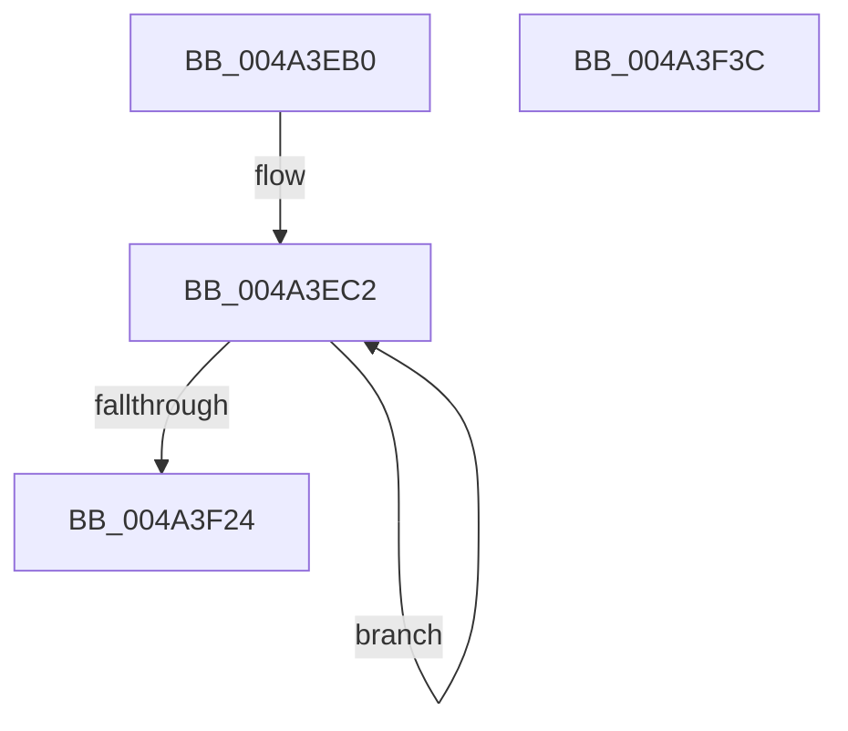

# PopDevicePowerTransitionInProgressWorker

- RVA: `0x004A3EB0`–`0x004A3F3D` (길이 `141` bytes)
- VA: `0x00000001404A3EB0`
- 실행 섹션: `.text`
- PDB 이름 있음: `예`; PDB Function 태그: `아니요`
- unwind 정보 RVA: `0x00063458`
- 디코드: `32`개 명령, `141/141` bytes 표시
- 미해석 바이트: `0` (있으면 어셈블리에 `.byte`로 보존)

> 이 문서는 커널 이미지의 기계어와 PDB 기호를 분석해 생성했습니다. 4번과 5번은 함수 원형과 자료형을 바이너리 사용 방식에서 추정한 C 해석이며 원본 소스 복구 결과는 아닙니다.

## 1. Dependencies

- 직접 호출 지점: **5**; 고유 호출 대상: **3**
- 직접 호출자로 확인된 함수: **0**
- RIP 상대 이미지 참조: **4**

### Outgoing calls
- `0x004A3EBB` → [KeAcquireSpinLockRaiseToDpc](../20/KeAcquireSpinLockRaiseToDpc_function_00208470.md) (function, `0x00208470`)
- `0x004A3ED8` → [KeReleaseSpinLock](../39/KeReleaseSpinLock_function_00392BA0.md) (function, `0x00392BA0`)
- `0x004A3F00` → [ZwUpdateWnfStateData](../6B/ZwUpdateWnfStateData_function_006B0D10.md) (function, `0x006B0D10`)
- `0x004A3F0C` → [KeAcquireSpinLockRaiseToDpc](../20/KeAcquireSpinLockRaiseToDpc_function_00208470.md) (function, `0x00208470`)
- `0x004A3F32` → [KeReleaseSpinLock](../39/KeReleaseSpinLock_function_00392BA0.md) (function, `0x00392BA0`)

### Direct callers
- 이 함수 시작 RVA로 연결되는 직접 call은 확인되지 않았습니다. 간접 호출은 완전히 역산할 수 없습니다.

### Static image references
- `0x004A3EB4` → RVA `0x00F0CA20` (`.data`; read)
- `0x004A3EC4` → RVA `0x00F0BCDC` (`.data`; read)
- `0x004A3EEC` → RVA `0x0001BAE0` (`.rdata`; read)
- `0x004A3F2B` → RVA `0x00F0BCE0` (`.data`; write)

## 2. Other-region calls and transfers

- 다른 실행 섹션으로 향하는 call: **0**
- 별도 외부 분기/꼬리 이동을 확인하지 못했습니다.

## 3. Assembly (complete function range)

```asm
004A3EB0  48 83 EC 48                     sub rsp, 0x48
004A3EB4  48 8D 0D 65 8B A6 00            lea rcx, [rip + 0xa68b65]
004A3EBB  E8 B0 45 D6 FF                  call 0x140208470
004A3EC0  8A D0                           mov dl, al
004A3EC2  33 C9                           xor ecx, ecx
004A3EC4  39 0D 12 7E A6 00               cmp dword ptr [rip + 0xa67e12], ecx
004A3ECA  0F 95 C1                        setne cl
004A3ECD  89 4C 24 58                     mov dword ptr [rsp + 0x58], ecx
004A3ED1  48 8D 0D 48 8B A6 00            lea rcx, [rip + 0xa68b48]
004A3ED8  E8 C3 EC EE FF                  call 0x140392ba0
004A3EDD  83 64 24 30 00                  and dword ptr [rsp + 0x30], 0
004A3EE2  48 8D 54 24 58                  lea rdx, [rsp + 0x58]
004A3EE7  83 64 24 28 00                  and dword ptr [rsp + 0x28], 0
004A3EEC  48 8D 0D ED 7B B7 FF            lea rcx, [rip - 0x488413]
004A3EF3  48 83 64 24 20 00               and qword ptr [rsp + 0x20], 0
004A3EF9  45 33 C9                        xor r9d, r9d
004A3EFC  45 8D 41 04                     lea r8d, [r9 + 4]
004A3F00  E8 0B CE 20 00                  call 0x1406b0d10
004A3F05  48 8D 0D 14 8B A6 00            lea rcx, [rip + 0xa68b14]
004A3F0C  E8 5F 45 D6 FF                  call 0x140208470
004A3F11  8A D0                           mov dl, al
004A3F13  33 C0                           xor eax, eax
004A3F15  39 05 C1 7D A6 00               cmp dword ptr [rip + 0xa67dc1], eax
004A3F1B  0F 95 C0                        setne al
004A3F1E  39 44 24 58                     cmp dword ptr [rsp + 0x58], eax
004A3F22  75 9E                           jne 0x1404a3ec2
004A3F24  48 8D 0D F5 8A A6 00            lea rcx, [rip + 0xa68af5]
004A3F2B  C6 05 AE 7D A6 00 00            mov byte ptr [rip + 0xa67dae], 0
004A3F32  E8 69 EC EE FF                  call 0x140392ba0
004A3F37  48 83 C4 48                     add rsp, 0x48
004A3F3B  C3                              ret
004A3F3C  CC                              int3
```

## 4. C-style interpretation (structured pseudocode)

```c
__int64 __fastcall PopDevicePowerTransitionInProgressWorker(__int64 a1, __int64 a2, __int64 a3, int a4)
{
    __int64 result;
    __int64 v_rsp;
    unsigned int v_stack_m18;
    unsigned int v_stack_m20;
    unsigned __int64 v_stack_m28;
    unsigned int v_stack_p10;

    v_rsp = (v_rsp) - (72);
    result = KeAcquireSpinLockRaiseToDpc(v_rip + 10914661, a2, a3, a4);
loc_004A3EC2:
    a1 = 0;
    a1 = ((*(unsigned int *)(v_rip + 10911250)) != 0) ? 1 : 0;
    v_stack_p10 = (unsigned int)(a1);
    result = KeReleaseSpinLock(v_rip + 10914632, (unsigned __int8)(result), a3, a4);
    a4 = 0;
    result = ZwUpdateWnfStateData(v_rip - 4752403, v_stack_p10, a4 + 4, a4);
    result = KeAcquireSpinLockRaiseToDpc(v_rip + 10914580, v_stack_p10, a4 + 4, a4);
    result = 0;
    result = ((*(unsigned int *)(v_rip + 10911169)) != 0) ? 1 : 0;
    if (v_stack_p10 != ((unsigned int)(result))) goto loc_004A3EC2;
    *(unsigned __int8 *)(v_rip + 10911150) = 0;
    result = KeReleaseSpinLock(v_rip + 10914549, (unsigned __int8)(result), a4 + 4, a4);
    v_rsp = (v_rsp) + (72);
    return result;
}
```

## 5. (Beta) C Style

```c
int64_t PopDevicePowerTransitionInProgressWorker(int64_t Arg1, int64_t Arg2, int64_t Arg3, int32_t Arg4)
{
    int64_t result;
    int64_t local_rsp;
    uint32_t v_stack_m18;
    uint32_t v_stack_m20;
    uint64_t v_stack_m28;
    uint32_t v_stack_p10;

    local_rsp = (local_rsp) - (72);
    result = KeAcquireSpinLockRaiseToDpc(v_rip + 10914661, Arg2, Arg3, Arg4);
loc_004A3EC2:
    Arg1 = 0;
    Arg1 = ((*(uint32_t *)(v_rip + 0xA67E12)) != 0) ? 1 : 0;
    v_stack_p10 = (uint32_t)(Arg1);
    result = KeReleaseSpinLock(v_rip + 10914632, (uint8_t)(result), Arg3, Arg4);
    Arg4 = 0;
    result = ZwUpdateWnfStateData(v_rip - 4752403, v_stack_p10, Arg4 + 4, Arg4);
    result = KeAcquireSpinLockRaiseToDpc(v_rip + 10914580, v_stack_p10, Arg4 + 4, Arg4);
    result = 0;
    result = ((*(uint32_t *)(v_rip + 0xA67DC1)) != 0) ? 1 : 0;
    if (v_stack_p10 != ((uint32_t)(result))) goto loc_004A3EC2;
    *(uint8_t *)(v_rip + 0xA67DAE) = 0;
    result = KeReleaseSpinLock(v_rip + 10914549, (uint8_t)(result), Arg4 + 4, Arg4);
    local_rsp = (local_rsp) + (72);
    return result;
}
```

## 6. Execution-region graph

[열기: 2D/3D 그래프와 함수 탐색 컨트롤 패널](../../../control-panel.html?section=text&rva=0x004A3EB0&view=graph)

- 2D 그래프는 위에서 아래로 흐르고, 3D 그래프는 빈 공간을 드래그해 회전합니다. Shift+드래그는 이동, 휠은 확대·축소, 함수 노드 선택은 대상 보고서 이동입니다.

### Static fallback


