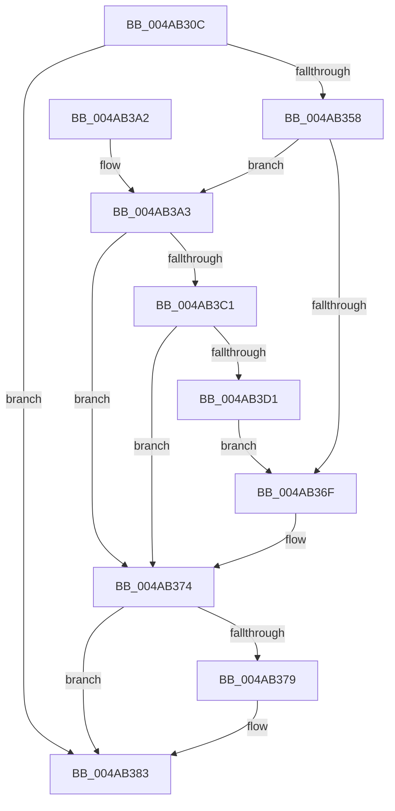

# PopDiagTraceDeviceIdleCheck

- RVA: `0x004AB30C`–`0x004AB4E1` (길이 `469` bytes)
- VA: `0x00000001404AB30C`
- 실행 섹션: `.text`
- PDB 이름 있음: `예`; PDB Function 태그: `아니요`
- unwind 정보 RVA: `0x000B7F40`
- 디코드: `107`개 명령, `469/469` bytes 표시
- 미해석 바이트: `0` (있으면 어셈블리에 `.byte`로 보존)

> 이 문서는 커널 이미지의 기계어와 PDB 기호를 분석해 생성했습니다. 4번과 5번은 함수 원형과 자료형을 바이너리 사용 방식에서 추정한 C 해석이며 원본 소스 복구 결과는 아닙니다.

## 1. Dependencies

- 직접 호출 지점: **5**; 고유 호출 대상: **5**
- 직접 호출자로 확인된 함수: **1**
- RIP 상대 이미지 참조: **4**

### Outgoing calls
- `0x004AB366` → [EtwEventEnabled](../39/EtwEventEnabled_function_00392450.md) (function, `0x00392450`)
- `0x004AB37E` → [ObfDereferenceObjectWithTag](../2F/ObfDereferenceObjectWithTag_function_002F78E0.md) (function, `0x002F78E0`)
- `0x004AB38A` → [_security_check_cookie](../6A/_security_check_cookie_function_006AC640.md) (function, `0x006AC640`)
- `0x004AB3AF` → [IoGetDeviceAttachmentBaseRefWithTag](../27/IoGetDeviceAttachmentBaseRefWithTag_function_00272788.md) (function, `0x00272788`)
- `0x004AB4D7` → [EtwWriteEx](../25/EtwWriteEx_function_0025F0D0.md) (function, `0x0025F0D0`)

### Direct callers
- [PopScanIdleList](../49/PopScanIdleList_function_00497F04.md) at `0x00498137`

### Static image references
- `0x004AB328` → RVA `0x00E0A740` (`.data`; read)
- `0x004AB33B` → RVA `0x00E67858` (`.data`; read)
- `0x004AB358` → RVA `0x00F0B408` (`.data`; read)
- `0x004AB35F` → RVA `0x0001BE78` (`.rdata`; read)

## 2. Other-region calls and transfers

- 다른 실행 섹션으로 향하는 call: **0**
- 별도 외부 분기/꼬리 이동을 확인하지 못했습니다.

## 3. Assembly (complete function range)

```asm
004AB30C  48 8B C4                        mov rax, rsp
004AB30F  48 89 58 20                     mov qword ptr [rax + 0x20], rbx
004AB313  44 89 40 18                     mov dword ptr [rax + 0x18], r8d
004AB317  89 50 10                        mov dword ptr [rax + 0x10], edx
004AB31A  55                              push rbp
004AB31B  56                              push rsi
004AB31C  57                              push rdi
004AB31D  48 8D 68 D8                     lea rbp, [rax - 0x28]
004AB321  48 81 EC 10 01 00 00            sub rsp, 0x110
004AB328  48 8B 05 11 F4 95 00            mov rax, qword ptr [rip + 0x95f411]
004AB32F  48 33 C4                        xor rax, rsp
004AB332  48 89 45 00                     mov qword ptr [rbp], rax
004AB336  33 F6                           xor esi, esi
004AB338  48 8B D9                        mov rbx, rcx
004AB33B  40 38 35 16 C5 9B 00            cmp byte ptr [rip + 0x9bc516], sil
004AB342  40 88 74 24 41                  mov byte ptr [rsp + 0x41], sil
004AB347  40 88 74 24 40                  mov byte ptr [rsp + 0x40], sil
004AB34C  66 89 74 24 44                  mov word ptr [rsp + 0x44], si
004AB351  48 89 74 24 48                  mov qword ptr [rsp + 0x48], rsi
004AB356  74 2B                           je 0x1404ab383
004AB358  48 8B 0D A9 00 A6 00            mov rcx, qword ptr [rip + 0xa600a9]
004AB35F  48 8D 15 12 0B B7 FF            lea rdx, [rip - 0x48f4ee]
004AB366  E8 E5 70 EE FF                  call 0x140392450
004AB36B  84 C0                           test al, al
004AB36D  75 34                           jne 0x1404ab3a3
004AB36F  48 8B 4C 24 48                  mov rcx, qword ptr [rsp + 0x48]
004AB374  48 85 C9                        test rcx, rcx
004AB377  74 0A                           je 0x1404ab383
004AB379  BA 50 6F 44 67                  mov edx, 0x67446f50
004AB37E  E8 5D C5 E4 FF                  call 0x1402f78e0
004AB383  48 8B 4D 00                     mov rcx, qword ptr [rbp]
004AB387  48 33 CC                        xor rcx, rsp
004AB38A  E8 B1 12 20 00                  call 0x1406ac640
004AB38F  48 8B 9C 24 48 01 00 00         mov rbx, qword ptr [rsp + 0x148]
004AB397  48 81 C4 10 01 00 00            add rsp, 0x110
004AB39E  5F                              pop rdi
004AB39F  5E                              pop rsi
004AB3A0  5D                              pop rbp
004AB3A1  C3                              ret
004AB3A2  CC                              int3
004AB3A3  48 8D 7B 18                     lea rdi, [rbx + 0x18]
004AB3A7  BA 50 6F 44 67                  mov edx, 0x67446f50
004AB3AC  48 8B 0F                        mov rcx, qword ptr [rdi]
004AB3AF  E8 D4 73 DC FF                  call 0x140272788
004AB3B4  48 89 44 24 48                  mov qword ptr [rsp + 0x48], rax
004AB3B9  48 8B C8                        mov rcx, rax
004AB3BC  48 85 C0                        test rax, rax
004AB3BF  74 B3                           je 0x1404ab374
004AB3C1  48 8B 80 38 01 00 00            mov rax, qword ptr [rax + 0x138]
004AB3C8  48 8B 50 28                     mov rdx, qword ptr [rax + 0x28]
004AB3CC  48 85 D2                        test rdx, rdx
004AB3CF  74 A3                           je 0x1404ab374
004AB3D1  0F B7 42 28                     movzx eax, word ptr [rdx + 0x28]
004AB3D5  41 B8 01 00 00 00               mov r8d, 1
004AB3DB  66 D1 E8                        shr ax, 1
004AB3DE  45 33 C9                        xor r9d, r9d
004AB3E1  66 89 44 24 44                  mov word ptr [rsp + 0x44], ax
004AB3E6  8A 43 34                        mov al, byte ptr [rbx + 0x34]
004AB3E9  41 2A C0                        sub al, r8b
004AB3EC  48 89 7C 24 50                  mov qword ptr [rsp + 0x50], rdi
004AB3F1  88 44 24 40                     mov byte ptr [rsp + 0x40], al
004AB3F5  8A 43 38                        mov al, byte ptr [rbx + 0x38]
004AB3F8  41 2A C0                        sub al, r8b
004AB3FB  48 C7 44 24 58 08 00 00 00      mov qword ptr [rsp + 0x58], 8
004AB404  88 44 24 41                     mov byte ptr [rsp + 0x41], al
004AB408  48 8D 44 24 48                  lea rax, [rsp + 0x48]
004AB40D  48 89 44 24 60                  mov qword ptr [rsp + 0x60], rax
004AB412  48 8D 44 24 44                  lea rax, [rsp + 0x44]
004AB417  48 89 44 24 70                  mov qword ptr [rsp + 0x70], rax
004AB41C  48 C7 44 24 68 08 00 00 00      mov qword ptr [rsp + 0x68], 8
004AB425  48 C7 44 24 78 02 00 00 00      mov qword ptr [rsp + 0x78], 2
004AB42E  48 8B 42 30                     mov rax, qword ptr [rdx + 0x30]
004AB432  0F B7 4A 28                     movzx ecx, word ptr [rdx + 0x28]
004AB436  48 8D 15 3B 0A B7 FF            lea rdx, [rip - 0x48f5c5]
004AB43D  48 89 45 80                     mov qword ptr [rbp - 0x80], rax
004AB441  48 8D 43 10                     lea rax, [rbx + 0x10]
004AB445  48 89 45 90                     mov qword ptr [rbp - 0x70], rax
004AB449  48 8D 43 14                     lea rax, [rbx + 0x14]
004AB44D  48 89 45 A0                     mov qword ptr [rbp - 0x60], rax
004AB451  48 8D 45 38                     lea rax, [rbp + 0x38]
004AB455  48 89 45 B0                     mov qword ptr [rbp - 0x50], rax
004AB459  48 8D 45 40                     lea rax, [rbp + 0x40]
004AB45D  48 89 45 C0                     mov qword ptr [rbp - 0x40], rax
004AB461  48 8D 43 0C                     lea rax, [rbx + 0xc]
004AB465  48 89 45 D0                     mov qword ptr [rbp - 0x30], rax
004AB469  48 8D 44 24 40                  lea rax, [rsp + 0x40]
004AB46E  48 89 45 E0                     mov qword ptr [rbp - 0x20], rax
004AB472  48 8D 44 24 41                  lea rax, [rsp + 0x41]
004AB477  48 89 45 F0                     mov qword ptr [rbp - 0x10], rax
004AB47B  48 8D 44 24 50                  lea rax, [rsp + 0x50]
004AB480  48 89 44 24 38                  mov qword ptr [rsp + 0x38], rax
004AB485  C7 44 24 30 0B 00 00 00         mov dword ptr [rsp + 0x30], 0xb
004AB48D  89 4D 88                        mov dword ptr [rbp - 0x78], ecx
004AB490  48 8B 0D 71 FF A5 00            mov rcx, qword ptr [rip + 0xa5ff71]
004AB497  4C 89 45 E8                     mov qword ptr [rbp - 0x18], r8
004AB49B  4C 89 45 F8                     mov qword ptr [rbp - 8], r8
004AB49F  45 33 C0                        xor r8d, r8d
004AB4A2  48 89 74 24 28                  mov qword ptr [rsp + 0x28], rsi
004AB4A7  48 89 74 24 20                  mov qword ptr [rsp + 0x20], rsi
004AB4AC  89 75 8C                        mov dword ptr [rbp - 0x74], esi
004AB4AF  48 C7 45 98 04 00 00 00         mov qword ptr [rbp - 0x68], 4
004AB4B7  48 C7 45 A8 04 00 00 00         mov qword ptr [rbp - 0x58], 4
004AB4BF  48 C7 45 B8 04 00 00 00         mov qword ptr [rbp - 0x48], 4
004AB4C7  48 C7 45 C8 04 00 00 00         mov qword ptr [rbp - 0x38], 4
004AB4CF  48 C7 45 D8 04 00 00 00         mov qword ptr [rbp - 0x28], 4
004AB4D7  E8 F4 3B DB FF                  call 0x14025f0d0
004AB4DC  E9 8E FE FF FF                  jmp 0x1404ab36f
```

## 4. C-style interpretation (structured pseudocode)

```c
__int64 __fastcall PopDiagTraceDeviceIdleCheck(__int64 a1, int a2, int a3, int a4)
{
    __int64 result;
    __int64 v_rsi;
    __int64 v_rsp;
    unsigned __int64 v_stack_mE0;
    unsigned __int16 v_stack_mE4;
    unsigned __int8 v_stack_mE7;
    unsigned __int8 v_stack_mE8;
    unsigned __int64 v_stack_p20;
    unsigned __int64 v_stack_p28;
    unsigned int v_stack_p30;
    unsigned __int64 v_stack_p38;
    unsigned __int8 v_stack_p40;
    unsigned __int8 v_stack_p41;
    unsigned __int16 v_stack_p44;
    unsigned __int64 v_stack_p48;
    unsigned __int64 v_stack_p50;
    unsigned __int64 v_stack_p58;
    unsigned __int64 v_stack_p60;
    unsigned __int64 v_stack_p68;
    unsigned __int64 v_stack_p70;
    unsigned __int64 v_stack_p78;

    *(unsigned __int64 *)(v_rsp + 32) = v_rbx;
    *(unsigned int *)(v_rsp + 24) = a3;
    *(unsigned int *)(v_rsp + 16) = a2;
    v_rsp = (v_rsp) - (272);
    result = (*(unsigned __int64 *)(v_rip + 9827345)) ^ (v_rsp);
    *(unsigned __int64 *)(v_rsp - 40) = result;
    v_rsi = 0;
    v_stack_mE7 = 0;
    v_stack_mE8 = 0;
    v_stack_mE4 = 0;
    v_stack_mE0 = 0;
    if ((*(unsigned __int8 *)(v_rip + 10208534)) == 0) goto loc_004AB383;
    result = EtwEventEnabled(*(unsigned __int64 *)(v_rip + 10879145), v_rip - 4781294, a3, a4);
    if ((unsigned __int8)(result) != 0) goto loc_004AB3A3;
loc_004AB36F:
loc_004AB374:
    if (v_stack_mE0 != 0) {
        a2 = 0x67446F50ULL;
        result = ObfDereferenceObjectWithTag(v_stack_mE0, a2, a3, a4);
    }
    a1 = (*(unsigned __int64 *)(v_rsp - 40)) ^ (v_rsp);
    result = _security_check_cookie(a1, a2, a3, a4);
    v_rsp = (v_rsp) + (272);
    return result;
loc_004AB3A3:
    result = IoGetDeviceAttachmentBaseRefWithTag(*(unsigned __int64 *)(v_stack_p20 + 24), (unsigned int)(0x67446F50ULL), a3, a4);
    v_stack_p48 = result;
    if (result == 0) goto loc_004AB374;
    if (*(unsigned __int64 *)(*(unsigned __int64 *)(result + 312) + 40) == 0) goto loc_004AB374;
    result = (unsigned __int16)((*(unsigned __int16 *)(*(unsigned __int64 *)(*(unsigned __int64 *)(result + 312) + 40) + 40)) >> (1));
    a4 = 0;
    v_stack_p44 = (unsigned __int16)(result);
    result = (unsigned __int8)((*(unsigned __int8 *)(v_stack_p20 + 52)) - (1));
    v_stack_p50 = v_stack_p20 + 24;
    v_stack_p40 = (unsigned __int8)(result);
    result = (unsigned __int8)((*(unsigned __int8 *)(v_stack_p20 + 56)) - (1));
    v_stack_p58 = 8;
    v_stack_p41 = (unsigned __int8)(result);
    v_stack_p60 = v_stack_p48;
    v_stack_p70 = v_stack_p44;
    v_stack_p68 = 8;
    v_stack_p78 = 2;
    *(unsigned __int64 *)(v_rsp - 40 - 128) = *(unsigned __int64 *)(*(unsigned __int64 *)(*(unsigned __int64 *)(result + 312) + 40) + 48);
    *(unsigned __int64 *)(v_rsp - 40 - 112) = v_stack_p20 + 16;
    *(unsigned __int64 *)(v_rsp - 40 - 96) = v_stack_p20 + 20;
    *(unsigned __int64 *)(v_rsp - 40 - 80) = v_rsp - 40 + 56;
    *(unsigned __int64 *)(v_rsp - 40 - 64) = v_rsp - 40 + 64;
    *(unsigned __int64 *)(v_rsp - 40 - 48) = v_stack_p20 + 12;
    *(unsigned __int64 *)(v_rsp - 40 - 32) = v_stack_p40;
    *(unsigned __int64 *)(v_rsp - 40 - 16) = v_stack_p41;
    v_stack_p38 = v_stack_p50;
    v_stack_p30 = 11;
    *(unsigned int *)(v_rsp - 40 - 120) = (unsigned int)(*(unsigned __int16 *)(*(unsigned __int64 *)(*(unsigned __int64 *)(result + 312) + 40) + 40));
    *(unsigned __int64 *)(v_rsp - 40 - 24) = 1;
    *(unsigned __int64 *)(v_rsp - 40 - 8) = 1;
    a3 = 0;
    v_stack_p28 = 0;
    v_stack_p20 = 0;
    *(unsigned int *)(v_rsp - 40 - 116) = 0;
    *(unsigned __int64 *)(v_rsp - 40 - 104) = 4;
    *(unsigned __int64 *)(v_rsp - 40 - 88) = 4;
    *(unsigned __int64 *)(v_rsp - 40 - 72) = 4;
    *(unsigned __int64 *)(v_rsp - 40 - 56) = 4;
    *(unsigned __int64 *)(v_rsp - 40 - 40) = 4;
    result = EtwWriteEx(*(unsigned __int64 *)(v_rip + 10878833), v_rip - 4781509, a3, a4);
    goto loc_004AB36F;
}
```

## 5. (Beta) C Style

```c
int64_t PopDiagTraceDeviceIdleCheck(void *Arg1, int32_t Arg2, int32_t Arg3, int32_t Arg4)
{
    uint8_t *arg1 = (uint8_t *)Arg1;

    int64_t result;
    int64_t local_rsi;
    int64_t local_rsp;
    uint64_t v_stack_mE0;
    uint16_t v_stack_mE4;
    uint8_t v_stack_mE7;
    uint8_t v_stack_mE8;
    uint64_t v_stack_p20;
    uint64_t v_stack_p28;
    uint32_t v_stack_p30;
    uint64_t v_stack_p38;
    uint8_t v_stack_p40;
    uint8_t v_stack_p41;
    uint16_t v_stack_p44;
    uint64_t v_stack_p48;
    uint64_t v_stack_p50;
    uint64_t v_stack_p58;
    uint64_t v_stack_p60;
    uint64_t v_stack_p68;
    uint64_t v_stack_p70;
    uint64_t v_stack_p78;

    *(uint64_t *)(local_rsp + 0x20) = local_rbx;
    *(uint32_t *)(local_rsp + 0x18) = Arg3;
    *(uint32_t *)(local_rsp + 0x10) = Arg2;
    local_rsp = (local_rsp) - (272);
    result = (*(uint64_t *)(v_rip + 0x95F411)) ^ (local_rsp);
    *(uint64_t *)(local_rsp - 0x28) = result;
    local_rsi = 0;
    v_stack_mE7 = 0;
    v_stack_mE8 = 0;
    v_stack_mE4 = 0;
    v_stack_mE0 = 0;
    if ((*(uint8_t *)(v_rip + 0x9BC516)) == 0) goto loc_004AB383;
    result = EtwEventEnabled(*(uint64_t *)(v_rip + 0xA600A9), v_rip - 4781294, Arg3, Arg4);
    if ((uint8_t)(result) != 0) goto loc_004AB3A3;
loc_004AB36F:
loc_004AB374:
    if (v_stack_mE0 != 0) {
        Arg2 = 0x67446F50ULL;
        result = ObfDereferenceObjectWithTag(v_stack_mE0, Arg2, Arg3, Arg4);
    }
    Arg1 = (*(uint64_t *)(local_rsp - 0x28)) ^ (local_rsp);
    result = _security_check_cookie(Arg1, Arg2, Arg3, Arg4);
    local_rsp = (local_rsp) + (272);
    return result;
loc_004AB3A3:
    result = IoGetDeviceAttachmentBaseRefWithTag(*(uint64_t *)(v_stack_p20 + 0x18), (uint32_t)(0x67446F50ULL), Arg3, Arg4);
    v_stack_p48 = result;
    if (result == 0) goto loc_004AB374;
    if (*(uint64_t *)(*(uint64_t *)(result + 0x138) + 0x28) == 0) goto loc_004AB374;
    result = (uint16_t)((*(uint16_t *)(*(uint64_t *)(*(uint64_t *)(result + 0x138) + 0x28) + 0x28)) >> (1));
    Arg4 = 0;
    v_stack_p44 = (uint16_t)(result);
    result = (uint8_t)((*(uint8_t *)(v_stack_p20 + 0x34)) - (1));
    v_stack_p50 = v_stack_p20 + 24;
    v_stack_p40 = (uint8_t)(result);
    result = (uint8_t)((*(uint8_t *)(v_stack_p20 + 0x38)) - (1));
    v_stack_p58 = 8;
    v_stack_p41 = (uint8_t)(result);
    v_stack_p60 = v_stack_p48;
    v_stack_p70 = v_stack_p44;
    v_stack_p68 = 8;
    v_stack_p78 = 2;
    *(uint64_t *)(local_rsp - 0x28 - 0x80) = *(uint64_t *)(*(uint64_t *)(*(uint64_t *)(result + 0x138) + 0x28) + 0x30);
    *(uint64_t *)(local_rsp - 0x28 - 0x70) = v_stack_p20 + 16;
    *(uint64_t *)(local_rsp - 0x28 - 0x60) = v_stack_p20 + 20;
    *(uint64_t *)(local_rsp - 0x28 - 0x50) = local_rsp - 40 + 56;
    *(uint64_t *)(local_rsp - 0x28 - 0x40) = local_rsp - 40 + 64;
    *(uint64_t *)(local_rsp - 0x28 - 0x30) = v_stack_p20 + 12;
    *(uint64_t *)(local_rsp - 0x28 - 0x20) = v_stack_p40;
    *(uint64_t *)(local_rsp - 0x28 - 0x10) = v_stack_p41;
    v_stack_p38 = v_stack_p50;
    v_stack_p30 = 11;
    *(uint32_t *)(local_rsp - 0x28 - 0x78) = (uint32_t)(*(uint16_t *)(*(uint64_t *)(*(uint64_t *)(result + 0x138) + 0x28) + 0x28));
    *(uint64_t *)(local_rsp - 0x28 - 0x18) = 1;
    *(uint64_t *)(local_rsp - 0x28 - 0x8) = 1;
    Arg3 = 0;
    v_stack_p28 = 0;
    v_stack_p20 = 0;
    *(uint32_t *)(local_rsp - 0x28 - 0x74) = 0;
    *(uint64_t *)(local_rsp - 0x28 - 0x68) = 4;
    *(uint64_t *)(local_rsp - 0x28 - 0x58) = 4;
    *(uint64_t *)(local_rsp - 0x28 - 0x48) = 4;
    *(uint64_t *)(local_rsp - 0x28 - 0x38) = 4;
    *(uint64_t *)(local_rsp - 0x28 - 0x28) = 4;
    result = EtwWriteEx(*(uint64_t *)(v_rip + 0xA5FF71), v_rip - 4781509, Arg3, Arg4);
    goto loc_004AB36F;
}
```

### 관측된 메모리 오프셋

구조체 형식이 확인되지 않은 접근은 인자 기준의 오프셋으로만 기록했습니다.

| 기준 인자 | 오프셋 표현 | 폭 (bit) | 접근 |
|---|---:|---:|---|
| `Arg1` | `+ 0x0` | `64` | `R` |
| `Arg1` | `+ 0xC` | `64` | `R` |
| `Arg1` | `+ 0x10` | `64` | `R` |
| `Arg1` | `+ 0x14` | `64` | `R` |
| `Arg1` | `+ 0x18` | `64` | `R` |
| `Arg1` | `+ 0x34` | `8` | `R` |
| `Arg1` | `+ 0x38` | `8` | `R` |

## 6. Execution-region graph

[열기: 2D/3D 그래프와 함수 탐색 컨트롤 패널](../../../control-panel.html?section=text&rva=0x004AB30C&view=graph)

- 2D 그래프는 위에서 아래로 흐르고, 3D 그래프는 빈 공간을 드래그해 회전합니다. Shift+드래그는 이동, 휠은 확대·축소, 함수 노드 선택은 대상 보고서 이동입니다.

### Static fallback


