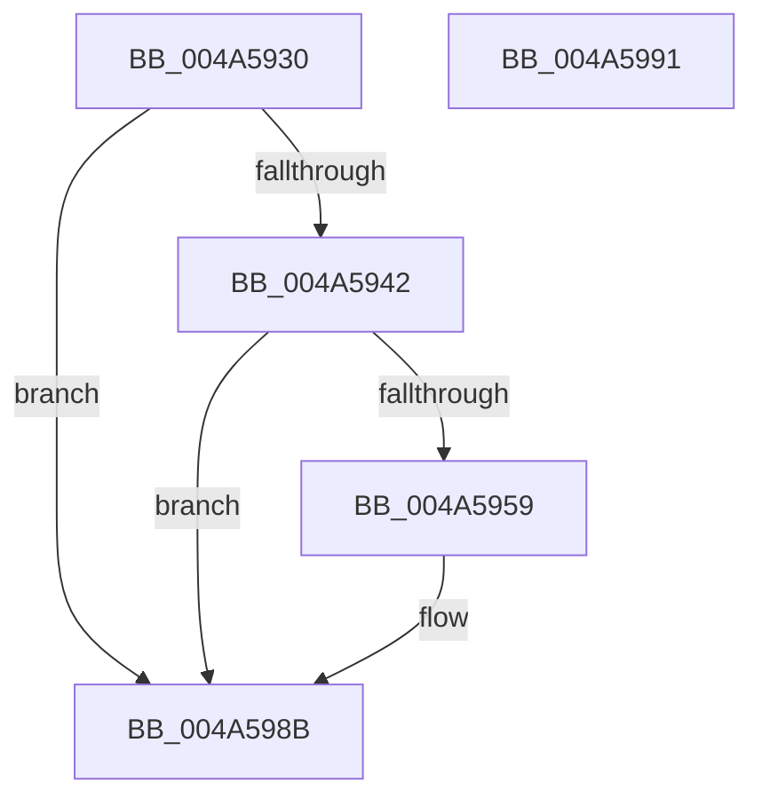

# PopDiagTraceSleepStudyBlocker

- RVA: `0x004A5930`–`0x004A5992` (길이 `98` bytes)
- VA: `0x00000001404A5930`
- 실행 섹션: `.text`
- PDB 이름 있음: `예`; PDB Function 태그: `아니요`
- unwind 정보 RVA: `0x000697A4`
- 디코드: `23`개 명령, `98/98` bytes 표시
- 미해석 바이트: `0` (있으면 어셈블리에 `.byte`로 보존)

> 이 문서는 커널 이미지의 기계어와 PDB 기호를 분석해 생성했습니다. 4번과 5번은 함수 원형과 자료형을 바이너리 사용 방식에서 추정한 C 해석이며 원본 소스 복구 결과는 아닙니다.

## 1. Dependencies

- 직접 호출 지점: **2**; 고유 호출 대상: **2**
- 직접 호출자로 확인된 함수: **2**
- RIP 상대 이미지 참조: **3**

### Outgoing calls
- `0x004A5950` → [EtwEventEnabled](../39/EtwEventEnabled_function_00392450.md) (function, `0x00392450`)
- `0x004A5986` → [EtwWriteEx](../25/EtwWriteEx_function_0025F0D0.md) (function, `0x0025F0D0`)

### Direct callers
- [sub_006EF506](../6E/Unknown_function_006EF506.md) at `0x006EF57C`
- [PopFxLogSocSubsystemBlockingTimes](../../page/97/PopFxLogSocSubsystemBlockingTimes_function_0097A4EC.md) at `0x0097A65B`

### Static image references
- `0x004A5936` → RVA `0x00E67859` (`.data`; read)
- `0x004A5942` → RVA `0x00F0B6B8` (`.data`; read)
- `0x004A5949` → RVA `0x0001BB08` (`.rdata`; read)

## 2. Other-region calls and transfers

- 다른 실행 섹션으로 향하는 call: **0**
- 별도 외부 분기/꼬리 이동을 확인하지 못했습니다.

## 3. Assembly (complete function range)

```asm
004A5930  40 53                           push rbx
004A5932  48 83 EC 40                     sub rsp, 0x40
004A5936  80 3D 1C 1F 9C 00 00            cmp byte ptr [rip + 0x9c1f1c], 0
004A593D  48 8B D9                        mov rbx, rcx
004A5940  74 49                           je 0x1404a598b
004A5942  48 8B 0D 6F 5D A6 00            mov rcx, qword ptr [rip + 0xa65d6f]
004A5949  48 8D 15 B8 61 B7 FF            lea rdx, [rip - 0x489e48]
004A5950  E8 FB CA EE FF                  call 0x140392450
004A5955  84 C0                           test al, al
004A5957  74 32                           je 0x1404a598b
004A5959  48 8B 0D 58 5D A6 00            mov rcx, qword ptr [rip + 0xa65d58]
004A5960  48 8D 15 A1 61 B7 FF            lea rdx, [rip - 0x489e5f]
004A5967  48 89 5C 24 38                  mov qword ptr [rsp + 0x38], rbx
004A596C  45 33 C9                        xor r9d, r9d
004A596F  C7 44 24 30 08 00 00 00         mov dword ptr [rsp + 0x30], 8
004A5977  45 33 C0                        xor r8d, r8d
004A597A  48 83 64 24 28 00               and qword ptr [rsp + 0x28], 0
004A5980  48 83 64 24 20 00               and qword ptr [rsp + 0x20], 0
004A5986  E8 45 97 DB FF                  call 0x14025f0d0
004A598B  48 83 C4 40                     add rsp, 0x40
004A598F  5B                              pop rbx
004A5990  C3                              ret
004A5991  CC                              int3
```

## 4. C-style interpretation (structured pseudocode)

```c
__int64 __fastcall PopDiagTraceSleepStudyBlocker(__int64 a1, __int64 a2, int a3, int a4)
{
    __int64 result;
    __int64 v_rsp;
    unsigned __int64 v_stack_m10;
    unsigned int v_stack_m18;
    unsigned __int64 v_stack_m20;
    unsigned __int64 v_stack_m28;

    v_rsp = (v_rsp) - (64);
    if ((*(unsigned __int8 *)(v_rip + 10231580)) == 0) goto loc_004A598B;
    result = EtwEventEnabled(*(unsigned __int64 *)(v_rip + 10902895), v_rip - 4759112, a3, a4);
    if ((unsigned __int8)(result) != 0) {
        a1 = *(unsigned __int64 *)(v_rip + 10902872);
        a2 = v_rip - 4759135;
        v_stack_m10 = a1;
        a4 = 0;
        v_stack_m18 = 8;
        a3 = 0;
        result = EtwWriteEx(a1, a2, a3, a4);
    }
    v_rsp = (v_rsp) + (64);
    return result;
}
```

## 5. (Beta) C Style

```c
int64_t PopDiagTraceSleepStudyBlocker(int64_t Arg1, int64_t Arg2, int32_t Arg3, int32_t Arg4)
{
    int64_t result;
    int64_t local_rsp;
    uint64_t v_stack_m10;
    uint32_t v_stack_m18;
    uint64_t v_stack_m20;
    uint64_t v_stack_m28;

    local_rsp = (local_rsp) - (64);
    if ((*(uint8_t *)(v_rip + 0x9C1F1C)) == 0) goto loc_004A598B;
    result = EtwEventEnabled(*(uint64_t *)(v_rip + 0xA65D6F), v_rip - 4759112, Arg3, Arg4);
    if ((uint8_t)(result) != 0) {
        Arg1 = *(uint64_t *)(v_rip + 0xA65D58);
        Arg2 = v_rip - 4759135;
        v_stack_m10 = Arg1;
        Arg4 = 0;
        v_stack_m18 = 8;
        Arg3 = 0;
        result = EtwWriteEx(Arg1, Arg2, Arg3, Arg4);
    }
    local_rsp = (local_rsp) + (64);
    return result;
}
```

## 6. Execution-region graph

[열기: 2D/3D 그래프와 함수 탐색 컨트롤 패널](../../../control-panel.html?section=text&rva=0x004A5930&view=graph)

- 2D 그래프는 위에서 아래로 흐르고, 3D 그래프는 빈 공간을 드래그해 회전합니다. Shift+드래그는 이동, 휠은 확대·축소, 함수 노드 선택은 대상 보고서 이동입니다.

### Static fallback


