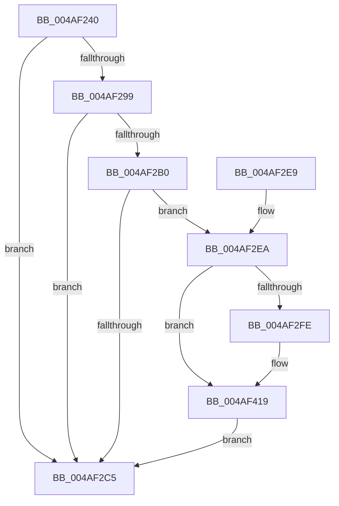

# PopDiagTraceThermalZoneRundown

- RVA: `0x004AF240`–`0x004AF42B` (길이 `491` bytes)
- VA: `0x00000001404AF240`
- 실행 섹션: `.text`
- PDB 이름 있음: `예`; PDB Function 태그: `아니요`
- unwind 정보 RVA: `0x000B8730`
- 디코드: `112`개 명령, `491/491` bytes 표시
- 미해석 바이트: `0` (있으면 어셈블리에 `.byte`로 보존)

> 이 문서는 커널 이미지의 기계어와 PDB 기호를 분석해 생성했습니다. 4번과 5번은 함수 원형과 자료형을 바이너리 사용 방식에서 추정한 C 해석이며 원본 소스 복구 결과는 아닙니다.

## 1. Dependencies

- 직접 호출 지점: **5**; 고유 호출 대상: **5**
- 직접 호출자로 확인된 함수: **1**
- RIP 상대 이미지 참조: **4**

### Outgoing calls
- `0x004AF2A7` → [EtwEventEnabled](../39/EtwEventEnabled_function_00392450.md) (function, `0x00392450`)
- `0x004AF2B8` → [IoGetDeviceAttachmentBaseRefWithTag](../27/IoGetDeviceAttachmentBaseRefWithTag_function_00272788.md) (function, `0x00272788`)
- `0x004AF2CC` → [_security_check_cookie](../6A/_security_check_cookie_function_006AC640.md) (function, `0x006AC640`)
- `0x004AF414` → [EtwWriteEx](../25/EtwWriteEx_function_0025F0D0.md) (function, `0x0025F0D0`)
- `0x004AF421` → [ObfDereferenceObjectWithTag](../2F/ObfDereferenceObjectWithTag_function_002F78E0.md) (function, `0x002F78E0`)

### Direct callers
- [PopThermalTraceRundownEvents](PopThermalTraceRundownEvents_function_004AF1A8.md) at `0x004AF233`

### Static image references
- `0x004AF25E` → RVA `0x00E0A740` (`.data`; read)
- `0x004AF272` → RVA `0x00E67858` (`.data`; read)
- `0x004AF299` → RVA `0x00F0B408` (`.data`; read)
- `0x004AF2A0` → RVA `0x0001BFA8` (`.rdata`; read)

## 2. Other-region calls and transfers

- 다른 실행 섹션으로 향하는 call: **0**
- 별도 외부 분기/꼬리 이동을 확인하지 못했습니다.

## 3. Assembly (complete function range)

```asm
004AF240  48 8B C4                        mov rax, rsp
004AF243  48 89 58 10                     mov qword ptr [rax + 0x10], rbx
004AF247  48 89 70 18                     mov qword ptr [rax + 0x18], rsi
004AF24B  44 89 48 20                     mov dword ptr [rax + 0x20], r9d
004AF24F  55                              push rbp
004AF250  57                              push rdi
004AF251  41 56                           push r14
004AF253  48 8D 68 C1                     lea rbp, [rax - 0x3f]
004AF257  48 81 EC 00 01 00 00            sub rsp, 0x100
004AF25E  48 8B 05 DB B4 95 00            mov rax, qword ptr [rip + 0x95b4db]
004AF265  48 33 C4                        xor rax, rsp
004AF268  48 89 45 17                     mov qword ptr [rbp + 0x17], rax
004AF26C  45 33 F6                        xor r14d, r14d
004AF26F  41 8A F0                        mov sil, r8b
004AF272  44 38 35 DF 85 9B 00            cmp byte ptr [rip + 0x9b85df], r14b
004AF279  48 8B FA                        mov rdi, rdx
004AF27C  48 8B D9                        mov rbx, rcx
004AF27F  66 44 89 74 24 44               mov word ptr [rsp + 0x44], r14w
004AF285  66 44 89 74 24 4C               mov word ptr [rsp + 0x4c], r14w
004AF28B  66 44 89 74 24 40               mov word ptr [rsp + 0x40], r14w
004AF291  66 44 89 74 24 48               mov word ptr [rsp + 0x48], r14w
004AF297  74 2C                           je 0x1404af2c5
004AF299  48 8B 0D 68 C1 A5 00            mov rcx, qword ptr [rip + 0xa5c168]
004AF2A0  48 8D 15 01 CD B6 FF            lea rdx, [rip - 0x4932ff]
004AF2A7  E8 A4 31 EE FF                  call 0x140392450
004AF2AC  84 C0                           test al, al
004AF2AE  74 15                           je 0x1404af2c5
004AF2B0  BA 50 6F 44 67                  mov edx, 0x67446f50
004AF2B5  48 8B CB                        mov rcx, rbx
004AF2B8  E8 CB 34 DC FF                  call 0x140272788
004AF2BD  48 8B D8                        mov rbx, rax
004AF2C0  48 85 C0                        test rax, rax
004AF2C3  75 25                           jne 0x1404af2ea
004AF2C5  48 8B 4D 17                     mov rcx, qword ptr [rbp + 0x17]
004AF2C9  48 33 CC                        xor rcx, rsp
004AF2CC  E8 6F D3 1F 00                  call 0x1406ac640
004AF2D1  4C 8D 9C 24 00 01 00 00         lea r11, [rsp + 0x100]
004AF2D9  49 8B 5B 28                     mov rbx, qword ptr [r11 + 0x28]
004AF2DD  49 8B 73 30                     mov rsi, qword ptr [r11 + 0x30]
004AF2E1  49 8B E3                        mov rsp, r11
004AF2E4  41 5E                           pop r14
004AF2E6  5F                              pop rdi
004AF2E7  5D                              pop rbp
004AF2E8  C3                              ret
004AF2E9  CC                              int3
004AF2EA  48 8B 88 38 01 00 00            mov rcx, qword ptr [rax + 0x138]
004AF2F1  48 8B 41 28                     mov rax, qword ptr [rcx + 0x28]
004AF2F5  48 85 C0                        test rax, rax
004AF2F8  0F 84 1B 01 00 00               je 0x1404af419
004AF2FE  0F B7 88 80 00 00 00            movzx ecx, word ptr [rax + 0x80]
004AF305  66 D1 E9                        shr cx, 1
004AF308  0F B7 D1                        movzx edx, cx
004AF30B  48 8D 4C 24 40                  lea rcx, [rsp + 0x40]
004AF310  48 89 4C 24 50                  mov qword ptr [rsp + 0x50], rcx
004AF315  0F B7 0F                        movzx ecx, word ptr [rdi]
004AF318  66 89 54 24 40                  mov word ptr [rsp + 0x40], dx
004AF31D  03 D2                           add edx, edx
004AF31F  40 84 F6                        test sil, sil
004AF322  48 C7 44 24 58 02 00 00 00      mov qword ptr [rsp + 0x58], 2
004AF32B  48 8B 80 88 00 00 00            mov rax, qword ptr [rax + 0x88]
004AF332  48 89 45 87                     mov qword ptr [rbp - 0x79], rax
004AF336  41 8B C6                        mov eax, r14d
004AF339  0F 95 C0                        setne al
004AF33C  89 55 8F                        mov dword ptr [rbp - 0x71], edx
004AF33F  44 38 75 67                     cmp byte ptr [rbp + 0x67], r14b
004AF343  48 8D 15 5E CC B6 FF            lea rdx, [rip - 0x4933a2]
004AF34A  66 89 44 24 44                  mov word ptr [rsp + 0x44], ax
004AF34F  48 8D 44 24 44                  lea rax, [rsp + 0x44]
004AF354  48 89 45 97                     mov qword ptr [rbp - 0x69], rax
004AF358  48 8D 45 5F                     lea rax, [rbp + 0x5f]
004AF35C  48 89 45 A7                     mov qword ptr [rbp - 0x59], rax
004AF360  41 8B C6                        mov eax, r14d
004AF363  0F 95 C0                        setne al
004AF366  89 4D 0F                        mov dword ptr [rbp + 0xf], ecx
004AF369  66 89 44 24 48                  mov word ptr [rsp + 0x48], ax
004AF36E  45 33 C9                        xor r9d, r9d
004AF371  48 8D 44 24 48                  lea rax, [rsp + 0x48]
004AF376  44 89 75 93                     mov dword ptr [rbp - 0x6d], r14d
004AF37A  48 89 45 B7                     mov qword ptr [rbp - 0x49], rax
004AF37E  45 33 C0                        xor r8d, r8d
004AF381  48 8D 45 6F                     lea rax, [rbp + 0x6f]
004AF385  48 C7 45 9F 02 00 00 00         mov qword ptr [rbp - 0x61], 2
004AF38D  48 89 45 C7                     mov qword ptr [rbp - 0x39], rax
004AF391  48 8D 45 77                     lea rax, [rbp + 0x77]
004AF395  48 89 45 D7                     mov qword ptr [rbp - 0x29], rax
004AF399  48 8D 45 7F                     lea rax, [rbp + 0x7f]
004AF39D  48 89 45 E7                     mov qword ptr [rbp - 0x19], rax
004AF3A1  0F B7 C1                        movzx eax, cx
004AF3A4  48 8B 0D 5D C0 A5 00            mov rcx, qword ptr [rip + 0xa5c05d]
004AF3AB  66 D1 E8                        shr ax, 1
004AF3AE  66 89 44 24 4C                  mov word ptr [rsp + 0x4c], ax
004AF3B3  48 8D 44 24 4C                  lea rax, [rsp + 0x4c]
004AF3B8  48 89 45 F7                     mov qword ptr [rbp - 9], rax
004AF3BC  48 8B 47 08                     mov rax, qword ptr [rdi + 8]
004AF3C0  48 89 45 07                     mov qword ptr [rbp + 7], rax
004AF3C4  48 8D 44 24 50                  lea rax, [rsp + 0x50]
004AF3C9  48 89 44 24 38                  mov qword ptr [rsp + 0x38], rax
004AF3CE  C7 44 24 30 0A 00 00 00         mov dword ptr [rsp + 0x30], 0xa
004AF3D6  4C 89 74 24 28                  mov qword ptr [rsp + 0x28], r14
004AF3DB  4C 89 74 24 20                  mov qword ptr [rsp + 0x20], r14
004AF3E0  48 C7 45 AF 04 00 00 00         mov qword ptr [rbp - 0x51], 4
004AF3E8  48 C7 45 BF 02 00 00 00         mov qword ptr [rbp - 0x41], 2
004AF3F0  48 C7 45 CF 04 00 00 00         mov qword ptr [rbp - 0x31], 4
004AF3F8  48 C7 45 DF 04 00 00 00         mov qword ptr [rbp - 0x21], 4
004AF400  48 C7 45 EF 04 00 00 00         mov qword ptr [rbp - 0x11], 4
004AF408  48 C7 45 FF 02 00 00 00         mov qword ptr [rbp - 1], 2
004AF410  44 89 75 13                     mov dword ptr [rbp + 0x13], r14d
004AF414  E8 B7 FC DA FF                  call 0x14025f0d0
004AF419  BA 50 6F 44 67                  mov edx, 0x67446f50
004AF41E  48 8B CB                        mov rcx, rbx
004AF421  E8 BA 84 E4 FF                  call 0x1402f78e0
004AF426  E9 9A FE FF FF                  jmp 0x1404af2c5
```

## 4. C-style interpretation (structured pseudocode)

```c
__int64 __fastcall PopDiagTraceThermalZoneRundown(__int64 a1, __int64 a2, int a3, int a4)
{
    __int64 result;
    __int64 v_r14;
    __int64 v_rsp;
    unsigned __int64 v_stack_m18;
    unsigned __int64 v_stack_mA8;
    unsigned __int64 v_stack_mB0;
    unsigned __int16 v_stack_mB4;
    unsigned __int16 v_stack_mB8;
    unsigned __int16 v_stack_mBC;
    unsigned __int64 v_stack_mC0;
    unsigned __int64 v_stack_mC8;
    unsigned __int16 v_stack_mCC;
    unsigned __int16 v_stack_mD0;
    unsigned __int16 v_stack_mD4;
    unsigned __int16 v_stack_mD8;
    unsigned __int64 v_stack_mE0;

    *(unsigned __int64 *)(v_rsp + 16) = v_rbx;
    *(unsigned __int64 *)(v_rsp + 24) = v_rsi;
    *(unsigned int *)(v_rsp + 32) = a4;
    v_rsp = (v_rsp) - (256);
    result = (*(unsigned __int64 *)(v_rip + 9811163)) ^ (v_rsp);
    *(unsigned __int64 *)(v_rsp - 63 + 23) = result;
    v_r14 = 0;
    v_stack_mD4 = 0;
    v_stack_mCC = 0;
    v_stack_mD8 = 0;
    v_stack_mD0 = 0;
    if ((*(unsigned __int8 *)(v_rip + 10192351)) == 0) goto loc_004AF2C5;
    result = EtwEventEnabled(*(unsigned __int64 *)(v_rip + 10862952), v_rip - 4797183, a3, a4);
    if ((unsigned __int8)(result) == 0) goto loc_004AF2C5;
    result = IoGetDeviceAttachmentBaseRefWithTag(a1, (unsigned int)(0x67446F50ULL), a3, a4);
    if (result != 0) goto loc_004AF2EA;
loc_004AF2C5:
    a1 = (*(unsigned __int64 *)(v_rsp - 63 + 23)) ^ (v_rsp);
    result = _security_check_cookie(a1, (unsigned int)(0x67446F50ULL), a3, a4);
    return result;
loc_004AF2EA:
    result = *(unsigned __int64 *)(*(unsigned __int64 *)(result + 312) + 40);
    if (*(unsigned __int64 *)(*(unsigned __int64 *)(result + 312) + 40) != 0) {
        a1 = *(unsigned __int16 *)(*(unsigned __int64 *)(*(unsigned __int64 *)(result + 312) + 40) + 128);
        a1 = (unsigned __int16)((a1) >> (1));
        a2 = (unsigned __int16)(a1);
        a1 = v_stack_mC0;
        v_stack_mB0 = a1;
        a1 = *(unsigned __int16 *)(a2);
        v_stack_mC0 = (unsigned __int16)(a2);
        a2 = (unsigned int)((a2) + ((unsigned int)(a2)));
        v_stack_mA8 = 2;
        result = *(unsigned __int64 *)(*(unsigned __int64 *)(*(unsigned __int64 *)(result + 312) + 40) + 136);
        *(unsigned __int64 *)(v_rsp - 63 - 121) = result;
        result = 0;
        result = ((unsigned __int8)(*(unsigned __int64 *)(v_stack_m18 + 48)) != 0) ? 1 : 0;
        *(unsigned int *)(v_rsp - 63 - 113) = (unsigned int)(a2);
        a2 = v_rip - 4797346;
        v_stack_mBC = (unsigned __int16)(result);
        result = v_stack_mBC;
        *(unsigned __int64 *)(v_rsp - 63 - 105) = result;
        result = v_rsp - 63 + 95;
        *(unsigned __int64 *)(v_rsp - 63 - 89) = result;
        result = 0;
        result = ((*(unsigned __int8 *)(v_rsp - 63 + 103)) != 0) ? 1 : 0;
        *(unsigned int *)(v_rsp - 63 + 15) = (unsigned int)(a1);
        v_stack_mB8 = (unsigned __int16)(result);
        a4 = 0;
        result = v_stack_mB8;
        *(unsigned int *)(v_rsp - 63 - 109) = 0;
        *(unsigned __int64 *)(v_rsp - 63 - 73) = result;
        a3 = 0;
        result = v_rsp - 63 + 111;
        *(unsigned __int64 *)(v_rsp - 63 - 97) = 2;
        *(unsigned __int64 *)(v_rsp - 63 - 57) = result;
        result = v_rsp - 63 + 119;
        *(unsigned __int64 *)(v_rsp - 63 - 41) = result;
        result = v_rsp - 63 + 127;
        *(unsigned __int64 *)(v_rsp - 63 - 25) = result;
        result = (unsigned __int16)(a1);
        a1 = *(unsigned __int64 *)(v_rip + 10862685);
        result = (unsigned __int16)((result) >> (1));
        v_stack_mB4 = (unsigned __int16)(result);
        result = v_stack_mB4;
        *(unsigned __int64 *)(v_rsp - 63 - 9) = result;
        result = *(unsigned __int64 *)(a2 + 8);
        *(unsigned __int64 *)(v_rsp - 63 + 7) = result;
        result = v_stack_mB0;
        v_stack_mC8 = result;
        v_stack_mD0 = 10;
        v_stack_mD8 = 0;
        v_stack_mE0 = 0;
        *(unsigned __int64 *)(v_rsp - 63 - 81) = 4;
        *(unsigned __int64 *)(v_rsp - 63 - 65) = 2;
        *(unsigned __int64 *)(v_rsp - 63 - 49) = 4;
        *(unsigned __int64 *)(v_rsp - 63 - 33) = 4;
        *(unsigned __int64 *)(v_rsp - 63 - 17) = 4;
        *(unsigned __int64 *)(v_rsp - 63 - 1) = 2;
        *(unsigned int *)(v_rsp - 63 + 19) = 0;
        result = EtwWriteEx(a1, a2, a3, a4);
    }
    result = ObfDereferenceObjectWithTag(*(unsigned __int64 *)(v_stack_m18 + 40), (unsigned int)(0x67446F50ULL), a3, a4);
    goto loc_004AF2C5;
}
```

## 5. (Beta) C Style

```c
int64_t PopDiagTraceThermalZoneRundown(int64_t Arg1, void *Arg2, int32_t Arg3, int32_t Arg4)
{
    uint8_t *arg2 = (uint8_t *)Arg2;

    int64_t result;
    int64_t local_r14;
    int64_t local_rsp;
    uint64_t v_stack_m18;
    uint64_t v_stack_mA8;
    uint64_t v_stack_mB0;
    uint16_t v_stack_mB4;
    uint16_t v_stack_mB8;
    uint16_t v_stack_mBC;
    uint64_t v_stack_mC0;
    uint64_t v_stack_mC8;
    uint16_t v_stack_mCC;
    uint16_t v_stack_mD0;
    uint16_t v_stack_mD4;
    uint16_t v_stack_mD8;
    uint64_t v_stack_mE0;

    *(uint64_t *)(local_rsp + 0x10) = local_rbx;
    *(uint64_t *)(local_rsp + 0x18) = local_rsi;
    *(uint32_t *)(local_rsp + 0x20) = Arg4;
    local_rsp = (local_rsp) - (256);
    result = (*(uint64_t *)(v_rip + 0x95B4DB)) ^ (local_rsp);
    *(uint64_t *)(local_rsp - 0x3F + 0x17) = result;
    local_r14 = 0;
    v_stack_mD4 = 0;
    v_stack_mCC = 0;
    v_stack_mD8 = 0;
    v_stack_mD0 = 0;
    if ((*(uint8_t *)(v_rip + 0x9B85DF)) == 0) goto loc_004AF2C5;
    result = EtwEventEnabled(*(uint64_t *)(v_rip + 0xA5C168), v_rip - 4797183, Arg3, Arg4);
    if ((uint8_t)(result) == 0) goto loc_004AF2C5;
    result = IoGetDeviceAttachmentBaseRefWithTag(Arg1, (uint32_t)(0x67446F50ULL), Arg3, Arg4);
    if (result != 0) goto loc_004AF2EA;
loc_004AF2C5:
    Arg1 = (*(uint64_t *)(local_rsp - 0x3F + 0x17)) ^ (local_rsp);
    result = _security_check_cookie(Arg1, (uint32_t)(0x67446F50ULL), Arg3, Arg4);
    return result;
loc_004AF2EA:
    result = *(uint64_t *)(*(uint64_t *)(result + 0x138) + 0x28);
    if (*(uint64_t *)(*(uint64_t *)(result + 0x138) + 0x28) != 0) {
        Arg1 = *(uint16_t *)(*(uint64_t *)(*(uint64_t *)(result + 0x138) + 0x28) + 0x80);
        Arg1 = (uint16_t)((Arg1) >> (1));
        Arg2 = (uint16_t)(Arg1);
        Arg1 = v_stack_mC0;
        v_stack_mB0 = Arg1;
        Arg1 = *(uint16_t *)(arg2);
        v_stack_mC0 = (uint16_t)(Arg2);
        Arg2 = (uint32_t)((Arg2) + ((uint32_t)(Arg2)));
        v_stack_mA8 = 2;
        result = *(uint64_t *)(*(uint64_t *)(*(uint64_t *)(result + 0x138) + 0x28) + 0x88);
        *(uint64_t *)(local_rsp - 0x3F - 0x79) = result;
        result = 0;
        result = ((uint8_t)(*(uint64_t *)(v_stack_m18 + 0x30)) != 0) ? 1 : 0;
        *(uint32_t *)(local_rsp - 0x3F - 0x71) = (uint32_t)(Arg2);
        Arg2 = v_rip - 4797346;
        v_stack_mBC = (uint16_t)(result);
        result = v_stack_mBC;
        *(uint64_t *)(local_rsp - 0x3F - 0x69) = result;
        result = local_rsp - 63 + 95;
        *(uint64_t *)(local_rsp - 0x3F - 0x59) = result;
        result = 0;
        result = ((*(uint8_t *)(local_rsp - 0x3F + 0x67)) != 0) ? 1 : 0;
        *(uint32_t *)(local_rsp - 0x3F + 0xF) = (uint32_t)(Arg1);
        v_stack_mB8 = (uint16_t)(result);
        Arg4 = 0;
        result = v_stack_mB8;
        *(uint32_t *)(local_rsp - 0x3F - 0x6D) = 0;
        *(uint64_t *)(local_rsp - 0x3F - 0x49) = result;
        Arg3 = 0;
        result = local_rsp - 63 + 111;
        *(uint64_t *)(local_rsp - 0x3F - 0x61) = 2;
        *(uint64_t *)(local_rsp - 0x3F - 0x39) = result;
        result = local_rsp - 63 + 119;
        *(uint64_t *)(local_rsp - 0x3F - 0x29) = result;
        result = local_rsp - 63 + 127;
        *(uint64_t *)(local_rsp - 0x3F - 0x19) = result;
        result = (uint16_t)(Arg1);
        Arg1 = *(uint64_t *)(v_rip + 0xA5C05D);
        result = (uint16_t)((result) >> (1));
        v_stack_mB4 = (uint16_t)(result);
        result = v_stack_mB4;
        *(uint64_t *)(local_rsp - 0x3F - 0x9) = result;
        result = *(uint64_t *)(arg2 + 0x8);
        *(uint64_t *)(local_rsp - 0x3F + 0x7) = result;
        result = v_stack_mB0;
        v_stack_mC8 = result;
        v_stack_mD0 = 10;
        v_stack_mD8 = 0;
        v_stack_mE0 = 0;
        *(uint64_t *)(local_rsp - 0x3F - 0x51) = 4;
        *(uint64_t *)(local_rsp - 0x3F - 0x41) = 2;
        *(uint64_t *)(local_rsp - 0x3F - 0x31) = 4;
        *(uint64_t *)(local_rsp - 0x3F - 0x21) = 4;
        *(uint64_t *)(local_rsp - 0x3F - 0x11) = 4;
        *(uint64_t *)(local_rsp - 0x3F - 0x1) = 2;
        *(uint32_t *)(local_rsp - 0x3F + 0x13) = 0;
        result = EtwWriteEx(Arg1, Arg2, Arg3, Arg4);
    }
    result = ObfDereferenceObjectWithTag(*(uint64_t *)(v_stack_m18 + 0x28), (uint32_t)(0x67446F50ULL), Arg3, Arg4);
    goto loc_004AF2C5;
}
```

### 관측된 메모리 오프셋

구조체 형식이 확인되지 않은 접근은 인자 기준의 오프셋으로만 기록했습니다.

| 기준 인자 | 오프셋 표현 | 폭 (bit) | 접근 |
|---|---:|---:|---|
| `Arg2` | `+ 0x0` | `16` | `R` |
| `Arg2` | `+ 0x8` | `64` | `R` |

## 6. Execution-region graph

[열기: 2D/3D 그래프와 함수 탐색 컨트롤 패널](../../../control-panel.html?section=text&rva=0x004AF240&view=graph)

- 2D 그래프는 위에서 아래로 흐르고, 3D 그래프는 빈 공간을 드래그해 회전합니다. Shift+드래그는 이동, 휠은 확대·축소, 함수 노드 선택은 대상 보고서 이동입니다.

### Static fallback


