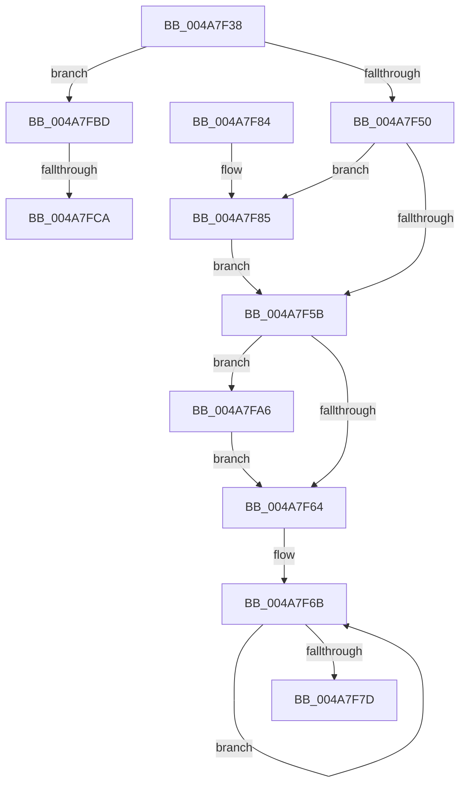

# PopDirectedDripsDiagPnpActionQueueAccountingUpdateUnsafe

- RVA: `0x004A7F38`–`0x004A7FD6` (길이 `158` bytes)
- VA: `0x00000001404A7F38`
- 실행 섹션: `.text`
- PDB 이름 있음: `예`; PDB Function 태그: `예`
- unwind 정보 RVA: `0x000DB714`
- 디코드: `35`개 명령, `158/158` bytes 표시
- 미해석 바이트: `0` (있으면 어셈블리에 `.byte`로 보존)

> 이 문서는 커널 이미지의 기계어와 PDB 기호를 분석해 생성했습니다. 4번과 5번은 함수 원형과 자료형을 바이너리 사용 방식에서 추정한 C 해석이며 원본 소스 복구 결과는 아닙니다.

## 1. Dependencies

- 직접 호출 지점: **0**; 고유 호출 대상: **0**
- 직접 호출자로 확인된 함수: **2**
- RIP 상대 이미지 참조: **10**

### Outgoing calls
- 직접 디코드된 call 명령이 없습니다.

### Direct callers
- [PopDirectedDripsDiagPnpActionQueueAccountingUpdate](PopDirectedDripsDiagPnpActionQueueAccountingUpdate_function_004A7EEC.md) at `0x004A7F11`
- [PopDirectedDripsDiagQueryAndResetPnpAccounting](PopDirectedDripsDiagQueryAndResetPnpAccounting_function_004AEF34.md) at `0x004AF0AA`
- [PopDirectedDripsDiagQueryAndResetPnpAccounting](PopDirectedDripsDiagQueryAndResetPnpAccounting_function_004AEF34.md) at `0x004AF0B6`

### Static image references
- `0x004A7F50` → RVA `0x00F0745C` (`.data`; read)
- `0x004A7F5B` → RVA `0x00F07458` (`.data`; read)
- `0x004A7F64` → RVA `0x00F075D0` (`.data`; read)
- `0x004A7F7D` → RVA `0x00F074D0` (`.data`; write)
- `0x004A7F88` → RVA `0x00F074F0` (`.data`; read)
- `0x004A7F92` → RVA `0x00F074E8` (`.data`; read)
- `0x004A7F9D` → RVA `0x00F074E8` (`.data`; write)
- `0x004A7FA6` → RVA `0x00F074E0` (`.data`; read)
- `0x004A7FAD` → RVA `0x00F074D8` (`.data`; read/write)
- `0x004A7FB4` → RVA `0x00F074E0` (`.data`; write)

## 2. Other-region calls and transfers

- 다른 실행 섹션으로 향하는 call: **0**
- call이 아닌 외부 분기/꼬리 이동: **2**
  - `0x004A7FC4` → `0x006F9C38` (`tail-transfer`)
  - `0x004A7FD1` → `0x006F9C38` (`tail-transfer`)

## 3. Assembly (complete function range)

```asm
004A7F38  45 33 DB                        xor r11d, r11d
004A7F3B  49 B9 08 00 00 00 80 F7 FF FF   movabs r9, 0xfffff78000000008
004A7F45  4D 8B 09                        mov r9, qword ptr [r9]
004A7F48  45 8D 43 1C                     lea r8d, [r11 + 0x1c]
004A7F4C  84 D2                           test dl, dl
004A7F4E  75 6D                           jne 0x1404a7fbd
004A7F50  8B 05 06 F5 A5 00               mov eax, dword ptr [rip + 0xa5f506]
004A7F56  41 3B C0                        cmp eax, r8d
004A7F59  75 2A                           jne 0x1404a7f85
004A7F5B  44 39 1D F6 F4 A5 00            cmp dword ptr [rip + 0xa5f4f6], r11d
004A7F62  75 42                           jne 0x1404a7fa6
004A7F64  48 8D 0D 65 F6 A5 00            lea rcx, [rip + 0xa5f665]
004A7F6B  8B 81 90 FE FF FF               mov eax, dword ptr [rcx - 0x170]
004A7F71  29 01                           sub dword ptr [rcx], eax
004A7F73  48 8D 49 04                     lea rcx, [rcx + 4]
004A7F77  49 83 E8 01                     sub r8, 1
004A7F7B  75 EE                           jne 0x1404a7f6b
004A7F7D  88 15 4D F5 A5 00               mov byte ptr [rip + 0xa5f54d], dl
004A7F83  C3                              ret
004A7F84  CC                              int3
004A7F85  48 8B C8                        mov rcx, rax
004A7F88  4C 8D 15 61 F5 A5 00            lea r10, [rip + 0xa5f561]
004A7F8F  49 8B C1                        mov rax, r9
004A7F92  48 2B 05 4F F5 A5 00            sub rax, qword ptr [rip + 0xa5f54f]
004A7F99  49 01 04 CA                     add qword ptr [r10 + rcx*8], rax
004A7F9D  4C 89 1D 44 F5 A5 00            mov qword ptr [rip + 0xa5f544], r11
004A7FA4  EB B5                           jmp 0x1404a7f5b
004A7FA6  4C 2B 0D 33 F5 A5 00            sub r9, qword ptr [rip + 0xa5f533]
004A7FAD  4C 01 0D 24 F5 A5 00            add qword ptr [rip + 0xa5f524], r9
004A7FB4  4C 89 1D 25 F5 A5 00            mov qword ptr [rip + 0xa5f525], r11
004A7FBB  EB A7                           jmp 0x1404a7f64
004A7FBD  44 39 05 98 F4 A5 00            cmp dword ptr [rip + 0xa5f498], r8d
004A7FC4  0F 84 6E 1C 25 00               je 0x1406f9c38
004A7FCA  4C 89 0D 17 F5 A5 00            mov qword ptr [rip + 0xa5f517], r9
004A7FD1  E9 62 1C 25 00                  jmp 0x1406f9c38
```

## 4. C-style interpretation (structured pseudocode)

```c
__int64 __fastcall PopDirectedDripsDiagPnpActionQueueAccountingUpdateUnsafe(__int64 a1, unsigned __int8 a2)
{
    __int64 result;
    __int64 v_r11;

    v_r11 = 0;
    if (a2 != 0) goto loc_004A7FBD;
    if (((unsigned int)((unsigned int)(*(unsigned int *)(v_rip + 10876166)))) != ((unsigned int)(v_r11 + 28))) goto loc_004A7F85;
loc_004A7F5B:
    if ((*(unsigned int *)(v_rip + 10876150)) != 0) goto loc_004A7FA6;
loc_004A7F64:
loc_004A7F6B:
    a3 = (v_r11 + 28) - (1);
    if (condition_is_not_equal) goto loc_004A7F6B;
    *(unsigned __int8 *)(v_rip + 10876237) = a2;
    return (unsigned int)(*(unsigned int *)(v_rip + 10876517 - 368));
loc_004A7F85:
    result = (*(unsigned __int64 *)(a4)) - (*(unsigned __int64 *)(v_rip + 10876239));
    *(unsigned __int64 *)(v_rip + 10876228) = 0;
    goto loc_004A7F5B;
loc_004A7FA6:
    a4 = (*(unsigned __int64 *)(a4)) - (*(unsigned __int64 *)(v_rip + 10876211));
    *(unsigned __int64 *)(v_rip + 10876197) = 0;
    goto loc_004A7F64;
loc_004A7FBD:
    *(unsigned __int64 *)(v_rip + 10876183) = a4;
}
```

## 5. (Beta) C Style

```c
int64_t PopDirectedDripsDiagPnpActionQueueAccountingUpdateUnsafe(int64_t Arg1, uint8_t Arg2)
{
    int64_t result;
    int64_t local_r11;

    local_r11 = 0;
    if (Arg2 != 0) goto loc_004A7FBD;
    if (((uint32_t)((uint32_t)(*(uint32_t *)(v_rip + 0xA5F506)))) != ((uint32_t)(local_r11 + 28))) goto loc_004A7F85;
loc_004A7F5B:
    if ((*(uint32_t *)(v_rip + 0xA5F4F6)) != 0) goto loc_004A7FA6;
loc_004A7F64:
loc_004A7F6B:
    a3 = (local_r11 + 28) - (1);
    if (condition_is_not_equal) goto loc_004A7F6B;
    *(uint8_t *)(v_rip + 0xA5F54D) = Arg2;
    return (uint32_t)(*(uint32_t *)(v_rip + 0xA5F665 - 0x170));
loc_004A7F85:
    result = (*(uint64_t *)(a4)) - (*(uint64_t *)(v_rip + 0xA5F54F));
    *(uint64_t *)(v_rip + 0xA5F544) = 0;
    goto loc_004A7F5B;
loc_004A7FA6:
    a4 = (*(uint64_t *)(a4)) - (*(uint64_t *)(v_rip + 0xA5F533));
    *(uint64_t *)(v_rip + 0xA5F525) = 0;
    goto loc_004A7F64;
loc_004A7FBD:
    *(uint64_t *)(v_rip + 0xA5F517) = a4;
}
```

## 6. Execution-region graph

[열기: 2D/3D 그래프와 함수 탐색 컨트롤 패널](../../../control-panel.html?section=text&rva=0x004A7F38&view=graph)

- 2D 그래프는 위에서 아래로 흐르고, 3D 그래프는 빈 공간을 드래그해 회전합니다. Shift+드래그는 이동, 휠은 확대·축소, 함수 노드 선택은 대상 보고서 이동입니다.

### Static fallback


