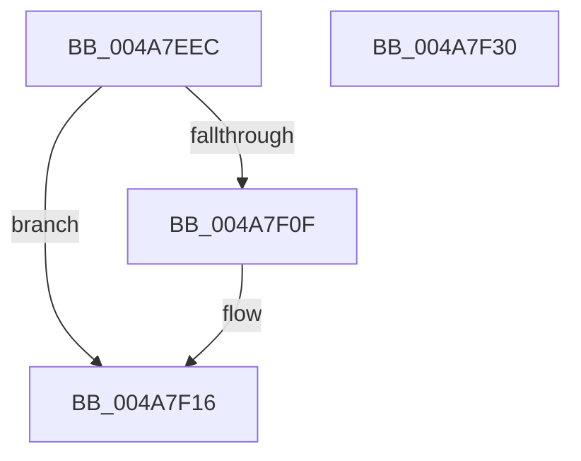

# PopDirectedDripsDiagPnpActionQueueAccountingUpdate

- RVA: `0x004A7EEC`–`0x004A7F31` (길이 `69` bytes)
- VA: `0x00000001404A7EEC`
- 실행 섹션: `.text`
- PDB 이름 있음: `예`; PDB Function 태그: `아니요`
- unwind 정보 RVA: `0x0005CAAC`
- 디코드: `19`개 명령, `69/69` bytes 표시
- 미해석 바이트: `0` (있으면 어셈블리에 `.byte`로 보존)

> 이 문서는 커널 이미지의 기계어와 PDB 기호를 분석해 생성했습니다. 4번과 5번은 함수 원형과 자료형을 바이너리 사용 방식에서 추정한 C 해석이며 원본 소스 복구 결과는 아닙니다.

## 1. Dependencies

- 직접 호출 지점: **3**; 고유 호출 대상: **3**
- 직접 호출자로 확인된 함수: **1**
- RIP 상대 이미지 참조: **2**

### Outgoing calls
- `0x004A7EFF` → [KeAcquireSpinLockRaiseToDpc](../20/KeAcquireSpinLockRaiseToDpc_function_00208470.md) (function, `0x00208470`)
- `0x004A7F11` → [PopDirectedDripsDiagPnpActionQueueAccountingUpdateUnsafe](PopDirectedDripsDiagPnpActionQueueAccountingUpdateUnsafe_function_004A7F38.md) (function, `0x004A7F38`)
- `0x004A7F20` → [KeReleaseSpinLock](../39/KeReleaseSpinLock_function_00392BA0.md) (function, `0x00392BA0`)

### Direct callers
- [PopDirectedDripsHandleResiliencyNotification](../../page/A4/PopDirectedDripsHandleResiliencyNotification_function_00A4DC3C.md) at `0x00A4DD75`

### Static image references
- `0x004A7EF6` → RVA `0x00F07450` (`.data`; read)
- `0x004A7F04` → RVA `0x00F074D0` (`.data`; read)

## 2. Other-region calls and transfers

- 다른 실행 섹션으로 향하는 call: **0**
- 별도 외부 분기/꼬리 이동을 확인하지 못했습니다.

## 3. Assembly (complete function range)

```asm
004A7EEC  48 89 5C 24 08                  mov qword ptr [rsp + 8], rbx
004A7EF1  57                              push rdi
004A7EF2  48 83 EC 20                     sub rsp, 0x20
004A7EF6  48 8D 0D 53 F5 A5 00            lea rcx, [rip + 0xa5f553]
004A7EFD  8A DA                           mov bl, dl
004A7EFF  E8 6C 05 D6 FF                  call 0x140208470
004A7F04  38 1D C6 F5 A5 00               cmp byte ptr [rip + 0xa5f5c6], bl
004A7F0A  40 8A F8                        mov dil, al
004A7F0D  74 07                           je 0x1404a7f16
004A7F0F  8A D3                           mov dl, bl
004A7F11  E8 22 00 00 00                  call 0x1404a7f38
004A7F16  40 8A D7                        mov dl, dil
004A7F19  48 8D 0D 30 F5 A5 00            lea rcx, [rip + 0xa5f530]
004A7F20  E8 7B AC EE FF                  call 0x140392ba0
004A7F25  48 8B 5C 24 30                  mov rbx, qword ptr [rsp + 0x30]
004A7F2A  48 83 C4 20                     add rsp, 0x20
004A7F2E  5F                              pop rdi
004A7F2F  C3                              ret
004A7F30  CC                              int3
```

## 4. C-style interpretation (structured pseudocode)

```c
__int64 __fastcall PopDirectedDripsDiagPnpActionQueueAccountingUpdate(__int64 a1, unsigned __int8 a2)
{
    __int64 result;
    __int64 v_rsp;
    unsigned __int64 v_stack_p8;

    v_stack_p8 = v_rbx;
    v_rsp = (v_rsp) - (32);
    result = KeAcquireSpinLockRaiseToDpc(v_rip + 10876243, a2, a3, a4);
    if ((*(unsigned __int8 *)(v_rip + 10876358)) != a2) {
        a2 = a2;
        result = PopDirectedDripsDiagPnpActionQueueAccountingUpdateUnsafe(v_rip + 10876243, a2, a3, a4);
    }
    result = KeReleaseSpinLock(v_rip + 10876208, (unsigned __int8)((unsigned __int8)(result)), a3, a4);
    v_rsp = (v_rsp) + (32);
    return result;
}
```

## 5. (Beta) C Style

```c
int64_t PopDirectedDripsDiagPnpActionQueueAccountingUpdate(int64_t Arg1, uint8_t Arg2)
{
    int64_t result;
    int64_t local_rsp;
    uint64_t v_stack_p8;

    v_stack_p8 = local_rbx;
    local_rsp = (local_rsp) - (32);
    result = KeAcquireSpinLockRaiseToDpc(v_rip + 10876243, Arg2, a3, a4);
    if ((*(uint8_t *)(v_rip + 0xA5F5C6)) != Arg2) {
        Arg2 = Arg2;
        result = PopDirectedDripsDiagPnpActionQueueAccountingUpdateUnsafe(v_rip + 10876243, Arg2, a3, a4);
    }
    result = KeReleaseSpinLock(v_rip + 10876208, (uint8_t)((uint8_t)(result)), a3, a4);
    local_rsp = (local_rsp) + (32);
    return result;
}
```

## 6. Execution-region graph

[열기: 2D/3D 그래프와 함수 탐색 컨트롤 패널](../../../control-panel.html?section=text&rva=0x004A7EEC&view=graph)

- 2D 그래프는 위에서 아래로 흐르고, 3D 그래프는 빈 공간을 드래그해 회전합니다. Shift+드래그는 이동, 휠은 확대·축소, 함수 노드 선택은 대상 보고서 이동입니다.

### Static fallback


