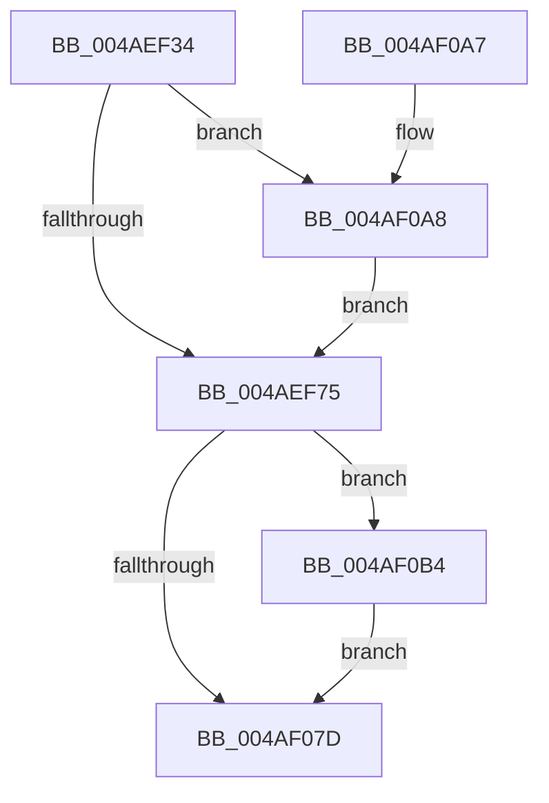

# PopDirectedDripsDiagQueryAndResetPnpAccounting

- RVA: `0x004AEF34`–`0x004AF0BD` (길이 `393` bytes)
- VA: `0x00000001404AEF34`
- 실행 섹션: `.text`
- PDB 이름 있음: `예`; PDB Function 태그: `아니요`
- unwind 정보 RVA: `0x000A67D8`
- 디코드: `92`개 명령, `393/393` bytes 표시
- 미해석 바이트: `0` (있으면 어셈블리에 `.byte`로 보존)

> 이 문서는 커널 이미지의 기계어와 PDB 기호를 분석해 생성했습니다. 4번과 5번은 함수 원형과 자료형을 바이너리 사용 방식에서 추정한 C 해석이며 원본 소스 복구 결과는 아닙니다.

## 1. Dependencies

- 직접 호출 지점: **6**; 고유 호출 대상: **4**
- 직접 호출자로 확인된 함수: **1**
- RIP 상대 이미지 참조: **12**

### Outgoing calls
- `0x004AEF5D` → [KeAcquireSpinLockRaiseToDpc](../20/KeAcquireSpinLockRaiseToDpc_function_00208470.md) (function, `0x00208470`)
- `0x004AF05F` → [memset](../6C/memset_function_006C6C40.md) (function, `0x006C6C40`)
- `0x004AF073` → [memset](../6C/memset_function_006C6C40.md) (function, `0x006C6C40`)
- `0x004AF087` → [KeReleaseSpinLock](../39/KeReleaseSpinLock_function_00392BA0.md) (function, `0x00392BA0`)
- `0x004AF0AA` → [PopDirectedDripsDiagPnpActionQueueAccountingUpdateUnsafe](PopDirectedDripsDiagPnpActionQueueAccountingUpdateUnsafe_function_004A7F38.md) (function, `0x004A7F38`)
- `0x004AF0B6` → [PopDirectedDripsDiagPnpActionQueueAccountingUpdateUnsafe](PopDirectedDripsDiagPnpActionQueueAccountingUpdateUnsafe_function_004A7F38.md) (function, `0x004A7F38`)

### Direct callers
- [PopDirectedDripsDiagNotifySessionStop](../../page/A8/PopDirectedDripsDiagNotifySessionStop_function_00A80ACC.md) at `0x00A80B44`

### Static image references
- `0x004AEF4D` → RVA `0x00F07450` (`.data`; read)
- `0x004AEF62` → RVA `0x00F074D0` (`.data`; read)
- `0x004AEF75` → RVA `0x00F074D8` (`.data`; read)
- `0x004AEF7C` → RVA `0x00F074F0` (`.data`; read)
- `0x004AEF83` → RVA `0x00F075D0` (`.data`; read)
- `0x004AEF98` → RVA `0x00F075E0` (`.data`; read)
- `0x004AEFA7` → RVA `0x00F075F0` (`.data`; read)
- `0x004AEFB2` → RVA `0x00F07600` (`.data`; read)
- `0x004AEFBD` → RVA `0x00F07610` (`.data`; read)
- `0x004AEFC8` → RVA `0x00F07620` (`.data`; read)
- `0x004AEFD3` → RVA `0x00F07630` (`.data`; read)
- `0x004AF057` → RVA `0x00F074D8` (`.data`; read/write)

## 2. Other-region calls and transfers

- 다른 실행 섹션으로 향하는 call: **0**
- 별도 외부 분기/꼬리 이동을 확인하지 못했습니다.

## 3. Assembly (complete function range)

```asm
004AEF34  48 8B C4                        mov rax, rsp
004AEF37  48 89 58 08                     mov qword ptr [rax + 8], rbx
004AEF3B  48 89 68 10                     mov qword ptr [rax + 0x10], rbp
004AEF3F  48 89 70 18                     mov qword ptr [rax + 0x18], rsi
004AEF43  48 89 78 20                     mov qword ptr [rax + 0x20], rdi
004AEF47  41 56                           push r14
004AEF49  48 83 EC 20                     sub rsp, 0x20
004AEF4D  48 8D 0D FC 84 A5 00            lea rcx, [rip + 0xa584fc]
004AEF54  49 8B D9                        mov rbx, r9
004AEF57  49 8B E8                        mov rbp, r8
004AEF5A  4C 8B F2                        mov r14, rdx
004AEF5D  E8 0E 95 D5 FF                  call 0x140208470
004AEF62  40 8A 3D 67 85 A5 00            mov dil, byte ptr [rip + 0xa58567]
004AEF69  40 8A F0                        mov sil, al
004AEF6C  40 84 FF                        test dil, dil
004AEF6F  0F 85 33 01 00 00               jne 0x1404af0a8
004AEF75  48 8B 0D 5C 85 A5 00            mov rcx, qword ptr [rip + 0xa5855c]
004AEF7C  48 8D 05 6D 85 A5 00            lea rax, [rip + 0xa5856d]
004AEF83  0F 10 05 46 86 A5 00            movups xmm0, xmmword ptr [rip + 0xa58646]
004AEF8A  49 89 0E                        mov qword ptr [r14], rcx
004AEF8D  33 D2                           xor edx, edx
004AEF8F  B9 80 00 00 00                  mov ecx, 0x80
004AEF94  0F 11 45 00                     movups xmmword ptr [rbp], xmm0
004AEF98  0F 10 0D 41 86 A5 00            movups xmm1, xmmword ptr [rip + 0xa58641]
004AEF9F  44 8D 41 F0                     lea r8d, [rcx - 0x10]
004AEFA3  0F 11 4D 10                     movups xmmword ptr [rbp + 0x10], xmm1
004AEFA7  0F 10 05 42 86 A5 00            movups xmm0, xmmword ptr [rip + 0xa58642]
004AEFAE  0F 11 45 20                     movups xmmword ptr [rbp + 0x20], xmm0
004AEFB2  0F 10 0D 47 86 A5 00            movups xmm1, xmmword ptr [rip + 0xa58647]
004AEFB9  0F 11 4D 30                     movups xmmword ptr [rbp + 0x30], xmm1
004AEFBD  0F 10 05 4C 86 A5 00            movups xmm0, xmmword ptr [rip + 0xa5864c]
004AEFC4  0F 11 45 40                     movups xmmword ptr [rbp + 0x40], xmm0
004AEFC8  0F 10 0D 51 86 A5 00            movups xmm1, xmmword ptr [rip + 0xa58651]
004AEFCF  0F 11 4D 50                     movups xmmword ptr [rbp + 0x50], xmm1
004AEFD3  0F 10 05 56 86 A5 00            movups xmm0, xmmword ptr [rip + 0xa58656]
004AEFDA  0F 11 45 60                     movups xmmword ptr [rbp + 0x60], xmm0
004AEFDE  0F 10 00                        movups xmm0, xmmword ptr [rax]
004AEFE1  0F 11 03                        movups xmmword ptr [rbx], xmm0
004AEFE4  0F 10 48 10                     movups xmm1, xmmword ptr [rax + 0x10]
004AEFE8  0F 11 4B 10                     movups xmmword ptr [rbx + 0x10], xmm1
004AEFEC  0F 10 40 20                     movups xmm0, xmmword ptr [rax + 0x20]
004AEFF0  0F 11 43 20                     movups xmmword ptr [rbx + 0x20], xmm0
004AEFF4  0F 10 48 30                     movups xmm1, xmmword ptr [rax + 0x30]
004AEFF8  0F 11 4B 30                     movups xmmword ptr [rbx + 0x30], xmm1
004AEFFC  0F 10 40 40                     movups xmm0, xmmword ptr [rax + 0x40]
004AF000  0F 11 43 40                     movups xmmword ptr [rbx + 0x40], xmm0
004AF004  0F 10 48 50                     movups xmm1, xmmword ptr [rax + 0x50]
004AF008  0F 11 4B 50                     movups xmmword ptr [rbx + 0x50], xmm1
004AF00C  0F 10 40 60                     movups xmm0, xmmword ptr [rax + 0x60]
004AF010  0F 11 43 60                     movups xmmword ptr [rbx + 0x60], xmm0
004AF014  48 03 D9                        add rbx, rcx
004AF017  0F 10 40 70                     movups xmm0, xmmword ptr [rax + 0x70]
004AF01B  48 03 C1                        add rax, rcx
004AF01E  48 8D 0D AB 85 A5 00            lea rcx, [rip + 0xa585ab]
004AF025  0F 11 43 F0                     movups xmmword ptr [rbx - 0x10], xmm0
004AF029  0F 10 08                        movups xmm1, xmmword ptr [rax]
004AF02C  0F 11 0B                        movups xmmword ptr [rbx], xmm1
004AF02F  0F 10 40 10                     movups xmm0, xmmword ptr [rax + 0x10]
004AF033  0F 11 43 10                     movups xmmword ptr [rbx + 0x10], xmm0
004AF037  0F 10 48 20                     movups xmm1, xmmword ptr [rax + 0x20]
004AF03B  0F 11 4B 20                     movups xmmword ptr [rbx + 0x20], xmm1
004AF03F  0F 10 40 30                     movups xmm0, xmmword ptr [rax + 0x30]
004AF043  0F 11 43 30                     movups xmmword ptr [rbx + 0x30], xmm0
004AF047  0F 10 48 40                     movups xmm1, xmmword ptr [rax + 0x40]
004AF04B  0F 11 4B 40                     movups xmmword ptr [rbx + 0x40], xmm1
004AF04F  0F 10 40 50                     movups xmm0, xmmword ptr [rax + 0x50]
004AF053  0F 11 43 50                     movups xmmword ptr [rbx + 0x50], xmm0
004AF057  48 83 25 79 84 A5 00 00         and qword ptr [rip + 0xa58479], 0
004AF05F  E8 DC 7B 21 00                  call 0x1406c6c40
004AF064  33 D2                           xor edx, edx
004AF066  48 8D 0D 83 84 A5 00            lea rcx, [rip + 0xa58483]
004AF06D  41 B8 E0 00 00 00               mov r8d, 0xe0
004AF073  E8 C8 7B 21 00                  call 0x1406c6c40
004AF078  40 84 FF                        test dil, dil
004AF07B  75 37                           jne 0x1404af0b4
004AF07D  40 8A D6                        mov dl, sil
004AF080  48 8D 0D C9 83 A5 00            lea rcx, [rip + 0xa583c9]
004AF087  E8 14 3B EE FF                  call 0x140392ba0
004AF08C  48 8B 5C 24 30                  mov rbx, qword ptr [rsp + 0x30]
004AF091  48 8B 6C 24 38                  mov rbp, qword ptr [rsp + 0x38]
004AF096  48 8B 74 24 40                  mov rsi, qword ptr [rsp + 0x40]
004AF09B  48 8B 7C 24 48                  mov rdi, qword ptr [rsp + 0x48]
004AF0A0  48 83 C4 20                     add rsp, 0x20
004AF0A4  41 5E                           pop r14
004AF0A6  C3                              ret
004AF0A7  CC                              int3
004AF0A8  33 D2                           xor edx, edx
004AF0AA  E8 89 8E FF FF                  call 0x1404a7f38
004AF0AF  E9 C1 FE FF FF                  jmp 0x1404aef75
004AF0B4  B2 01                           mov dl, 1
004AF0B6  E8 7D 8E FF FF                  call 0x1404a7f38
004AF0BB  EB C0                           jmp 0x1404af07d
```

## 4. C-style interpretation (structured pseudocode)

```c
__int64 __fastcall PopDirectedDripsDiagQueryAndResetPnpAccounting(__int64 a1, __int64 a2, __int64 a3, __int64 a4)
{
    __int64 result;
    __int64 v_rbx;
    __int64 v_rsp;
    unsigned __int64 v_stack_p10;
    unsigned __int64 v_stack_p18;
    unsigned __int64 v_stack_p20;
    unsigned __int64 v_stack_p8;

    *(unsigned __int64 *)(v_rsp + 8) = v_rbx;
    *(unsigned __int64 *)(v_rsp + 16) = v_rbp;
    *(unsigned __int64 *)(v_rsp + 24) = v_rsi;
    *(unsigned __int64 *)(v_rsp + 32) = v_rdi;
    v_rsp = (v_rsp) - (32);
    result = KeAcquireSpinLockRaiseToDpc(v_rip + 10847484, a2, a3, a4);
    if ((unsigned __int8)(*(unsigned __int8 *)(v_rip + 10847591)) != 0) goto loc_004AF0A8;
loc_004AEF75:
    *(unsigned __int64 *)(a2) = *(unsigned __int64 *)(v_rip + 10847580);
    a2 = 0;
    *(unsigned __int64 *)(a3) = v_xmm0;
    *(unsigned __int64 *)(a3 + 16) = v_xmm1;
    *(unsigned __int64 *)(a3 + 32) = v_xmm0;
    *(unsigned __int64 *)(a3 + 48) = v_xmm1;
    *(unsigned __int64 *)(a3 + 64) = v_xmm0;
    *(unsigned __int64 *)(a3 + 80) = v_xmm1;
    *(unsigned __int64 *)(a3 + 96) = v_xmm0;
    *(unsigned __int64 *)(a4) = v_xmm0;
    *(unsigned __int64 *)(a4 + 16) = v_xmm1;
    *(unsigned __int64 *)(a4 + 32) = v_xmm0;
    *(unsigned __int64 *)(a4 + 48) = v_xmm1;
    *(unsigned __int64 *)(a4 + 64) = v_xmm0;
    *(unsigned __int64 *)(a4 + 80) = v_xmm1;
    *(unsigned __int64 *)(a4 + 96) = v_xmm0;
    v_rbx = (a4) + (128);
    result = (v_rip + 10847597) + (128);
    *(unsigned __int64 *)(v_rbx - 16) = v_xmm0;
    *(unsigned __int64 *)(v_rbx) = v_xmm1;
    *(unsigned __int64 *)(v_rbx + 16) = v_xmm0;
    *(unsigned __int64 *)(v_rbx + 32) = v_xmm1;
    *(unsigned __int64 *)(v_rbx + 48) = v_xmm0;
    *(unsigned __int64 *)(v_rbx + 64) = v_xmm1;
    *(unsigned __int64 *)(v_rbx + 80) = v_xmm0;
    result = memset(v_rip + 10847659, a2, 128 - 16, a4);
    a2 = 0;
    result = memset(v_rip + 10847363, a2, 224, a4);
    if ((unsigned __int8)(*(unsigned __int8 *)(v_rip + 10847591)) != 0) goto loc_004AF0B4;
loc_004AF07D:
    result = KeReleaseSpinLock(v_rip + 10847177, (unsigned __int8)((unsigned __int8)(result)), 224, a4);
    v_rsp = (v_rsp) + (32);
    return result;
loc_004AF0A8:
    a2 = 0;
    result = PopDirectedDripsDiagPnpActionQueueAccountingUpdateUnsafe(v_rip + 10847177, a2, 224, a4);
    goto loc_004AEF75;
loc_004AF0B4:
    result = PopDirectedDripsDiagPnpActionQueueAccountingUpdateUnsafe(v_rip + 10847177, 1, 224, a4);
    goto loc_004AF07D;
}
```

## 5. (Beta) C Style

```c
int64_t PopDirectedDripsDiagQueryAndResetPnpAccounting(int64_t Arg1, void *Arg2, void *Arg3, void *Arg4)
{
    uint8_t *arg2 = (uint8_t *)Arg2;
    uint8_t *arg3 = (uint8_t *)Arg3;
    uint8_t *arg4 = (uint8_t *)Arg4;

    int64_t result;
    int64_t local_rbx;
    int64_t local_rsp;
    uint64_t v_stack_p10;
    uint64_t v_stack_p18;
    uint64_t v_stack_p20;
    uint64_t v_stack_p8;

    *(uint64_t *)(local_rsp + 0x8) = local_rbx;
    *(uint64_t *)(local_rsp + 0x10) = local_rbp;
    *(uint64_t *)(local_rsp + 0x18) = local_rsi;
    *(uint64_t *)(local_rsp + 0x20) = local_rdi;
    local_rsp = (local_rsp) - (32);
    result = KeAcquireSpinLockRaiseToDpc(v_rip + 10847484, Arg2, Arg3, Arg4);
    if ((uint8_t)(*(uint8_t *)(v_rip + 0xA58567)) != 0) goto loc_004AF0A8;
loc_004AEF75:
    *(uint64_t *)(arg2) = *(uint64_t *)(v_rip + 0xA5855C);
    Arg2 = 0;
    *(uint64_t *)(arg3) = v_xmm0;
    *(uint64_t *)(arg3 + 0x10) = v_xmm1;
    *(uint64_t *)(arg3 + 0x20) = v_xmm0;
    *(uint64_t *)(arg3 + 0x30) = v_xmm1;
    *(uint64_t *)(arg3 + 0x40) = v_xmm0;
    *(uint64_t *)(arg3 + 0x50) = v_xmm1;
    *(uint64_t *)(arg3 + 0x60) = v_xmm0;
    *(uint64_t *)(arg4) = v_xmm0;
    *(uint64_t *)(arg4 + 0x10) = v_xmm1;
    *(uint64_t *)(arg4 + 0x20) = v_xmm0;
    *(uint64_t *)(arg4 + 0x30) = v_xmm1;
    *(uint64_t *)(arg4 + 0x40) = v_xmm0;
    *(uint64_t *)(arg4 + 0x50) = v_xmm1;
    *(uint64_t *)(arg4 + 0x60) = v_xmm0;
    local_rbx = (Arg4) + (128);
    result = (v_rip + 10847597) + (128);
    *(uint64_t *)(local_rbx - 0x10) = v_xmm0;
    *(uint64_t *)(local_rbx) = v_xmm1;
    *(uint64_t *)(local_rbx + 0x10) = v_xmm0;
    *(uint64_t *)(local_rbx + 0x20) = v_xmm1;
    *(uint64_t *)(local_rbx + 0x30) = v_xmm0;
    *(uint64_t *)(local_rbx + 0x40) = v_xmm1;
    *(uint64_t *)(local_rbx + 0x50) = v_xmm0;
    result = memset(v_rip + 10847659, Arg2, 128 - 16, Arg4);
    Arg2 = 0;
    result = memset(v_rip + 10847363, Arg2, 224, Arg4);
    if ((uint8_t)(*(uint8_t *)(v_rip + 0xA58567)) != 0) goto loc_004AF0B4;
loc_004AF07D:
    result = KeReleaseSpinLock(v_rip + 10847177, (uint8_t)((uint8_t)(result)), 224, Arg4);
    local_rsp = (local_rsp) + (32);
    return result;
loc_004AF0A8:
    Arg2 = 0;
    result = PopDirectedDripsDiagPnpActionQueueAccountingUpdateUnsafe(v_rip + 10847177, Arg2, 224, Arg4);
    goto loc_004AEF75;
loc_004AF0B4:
    result = PopDirectedDripsDiagPnpActionQueueAccountingUpdateUnsafe(v_rip + 10847177, 1, 224, Arg4);
    goto loc_004AF07D;
}
```

### 관측된 메모리 오프셋

구조체 형식이 확인되지 않은 접근은 인자 기준의 오프셋으로만 기록했습니다.

| 기준 인자 | 오프셋 표현 | 폭 (bit) | 접근 |
|---|---:|---:|---|
| `Arg2` | `+ 0x0` | `64` | `W` |
| `Arg3` | `+ 0x0` | `128` | `R` |
| `Arg3` | `+ 0x10` | `128` | `R` |
| `Arg3` | `+ 0x20` | `128` | `R` |
| `Arg3` | `+ 0x30` | `128` | `R` |
| `Arg3` | `+ 0x40` | `128` | `R` |
| `Arg3` | `+ 0x50` | `128` | `R` |
| `Arg3` | `+ 0x60` | `128` | `R` |
| `Arg4` | `- 0x10` | `128` | `R` |
| `Arg4` | `+ 0x0` | `128` | `R` |
| `Arg4` | `+ 0x10` | `128` | `R` |
| `Arg4` | `+ 0x20` | `128` | `R` |
| `Arg4` | `+ 0x30` | `128` | `R` |
| `Arg4` | `+ 0x40` | `128` | `R` |
| `Arg4` | `+ 0x50` | `128` | `R` |
| `Arg4` | `+ 0x60` | `128` | `R` |

## 6. Execution-region graph

[열기: 2D/3D 그래프와 함수 탐색 컨트롤 패널](../../../control-panel.html?section=text&rva=0x004AEF34&view=graph)

- 2D 그래프는 위에서 아래로 흐르고, 3D 그래프는 빈 공간을 드래그해 회전합니다. Shift+드래그는 이동, 휠은 확대·축소, 함수 노드 선택은 대상 보고서 이동입니다.

### Static fallback


