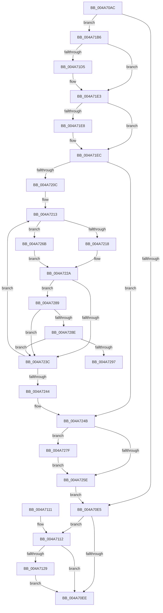

# PopDirectedDripsDiagTraceNotifyDevices

- RVA: `0x004A70AC`–`0x004A72AB` (길이 `511` bytes)
- VA: `0x00000001404A70AC`
- 실행 섹션: `.text`
- PDB 이름 있음: `예`; PDB Function 태그: `예`
- unwind 정보 RVA: `0x000B6FA0`
- 디코드: `127`개 명령, `511/511` bytes 표시
- 미해석 바이트: `0` (있으면 어셈블리에 `.byte`로 보존)

> 이 문서는 커널 이미지의 기계어와 PDB 기호를 분석해 생성했습니다. 4번과 5번은 함수 원형과 자료형을 바이너리 사용 방식에서 추정한 C 해석이며 원본 소스 복구 결과는 아닙니다.

## 1. Dependencies

- 직접 호출 지점: **7**; 고유 호출 대상: **7**
- 직접 호출자로 확인된 함수: **2**
- RIP 상대 이미지 참조: **10**

### Outgoing calls
- `0x004A70F5` → [_security_check_cookie](../6A/_security_check_cookie_function_006AC640.md) (function, `0x006AC640`)
- `0x004A7120` → [EtwEventEnabled](../39/EtwEventEnabled_function_00392450.md) (function, `0x00392450`)
- `0x004A71AC` → [EtwWriteEx](../25/EtwWriteEx_function_0025F0D0.md) (function, `0x0025F0D0`)
- `0x004A71C5` → [KeAbPreAcquire](../21/KeAbPreAcquire_function_00210230.md) (function, `0x00210230`)
- `0x004A71DE` → [ExfAcquirePushLockExclusiveEx](../20/ExfAcquirePushLockExclusiveEx_function_0020FC90.md) (function, `0x0020FC90`)
- `0x004A7261` → [KeAbPostRelease](../2E/KeAbPostRelease_function_002E1600.md) (function, `0x002E1600`)
- `0x004A7282` → [ExfTryToWakePushLock](../26/ExfTryToWakePushLock_function_00265DD0.md) (function, `0x00265DD0`)

### Direct callers
- [PopDirectedDripsSuspendDevices](../../page/A4/PopDirectedDripsSuspendDevices_function_00A4D474.md) at `0x00A4D56D`
- [PopDirectedDripsResumeDevices](../../page/A4/PopDirectedDripsResumeDevices_function_00A4DB10.md) at `0x00A4DB9B`

### Static image references
- `0x004A70CC` → RVA `0x00E0A740` (`.data`; read)
- `0x004A70E5` → RVA `0x00E67858` (`.data`; read)
- `0x004A7112` → RVA `0x00F0B408` (`.data`; read)
- `0x004A7119` → RVA `0x0001BC58` (`.rdata`; read)
- `0x004A712D` → RVA `0x00F0B6B0` (`.data`; read)
- `0x004A71B6` → RVA `0x00F07650` (`.data`; read)
- `0x004A71F6` → RVA `0x00F07420` (`.data`; read)
- `0x004A720C` → RVA `0x000294D8` (`.rdata`; read)
- `0x004A7231` → RVA `0x00F07648` (`.data`; read)
- `0x004A724F` → RVA `0x00F07650` (`.data`; read/write)

## 2. Other-region calls and transfers

- 다른 실행 섹션으로 향하는 call: **0**
- call이 아닌 외부 분기/꼬리 이동: **1**
  - `0x004A72A6` → [sub_006F9A5C](../6F/Unknown_function_006F9A5C.md) (`tail-transfer`)

## 3. Assembly (complete function range)

```asm
004A70AC  48 8B C4                        mov rax, rsp
004A70AF  48 89 58 08                     mov qword ptr [rax + 8], rbx
004A70B3  4C 89 40 18                     mov qword ptr [rax + 0x18], r8
004A70B7  89 50 10                        mov dword ptr [rax + 0x10], edx
004A70BA  55                              push rbp
004A70BB  56                              push rsi
004A70BC  57                              push rdi
004A70BD  41 54                           push r12
004A70BF  41 57                           push r15
004A70C1  48 8D 68 A1                     lea rbp, [rax - 0x5f]
004A70C5  48 81 EC A0 00 00 00            sub rsp, 0xa0
004A70CC  48 8B 05 6D 36 96 00            mov rax, qword ptr [rip + 0x96366d]
004A70D3  48 33 C4                        xor rax, rsp
004A70D6  48 89 45 27                     mov qword ptr [rbp + 0x27], rax
004A70DA  0F B6 F9                        movzx edi, cl
004A70DD  85 D2                           test edx, edx
004A70DF  0F 89 D1 00 00 00               jns 0x1404a71b6
004A70E5  80 3D 6C 07 9C 00 00            cmp byte ptr [rip + 0x9c076c], 0
004A70EC  75 24                           jne 0x1404a7112
004A70EE  48 8B 4D 27                     mov rcx, qword ptr [rbp + 0x27]
004A70F2  48 33 CC                        xor rcx, rsp
004A70F5  E8 46 55 20 00                  call 0x1406ac640
004A70FA  48 8B 9C 24 D0 00 00 00         mov rbx, qword ptr [rsp + 0xd0]
004A7102  48 81 C4 A0 00 00 00            add rsp, 0xa0
004A7109  41 5F                           pop r15
004A710B  41 5C                           pop r12
004A710D  5F                              pop rdi
004A710E  5E                              pop rsi
004A710F  5D                              pop rbp
004A7110  C3                              ret
004A7111  CC                              int3
004A7112  48 8B 0D EF 42 A6 00            mov rcx, qword ptr [rip + 0xa642ef]
004A7119  48 8D 15 38 4B B7 FF            lea rdx, [rip - 0x48b4c8]
004A7120  E8 2B B3 EE FF                  call 0x140392450
004A7125  84 C0                           test al, al
004A7127  74 C5                           je 0x1404a70ee
004A7129  83 65 F3 00                     and dword ptr [rbp - 0xd], 0
004A712D  48 8D 05 7C 45 A6 00            lea rax, [rip + 0xa6457c]
004A7134  83 65 03 00                     and dword ptr [rbp + 3], 0
004A7138  48 8D 15 19 4B B7 FF            lea rdx, [rip - 0x48b4e7]
004A713F  83 65 13 00                     and dword ptr [rbp + 0x13], 0
004A7143  45 33 C9                        xor r9d, r9d
004A7146  83 65 23 00                     and dword ptr [rbp + 0x23], 0
004A714A  45 33 C0                        xor r8d, r8d
004A714D  48 8B 0D B4 42 A6 00            mov rcx, qword ptr [rip + 0xa642b4]
004A7154  48 89 45 E7                     mov qword ptr [rbp - 0x19], rax
004A7158  48 8D 45 D7                     lea rax, [rbp - 0x29]
004A715C  48 89 45 F7                     mov qword ptr [rbp - 9], rax
004A7160  48 8D 45 6F                     lea rax, [rbp + 0x6f]
004A7164  48 89 45 07                     mov qword ptr [rbp + 7], rax
004A7168  48 8D 45 77                     lea rax, [rbp + 0x77]
004A716C  48 89 45 17                     mov qword ptr [rbp + 0x17], rax
004A7170  48 8D 45 E7                     lea rax, [rbp - 0x19]
004A7174  48 89 44 24 38                  mov qword ptr [rsp + 0x38], rax
004A7179  C7 44 24 30 04 00 00 00         mov dword ptr [rsp + 0x30], 4
004A7181  48 83 64 24 28 00               and qword ptr [rsp + 0x28], 0
004A7187  48 83 64 24 20 00               and qword ptr [rsp + 0x20], 0
004A718D  89 7D D7                        mov dword ptr [rbp - 0x29], edi
004A7190  C7 45 EF 01 00 00 00            mov dword ptr [rbp - 0x11], 1
004A7197  C7 45 FF 04 00 00 00            mov dword ptr [rbp - 1], 4
004A719E  C7 45 0F 04 00 00 00            mov dword ptr [rbp + 0xf], 4
004A71A5  C7 45 1F 08 00 00 00            mov dword ptr [rbp + 0x1f], 8
004A71AC  E8 1F 7F DB FF                  call 0x14025f0d0
004A71B1  E9 38 FF FF FF                  jmp 0x1404a70ee
004A71B6  4C 8D 3D 93 04 A6 00            lea r15, [rip + 0xa60493]
004A71BD  45 33 C0                        xor r8d, r8d
004A71C0  49 8B CF                        mov rcx, r15
004A71C3  33 D2                           xor edx, edx
004A71C5  E8 66 90 D6 FF                  call 0x140210230
004A71CA  F0 49 0F BA 2F 00               lock bts qword ptr [r15], 0
004A71D0  48 8B D8                        mov rbx, rax
004A71D3  73 0E                           jae 0x1404a71e3
004A71D5  4D 8B C7                        mov r8, r15
004A71D8  48 8B D0                        mov rdx, rax
004A71DB  49 8B CF                        mov rcx, r15
004A71DE  E8 AD 8A D6 FF                  call 0x14020fc90
004A71E3  48 85 DB                        test rbx, rbx
004A71E6  74 04                           je 0x1404a71ec
004A71E8  C6 43 0A 01                     mov byte ptr [rbx + 0xa], 1
004A71EC  48 BE 08 00 00 00 80 F7 FF FF   movabs rsi, 0xfffff78000000008
004A71F6  4C 8D 25 23 02 A6 00            lea r12, [rip + 0xa60223]
004A71FD  48 8B 36                        mov rsi, qword ptr [rsi]
004A7200  48 8B 15 19 02 A6 00            mov rdx, qword ptr [rip + 0xa60219]
004A7207  49 3B D4                        cmp rdx, r12
004A720A  74 3F                           je 0x1404a724b
004A720C  4C 8D 3D C5 22 B8 FF            lea r15, [rip - 0x47dd3b]
004A7213  40 84 FF                        test dil, dil
004A7216  74 53                           je 0x1404a726b
004A7218  48 8B 4A 30                     mov rcx, qword ptr [rdx + 0x30]
004A721C  B8 38 00 00 00                  mov eax, 0x38
004A7221  48 83 62 30 00                  and qword ptr [rdx + 0x30], 0
004A7226  44 8D 40 18                     lea r8d, [rax + 0x18]
004A722A  4C 03 C2                        add r8, rdx
004A722D  4C 8D 0C 10                     lea r9, [rax + rdx]
004A7231  8B 05 11 04 A6 00               mov eax, dword ptr [rip + 0xa60411]
004A7237  39 42 24                        cmp dword ptr [rdx + 0x24], eax
004A723A  74 4D                           je 0x1404a7289
004A723C  48 8B 12                        mov rdx, qword ptr [rdx]
004A723F  49 3B D4                        cmp rdx, r12
004A7242  75 CF                           jne 0x1404a7213
004A7244  4C 8D 3D 05 04 A6 00            lea r15, [rip + 0xa60405]
004A724B  48 83 C8 FF                     or rax, 0xffffffffffffffff
004A724F  F0 48 0F C1 05 F8 03 A6 00      lock xadd qword ptr [rip + 0xa603f8], rax
004A7258  24 06                           and al, 6
004A725A  3C 02                           cmp al, 2
004A725C  74 21                           je 0x1404a727f
004A725E  49 8B CF                        mov rcx, r15
004A7261  E8 9A A3 E3 FF                  call 0x1402e1600
004A7266  E9 7A FE FF FF                  jmp 0x1404a70e5
004A726B  48 8B 4A 78                     mov rcx, qword ptr [rdx + 0x78]
004A726F  B8 80 00 00 00                  mov eax, 0x80
004A7274  48 83 62 78 00                  and qword ptr [rdx + 0x78], 0
004A7279  44 8D 40 18                     lea r8d, [rax + 0x18]
004A727D  EB AB                           jmp 0x1404a722a
004A727F  49 8B CF                        mov rcx, r15
004A7282  E8 49 EB DB FF                  call 0x140265dd0
004A7287  EB D5                           jmp 0x1404a725e
004A7289  48 85 C9                        test rcx, rcx
004A728C  74 AE                           je 0x1404a723c
004A728E  F7 42 28 00 01 00 00            test dword ptr [rdx + 0x28], 0x100
004A7295  75 A5                           jne 0x1404a723c
004A7297  4C 8B DE                        mov r11, rsi
004A729A  45 33 D2                        xor r10d, r10d
004A729D  4C 2B D9                        sub r11, rcx
004A72A0  49 8B DF                        mov rbx, r15
004A72A3  49 2B D8                        sub rbx, r8
004A72A6  E9 B1 27 25 00                  jmp 0x1406f9a5c
```

## 4. C-style interpretation (structured pseudocode)

```c
__int64 __fastcall PopDirectedDripsDiagTraceNotifyDevices(unsigned __int8 a1, int a2, __int64 a3, int a4)
{
    __int64 result;
    __int64 v_r10;
    __int64 v_r11;
    __int64 v_rbx;
    __int64 v_rsp;
    unsigned __int64 v_stack_p20;
    unsigned __int64 v_stack_p28;
    unsigned int v_stack_p30;
    unsigned __int64 v_stack_p38;
    unsigned __int64 v_stack_p8;

    *(unsigned __int64 *)(v_rsp + 8) = v_rbx;
    *(unsigned __int64 *)(v_rsp + 24) = a3;
    *(unsigned int *)(v_rsp + 16) = a2;
    v_rsp = (v_rsp) - (160);
    result = (*(unsigned __int64 *)(v_rip + 9844333)) ^ (v_rsp);
    *(unsigned __int64 *)(v_rsp - 95 + 39) = result;
    if (!sign_flag) goto loc_004A71B6;
loc_004A70E5:
    if ((*(unsigned __int8 *)(v_rip + 10225516)) != 0) goto loc_004A7112;
loc_004A70EE:
    a1 = (*(unsigned __int64 *)(v_rsp - 95 + 39)) ^ (v_rsp);
    result = _security_check_cookie(a1, a2, a3, a4);
    v_rsp = (v_rsp) + (160);
    return result;
loc_004A7112:
    result = EtwEventEnabled(*(unsigned __int64 *)(v_rip + 10896111), v_rip - 4764872, a3, a4);
    if ((unsigned __int8)(result) == 0) goto loc_004A70EE;
    a4 = 0;
    a3 = 0;
    *(unsigned __int64 *)(v_rsp - 95 - 25) = v_rip + 10896764;
    *(unsigned __int64 *)(v_rsp - 95 - 9) = v_rsp - 95 - 41;
    *(unsigned __int64 *)(v_rsp - 95 + 7) = v_rsp - 95 + 111;
    *(unsigned __int64 *)(v_rsp - 95 + 23) = v_rsp - 95 + 119;
    v_stack_p38 = v_rsp - 95 - 25;
    v_stack_p30 = 4;
    *(unsigned int *)(v_rsp - 95 - 41) = a1;
    *(unsigned int *)(v_rsp - 95 - 17) = 1;
    *(unsigned int *)(v_rsp - 95 - 1) = 4;
    *(unsigned int *)(v_rsp - 95 + 15) = 4;
    *(unsigned int *)(v_rsp - 95 + 31) = 8;
    result = EtwWriteEx(*(unsigned __int64 *)(v_rip + 10896052), v_rip - 4764903, a3, a4);
    goto loc_004A70EE;
loc_004A71B6:
    a3 = 0;
    a2 = 0;
    result = KeAbPreAcquire(v_rip + 10880147, a2, a3, a4);
    if (!(condition_is_above_or_equal)) {
        a3 = v_rip + 10880147;
        a2 = result;
        a1 = v_rip + 10880147;
        result = ExfAcquirePushLockExclusiveEx(a1, a2, a3, a4);
    }
    if (result != 0) {
        *(unsigned __int8 *)(result + 10) = 1;
    }
    if ((*(unsigned __int64 *)(v_rip + 10879513)) == (v_rip + 10879523)) goto loc_004A724B;
loc_004A7213:
    if (a1 == 0) goto loc_004A726B;
loc_004A722A:
    a3 = (56 + 24) + (*(unsigned __int64 *)(v_rip + 10879513));
    if ((*(unsigned int *)(*(unsigned __int64 *)(v_rip + 10879513) + 36)) == ((unsigned int)((unsigned int)(*(unsigned int *)(v_rip + 10880017))))) goto loc_004A7289;
loc_004A723C:
    if ((*(unsigned __int64 *)(*(unsigned __int64 *)(v_rip + 10879513))) != (v_rip + 10879523)) goto loc_004A7213;
loc_004A724B:
    result = ((unsigned int)(*(unsigned int *)(v_rip + 10880017))) | (-1);
    result = (unsigned __int8)((result) & (6));
    if (((unsigned __int8)(result)) == 2) goto loc_004A727F;
loc_004A725E:
    result = KeAbPostRelease(v_rip + 10880005, *(unsigned __int64 *)(*(unsigned __int64 *)(v_rip + 10879513)), a3, 56 + *(unsigned __int64 *)(v_rip + 10879513) * 1);
    goto loc_004A70E5;
loc_004A726B:
    goto loc_004A722A;
loc_004A727F:
    result = ExfTryToWakePushLock(v_rip + 10880005, *(unsigned __int64 *)(*(unsigned __int64 *)(v_rip + 10879513)), 128 + 24, 56 + *(unsigned __int64 *)(v_rip + 10879513) * 1);
    goto loc_004A725E;
loc_004A7289:
    if (v_rip + 10880005 == 0) goto loc_004A723C;
    if (((*(unsigned int *)(*(unsigned __int64 *)(*(unsigned __int64 *)(v_rip + 10879513)) + 40)) & (256)) != 0) goto loc_004A723C;
    v_r10 = 0;
    v_r11 = (*(unsigned __int64 *)(v_rsi)) - (v_rip + 10880005);
    v_rbx = (v_rip + 10880005) - (128 + 24);
}
```

## 5. (Beta) C Style

```c
int64_t PopDirectedDripsDiagTraceNotifyDevices(uint8_t Arg1, int32_t Arg2, int64_t Arg3, int32_t Arg4)
{
    int64_t result;
    int64_t local_r10;
    int64_t local_r11;
    int64_t local_rbx;
    int64_t local_rsp;
    uint64_t v_stack_p20;
    uint64_t v_stack_p28;
    uint32_t v_stack_p30;
    uint64_t v_stack_p38;
    uint64_t v_stack_p8;

    *(uint64_t *)(local_rsp + 0x8) = local_rbx;
    *(uint64_t *)(local_rsp + 0x18) = Arg3;
    *(uint32_t *)(local_rsp + 0x10) = Arg2;
    local_rsp = (local_rsp) - (160);
    result = (*(uint64_t *)(v_rip + 0x96366D)) ^ (local_rsp);
    *(uint64_t *)(local_rsp - 0x5F + 0x27) = result;
    if (!sign_flag) goto loc_004A71B6;
loc_004A70E5:
    if ((*(uint8_t *)(v_rip + 0x9C076C)) != 0) goto loc_004A7112;
loc_004A70EE:
    Arg1 = (*(uint64_t *)(local_rsp - 0x5F + 0x27)) ^ (local_rsp);
    result = _security_check_cookie(Arg1, Arg2, Arg3, Arg4);
    local_rsp = (local_rsp) + (160);
    return result;
loc_004A7112:
    result = EtwEventEnabled(*(uint64_t *)(v_rip + 0xA642EF), v_rip - 4764872, Arg3, Arg4);
    if ((uint8_t)(result) == 0) goto loc_004A70EE;
    Arg4 = 0;
    Arg3 = 0;
    *(uint64_t *)(local_rsp - 0x5F - 0x19) = v_rip + 10896764;
    *(uint64_t *)(local_rsp - 0x5F - 0x9) = local_rsp - 95 - 41;
    *(uint64_t *)(local_rsp - 0x5F + 0x7) = local_rsp - 95 + 111;
    *(uint64_t *)(local_rsp - 0x5F + 0x17) = local_rsp - 95 + 119;
    v_stack_p38 = local_rsp - 95 - 25;
    v_stack_p30 = 4;
    *(uint32_t *)(local_rsp - 0x5F - 0x29) = Arg1;
    *(uint32_t *)(local_rsp - 0x5F - 0x11) = 1;
    *(uint32_t *)(local_rsp - 0x5F - 0x1) = 4;
    *(uint32_t *)(local_rsp - 0x5F + 0xF) = 4;
    *(uint32_t *)(local_rsp - 0x5F + 0x1F) = 8;
    result = EtwWriteEx(*(uint64_t *)(v_rip + 0xA642B4), v_rip - 4764903, Arg3, Arg4);
    goto loc_004A70EE;
loc_004A71B6:
    Arg3 = 0;
    Arg2 = 0;
    result = KeAbPreAcquire(v_rip + 10880147, Arg2, Arg3, Arg4);
    if (!(condition_is_above_or_equal)) {
        Arg3 = v_rip + 10880147;
        Arg2 = result;
        Arg1 = v_rip + 10880147;
        result = ExfAcquirePushLockExclusiveEx(Arg1, Arg2, Arg3, Arg4);
    }
    if (result != 0) {
        *(uint8_t *)(result + 0xA) = 1;
    }
    if ((*(uint64_t *)(v_rip + 0xA60219)) == (v_rip + 10879523)) goto loc_004A724B;
loc_004A7213:
    if (Arg1 == 0) goto loc_004A726B;
loc_004A722A:
    Arg3 = (56 + 24) + (*(uint64_t *)(v_rip + 0xA60219));
    if ((*(uint32_t *)(*(uint64_t *)(v_rip + 0xA60219) + 0x24)) == ((uint32_t)((uint32_t)(*(uint32_t *)(v_rip + 0xA60411))))) goto loc_004A7289;
loc_004A723C:
    if ((*(uint64_t *)(*(uint64_t *)(v_rip + 0xA60219))) != (v_rip + 10879523)) goto loc_004A7213;
loc_004A724B:
    result = ((uint32_t)(*(uint32_t *)(v_rip + 0xA60411))) | (-1);
    result = (uint8_t)((result) & (6));
    if (((uint8_t)(result)) == 2) goto loc_004A727F;
loc_004A725E:
    result = KeAbPostRelease(v_rip + 10880005, *(uint64_t *)(*(uint64_t *)(v_rip + 0xA60219)), Arg3, 56 + *(uint64_t *)(v_rip + 0xA60219) * 1);
    goto loc_004A70E5;
loc_004A726B:
    goto loc_004A722A;
loc_004A727F:
    result = ExfTryToWakePushLock(v_rip + 10880005, *(uint64_t *)(*(uint64_t *)(v_rip + 0xA60219)), 128 + 24, 56 + *(uint64_t *)(v_rip + 0xA60219) * 1);
    goto loc_004A725E;
loc_004A7289:
    if (v_rip + 10880005 == 0) goto loc_004A723C;
    if (((*(uint32_t *)(*(uint64_t *)(*(uint64_t *)(v_rip + 0xA60219)) + 0x28)) & (256)) != 0) goto loc_004A723C;
    local_r10 = 0;
    local_r11 = (*(uint64_t *)(local_rsi)) - (v_rip + 10880005);
    local_rbx = (v_rip + 10880005) - (128 + 24);
}
```

## 6. Execution-region graph

[열기: 2D/3D 그래프와 함수 탐색 컨트롤 패널](../../../control-panel.html?section=text&rva=0x004A70AC&view=graph)

- 2D 그래프는 위에서 아래로 흐르고, 3D 그래프는 빈 공간을 드래그해 회전합니다. Shift+드래그는 이동, 휠은 확대·축소, 함수 노드 선택은 대상 보고서 이동입니다.

### Static fallback


