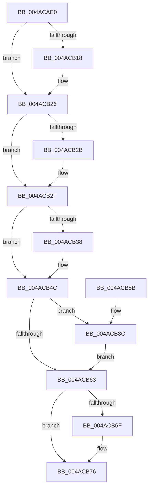

# PopDirectedDripsNotifyResiliencyCompletionWorker

- RVA: `0x004ACAE0`–`0x004ACB96` (길이 `182` bytes)
- VA: `0x00000001404ACAE0`
- 실행 섹션: `.text`
- PDB 이름 있음: `예`; PDB Function 태그: `아니요`
- unwind 정보 RVA: `0x00073808`
- 디코드: `50`개 명령, `182/182` bytes 표시
- 미해석 바이트: `0` (있으면 어셈블리에 `.byte`로 보존)

> 이 문서는 커널 이미지의 기계어와 PDB 기호를 분석해 생성했습니다. 4번과 5번은 함수 원형과 자료형을 바이너리 사용 방식에서 추정한 C 해석이며 원본 소스 복구 결과는 아닙니다.

## 1. Dependencies

- 직접 호출 지점: **5**; 고유 호출 대상: **5**
- 직접 호출자로 확인된 함수: **0**
- RIP 상대 이미지 참조: **0**

### Outgoing calls
- `0x004ACB08` → [KeAbPreAcquire](../21/KeAbPreAcquire_function_00210230.md) (function, `0x00210230`)
- `0x004ACB21` → [ExfAcquirePushLockExclusiveEx](../20/ExfAcquirePushLockExclusiveEx_function_0020FC90.md) (function, `0x0020FC90`)
- `0x004ACB66` → [KeAbPostRelease](../2E/KeAbPostRelease_function_002E1600.md) (function, `0x002E1600`)
- `0x004ACB71` → [PopPdcCompleteResiliencyCallback](../../page/AA/PopPdcCompleteResiliencyCallback_function_00AA5940.md) (function, `0x00AA5940`)
- `0x004ACB8F` → [ExfTryToWakePushLock](../26/ExfTryToWakePushLock_function_00265DD0.md) (function, `0x00265DD0`)

### Direct callers
- 이 함수 시작 RVA로 연결되는 직접 call은 확인되지 않았습니다. 간접 호출은 완전히 역산할 수 없습니다.

### Static image references
- 디코드된 RIP-relative 메모리 참조가 없습니다.

## 2. Other-region calls and transfers

- 다른 실행 섹션으로 향하는 call: **1**
  - `0x004ACB71` → [PopPdcCompleteResiliencyCallback](../../page/AA/PopPdcCompleteResiliencyCallback_function_00AA5940.md) (`.text` → `PAGE`)
- 별도 외부 분기/꼬리 이동을 확인하지 못했습니다.

## 3. Assembly (complete function range)

```asm
004ACAE0  48 89 5C 24 08                  mov qword ptr [rsp + 8], rbx
004ACAE5  48 89 6C 24 10                  mov qword ptr [rsp + 0x10], rbp
004ACAEA  48 89 74 24 18                  mov qword ptr [rsp + 0x18], rsi
004ACAEF  57                              push rdi
004ACAF0  48 83 EC 20                     sub rsp, 0x20
004ACAF4  48 8D 99 A0 00 00 00            lea rbx, [rcx + 0xa0]
004ACAFB  48 8B F9                        mov rdi, rcx
004ACAFE  48 8B CB                        mov rcx, rbx
004ACB01  45 33 C0                        xor r8d, r8d
004ACB04  33 D2                           xor edx, edx
004ACB06  33 F6                           xor esi, esi
004ACB08  E8 23 37 D6 FF                  call 0x140210230
004ACB0D  F0 48 0F BA 2B 00               lock bts qword ptr [rbx], 0
004ACB13  48 8B E8                        mov rbp, rax
004ACB16  73 0E                           jae 0x1404acb26
004ACB18  4C 8B C3                        mov r8, rbx
004ACB1B  48 8B D0                        mov rdx, rax
004ACB1E  48 8B CB                        mov rcx, rbx
004ACB21  E8 6A 31 D6 FF                  call 0x14020fc90
004ACB26  48 85 ED                        test rbp, rbp
004ACB29  74 04                           je 0x1404acb2f
004ACB2B  C6 45 0A 01                     mov byte ptr [rbp + 0xa], 1
004ACB2F  40 38 B7 B0 00 00 00            cmp byte ptr [rdi + 0xb0], sil
004ACB36  74 14                           je 0x1404acb4c
004ACB38  8B B7 AC 00 00 00               mov esi, dword ptr [rdi + 0xac]
004ACB3E  83 A7 AC 00 00 00 00            and dword ptr [rdi + 0xac], 0
004ACB45  C6 87 B0 00 00 00 00            mov byte ptr [rdi + 0xb0], 0
004ACB4C  33 C0                           xor eax, eax
004ACB4E  87 87 D8 00 00 00               xchg dword ptr [rdi + 0xd8], eax
004ACB54  48 83 C8 FF                     or rax, 0xffffffffffffffff
004ACB58  F0 48 0F C1 03                  lock xadd qword ptr [rbx], rax
004ACB5D  24 06                           and al, 6
004ACB5F  3C 02                           cmp al, 2
004ACB61  74 29                           je 0x1404acb8c
004ACB63  48 8B CB                        mov rcx, rbx
004ACB66  E8 95 4A E3 FF                  call 0x1402e1600
004ACB6B  85 F6                           test esi, esi
004ACB6D  74 07                           je 0x1404acb76
004ACB6F  8B D6                           mov edx, esi
004ACB71  E8 CA 8D 5F 00                  call 0x140aa5940
004ACB76  48 8B 5C 24 30                  mov rbx, qword ptr [rsp + 0x30]
004ACB7B  48 8B 6C 24 38                  mov rbp, qword ptr [rsp + 0x38]
004ACB80  48 8B 74 24 40                  mov rsi, qword ptr [rsp + 0x40]
004ACB85  48 83 C4 20                     add rsp, 0x20
004ACB89  5F                              pop rdi
004ACB8A  C3                              ret
004ACB8B  CC                              int3
004ACB8C  48 8B CB                        mov rcx, rbx
004ACB8F  E8 3C 92 DB FF                  call 0x140265dd0
004ACB94  EB CD                           jmp 0x1404acb63
```

## 4. C-style interpretation (structured pseudocode)

```c
__int64 __fastcall PopDirectedDripsNotifyResiliencyCompletionWorker(__int64 a1, int a2, int a3)
{
    __int64 result;
    __int64 v_rsi;
    __int64 v_rsp;
    unsigned __int64 v_stack_p10;
    unsigned __int64 v_stack_p18;
    unsigned __int64 v_stack_p8;

    v_stack_p8 = v_rbx;
    v_stack_p10 = v_rbp;
    v_stack_p18 = v_rsi;
    v_rsp = (v_rsp) - (32);
    a3 = 0;
    a2 = 0;
    v_rsi = 0;
    result = KeAbPreAcquire(a1 + 160, a2, a3, a4);
    if (!(condition_is_above_or_equal)) {
        a3 = a1 + 160;
        a2 = result;
        a1 = a1 + 160;
        result = ExfAcquirePushLockExclusiveEx(a1, a2, a3, a4);
    }
    if (result != 0) {
        *(unsigned __int8 *)(result + 10) = 1;
    }
    if ((*(unsigned __int8 *)(a1 + 176)) != 0) {
        v_rsi = *(unsigned int *)(a1 + 172);
        *(unsigned __int8 *)(a1 + 176) = 0;
    }
    result = 0;
    result = (result) | (-1);
    result = (unsigned __int8)((result) & (6));
    if (((unsigned __int8)(result)) == 2) goto loc_004ACB8C;
loc_004ACB63:
    result = KeAbPostRelease(a1 + 160, a2, a3, a4);
    if ((unsigned int)(v_rsi) != 0) {
        a2 = (unsigned int)(v_rsi);
        result = PopPdcCompleteResiliencyCallback(a1 + 160, a2, a3, a4);
    }
    v_rsp = (v_rsp) + (32);
    return result;
loc_004ACB8C:
    result = ExfTryToWakePushLock(v_stack_p8, a2, a3, a4);
    goto loc_004ACB63;
}
```

## 5. (Beta) C Style

```c
int64_t PopDirectedDripsNotifyResiliencyCompletionWorker(void *Arg1, int32_t Arg2, int32_t Arg3)
{
    uint8_t *arg1 = (uint8_t *)Arg1;

    int64_t result;
    int64_t local_rsi;
    int64_t local_rsp;
    uint64_t v_stack_p10;
    uint64_t v_stack_p18;
    uint64_t v_stack_p8;

    v_stack_p8 = local_rbx;
    v_stack_p10 = local_rbp;
    v_stack_p18 = local_rsi;
    local_rsp = (local_rsp) - (32);
    Arg3 = 0;
    Arg2 = 0;
    local_rsi = 0;
    result = KeAbPreAcquire(Arg1 + 160, Arg2, Arg3, a4);
    if (!(condition_is_above_or_equal)) {
        Arg3 = Arg1 + 160;
        Arg2 = result;
        Arg1 = Arg1 + 160;
        result = ExfAcquirePushLockExclusiveEx(Arg1, Arg2, Arg3, a4);
    }
    if (result != 0) {
        *(uint8_t *)(result + 0xA) = 1;
    }
    if ((*(uint8_t *)(arg1 + 0xB0)) != 0) {
        local_rsi = *(uint32_t *)(arg1 + 0xAC);
        *(uint8_t *)(arg1 + 0xB0) = 0;
    }
    result = 0;
    result = (result) | (-1);
    result = (uint8_t)((result) & (6));
    if (((uint8_t)(result)) == 2) goto loc_004ACB8C;
loc_004ACB63:
    result = KeAbPostRelease(Arg1 + 160, Arg2, Arg3, a4);
    if ((uint32_t)(local_rsi) != 0) {
        Arg2 = (uint32_t)(local_rsi);
        result = PopPdcCompleteResiliencyCallback(Arg1 + 160, Arg2, Arg3, a4);
    }
    local_rsp = (local_rsp) + (32);
    return result;
loc_004ACB8C:
    result = ExfTryToWakePushLock(v_stack_p8, Arg2, Arg3, a4);
    goto loc_004ACB63;
}
```

### 관측된 메모리 오프셋

구조체 형식이 확인되지 않은 접근은 인자 기준의 오프셋으로만 기록했습니다.

| 기준 인자 | 오프셋 표현 | 폭 (bit) | 접근 |
|---|---:|---:|---|
| `Arg1` | `+ 0x0` | `64` | `R/W` |
| `Arg1` | `+ 0xA0` | `64` | `R` |
| `Arg1` | `+ 0xAC` | `32` | `R` |
| `Arg1` | `+ 0xAC` | `32` | `R/W` |
| `Arg1` | `+ 0xB0` | `8` | `R` |
| `Arg1` | `+ 0xB0` | `8` | `W` |
| `Arg1` | `+ 0xD8` | `32` | `R/W` |

## 6. Execution-region graph

[열기: 2D/3D 그래프와 함수 탐색 컨트롤 패널](../../../control-panel.html?section=text&rva=0x004ACAE0&view=graph)

- 2D 그래프는 위에서 아래로 흐르고, 3D 그래프는 빈 공간을 드래그해 회전합니다. Shift+드래그는 이동, 휠은 확대·축소, 함수 노드 선택은 대상 보고서 이동입니다.

### Static fallback


