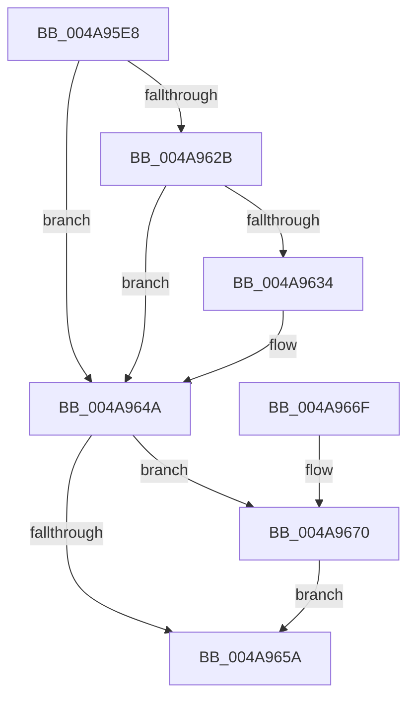

# PopDisableIrpWatchdog

- RVA: `0x004A95E8`–`0x004A967A` (길이 `146` bytes)
- VA: `0x00000001404A95E8`
- 실행 섹션: `.text`
- PDB 이름 있음: `예`; PDB Function 태그: `아니요`
- unwind 정보 RVA: `0x00073808`
- 디코드: `37`개 명령, `146/146` bytes 표시
- 미해석 바이트: `0` (있으면 어셈블리에 `.byte`로 보존)

> 이 문서는 커널 이미지의 기계어와 PDB 기호를 분석해 생성했습니다. 4번과 5번은 함수 원형과 자료형을 바이너리 사용 방식에서 추정한 C 해석이며 원본 소스 복구 결과는 아닙니다.

## 1. Dependencies

- 직접 호출 지점: **4**; 고유 호출 대상: **4**
- 직접 호출자로 확인된 함수: **1**
- RIP 상대 이미지 참조: **0**

### Outgoing calls
- `0x004A961A` → [KeAcquireSpinLockRaiseToDpc](../20/KeAcquireSpinLockRaiseToDpc_function_00208470.md) (function, `0x00208470`)
- `0x004A9638` → [KeCancelTimer](../23/KeCancelTimer_function_002327E0.md) (function, `0x002327E0`)
- `0x004A9650` → [KeReleaseSpinLock](../39/KeReleaseSpinLock_function_00392BA0.md) (function, `0x00392BA0`)
- `0x004A9673` → [PopIrpWatchdogBugcheck](../5C/PopIrpWatchdogBugcheck_function_005CE868.md) (function, `0x005CE868`)

### Direct callers
- [PopDequeueQuerySetIrp](../26/PopDequeueQuerySetIrp_function_0026EC34.md) at `0x0026EE15`

### Static image references
- 디코드된 RIP-relative 메모리 참조가 없습니다.

## 2. Other-region calls and transfers

- 다른 실행 섹션으로 향하는 call: **0**
- 별도 외부 분기/꼬리 이동을 확인하지 못했습니다.

## 3. Assembly (complete function range)

```asm
004A95E8  48 89 5C 24 08                  mov qword ptr [rsp + 8], rbx
004A95ED  48 89 6C 24 10                  mov qword ptr [rsp + 0x10], rbp
004A95F2  48 89 74 24 18                  mov qword ptr [rsp + 0x18], rsi
004A95F7  57                              push rdi
004A95F8  48 83 EC 20                     sub rsp, 0x20
004A95FC  48 0F BE 41 42                  movsx rax, byte ptr [rcx + 0x42]
004A9601  40 32 FF                        xor dil, dil
004A9604  48 8D 14 C0                     lea rdx, [rax + rax*8]
004A9608  48 8B 9C D1 C8 00 00 00         mov rbx, qword ptr [rcx + rdx*8 + 0xc8]
004A9610  48 8D B3 20 01 00 00            lea rsi, [rbx + 0x120]
004A9617  48 8B CE                        mov rcx, rsi
004A961A  E8 51 EE D5 FF                  call 0x140208470
004A961F  83 BB BC 00 00 00 01            cmp dword ptr [rbx + 0xbc], 1
004A9626  40 8A E8                        mov bpl, al
004A9629  75 1F                           jne 0x1404a964a
004A962B  83 BB 28 01 00 00 01            cmp dword ptr [rbx + 0x128], 1
004A9632  75 16                           jne 0x1404a964a
004A9634  48 8D 4B 38                     lea rcx, [rbx + 0x38]
004A9638  E8 A3 91 D8 FF                  call 0x1402327e0
004A963D  83 A3 28 01 00 00 00            and dword ptr [rbx + 0x128], 0
004A9644  84 C0                           test al, al
004A9646  40 0F 94 C7                     sete dil
004A964A  40 8A D5                        mov dl, bpl
004A964D  48 8B CE                        mov rcx, rsi
004A9650  E8 4B 95 EE FF                  call 0x140392ba0
004A9655  40 84 FF                        test dil, dil
004A9658  75 16                           jne 0x1404a9670
004A965A  48 8B 5C 24 30                  mov rbx, qword ptr [rsp + 0x30]
004A965F  48 8B 6C 24 38                  mov rbp, qword ptr [rsp + 0x38]
004A9664  48 8B 74 24 40                  mov rsi, qword ptr [rsp + 0x40]
004A9669  48 83 C4 20                     add rsp, 0x20
004A966D  5F                              pop rdi
004A966E  C3                              ret
004A966F  CC                              int3
004A9670  48 8B CB                        mov rcx, rbx
004A9673  E8 F0 51 12 00                  call 0x1405ce868
004A9678  EB E0                           jmp 0x1404a965a
```

## 4. C-style interpretation (structured pseudocode)

```c
__int64 __fastcall PopDisableIrpWatchdog(__int64 a1)
{
    __int64 result;
    __int64 v_rdi;
    __int64 v_rsp;
    unsigned __int64 v_stack_p10;
    unsigned __int64 v_stack_p18;
    unsigned __int64 v_stack_p8;

    v_stack_p8 = v_rbx;
    v_stack_p10 = v_rbp;
    v_stack_p18 = v_rsi;
    v_rsp = (v_rsp) - (32);
    v_rdi = 0;
    result = KeAcquireSpinLockRaiseToDpc(*(unsigned __int64 *)(a1 + (__int8)(*(unsigned __int8 *)(a1 + 66)) + (__int8)(*(unsigned __int8 *)(a1 + 66)) * 8 * 8 + 200) + 288, (__int8)(*(unsigned __int8 *)(a1 + 66)) + (__int8)(*(unsigned __int8 *)(a1 + 66)) * 8, a3, a4);
    if ((*(unsigned int *)(*(unsigned __int64 *)(a1 + (__int8)(*(unsigned __int8 *)(a1 + 66)) + (__int8)(*(unsigned __int8 *)(a1 + 66)) * 8 * 8 + 200) + 188)) != 1) goto loc_004A964A;
    if ((*(unsigned int *)(*(unsigned __int64 *)(a1 + (__int8)(*(unsigned __int8 *)(a1 + 66)) + (__int8)(*(unsigned __int8 *)(a1 + 66)) * 8 * 8 + 200) + 296)) == 1) {
        a1 = *(unsigned __int64 *)(a1 + (__int8)(*(unsigned __int8 *)(a1 + 66)) + (__int8)(*(unsigned __int8 *)(a1 + 66)) * 8 * 8 + 200) + 56;
        result = KeCancelTimer(a1, (__int8)(*(unsigned __int8 *)(a1 + 66)) + (__int8)(*(unsigned __int8 *)(a1 + 66)) * 8, a3, a4);
        v_rdi = ((unsigned __int8)(result) == 0) ? 1 : 0;
    }
    result = KeReleaseSpinLock(*(unsigned __int64 *)(a1 + (__int8)(*(unsigned __int8 *)(a1 + 66)) + (__int8)(*(unsigned __int8 *)(a1 + 66)) * 8 * 8 + 200) + 288, (unsigned __int8)((unsigned __int8)(result)), a3, a4);
    if ((unsigned __int8)(v_rdi) != 0) goto loc_004A9670;
loc_004A965A:
    v_rsp = (v_rsp) + (32);
    return result;
loc_004A9670:
    result = PopIrpWatchdogBugcheck(v_stack_p8, (unsigned __int8)((unsigned __int8)(result)), a3, a4);
    goto loc_004A965A;
}
```

## 5. (Beta) C Style

```c
int64_t PopDisableIrpWatchdog(void *Arg1)
{
    uint8_t *arg1 = (uint8_t *)Arg1;

    int64_t result;
    int64_t local_rdi;
    int64_t local_rsp;
    uint64_t v_stack_p10;
    uint64_t v_stack_p18;
    uint64_t v_stack_p8;

    v_stack_p8 = local_rbx;
    v_stack_p10 = local_rbp;
    v_stack_p18 = local_rsi;
    local_rsp = (local_rsp) - (32);
    local_rdi = 0;
    result = KeAcquireSpinLockRaiseToDpc(*(uint64_t *)(arg1 + (int8_t)(*(uint8_t *)(arg1 + 0x42)) + (int8_t)(*(uint8_t *)(arg1 + 0x42)) * 8 * 8 + 0xC8) + 288, (int8_t)(*(uint8_t *)(arg1 + 0x42)) + (int8_t)(*(uint8_t *)(arg1 + 0x42)) * 8, a3, a4);
    if ((*(uint32_t *)(*(uint64_t *)(arg1 + (int8_t)(*(uint8_t *)(arg1 + 0x42)) + (int8_t)(*(uint8_t *)(arg1 + 0x42)) * 8 * 8 + 0xC8) + 0xBC)) != 1) goto loc_004A964A;
    if ((*(uint32_t *)(*(uint64_t *)(arg1 + (int8_t)(*(uint8_t *)(arg1 + 0x42)) + (int8_t)(*(uint8_t *)(arg1 + 0x42)) * 8 * 8 + 0xC8) + 0x128)) == 1) {
        Arg1 = *(uint64_t *)(arg1 + (int8_t)(*(uint8_t *)(arg1 + 0x42)) + (int8_t)(*(uint8_t *)(arg1 + 0x42)) * 8 * 8 + 0xC8) + 56;
        result = KeCancelTimer(Arg1, (int8_t)(*(uint8_t *)(arg1 + 0x42)) + (int8_t)(*(uint8_t *)(arg1 + 0x42)) * 8, a3, a4);
        local_rdi = ((uint8_t)(result) == 0) ? 1 : 0;
    }
    result = KeReleaseSpinLock(*(uint64_t *)(arg1 + (int8_t)(*(uint8_t *)(arg1 + 0x42)) + (int8_t)(*(uint8_t *)(arg1 + 0x42)) * 8 * 8 + 0xC8) + 288, (uint8_t)((uint8_t)(result)), a3, a4);
    if ((uint8_t)(local_rdi) != 0) goto loc_004A9670;
loc_004A965A:
    local_rsp = (local_rsp) + (32);
    return result;
loc_004A9670:
    result = PopIrpWatchdogBugcheck(v_stack_p8, (uint8_t)((uint8_t)(result)), a3, a4);
    goto loc_004A965A;
}
```

### 관측된 메모리 오프셋

구조체 형식이 확인되지 않은 접근은 인자 기준의 오프셋으로만 기록했습니다.

| 기준 인자 | 오프셋 표현 | 폭 (bit) | 접근 |
|---|---:|---:|---|
| `Arg1` | `+ 0x42` | `8` | `R` |
| `Arg1` | `+ 0xC8 + rdx*8` | `64` | `R` |

## 6. Execution-region graph

[열기: 2D/3D 그래프와 함수 탐색 컨트롤 패널](../../../control-panel.html?section=text&rva=0x004A95E8&view=graph)

- 2D 그래프는 위에서 아래로 흐르고, 3D 그래프는 빈 공간을 드래그해 회전합니다. Shift+드래그는 이동, 휠은 확대·축소, 함수 노드 선택은 대상 보고서 이동입니다.

### Static fallback


