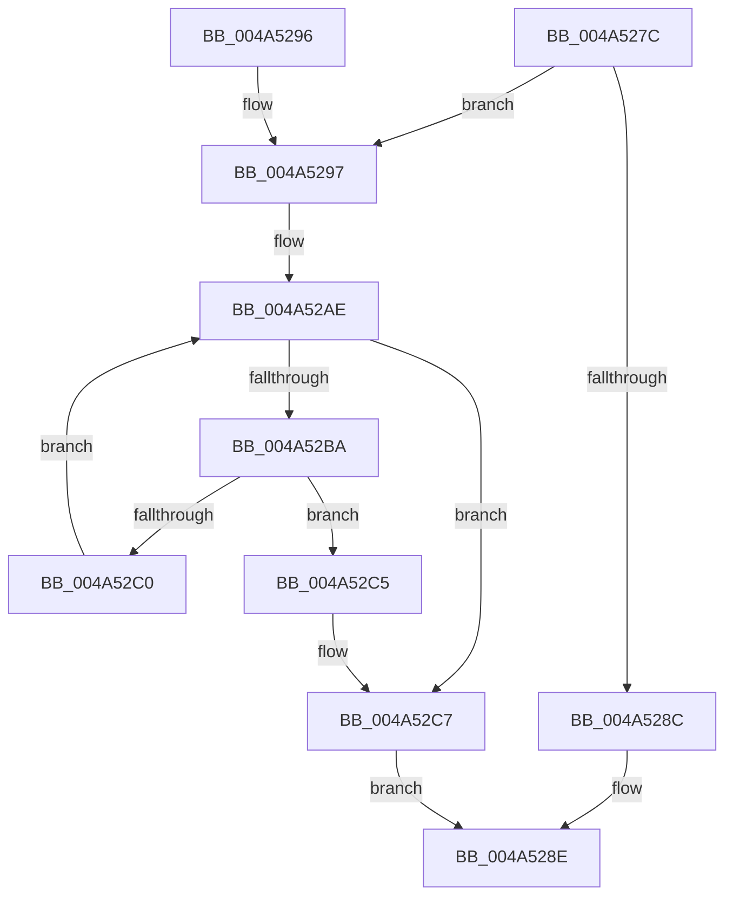

# PopDisksRegisteredForIdle

- RVA: `0x004A527C`–`0x004A52D5` (길이 `89` bytes)
- VA: `0x00000001404A527C`
- 실행 섹션: `.text`
- PDB 이름 있음: `예`; PDB Function 태그: `아니요`
- unwind 정보 RVA: `0x000B68BC`
- 디코드: `27`개 명령, `89/89` bytes 표시
- 미해석 바이트: `0` (있으면 어셈블리에 `.byte`로 보존)

> 이 문서는 커널 이미지의 기계어와 PDB 기호를 분석해 생성했습니다. 4번과 5번은 함수 원형과 자료형을 바이너리 사용 방식에서 추정한 C 해석이며 원본 소스 복구 결과는 아닙니다.

## 1. Dependencies

- 직접 호출 지점: **2**; 고유 호출 대상: **2**
- 직접 호출자로 확인된 함수: **1**
- RIP 상대 이미지 참조: **3**

### Outgoing calls
- `0x004A52A0` → [KeAcquireSpinLockRaiseToDpc](../20/KeAcquireSpinLockRaiseToDpc_function_00208470.md) (function, `0x00208470`)
- `0x004A52CE` → [KeReleaseSpinLock](../39/KeReleaseSpinLock_function_00392BA0.md) (function, `0x00392BA0`)

### Direct callers
- [NtPowerInformation](../../page/95/NtPowerInformation_function_00955D80.md) at `0x00956313`

### Static image references
- `0x004A5282` → RVA `0x00F0CF0C` (`.data`; read)
- `0x004A5299` → RVA `0x00F0CBA0` (`.data`; read)
- `0x004A52A7` → RVA `0x00F0CB90` (`.data`; read)

## 2. Other-region calls and transfers

- 다른 실행 섹션으로 향하는 call: **0**
- 별도 외부 분기/꼬리 이동을 확인하지 못했습니다.

## 3. Assembly (complete function range)

```asm
004A527C  40 53                           push rbx
004A527E  48 83 EC 20                     sub rsp, 0x20
004A5282  8B 05 84 7C A6 00               mov eax, dword ptr [rip + 0xa67c84]
004A5288  A8 02                           test al, 2
004A528A  74 0B                           je 0x1404a5297
004A528C  B3 01                           mov bl, 1
004A528E  8A C3                           mov al, bl
004A5290  48 83 C4 20                     add rsp, 0x20
004A5294  5B                              pop rbx
004A5295  C3                              ret
004A5296  CC                              int3
004A5297  32 DB                           xor bl, bl
004A5299  48 8D 0D 00 79 A6 00            lea rcx, [rip + 0xa67900]
004A52A0  E8 CB 31 D6 FF                  call 0x140208470
004A52A5  8A D0                           mov dl, al
004A52A7  48 8B 05 E2 78 A6 00            mov rax, qword ptr [rip + 0xa678e2]
004A52AE  48 8D 0D DB 78 A6 00            lea rcx, [rip + 0xa678db]
004A52B5  48 3B C1                        cmp rax, rcx
004A52B8  74 0D                           je 0x1404a52c7
004A52BA  83 78 10 01                     cmp dword ptr [rax + 0x10], 1
004A52BE  74 05                           je 0x1404a52c5
004A52C0  48 8B 00                        mov rax, qword ptr [rax]
004A52C3  EB E9                           jmp 0x1404a52ae
004A52C5  B3 01                           mov bl, 1
004A52C7  48 8D 0D D2 78 A6 00            lea rcx, [rip + 0xa678d2]
004A52CE  E8 CD D8 EE FF                  call 0x140392ba0
004A52D3  EB B9                           jmp 0x1404a528e
```

## 4. C-style interpretation (structured pseudocode)

```c
__int64 __fastcall PopDisksRegisteredForIdle(void)
{
    __int64 result;
    __int64 v_rbx;
    __int64 v_rsp;

    v_rsp = (v_rsp) - (32);
    if ((((unsigned __int8)((unsigned int)(*(unsigned int *)(v_rip + 10910852)))) & (2)) == 0) goto loc_004A5297;
loc_004A528E:
    v_rsp = (v_rsp) + (32);
    return 1;
loc_004A5297:
    v_rbx = 0;
    result = KeAcquireSpinLockRaiseToDpc(v_rip + 10909952, a2, a3, a4);
loc_004A52AE:
    if ((*(unsigned __int64 *)(v_rip + 10909922)) == (v_rip + 10909915)) goto loc_004A52C7;
    if ((*(unsigned int *)(*(unsigned __int64 *)(v_rip + 10909922) + 16)) == 1) goto loc_004A52C5;
    goto loc_004A52AE;
loc_004A52C5:
loc_004A52C7:
    result = KeReleaseSpinLock(v_rip + 10909906, (unsigned __int8)(result), a3, a4);
    goto loc_004A528E;
}
```

## 5. (Beta) C Style

```c
void PopDisksRegisteredForIdle(void)
{
    int64_t result;
    int64_t local_rbx;
    int64_t local_rsp;

    local_rsp = (local_rsp) - (32);
    if ((((uint8_t)((uint32_t)(*(uint32_t *)(v_rip + 0xA67C84)))) & (2)) == 0) goto loc_004A5297;
loc_004A528E:
    local_rsp = (local_rsp) + (32);
    return 1;
loc_004A5297:
    local_rbx = 0;
    result = KeAcquireSpinLockRaiseToDpc(v_rip + 10909952, a2, a3, a4);
loc_004A52AE:
    if ((*(uint64_t *)(v_rip + 0xA678E2)) == (v_rip + 10909915)) goto loc_004A52C7;
    if ((*(uint32_t *)(*(uint64_t *)(v_rip + 0xA678E2) + 0x10)) == 1) goto loc_004A52C5;
    goto loc_004A52AE;
loc_004A52C5:
loc_004A52C7:
    result = KeReleaseSpinLock(v_rip + 10909906, (uint8_t)(result), a3, a4);
    goto loc_004A528E;
}
```

## 6. Execution-region graph

[열기: 2D/3D 그래프와 함수 탐색 컨트롤 패널](../../../control-panel.html?section=text&rva=0x004A527C&view=graph)

- 2D 그래프는 위에서 아래로 흐르고, 3D 그래프는 빈 공간을 드래그해 회전합니다. Shift+드래그는 이동, 휠은 확대·축소, 함수 노드 선택은 대상 보고서 이동입니다.

### Static fallback


